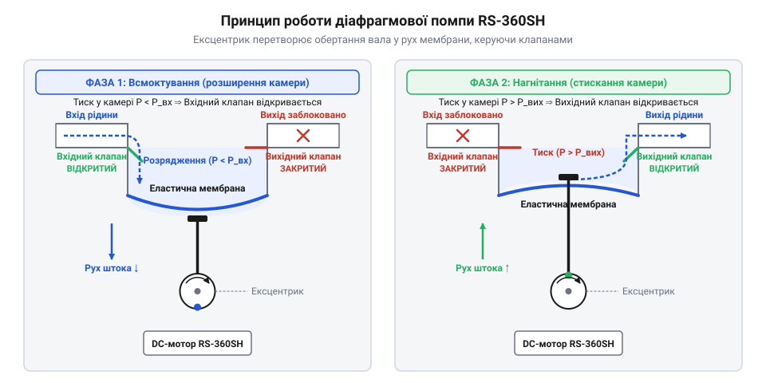
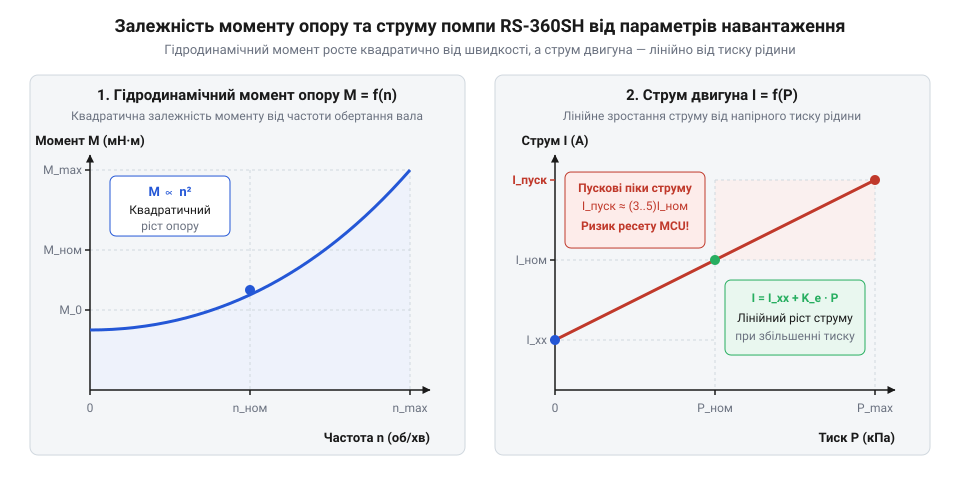
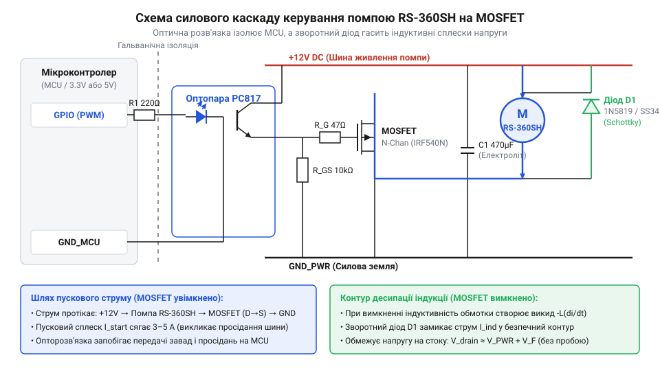
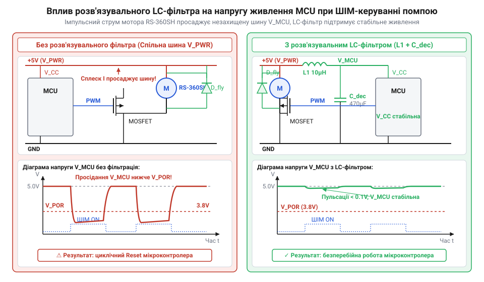
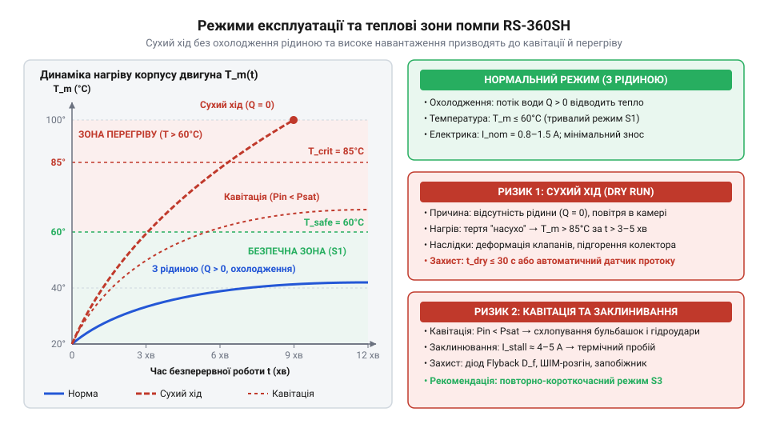
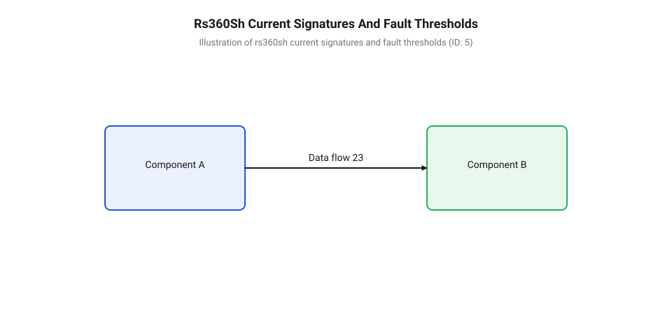

# Водяна помпа RS-360SH

<preknowlist>
- [Колекторний двигун типорозміру 130](root:cat-hw-actuators/dc-motor-130) — Принцип роботи колекторно-щіткового вузла, виникнення проти-ЕРС та електромагнітні характеристики колекторного DC-двигуна.
</preknowlist>

## Проблема прокачування рідин і діафрагмовий механізм

Уявіть практичну задачу автоматизації: робототехнічному пристрою необхідно дозовано подавати воду, прокачувати охолоджувальну рідину або піднімати рідкий розчин із нижнього резервуара у верхню ємність. Перше інтуїтивне рішення — занурити простий електродвигун безпосередньо у рідину та закріпити на його валу гвинт або лопатеву крильчатку. Проте пряме занурення [колекторного DC-двигуна](root:cat-hw-actuators/dc-motor-130) миттєво призводить до проникнення вологи всередину корпусу через щілини вала, короткого замикання колекторно-щіткового вузла, корозії обмоток і швидкого виходу приводу з ладу.

Друга спроба полягає у винесенні двигуна за межі резервуара та використанні відцентрової помпи (англ. @@en|centrifugal pump@@). Відцентровий механізм чудово працює на високих швидкостях у заповненому стані, але володіє фундаментальним обмеженням: він не здатний створювати розрідження в сухому каналі. Якщо підвідна магістраль або робоча камера заповнені повітрям, лопатеве колесо просто безкорисливо обертає газове середовище, не створюючи перепаду тиску, достатнього для підйому води з нижчого рівня. Така система вимагає попереднього заповнення каналу рідиною (@@en|заповнення магістралі@@), що робить її непридатною для автономних систем, де помпа повинна самостійно захоплювати рідину з сухого стану. Порівняльний аналіз динамічних та об'ємних гідравлічних машин наведено в [порівняльному аналізі помп](root:cat-hw-actuators/peristaltic-and-centrifugal-pumps-comparison).

Розв'язанням цієї проблеми є об'ємна помпа (англ. @@en|positive displacement pump@@), а саме еластомерна діафрагмова помпа (грец. @@el|diaphragma@@ — перегородка). Докладно про еволюцію цього класу пристроїв від промислових поршневих агрегатів до мініатюрних вузлів ви можете прочитати в [історії розвитку мікропомп](root:cat-hw-actuators/water-pump-rs360sh/hist-rs360sh-diaphragm-pump-evolution.md). У компактному приводі @@en|RS-360SH@@ повна герметична ізоляція електричної частини від рідкого середовища досягається за рахунок фізичного розділення робочої камери та електродвигуна гнучкою мембраною (лат. @@la|membrana@@ — шкірочка, перетинка).

Головне механічне завдання внутрішнього привода помпи @@en|RS-360SH@@ — перетворити безперервний обертовий рух вала колекторного двигуна на зворотно-поступальний рух еластомерної мембрани. Для цього на валу двигуна жорстко закріплено ексцентрик (лат. @@la|excentricus@@ — поза центром). Ексцентриковий вал має зміщення осі обертання на величину ексцентриситету `e`. При обертанні вала двигуна зі швидкістю кількох тисяч обертів на хвилину ексцентрик штовхає поводковий механізм (англ. @@en|wobble plate@@ — хитна шайба або шатун). Цей механізм здійснює коливальні рухи вперед і назад уздовж осьового напрямку.

Центральна частина еластомерної діафрагми жорстко з'єднана з поводковим штоком, тоді як її зовнішній периметр герметично затиснутий між корпусом приводного вузла та головкою помпи. Таким чином утворюється ізольована робоча камера (англ. @@en|working chamber@@) змінного об'єму. Оскільки мембрана суцільна і повністю відокремлює механічний привід від внутрішнього об'єму камери, рідина жодним чином не може потрапити до вала, підшипників чи колекторно-щіткового вузла двигуна.

Для перетворення зворотно-поступального руху мембрани у спрямований потік рідини в головці помпи встановлено два односторонні клапани (англ. @@en|check valves@@) — вхідний та вихідний. Зазвичай це еластичні грибкові або пелюсткові клапани, виготовлені з силікону або каучуку, які відкриваються лише в одному напрямку під дією різниці тисків. Робочий цикл помпи складається з двох послідовних фаз:

1. **Такт усмоктування** (англ. @@en|intake stroke@@): Ексцентрик відводить шток із центральною частиною мембрани назад, збільшуючи об'єм робочої камери `V`. Згідно з законами гідродинаміки, збільшення об'єму герметичної камери викликає падіння тиску всередині неї нижче за зовнішній атмосферний або гідростатичний тиск підвідної лінії (`P_chamber < P_inlet`). Виникає перепад тиску `ΔP_in = P_inlet - P_chamber > 0`. Цей перепад перевищує поріг відкриття клапана (англ. @@en|cracking pressure@@) і віджимає пелюстку вхідного клапана від сідла, відкриваючи прохід для рідини. У той самий час вихідний клапан щільно притискається до свого сідла зворотним тиском вихідної магістралі, запобігаючи витоку рідини з вихідного патрубка назад у камеру. Завдяки створенню глибокого розрідження помпа здатна всмоктувати повітря з сухої трубки, забезпечуючи властивість самоусмоктування (англ. @@en|self-priming@@).

2. **Такт виштовхування** (англ. @@en|discharge stroke@@): Ексцентрик повертає шток із мембраною вперед, зменшуючи об'єм робочої камери `V`. Рідина всередині камери зазнає стиснення. Оскільки вода є практично нестисливою рідиною (англ. @@en|incompressible fluid@@), тиск у камері стрімко зростає і перевищує тиск у вихідній магістралі (`P_chamber > P_outlet`). Перепад тиску `ΔP_out = P_chamber - P_outlet > 0` примусово закриває вхідний клапан (притискаючи його до сідла) і одночасно відкриває вихідний клапан. Затиснутий об'єм рідини під тиском виштовхується у вихідний патрубок.

Наочне розташування елементів механізму та послідовність спрацьовування клапанів під час двох фаз руху мембрани показано на принциповій схемі.


*Механічна структура діафрагмової помпи RS-360SH: перетворення обертання ексцентрика на зворотно-поступальний рух еластомерної мембрани та робота зворотно-клапанної системи.*

Під час руху мембрани всередині рідини виникає реактивний гідравлічний опір (англ. @@en|hydraulic resistance@@). На відміну від роботи в повітряному середовищі, де опір переміщенню мембрани визначається лише пружністю еластомеру, при прокачуванні води двигун повинен долати динамічне тертя рідини у вузьких каналах клапанів і патрубків, а також інерційну масу стовпа рідини у підключених шлангах. Якщо опір на всмоктуванні занадто високий, в інтервалі усмоктування тиск у камері може впасти нижче тиску насиченої пари рідини. Це викликає кавітацію (лат. @@la|cavitas@@ — порожнина) — утворення бульбашок пари, які розриваються при стисненні й деструктивно руйнують клапани та мембрану. Загальні системні принципи побудови таких гідравлічних вузлів висвітлено в [архітектурі діафрагмових помп](root:cat-hw-actuators/diaphragm-micro-pumps).

Геометричні параметри патрубків (вхідного та вихідного діаметром 4–6 мм), допустима висота самоусмоктування та габаритні кріплення корпусу помпи @@en|RS-360SH@@ детально описані в [апаратному довіднику інтерфейсів RS-360SH](root:cat-hw-actuators/water-pump-rs360sh/api-rs360sh-hardware-interface.md). Розуміння механічного перетворення руху дає змогу перейти до аналізу електромеханічного навантаження на валу двигуна.

## Гідродинамічне навантаження та електрична поведінка

З'ясувавши кінематику руху еластомерної мембрани, розглянемо, як гідравлічні процеси в робочій камері трансформуються у механічний опір на валу двигуна @@en|RS-360SH@@ та визначають його електричні параметри.

За один повний оберт вала двигуна `n` (об/хв) або кутовий поворот `2·π` радіан поводковий механізм здійснює один повний подвійний хід мембрани, виштовхуючи циклічний об'єм рідини `V_stroke`. Загальна об'ємна продуктивність помпи `Q` (у літрах за хвилину або кубічних метрах за секунду) прямо пропорційна циклічному об'єму робочої камери `V_stroke` та частоті обертання вала `n`:

```
Q = V_stroke × n ÷ 60                   [продуктивність від частоти обертання]
```

Однак при русі рідини крізь вузькі перерізи клапанних отворів і з'єднувальних шлангів виникають турбулентні та в'язкісні втрати тиску. Закони гідродинаміки стверджують, що гідравлічний перепад тиску `ΔP` у магістралі зростає квадратично від швидкості потоку, а отже — від об'ємної витрати `Q`:

```
ΔP = k_hydr × Q²                        [квадратичний закон гідравлічного опору]
```

де `k_hydr` — коефіцієнт гідравлічного опору тракту, який залежить від динамічної в'язкості рідини (лат. @@la|viscositas@@ — клейкість), внутрішнього діаметра шлангів та геометрії вихідного сопла.

Механічний момент опору `M_load`, який рідина чинить на вал двигуна через мембрану й ексцентрик, визначається роботою перекачування за один оберт із урахуванням механічного ККД `η_mech`:

```
M_load = (ΔP × V_stroke) ÷ (2 × π × η_mech)   [момент від перепаду тиску]
       = (k_hydr × V_stroke³ × n²) ÷ (7200 × π × η_mech)   [підстановка продуктивності Q]
       = K_h × ω²                       [зведена квадратична залежність від кутової швидкості]
```

де `K_h` — зведений коефіцієнт гідродинамічного опору помпи, а `ω` — кутова швидкість обертання вала двигуна в радіанах за секунду (`ω = 2·π·n / 60`). З отриманого виразу видно фундаментальну особливість помпи @@en|RS-360SH@@: момент опору на валу зростає квадратично зі збільшенням кутової швидкості обертання. Виведення розрахункових співвідношень для різних типів рідин міститься у [гідродинамічному розрахунку моменту опору](root:cat-hw-actuators/water-pump-rs360sh/math-rs360sh-hydrodynamics-and-torque-calc.md).

Тепер зв'яжемо механічний момент на валу з електричною поведінкою колекторного DC-двигуна. Внутрішній електромагнітний момент двигуна `M_elem` прямо пропорційний струму якоря `I_a` через конструктивний коефіцієнт моменту `K_t` (Н·м/А):

```
M_elem = K_t × I_a                      [зв'язок моменту та струму якоря]
```

У сталому режимі обертання електромагнітний момент двигуна врівноважує суму моменту сухого тертя механізму `M_0` та гідродинамічного моменту опору `M_load`. Виразивши струм споживання `I_a`, отримуємо:

```
I_a = I_0 + M_load ÷ K_t                [баланс моментів на валу]
    = I_0 + (K_h × ω²) ÷ K_t            [струм від квадрата кутової швидкості]
```

де `I_0` — струм холостого ходу двигуна (без рідини). З цієї формули випливає: чим вищий гідравлічний тиск у вихідній магістралі або чим вища в'язкість прокачуваного середовища (наприклад, густі розчини замість чистої води), тим більший момент `M_load` діє на вал і тим вищий струм `I_a` споживає двигун від джерела живлення.

Графіки залежності моменту опору та струму споживання від частоти обертання вала під різним тиском наведено на діаграмі.


*Гідроелектричні характеристики RS-360SH: квадратичне зростання моменту опору від швидкості та відповідна крива споживання струму під різним гідравлічним тиском.*

Окрім усталеного режиму, критично важливе значення для проектування силових схем мають електромеханічні перехідні процеси (англ. @@en|transients@@). Колекторний двигун помпи @@en|RS-360SH@@ містить індуктивність (лат. @@la|inductio@@ — наведення) обмоток якоря `L_a` та активний опір `R_a`.

1. **Пусковий струм** (англ. @@en|inrush current@@): У момент подачі живлення (`t = 0`) ротор двигуна перебуває у стані спокою (`ω = 0`). Оскільки кутова швидкість дорівнює нулю, проти-ЕРС (англ. @@en|back-EMF@@, від *back electromotive force* — зворотна електрорушійна сила) обмоток також дорівнює нулю (`E_emf = K_e · ω = 0`). У цей мікроінтервал часу єдиним обмежником струму є власний активний опір обмоток якоря `R_a`.

Обчислимо пусковий струм `I_start` для двигуна @@en|RS-360SH@@ при номінальній напрузі живлення `V_supply = 12 B` та опорі обмоток якоря `R_a = 2.4 Ом` у момент увімкнення (`ω = 0`, `E_emf = 0`):

```
I_start = V_supply ÷ R_a                [закон Ома для нерухомого ротора]
        = 12 ÷ 2.4                      [підстановка напруги та опору обмотки]
        = 5.0 A                         [пусковий струм у момент старт-імпульсу]
```

Спадний старт-імпульс струму амплітудою 5.0 А триває десятки мілісекунд, поки ротор не розженеться і не згенерує проти-ЕРС, яка зменшить робочий струм до стаціонарного рівня `I_run ≈ 0.5...0.8 A`.

2. **Просідання шини живлення та аварійний скид мікроконтролера** (англ. @@en|brownout reset@@): Якщо помпа та керуючий мікроконтролер живляться від одного джерела або спільної шини живлення без належної розв'язки, пусковий стрибок струму в 5.0 А створює миттєве спадання напруги на внутрішньому опорі джерела живлення та провідниках (`ΔV = I_start · R_line`). Напруга на шині 5 В або 3.3 В може короткочасно просісти нижче порогу спрацьовування детектора зниження напруги (англ. @@en|Brownout Detector@@, @@en|BOD@@). В результаті мікроконтролер зазнає циклічного хаотичного перезавантаження (англ. @@en|brownout loop@@) щоразу під час спроби включити помпу.

3. **Індуктивний викид напруги** (англ. @@en|inductive kickback@@): Обмотки якоря двигуна накопичують енергію магнітного поля `E_mag = 0.5 · L_a · I_a²`. При вимкненні силового транзистора струм через обмотку намагається миттєво зменшитися до нуля (`dI/dt → -∞`). Згідно з законом електромагнітної індукції Фарадея, індуктивність обмотки `L_a` генерує зворотний сплеск напруги протилежної полярності.

Визначимо амплітуду індуктивного викиду напруги `V_spike` на обмотці індуктивністю `L_a = 1.2 мГн` при розмиканні ключа за час `Δt = 10 мкс` при робочому струмі `I_a = 0.8 A`:

```
V_spike = -L_a × (ΔI ÷ Δt)              [закон самоіндукції Фарадея]
        = -0.0012 × (-0.8 ÷ 0.000010)   [підстановка індуктивності та швидкості спаду струму]
        = +96 B                         [амплітуда зворотного індуктивного сплеску]
```

Сплеск напруги в +96 В миттєво пробиває p-n перехід силового ключа (наприклад, @@en|MOSFET@@-транзистора з граничною напругою `V_DS_max = 30 B`), якщо ключовий каскад не захищено зворотним швидкісним діодом (англ. @@en|flyback diode@@) або паралельним @@en|RC-снабером@@.

Математичне моделювання всіх етапів перехідних процесів і часових діаграм струму ви знайдете в [перехідних електромеханічних процесах](root:cat-hw-actuators/water-pump-rs360sh/math-rs360sh-electrical-transients-and-pwm-calc.md). Для нейтралізації електричних завад і захисту чутливої електронної обв'язки застосовують спеціалізовані методи, викладені в [придушенні електричних завад DC-моторів](root:hw-analog/brush-dc-noise-suppression), тоді як способи керування середньою напругою на помпі за допомогою широтно-імпульсної модуляції (ШІМ) описано в [методах ШІМ-регулювання швидкості](root:hw-motion/pwm-motor-speed-control).

## Схеми силового керування та гальванічний захист

Вихідний контакт цифрового мікроконтролера здатен віддавати струм у межах 10–20 мА при напрузі 3.3 В або 5 В. Водночас коли використовується [колекторний двигун типорозміру 130](root:cat-hw-actuators/dc-motor-130), що приводить у рух помпу RS-360SH, робочий струм досягає 1.5–2 A, а пусковий стрибок перевищує 3.5 A при робочій напрузі 12 В. Пряме підключення обмотки до логічного виводу миттєво знищує вихідний каскад мікроконтролера вигоранням вихідних транзисторів. Для узгодження низьковольтного цифрового сигналу з потужним індуктивним навантаженням необхідний проміжний силовий каскад.

Найпростішим і найефективнішим рішенням для односпрямованого керування є ключ на N-канальному @@en|MOSFET@@ (від англ. *Metal-Oxide-Semiconductor Field-Effect Transistor* — польовий транзистор із структурою метал-оксид-напівпровідник). Оскільки помпа вмикається між позитивною шиною живлення `V_motor` та стоком транзистора, таку схему називають нижнім ключем (@@en|low-side switch@@). На відміну від біполярних транзисторів, керування затвором @@en|MOSFET@@ здійснюється електричним полем, а не струмом, що зводить постійне споживання затвора майже до нуля.

Проте для прямого керування від цифрового виводу з напругою 3.3 В або 5 В звичайні силові транзистори не підходять: їхня гранична напруга відкривання `V_GS(th)` становить 4–5 В, і при керуванні напругою 3.3 В транзистор залишається у напіввідкритому режимі з високим опором каналу `R_DS(on)`. Це призводить до колосального виділення тепла та падіння напруги на самому ключі замість мотора. Тому слід обирати транзистори з керованим логічним рівнем (@@en|logic-level MOSFET@@), у яких `V_GS(th)` становить 1.0–2.0 В, а опір каналу `R_DS(on)` досягає мінімуму вже при `V_GS` = 3.0 В.

Вхідна ємність затвора `C_iss` (зазвичай 500–2000 пФ) у момент комутації поводиться як коротке замикання. Для обмеження імпульсного струму заряджання ємності затвора між цифровим виводом та затвором обов'язково встановлюють обмежувальний резистор `R_gate` величиною 47–100 Ом. Додатково між затвором та землею підключають стягувальний резистор `R_pull` величиною 10 кОм. Він утримує транзистор у надійно закритому стані під час перезавантаження або ініціалізації мікроконтролера, коли вивід перебуває у стані високого імпедансу.

Для розрахунку теплових втрат на повністю відкритому транзисторі використовують формулу активної потужності:

```
P_MOSFET = I_RMS² × R_DS(on)
= (2.0)² × 0.035          [підстановка струму помпи та опору каналу]
= 0.14 Вт                 [розрахована теплова потужність]
```

Отримане значення в 0.14 Вт свідчить, що ключовий транзистор з опором 35 мОм працює без додаткового радіатора cooling.

При розмиканні транзисторного ключа виникає головна загроза для силової схеми — самоіндукція обмотки двигуна. Струм в індуктивності не може змінитися миттєво. Коли @@en|MOSFET@@ закривається, напруга на стоці стрибкоподібно зростає до десятків або сотень вольт зворотної полярності, намагаючись підтримати протікання струму. Цей індуктивний викид здатний легко пробити ізоляційний шар транзистора.

Для гасіння цього сплеску паралельно клемам помпи в зворотному напрямку підключають @@en|демпферний діод@@ (від англ. *flyback diode* — діод зворотного ходу, від *flyback* — зворотний стрибок). Коли ключ закривається, струм індуктивності замикається через діод, розсіюючи накопичену магнітну енергію на власному активному опорі обмотки. Як захисний діод використовують @@en|діод Шотткі@@ (названий на честь німецького фізика Вальтера Шотткі, нім. *Walter Schottky*). Він має низьке пряме падіння напруги (0.3–0.4 В проти 0.7–1.0 В у звичайних кремнієвих діодів) та надшвидкий час відновлення зворотного опору `t_rr`, що унеможливлює виникнення високовольтних піків.

Для глушіння високочастотного брязкоту, спричиненого іскрінням колекторних щіток, паралельно діоду або мотору додають @@en|снабер@@ (від англ. *snubber*, від *to snub* — затискати, приборкувати) — послідовне RC-коло з резистора 10–47 Ом та керамічного конденсатора 10–100 нФ. Детальний фізичний механізм [придушення електричних завад](root:hw-analog/brush-dc-noise-suppression) в індуктивних навантаженнях показує, як саме ці компоненти поглинають високочастотні коливання.

Незважаючи на наявність захисного діода, спільне заземлення силової частини та мікроконтролера створює ризик потрапляння імпульсних завад через контури заземлення (@@en|ground loop@@). Для повного розриву електричного зв'язку застосовується @@en|оптопара@@ (від грец. *optikos* — зоровий та укр. пара; англ. *optocoupler*).

У такій схемі вихідний вивід мікроконтролера живить світлодіод оптопари через обмежувальний резистор `R_in` (330 Ом). Світловий імпульс відкриває внутрішній фототранзистор, який, у свою чергу, комутує напругу затвора @@en|MOSFET@@ від силового джерела живлення мотора. Сигнальне заземлення мікроконтролера `GND_MCU` та силове заземлення помпи `GND_PWR` залишаються повністю ізольованими.

У випадках, коли вимагається реверсування обертання приводу або активне електродинамічне гальмування вала, замість одиночного транзистора застосовують @@en|H-міст@@ (від англ. *H-bridge* — схема у формі літери H). Монолітні інтегральні драйвери (наприклад, DRV8871 або TB6612FNG) містять чотири внутрішні @@en|MOSFET@@-ключі та вбудовані захисні діоди. Використання застарілих біполярних драйверів на кшталт L298N є небажаним, оскільки падіння напруги на їхніх вихідних транзисторах досягає 2–3 В, що призводить до суттєвої втрати потужності помпи та надмірного нагріву.


*Принципова електрична схема силового каскаду керування помпою на N-канальному MOSFET із зворотним захисним діодом та оптичною розв'язкою.*

Також практичні інструкції із розведення друкованої плати містить [проєктування силового MOSFET-драйвера](root:cat-hw-actuators/water-pump-rs360sh/proj-rs360sh-mosfet-driver-shield.md), де детально показано компоновку силових доріжок. Граничні струми та електричні значення містить [апаратний довідник електричних інтерфейсів](root:cat-hw-actuators/water-pump-rs360sh/api-rs360sh-hardware-interface.md), який дає точні специфікації виводів. На відміну від випадків, де застосовують [мотор-редуктор постійного струму](root:cat-hw-actuators/gearmotor-6v) або [кроковий мотор 28BYJ-48](root:cat-hw-actuators/28byj-48-stepper), вихідне затискне коло даного каскаду розраховане на постійний пульсуючий струм еластомерної мембрани.

## ШІМ-регулювання продуктивності та стабілізація живлення

Після побудови силового драйвера постає завдання точного регулювання об'ємного витрати рідини. Зміна постійної напруги живлення за допомогою лінійних регуляторів недоцільна через низький ККД та високі теплові втрати. Замість цього застосовують @@en|ШІМ@@ (від англ. *Pulse-Width Modulation* — широтно-імпульсна модуляція).

Сутність @@en|ШІМ@@ полягає в подачі на мотор прямокутних імпульсів напруги постійної амплітуди `V_supply` з певною частотою `f_PWM`. Середнє значення напруги `V_avg`, яке визначає кутову швидкість вала двигуна, пропорційне параметру, що називається @@en|коефіцієнт заповнення@@ (від англ. *duty cycle* — робочий цикл), або свердловина `D`:

```
V_avg = V_supply × D
= 12.0 × 0.60             [підстановка напруги живлення та коефіцієнта заповнення 60%]
= 7.2 В                   [середнє значення напруги на обмотці]
```

Однак гідравлічна продуктивність помпи `Q` залежить від `D` нелінійно. У діафрагмових помпах існує так звана мертва зона пуску (0–25% @@en|коефіцієнт заповнення@@). На низьких значеннях `D` усереднена напруга виявляється недостатньою для подолання статичного тертя механізму (@@en|stiction@@), сухого опору еластомерної мембрани та протитиску клапанів. Двигун гуде, але вал не обертається. Помпа починає стабільно перекачувати рідину лише при досягненні порогового значення `D_min ≈ 25–30%`.

Вибір частоти @@en|ШІМ@@ є критичним компромісом:
1. Низька частота (100 Гц – 1 кГц): струм в обмотці мотора переривається до нуля під час паузи імпульсу. Це викликає сильні гідравлічні пульсації тиску, прискорений знос односторонніх клапанів та виразне акустичне пищання. 2. Висока частота (понад 20 кГц): виходить за межі чутності людського вуха, але різко збільшує динамічні втрати на перемикання у @@en|MOSFET@@ (через затримки перезаряду ємності затвора) та викликає нагрів драйвера.

Оптимальний діапазон частот @@en|ШІМ@@ для помпи RS-360SH становить 8–16 кГц. На цих частотах індуктивність обмотки мотора згладжує пульсації струму, забезпечуючи плавний рух вала.

Під час подачі першого прямокутного імпульсу @@en|ШІМ@@ або суцільного ввімкнення помпи виникає пусковий струм `I_start`, що у 3–5 разів перевищує номінальний. Внутрішній опір джерела живлення та сполучних провідників призводить до миттєвого просідання напруги на спільній шині:

```
ΔV = I_start × R_wire
```

Якщо мікроконтролер живиться від тієї ж шини без належної розв'язки, напруга живлення логіки падає нижче критичного порогу. Спрацьовує схема захисту від зниження напруги @@en|Brownout Reset@@ (від англ. *brownout* — часткове падіння напруги та *reset* — скидання), що призводить до спонтанного перезавантаження керувальної програми.

Для усунення просідання напруги застосовують комплекс заходів:
1. Встановлення буферного електролітичного конденсатора високої ємності (470–1000 мкФ) безпосередньо біля силового ключа помпи для віддачі струму в перші мікросекунди пуску. 2. Підключення паралельних керамічних конденсаторів ємністю 100 нФ для фільтрації високочастотних завад від щіткового вузла. 3. Організація розв'язувального LC-фільтра або діодно-конденсаторної розв'язки у колі живлення мікроконтролера.

Розрахунок частоти зрізу розв'язувального LC-фільтра здійснюється за формулою:

```
f_c = 1 / (2 × π × √(L_f × C_f))
= 1 / (2 × 3.1416 × √(47 × 10⁻⁶ × 470 × 10⁻⁶))     [підстановка L = 47 мкГн, C = 470 мкФ]
= 1068 Гц                                          [частота зрізу розв'язувального фільтра]
```

Оскільки частота зрізу (1068 Гц) значно нижча за робочу частоту @@en|ШІМ@@ (15 кГц), фільтр повністю блокує пульсації напруги, захищаючи шину живлення логіки.


*Електрична схема та часові діаграми напруги живлення мікроконтролера при ШІМ-керуванні помпою з розв'язувальним LC-фільтром та без нього.*

Експлуатація водяної помпи RS-360SH вимагає суворого дотримання температурних та гідравлічних обмежень. Найнебезпечнішим аварійним режимом є @@en|сухий хід@@ (від англ. *dry run* — пусте або сухе функціонування) — робота помпи без прокачування рідини.

У нормальному режимі перекачуване середовище виконує функцію змащування еластомерних клапанів і діафрагми, а також відводить тепло від робочої камери. Під час сухого ходу тертя еластомерних частин об пластикові стінки камери різко зростає. Це викликає локальне розігрівання еластомера понад 80 °C, що призводить до втрати еластичності, деформації клапанів та розриву мембрани. Крім того, без гідравлічного опору рідини мотор розганяється до максимальних обертів, прискорюючи знос щітково-колекторного вузла.

Температура корпусу двигуна в тривалому режимі не повинна перевищувати 60 °C. При неперервній роботі понад 15 хвилин необхідно забезпечувати примусове охолодження або робити паузи у робочому циклі.


*Діаграма безпечних та критичних режимів експлуатації помпи залежно від наявності рідини, тривалості включення та температури корпусу.*

Для мінімізації пускових струмів та гідравлічних ударів у програмі реалізують плавний пуск (@@en|soft-start@@). Нижченаведений код демонструє реалізацію плавного розгону та регулювання швидкості помпи:

:::tabs
@tab ESP-IDF (C)
:::code water-pump-rs360sh-d/c/esp-idf/init-pump-pwm.c
@tab Arduino (C++)
:::code water-pump-rs360sh-d/cpp/arduino/setuppump.cpp
:::

Теоретичні засади та [методи ШІМ-регулювання швидкості](root:hw-motion/pwm-motor-speed-control) пояснюють перехідні електричні режими під час комутації. Математичне розгортання цих рівнянь наведено у розділі про [електромеханічні розрахунки пускових струмів](root:cat-hw-actuators/water-pump-rs360sh/math-rs360sh-electrical-transients-and-pwm-calc.md), де розраховано часові константи кола. Залежність гідравлічного опору від швидкості розкриває [розрахунок моменту опору помпи](root:cat-hw-actuators/water-pump-rs360sh/math-rs360sh-hydrodynamics-and-torque-calc.md), що пояснює невисокий ККД на малих обертах.

Комплексна побудова замкненого контуру описується у проекті [автоматизована система дозування рідини](root:cat-hw-actuators/water-pump-rs360sh/proj-rs360sh-automated-liquid-dosing-system.md), де використано зворотний зв'язок за об'ємом. Повноцінні програмні виклики містить [програмний довідник API драйвера](root:cat-hw-actuators/water-pump-rs360sh/api-rs360sh-pump-control-driver-api.md), у якому зібрано методи діагностики. Історичні передумови впровадження цих вузлів висвітлює [еволюцію еластомерних діафрагмових помп](root:cat-hw-actuators/water-pump-rs360sh/hist-rs360sh-diaphragm-pump-evolution.md), а їхній порівняльний аналіз із іншими типами помп містить [порівняльний аналіз перистальтичних помп](root:cat-hw-actuators/peristaltic-and-centrifugal-pumps-comparison).

Якщо порівняти її з охолодженням, де працюють [безколекторні вентилятори постійного струму](root:cat-hw-actuators/fan-5v) або розглядається [безколекторний мотор у зборі](root:cat-hw-actuators/bldc-motor-module), то діафрагмова помпа вимагає значно жорсткішого захисту шини живлення. Також для малопотужних приводів використовують [компактний N20 мікромотор](root:cat-hw-actuators/n20-motor), а загальна [архітектура діафрагмових помп](root:cat-hw-actuators/diaphragm-micro-pumps) демонструє схожі обмеження щодо роботи всуху.

## Межі експлуатації та запобігання аваріям

Автономна система поливу або лабораторний дозатор працює бездоганно до моменту, коли в резервуарі вичерпується рідина або перегинається підвідна трубка. Занурена у роботу помпа RS-360SH продовжує обертатися, проте середовище всередині її камери докорінно змінюється. Рідина для діафрагмового насоса є не лише транспортованим матеріалом, а й ключовим тертєзнижувальним та тепловідвідним середовищем для внутрішніх вузлів. Коли помпа працює всуху, механічні й термічні навантаження на її компоненти зростають у рази, що призводить до стрімкої деградації приводу.

Тривала робота без рідини — режим сухого ходу (англ. @@en|dry run@@) — руйнує два найвразливіших вузли: еластомерну діафрагму (грец. @@el|elastos@@ — пружний) та колекторно-щітковий вузол DC-мотора. Під час нормального перекачування вода постійно омиває внутрішні стінки робочої камери та односторонні клапани, знімаючи виділене тертям тепло. За відсутності рідини сухе тертя поводкового механізму об еластомерну мембрану спричиняє локальний перегрів гуми понад критичні 80–100 °C. Під дією температури еластомер втрачає високоеластичні властивості, стає крихким, покривається мікротріщинами або деформується, через що помпа втрачає герметичність і здатність створювати розрідження. Паралельно колекторний двигун типорозміру 130 позбавляється конвективного охолодження через проточний канал. Без відведення тепла обмотки ротора розігріваються, лакове ізоляційне покриття дроту дегрудує, а мідно-графітові щітки прискорено зношуються та залишають струмопровідний нагар на ламелях колектора. Детальний аналіз фізичних процесів зносу ущільнень та теплового розгону приводу висвітлено у матеріалі про [механізми захисту від сухого ходу та теплового перегріву мікропомп](root:cat-hw-actuators/dry-running-and-thermal-protection-of-micro-pumps).

Іншою прихованою загрозою, яка руйнує помпу навіть за наявності рідини в баку, є кавітація (лат. @@la|cavitatio@@, від *cavitas* — порожнина). Якщо вхідний патрубок має високий гідравлічний опір (занадто довгий або вузький шланг, зачеплений фільтр), під час такту всмоктування ексцентрик відтягує мембрану надто швидко. Об'єм камери стрімко зростає, а локальний тиск рідини падає нижче тиску насиченої пари за даної температури. У товщі води утворюються мікроскопічні бульбашки пари. Коли під час наступного такту виштовхування тиск у камері різко зростає, ці бульбашки вибухоподібно схлопуються. Схлопування бульбашок генерує локальні гідроудари з тиском у сотні атмосфер. Ці мікровибухи фізично вибивають частинки матеріалу з пелюсток клапанів та стінок камери, спричиняючи кавітаційну ерозію, сильний шум, вібрацію та різке падіння об'ємної продуктивності. Для глибшого розуміння запобігання кавітаційним явищам у гідравліці доречно переглянути [архітектуру та принципи роботи](root:cat-hw-actuators/diaphragm-micro-pumps) діафрагмових помп.

Запобігти руйнуванню помпи від сухого ходу чи заклинювання можна шляхом постійного аналізу її електричних параметрів. Оскільки момент опору на валу RS-360SH прямо залежить від густини середовища та гідравлічного тиску, струм споживання двигуна виступає надійним індикатором стану гідросистеми. При нормальному перекачуванні води помпа споживає робочий струм у межах 0.6–1.2 А. У режимі @@en|dry run@@ в'язкісне та динамічне навантаження на мембрану зникає, тому момент опору падає до рівня механічного тертя холостого ходу, а струм зменшується до 0.2–0.35 А. Навпаки, при механічному заклинюванні клапанів або забитті вихідної лінії ротор зупиняється, і струм злітає до пускового значення заторможеного мотора (до 3–4 А).


*Профіль струму споживання помпи в нормальному режимі, при сухому ході та заклинюванні з показаними порогами спрацьованого захисту.*

Для вимірювання струму в силову лінію нижнього плеча послідовно вмикають вимірювальний шунт (нім. @@de|Nebenschluss@@ — паралельне відгалуження) — низькоомний резистор опором 0.1 Ом. Спадання напруги на шунті підсилюється операційним підсилювачем або подається на аналогово-цифровий перетворювач мікроконтролера. Алгоритм керування вимірює струм після завершення пускового перехідного процесу (через 100–200 мс після старту). Якщо виміряний струм опускається нижче порога @@en|dry run@@ на триваліший час, ніж допустимий інтервал заповнення системи (наприклад, понад 3 с), мікроконтролер негайно вимикає керуючий транзистор і сигналізує про аварію. Детальні специфікації електричних рівнів та номіналів дивіться в [апаратному довіднику](root:cat-hw-actuators/water-pump-rs360sh/api-rs360sh-hardware-interface.md) помпи RS-360SH.

Нижче наведено базову реалізацію програмного моніторингу стану помпи RS-360SH на мікроконтролері. Алгоритм виконує плавний пуск (англ. @@en|soft-start@@), пропускає пусковий сплеск струму, а потім аналізує дані з аналогового входу для виявлення сухого ходу або струмового перевантаження.

:::tabs
:::code water-pump-rs360sh-d/c/esp-idf/check-pump-health.c
:::code water-pump-rs360sh-d/cpp/arduino/verifypumpstate.cpp
:::

Крім вимірювання струму, у відповідальних системах застосовують зовнішні датчики. Встановлення оптичного або поплавкового датчика рівня у вихідному баку унеможливлює подачу живлення на помпу за відсутності рідини. Для перевірки реального протоку на вихідній лінії монтують датчик потоку на ефекті Холла. Якщо програмне забезпечення подає сигнал ШІМ із коефіцієнтом заповнення (англ. @@en|duty cycle@@) більше нуля, але імпульси від датчика потоку відсутні, мікроконтролер реєструє аварію лінії (повітряний затор або порив шланга). Повний приклад організації замкненого контуру керування та обробки сигналів датчиків розкрито в [проєкті автоматизованої системи](root:cat-hw-actuators/water-pump-rs360sh/proj-rs360sh-automated-liquid-dosing-system.md) дозування.

Надійна інтеграція помпи RS-360SH у складному робототехнічному комплексі вимагає комплексного підходу:

1. **Механічна розв'язка**: Зворотно-поступальний рух діафрагми генерує низькочастотну вібрацію. Помпу необхідно кріпити через гумові демпферні втулки (віброгасники), щоб вібрація не передавалася на корпус приладу та не викликала послаблення різьбових з'єднань. 2. **Орієнтація у просторі та запобігання повітряним коркам**: Вхідний патрубок має розташовуватися нижче або на рівні рідини, щоб мінімізувати необхідність самоусмоктування при першому пуску. Повітряні бульбашки в робочій камері знижують ефективність клапанів, тому магістралі повинні мати мінімальну кількість вигинів. 3. **Електричний захист та ШІМ-софтстарт**: Застосування режиму @@en|soft-start@@ під час пуску усуває ударні механічні навантаження на пелюсткові клапани та захищає мікроконтролер від просідання живлення. Програмне забезпечення повинне обмежувати максимальний безперервний час роботи помпи (наприклад, не більше 5 хвилин поспіль з подальшою паузою для охолодження щіткового вузла). Для розробки власного програмного драйвера керування скористайтеся [програмним довідником API](root:cat-hw-actuators/water-pump-rs360sh/api-rs360sh-pump-control-driver-api.md).

Збалансоване поєднання схемотехнічного захисту, вимірювання струму споживання та правильного монтажу дозволяє експлуатувати водяну помпу RS-360SH у тривалих автоматичних режимах без ризику раптового виходу з ладу.