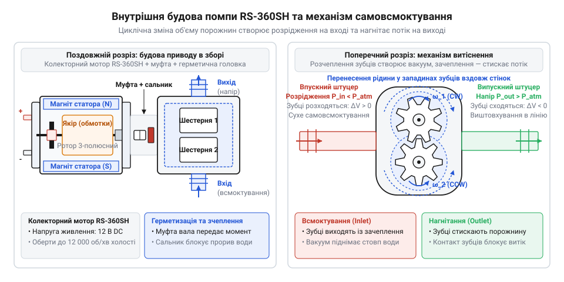
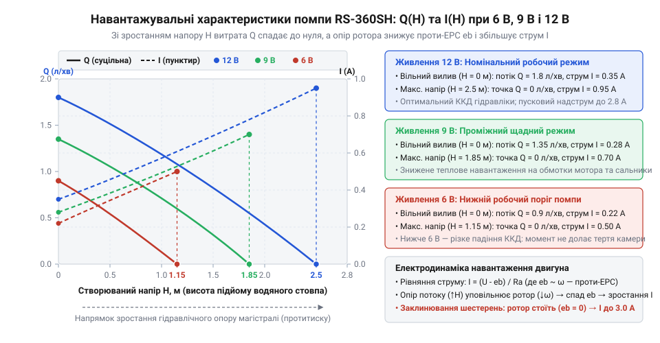
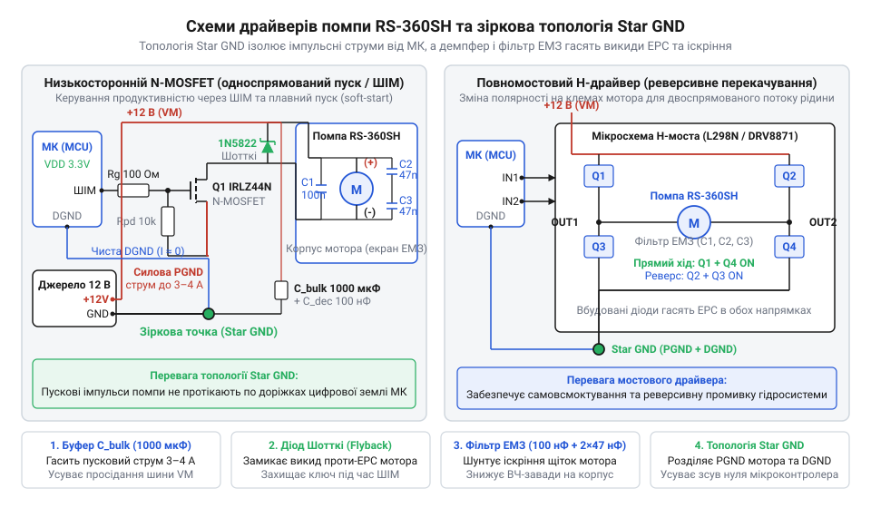
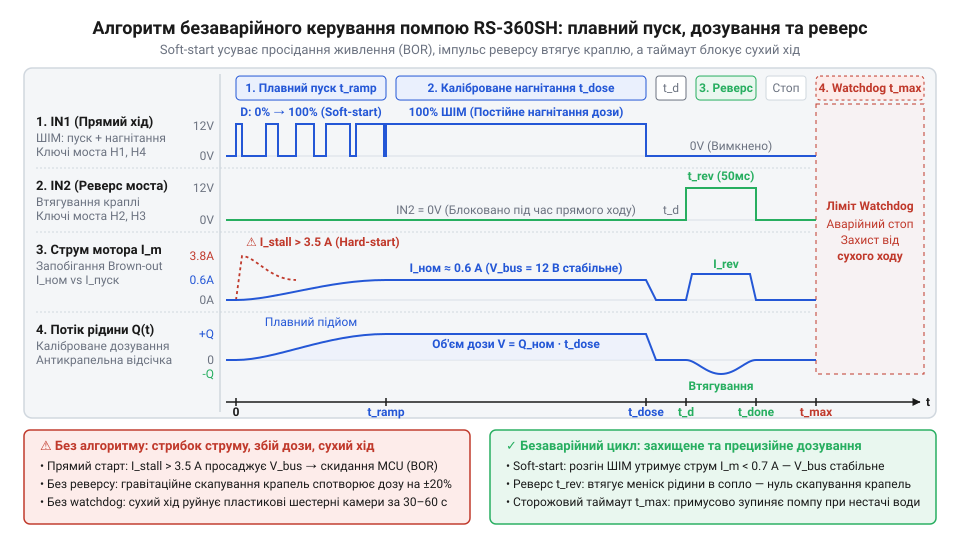

# Водяна помпа RS-360SH

<preknowlist>
- [Колекторний двигун типорозміру 130](root:cat-hw-actuators/dc-motor-130) — фізичний устрій щітково-колекторного вузла постійного струму, комутація ламелей ротора та генерація проти-ЕРС під час обертання у магнітному полі статора
- [Мотор-редуктор 6 В (100 і 600 об/хв)](root:cat-hw-actuators/gearmotor-6v) — комутація індуктивного навантаження польовими транзисторами й мостовими драйверами, призначення зворотного діода для гасіння сплесків самоіндукції та фільтрація іскрових завад
</preknowlist>

## Чому відмовляють прості системи перекачування

Автоматизація догляду за рослинами, внесення рідких добрив чи охолодження силової електроніки вимагає транспортування рідини між резервуарами та робочими вузлами. Найпростіший задум — використати природний самоплив під дією сили тяжіння, встановивши на магістралі керований електромагнітний або сервоприводний клапан. Проте гравітаційне перетікання накладає жорстке геометричне обмеження: резервуар із запасом води мусить постійно розташовуватися вище за всі точки поливу чи форсунки. Щойно ємність опиняється на підлозі поруч із високим стелажем або рівень води опускається нижче вихідного штуцера, рух рідини зупиняється. До того ж вільний самоплив створює мізерний гідростатичний тиск (грец. *hydro* — вода, *statikos* — нерухомий; англ. @@en|hydrostatic head@@). Цього напору недостатньо, щоб проштовхнути потік крізь тонкі розподільчі трубки, крапельниці чи фільтри зі значним гідравлічним опором, а витрата води нелінійно падає в міру спорожнення бака.

Для створення активного напору та перекачування води знизу вгору типово обирають дешеві мініатюрні відцентрові помпи (від лат. *centrum* — центр і *fugere* — тікати; англ. @@en|centrifugal pump@@) з живленням 5–12 В. Здебільшого це занурювальні пристрої: електричний двигун разом із робочим колесом мусить постійно перебувати на дні резервуара у воді. Таке розміщення загрожує корозією контактів, вимагає надійної герметизації кабельного вводу та ускладнює обслуговування резервуара. Спроба винести таку помпу назовні й опустити в резервуар лише гнучку впускну трубку натикається на нездоланний фізичний бар'єр: відцентровий механізм виявляється безсилим підняти воду по порожній магістралі. Якщо перед увімкненням уся впускна лінія й внутрішня камера не заповнені водою вручну, помпа не качатиме рідину. Вона позбавлена здатності до сухого самовсмоктування (англ. @@en|self-priming@@).

Причина цієї безпорадності криється у гідродинамічному принципі дії відцентрового робочого колеса — крильчатки (англ. @@en|impeller@@, від лат. *impellere* — штовхати вперед). Обертові лопатки розганяють середовище від центру до периферії камери, передаючи йому кінетичну енергію. Перепад тиску `ΔP`, який розвиває крильчатка, прямо пропорційний густині робочого середовища `ρ` та квадрату лінійної швидкості руху лопаток `u`:

    ΔP ≈ ρ · u²

Густина рідкої води становить близько `ρ_води ≈ 1000 кг/м³`, тоді як густина повітря — лише `ρ_повітря ≈ 1.2 кг/м³`, тобто у 830 разів менше. Коли в робочу камеру замість рідини потрапляє повітря, обертання лопаток навіть на високій частоті створює на вході мізерне розрідження — частки міліметра водяного стовпа замість кількох метрів. Зовнішній атмосферний тиск, що діє на дзеркало води в резервуарі, не здатний проштовхнути стовп рідини вгору по магістралі проти сили тяжіння. Будь-яка повітряна бульбашка в робочій камері призводить до явища завоздушування (англ. @@en|air binding@@): крильчатка обертається в повітрі без гідродинамічного зачеплення, рух рідини повністю блокується, а тертя у підшипниках ковзання без водяного змащення швидко перегріває пластикові деталі.

Таким чином, гравітаційні та динамічні відцентрові рішення виявляються непридатними для систем, де електропривод має стояти вище рівня рідини, запускатися з сухими трубками після простою та створювати напір крізь вузькі канали. Надійна робота вимагає іншого фізичного принципу — переміщення рідини ізольованими порціями. Створення глибокого розрідження (від лат. *vacuus* — порожній; англ. @@en|vacuum@@) механічним розширенням герметичної порожнини лежить в основі [об'ємних гідравлічних насосів](root:ph-mechanics/positive-displacement-pumps) (англ. @@en|positive displacement pump@@): вони захоплюють повітря разом із залишками рідини, піднімають воду з нижнього резервуара завдяки перепаду тисків і виштовхують її у напірну магістраль незалежно від наявності повітряних корків.

## Анатомія помпи та механізм самовсмоктування

Зовні мініатюрна водяна помпа виглядає як суцільний циліндричний блок із парою металевих пелюсток живлення та двома гідравлічними штуцерами (від нім. *Stutzen* — патрубок; англ. @@en|hose barb@@). Конструктивно цей вузол складається з двох жорстко сполучених модулів: високообертового колекторного електродвигуна постійного струму типорозміру @@en|RS-360SH@@ та механічної насосної головки об'ємного витіснення. Сталевий корпус мотора містить постійні магніти статора, триполюсний якір з обмотками та щітковий вузол, конструктивно подібний до класичного [двигуна типорозміру 130](root:cat-hw-actuators/dc-motor-130). Через вихідний вал і сполучну пластикову муфту обертальний рух ротора передається всередину герметичної робочої камери (англ. @@en|displacement chamber@@).

Масова поява таких пристроїв стала можливою завдяки переходу від важких металевих конструкцій до прецизійного лиття зносостійких полімерів. У другій половині XX століття японська компанія @@en|Mabuchi Motor@@ розробила низьковольтні колекторні мотори серії 300 для склоомивачів автомобілів. Поєднання надійного мікромотора з деталями з поліацеталю та нейлону започаткувало швидку [еволюцію мініатюрних помп](root:cat-hw-actuators/water-pump-rs360sh/hist-miniature-dc-water-pumps.md): точне лиття пластикових шестерень дозволило досягти мікронних зазорів між рухомими стінками, завдяки чому привід отримав здатність піднімати рідину без попереднього заповнення трубок і став базовим вузлом для поливу, акваріумів та контурів рідинного охолодження.

Усередині насосної головки розміщено пару спряжених зубчастих коліс із пружного пластику — шестеренчастий механізм (англ. @@en|gear pump@@) — або пелюсткову діафрагму (від грец. *diaphragma* — перегородка; англ. @@en|diaphragm pump@@), яку коливає ексцентрик (від лат. *ex* — поза і *centrum* — центр; англ. @@en|eccentric cam@@). Механіка самовсмоктування базується на циклічній зміні геометричного об'єму ізольованих порожнин. Коли зубці шестерень виходять із взаємного зачеплення з боку впускного патрубка, об'єм міжзубцевих западин різко зростає. У герметичній зоні утворюється глибоке розрідження (@@en|vacuum@@), тиск падає нижче атмосферного, і зовнішній повітряний тиск втискає повітря разом із водою з резервуара вгору по порожній трубці. Помпа розвиває вакуум, достатній для підйому стовпа води із сухої глибини до 1.5 м. Кінематика шестеренчастого приводу забезпечує неперервне обертання коліс і плавне витіснення рідини з мінімальною пульсацією тиску (від лат. *pulsatio* — штовхання; англ. @@en|pressure ripple@@). Натомість пелюсткова діафрагма перетворює обертання ексцентрика на зворотно-поступальний рух і нагнітає середовище окремими тактами крізь клапани, що породжує значні коливання напору та вібраційні ривки в трубках. Водночас ці схеми принципово різняться чутливістю до сухого тертя (англ. @@en|dry friction@@). У шестеренчастій помпі зубці ковзають між собою та вздовж стінок камери з мікронними зазорами, де рідина одночасно є мастилом і гідравлічним ущільнювачем. Робота без рідини призводить до швидкого нагрівання від тертя, стирання пластикових поверхонь і втрати розрідження. Пелюсткова діафрагма повністю ізолює привід від робочої зони, а сама мембрана працює суто на пружний вигин без взаємного ковзання твердих тіл. Через відсутність ковзних пар діафрагмовий вузол легко переносить роботу без води без ризику зношування й заклинювання.

Перекачування рідини здійснюється замкненими порціями. Вода потрапляє в заглибини між зубцями та внутрішньою стінкою корпусу й переноситься вздовж дуги до протилежного боку камери. Біля випускного патрубка зубці шестерень знову входять у зачеплення. Об'єм між ними різко стискається, що створює локальний надлишковий тиск, який проштовхує порцію рідини далі в напірну лінію. Оскільки рідина не може повернутися назад крізь щільний контакт зубців у центрі камери, помпа безперервно переміщує об'єм із входу на вихід.


*Анатомія помпи: обертання шестеренчастої головки створює розрідження на вході для сухого самовсмоктування та витісняє рідину під тиском у вихідний штуцер.*

Напрямок руху середовища жорстко прив'язаний до полярності електричного живлення. Зміна знака напруги на клемах електродвигуна змушує ротор обертатися у протилежний бік. Для шестеренчастої помпи із симетричною камерою це викликає повний реверс потоку (від лат. *reversus* — повернутий назад; англ. @@en|flow reversal@@): впускний штуцер починає нагнітати рідину, а випускний — засмоктувати. Ця властивість дозволяє після завершення поливу чи дозування короткочасним зворотним обертанням втягнути назад завислу краплю, усуваючи небажане підтікання. Докладні монтажні розміри корпусу, електричні характеристики клем та діаметри штуцерів наведено в [апаратному інтерфейсі приводу](root:cat-hw-actuators/water-pump-rs360sh/api-rs360sh-pump-hardware.md).

## Гідравлічні характеристики та навантажувальна залежність

Проєктування поливу, контуру охолодження чи хімічного дозатора вимагає точного узгодження двох параметрів: об'ємної витрати рідини (англ. @@en|volumetric flow rate@@) та створюваного напору (англ. @@en|hydraulic head@@). Паспортні показники помпи RS-360SH — витрата до 1.8 л/хв і висота стовпа води до 2.5 м — визначають краї робочого діапазону при номінальній напрузі 12 В. Однак вони ніколи не досягаються одночасно: максимальна витрата виникає лише під час вільного виливу на рівні землі, а максимальний напір відповідає точці повної зупинки потоку на граничній висоті підйому.

В об'ємному механізмі кожен оберт вала переносить крізь робочу камеру фіксовану порцію води. Оскільки швидкість обертання щіткового мотора постійного струму пропорційна прикладеній напрузі, зміна живлення в межах робочого вікна 6–12 В безпосередньо масштабує продуктивність. За нульового тиску нагнітання помпа перекачує близько 0.9 л/хв при 6 В, досягаючи 1.8 л/хв при 12 В. Зі зростанням геодезичної висоти або звуженням магістралі потік спадає вздовж нахиленої робочої кривої.


*Гідравлічні та електричні криві помпи: зі збільшенням висоти підйому витрата падає до нуля при максимальному напорі, а струм двигуна лінійно зростає через механічне гальмування ротора.*

Будь-яка перешкода на виході — клапан, зворотний фільтр, тонка трубка або підйом рідини вгору — створює гідродинамічний протитиск (англ. @@en|back pressure@@). Рідина чинить опір обертанню пластикових шестерень, навантажуючи вал електродвигуна і змушуючи його сповільнюватись. Електродинамічний відгук мотора на це гальмування описує баланс між напругою живлення `U`, активним опором обмоток якоря `R_a` та внутрішньою наведеною протиелектрорушійною силою (від грец. *ēlektron* — бурштин, лат. *motor* — рушій; англ. @@en|counter-electromotive force@@, або @@en|back-EMF@@) `e_b`:

    I = (U - e_b) / R_a

Проти-ЕРС генерується обертанням провідників якоря в магнітному полі статора і прямо пропорційна швидкості вала. У режимі холостого ходу (англ. @@en|no-load condition@@), коли помпа вільно качає воду без підйому, ротор обертається з найбільшою частотою, величина `e_b` близька до `U`, а споживаний струм становить лише 0.2–0.3 А. Підвищення гідравлічного опору сповільнює ротор. Проти-ЕРС падає, різниця напруг `U - e_b` зростає, і струм збільшується до 0.8–1.0 А під час нагнітання максимального тиску. У разі повного заклинювання шестерень чи блокування трубки ротор зупиняється (`e_b = 0`), а струм стрибає до 2.5–3.0 А, викликаючи швидкий перегрів мідного дроту обмоток.

Зниження напруги живлення нижче 6 В для зменшення потоку є помилковим рішенням через нелінійне падіння коефіцієнта корисної дії (від лат. *coefficiens* — той, що сприяє разом; англ. @@en|efficiency@@). У пластиковій камері постійно присутнє тертя рухомих шестерень об стінки та опір ущільнювальних сальників. При низьких напругах крутний момент електродвигуна ледь перекриває ці втрати на тертя: помпа майже перестає подавати воду проти найменшого тиску, а більша частина підведеної електричної потужності марно розсіюється у вигляді тепла на активному опорі обмоток. Розрахунок гідравлічних втрат у трубах різного перерізу та формули для часового відмірювання об'ємів розкриває [гідравлічна модель помпи](root:cat-hw-actuators/water-pump-rs360sh/math-pump-hydraulics-and-dosing.md).

## Пускові надструми та електромагнітні завади

Під час автономного тестування від лабораторного джерела помпа RS-360SH споживає цілком очікуваний робочий струм: 0.8–1.0 А під максимальним гідравлічним навантаженням. Проте перша спроба об'єднати помпу на спільну лінію живлення з цифровою платою керування часто завершується апаратними аваріями: під час кожного старту мікроконтролер спонтанно перезавантажується, обмін даними цифровими шинами I2C або SPI зависає, а напівпровідникові комутаційні ключі пробиваються без видимих причин.

Причиною цих збоїв є електродинамічні перехідні процеси в колекторному двигуні постійного струму. У мить замикання силового ключа ротор мотора нерухомий. Оскільки протиелектрорушійна сила виникає лише під час руху провідників у магнітному полі статора, у початкову частку секунди вона строго дорівнює нулю. Струм у колі стримується виключно малим активним опором мідного дроту якірних обмоток `R_a`, викликаючи різкий стрибок — пусковий надструм (англ. @@en|inrush current@@).

Амплітуду пускового струму `I_start` у початковий момент подачі робочої напруги `U = 12 В` на якірне коло помпи з опором `R_a ≈ 4.0 Ом` визначає баланс напруг:

```text
I_start
= (U - e_b) / R_a       [закон Ома для кола з проти-ЕРС]
= (12 - 0) / 4.0        [значення проти-ЕРС e_b = 0 при нерухомому роторі]
= 3.0 А                 [піковий пусковий надструм]
```

Цей триамперний сплеск триває від 30 до 80 мс — доки обертовий момент двигуна не подолає механічну інерцію ротора та гідравлічний опір стовпа води в камері й не наведе зустрічну проти-ЕРС `e_b`, яка поверне струм до номінального рівня.

Коли піковий струм силою 3 А раптово протікає крізь спільне джерело живлення та монтажні дроти, на їхньому внутрішньому опорі виникає пропорційне падіння напруги. Напруга на загальній шині живлення просідає нижче робочого вікна стабілізаторів логіки. Якщо напруга живлення мікроконтролера падає нижче критичного рівня, спрацьовує апаратне [скидання через зниження напруги](root:hw-arch/mcu-brownout-reset) (англ. @@en|brown-out reset@@, скорочено @@en|BOR@@). Вбудований компаратор примусово перезавантажує процесор, керуючий сигнал зникає, помпа знеструмлюється, напруга на шині відновлюється — і після рестарту мікроконтролер знову відкриває ключ, зациклюючи систему в нескінченних перезавантаженнях.

Математичний апарат цих перехідних процесів описує диференціальне рівняння балансу напруг якірного кола, де наростання струму визначається не лише активним опором, а й індуктивністю обмоток та динамікою розгону ротора проти протитиску магістралі. Розрахунок амплітуди пускового просідання шини, пікового струму заблокованого ротора та енергії комутаційного викиду для підбору захисних демпферів розгортає [електромеханічна модель приводу](root:cat-hw-actuators/water-pump-rs360sh/math-dc-pump-electromechanics-and-transients.md).

Друга руйнівна загроза виникає в момент розмикання силового кола під час вимикання помпи або при регулюванні обертів широтно-імпульсною модуляцією. Котушки якоря мають власну індуктивність `L_a`. За законом електромагнітної індукції швидкий спад струму `di / dt` за частки мікросекунди породжує високовольтний сплеск ЕРС самоіндукції (від лат. *inductio* — наведення; англ. @@en|inductive kickback@@) `e_L = -L_a · (di / dt)`. Амплітуда цього викиду зворотної полярності досягає десятків вольт (від 40 до 80 В), що миттєво перевищує гранично допустиму напругу стік–витік закритого транзистора. Без демпферного діода або захисного ланцюга силовий [транзисторний ключ](root:hw-components/mosfet-low-side-switch) пробивається лавинним пробоєм (від лат. *labina* — зсув; англ. @@en|avalanche breakdown@@). Причиною руйнування кристала стає магнітна енергія `W`, накопичена в індуктивності якірних обмоток `L_a ≈ 1.2 мГн` під час протікання номінального робочого струму `I = 1.0 А`, яку визначає квадратична залежність:

```text
W
= 0.5 · L_a · I²               [енергія магнітного поля індуктивності]
= 0.5 · (1.2 · 10⁻³) · 1.0²    [підстановка індуктивності L_a = 1.2 мГн та струму I = 1.0 А]
= 0.60 · 10⁻³ Дж               [добуток величин у системі СІ]
= 0.60 мДж                     [переведення значення в міліджоулі]
```

Квадратична залежність від струму означає, що при зростанні механічного навантаження або під час заклинювання ротора, коли струм підскакує до пускових 3 А, енергія викиду зростає майже вдев'ятеро (до 5.4 мДж). Якщо колу індуктивного струму нікуди замкнутися, уся накопичена енергія за частки мікросекунди вивільняється безпосередньо в кремнієвій структурі напівпровідника, створюючи колосальну пікову потужність і спричиняючи незворотне теплове руйнування кристала. Натомість демпферний діод паралельно двигуну замикає струм самоіндукції у безпечний внутрішній контур крізь діодний перехід та опір якірного дроту `R_a ≈ 4.0 Ом`. Швидкість згасання струму та розсіювання накопиченої енергії визначає електрична стала часу якірного кола `τ = L_a / R_a ≈ 1.2 · 10⁻³ Гн / 4.0 Ом = 0.3 мс` (300 мкс). Приблизно за три сталі часу `t_decay ≈ 3 · τ ≈ 0.9 мс` струм експоненційно спадає майже до нуля, а магнітна енергія безпечно перетворюється на тепло в обмотках і на діоді, не наражаючи транзистор на руйнівний викид напруги.

Третє джерело нестабільності має високочастотну природу. Механічний комутатор (від лат. *commuto* — змінюю, перемикаю; англ. @@en|commutator@@) помпи RS-360SH комутує обмотки за допомогою підпружинених металевих щіток, що ковзають по мідних ламелях обертового колектора. Під навантаженням перемикання секцій ротора супроводжується механічним брязкотом і мікродугами. Це іскріння генерує широкосмугові електромагнітні завади (англ. @@en|electromagnetic interference@@, скорочено @@en|EMI@@) з частотами від сотень кілогерців до десятків мегагерців. Силові дроти помпи працюють як передавальні антени, наводячи високочастотні струми на довколишні провідники друкованої плати. Якщо не виконати [придушення комутаційних завад](root:hw-analog/brush-dc-noise-suppression), цей шум спотворює фронти тактових сигналів на шинах I2C та SPI, блокуючи опитування датчиків і зв'язок із периферією.


*Осцилограми перехідних процесів у момент увімкнення та зупинки помпи: пусковий надструм провалює напругу шини нижче порогу скидання мікроконтролера, а розмикання індуктивності та іскріння колектора генерують небезпечні високовольтні сплески й завади.*

Поєднання цих трьох факторів — глибокого просідання шини від пускового струму, високовольтних викидів самоіндукції та радіочастотного іскріння щіток — робить неможливим пряме підключення помпи RS-360SH до спільного живлення з логікою. Безаварійна робота приводу вимагає обов'язкових апаратних бар'єрів: демпферного діода паралельно обмоткам, керамічних конденсаторів безпосередньо на виводах двигуна та схемотехнічного [розділення живлення](root:hw-pcb/power-rail-isolation-for-motors) за допомогою накопичувальних буферів і зіркового заземлення.

## Схемотехніка силових ключів та розв'язка

Пряме підключення помпи RS-360SH до цифрових портів мікроконтролера неможливе: стандартний логічний вихід здатен видати напругу 3.3 В або 5 В при струмі не більше 20–40 мА. Водяний привід вимагає постійної напруги 12 В і споживає від 0.8–1.0 А під робочим гідравлічним навантаженням до 3.0 А в пусковому режимі. Щоб керувати високою потужністю за допомогою слабкого логічного сигналу, потрібен зовнішній напівпровідниковий комутатор.

Для систем односпрямованого перекачування базовим рішенням є [низькосторонній транзисторний ключ](root:hw-components/mosfet-low-side-switch) (англ. @@en|low-side switch@@) на N-канальному польовому транзисторі з ізольованим затвором (англ. @@en|metal-oxide-semiconductor field-effect transistor@@, скорочено @@en|MOSFET@@). Транзистор вмикають між мінусовим виводом двигуна та загальною шиною заземлення (GND). Вирішальним параметром при виборі компонента є порогова напруга затвора (англ. @@en|gate threshold voltage@@) `V_GS(th)`. Класичні польові транзистори для повного відкриття вимагають напруги на затворі 10–12 В; при керуванні від логічних рівнів 3.3 В або 5 В вони потрапляють у лінійний опірний режим, сильно нагріваються струмом навантаження і виходять із ладу. Схема керування вимагає застосування транзистора логічного рівня (англ. @@en|logic-level@@ MOSFET, наприклад IRLZ44N або AO3400), чий опір відкритого каналу `R_DS(on)` падає нижче `0.05 Ом` уже при напрузі на затворі `V_GS = 3.3–4.5 В`.

Керуючий вивід мікроконтролера з'єднують із затвором через дві обов'язкові деталі:
1. Затворний резистор (англ. @@en|gate resistor@@) `R_gate ≈ 100–220 Ом`, підключений послідовно між виходом процесора та затвором. Він обмежує імпульсний струм перезаряджання вхідної ємності затвора `C_iss` у мить перемикання, захищаючи вихідний каскад мікроконтролера від струмового перевантаження, і демпфує високочастотний дзвін у паразитному LC-контурі друкованої плати.
2. Стягувальний резистор (англ. @@en|pull-down resistor@@) `R_pd ≈ 10–100 кОм`, увімкнений між затвором і землею. Під час запуску або прошивання мікроконтролера його виводи перебувають у високоімпедансному Z-стані. Без стягувального резистора випадковий статичний заряд на затворі може частково відкрити ключ, спричинивши хаотичне вмикання помпи або аварійний перегрів кристала.

Для захисту від індуктивних викидів паралельно клемам електродвигуна обов'язково встановлюють демпферний діод (англ. @@en|flyback diode@@) у зворотному ввімкненні: катодом до шини +12 В, а анодом — до стоку транзистора. У момент закриття ключа струм в індуктивності обмоток не може обірватися миттєво; спад магнітного поля генерує високовольтний сплеск протилежної полярності. Демпферний діод відкривається, замикаючи струм самоіндукції в контур крізь обмотки двигуна, і скидає магнітну енергію у вигляді тепла на їхньому активному опорі. Звичайні випрямні діоди (на зразок 1N4007) тут непридатні через повільне зворотне відновлення (англ. @@en|reverse recovery time@@) тривалістю в кілька мікросекунд — транзистор встигне пробитися раніше, ніж діод увімкнеться. Необхідно застосовувати швидкодіючий діод Шотткі (від імені нім. фізика В. Шотткі; англ. @@en|Schottky diode@@, наприклад 1N5819 або SS34) з метало-напівпровідниковим бар'єром, чий час перемикання становить менше 10 нс. Під час ШІМ-комутації діод відкривається на кожному такті вимкнення транзистора, тому потужність теплових втрат `P` на ньому визначають через пряме падіння напруги `V_F ≈ 0.3–0.4 В` та середній струм через діод `I_avg`:

    P = V_F · I_avg

Ця залежність показує, що при низькій шпаруватості ШІМ струм циркулює через діод більшу частину періоду, тому саме діод, а не транзистор, перебирає на себе основний нагрів у силовому контурі.

Якщо система передбачає реверс напрямку перекачування для осушення магістралі або зворотного втягування краплі, одиничного транзистора недостатньо. У таких задачах використовують інтегральний H-міст (від графічної подібності схеми до літери «H»; англ. @@en|H-bridge@@, наприклад DRV8871 або TB6612FNG). Чотири внутрішні транзисторні ключі моста перемикаються попарно по діагоналі, що дозволяє прикладати до клем помпи напругу прямої або зворотної полярності. Драйвер повинен витримувати робочий струм 1.0 А та пікові пускові перевантаження до 3.0 А без передчасного спрацьовування теплового захисту.

Стабільна робота системи вимагає дотримання чотирьох апаратних правил розведення та монтажу:
1. Апаратне [розділення живлення](root:hw-pcb/power-rail-isolation-for-motors): силова лінія 12 В помпи повинна бути фізично відокремлена від цифрової лінії 3.3 В або 5 В. Живлення логіки реалізують через окремий імпульсний або лінійний стабілізатор із фільтрами.
2. Буферний конденсатор (англ. @@en|bulk capacitor@@): безпосередньо біля силового ключа та роз'єму живлення помпи встановлюють електролітичний накопичувач ємністю `C_bulk = 470–1000 мкФ` на робочу напругу не менше 25 В із низьким еквівалентним послідовним опором (англ. @@en|low ESR@@). У момент старту він віддає запасену енергію локально, зрізаючи триамперний пік і не дозволяючи просідати напрузі на виході основного джерела.
3. Зіркове заземлення (англ. @@en|star ground@@): струм силового контуру мотора замикається окремими широкими провідниками. Силова земля комутатора з'єднується з логічною землею мікроконтролера строго в одній спільній точці біля мінусової клеми джерела живлення («зірка»), що виключає циркуляцію зворотних симульованих струмів через сигнальні земляні полігони плати.
4. Триконденсаторний фільтр завад: механічне іскріння колектора помпи генерує інтенсивний радіочастотний шум. Для його локалізації безпосередньо на виводах мотора розпаюють три дискові керамічні конденсатори ємністю по `0.1 мкФ`: один між клемами живлення двигуна (гасить диференціальні завади) та два від кожної клеми на металевий сталевий корпус (скидають синфазні завади на екран).


*Принципові схеми комутації помпи: швидкодіючий діод Шотткі паралельно мотору гасить індуктивні викиди, а буферна ємність живлення і зіркове заземлення ізолюють цифрові кола від імпульсних просідань напруги.*

Схемотехнічний розрахунок номіналів, вибір радіатора охолодження та трасування друкованої плати силового модуля наведено у [вузлі низькостороннього керування](root:cat-hw-actuators/water-pump-rs360sh/proj-low-side-pump-controller.md).

## Програмне керування, дозування та захист

Після складання силового каскаду пряма подача повної напруги (100% потужності) наражає гідравлічний та електричний контур на аварійні навантаження. Миттєвий розгін нерухомого ротора й стовпа рідини створює стрибок тиску — гідравлічний удар (англ. @@en|water hammer@@), здатний зірвати еластичні трубки зі штуцерів і пошкодити клапани. Одночасно якірне коло споживає піковий пусковий струм 3 А, навантажуючи джерело живлення. Крім того, тривала неконтрольована робота помпи швидко виводить її з ладу через перегрів і знос.

Для гнучкого регулювання продуктивності потоку мікроконтролер використовує широтно-імпульсну модуляцію (англ. @@en|pulse-width modulation@@, скорочено @@en|PWM@@). Апаратний таймер комутує затвор польового транзистора з фіксованою частотою (зазвичай від 1 до 20 кГц), змінюючи коефіцієнт заповнення (шпаруватість; англ. @@en|duty cycle@@) `D` від 0 до 1 (або 0–100%). Середня ефективна напруга на клемах помпи становить:

```text
U_avg
= U_supply · D       [формула середньої напруги ШІМ]
```

Оскільки об'ємна помпа має власну механічну інерцію та опір тертя, витрата рідини змінюється пропорційно середній напрузі в робочому діапазоні `D ≥ 0.45–0.50`. Зменшення шпаруватості нижче 40% при напрузі 12 В призводить до зупинки вала через внутрішній опір сальників і шестерень камери.

Щоб усунути пусковий надструм і пом'якшити механічний удар, програмний драйвер реалізує [алгоритм плавного пуску](root:cat-hw-actuators/water-pump-rs360sh/api-pump-controller-driver.md) (англ. @@en|soft-start@@). Замість миттєвого встановлення цільової шпаруватості `D_target` значення коефіцієнта заповнення лінійно збільшують від нуля протягом інтервалу часу `T_ramp = 100–300 мс`:

```text
D(t)
= D_target · (t / T_ramp)    [лінійне наростання шпаруватості плавного пуску]
```

За час наростання ротор плавно набирає обертів паралельно зі зростанням напруги. У міру розгону якірні провідники наводять внутрішню проти-ЕРС, яка підтримує низьку різницю `U_avg(t) - e_b(t)` у колі. Завдяки цьому піковий струм розгону не перевищує 1.1–1.3 А замість 3.0 А при прямому пуску, що повністю запобігає динамічному просіданню напруги живлення. Для збереження працездатності мікроконтролера цей алгоритм виконують неблокуючим способом — за допомогою періодичного опитування апаратного таймера або міток часу (`millis()`), без використання блокуючих інструкцій очікування (`delay()`).

В об'ємному насосі кожен робочий цикл витісняє фіксований об'єм, тому сумарна подача рідини `V` пропорційна тривалості роботи `t_dose` за стабільної об'ємної витрати `Q`:

```text
V
= Q · t_dose         [об'ємне дозування за часом роботи]
```

Калібрування реальної продуктивності нагнітання (наприклад, `Q = 20 мл/с` при `D = 0.8`) дозволяє відмірювати точні дози рідини з похибкою до 3–5%, задаючи інтервал увімкнення `t_dose = V / Q`. Проте після знеструмлення мотора на зрізі випускного штуцера чи голки під дією сил поверхневого натягу утворюється висяча крапля, яка спотворює точність дози та викликає забруднення. У системах із мостовим драйвером контролер подає короткий імпульс реверсивного відсікання краплі (англ. @@en|anti-drip reverse pulse@@): зворотне обертання шестерень на потужності 50–60% протягом 80–150 мс втягує залишковий меніск на кілька міліметрів усередину трубки. Алгоритми часової координації дозатора викладено в [реверсивній станції дозування](root:cat-hw-actuators/water-pump-rs360sh/proj-reversible-dosing-station.md).


*Часова діаграма алгоритму дозування: плавне наростання шпаруватості ШІМ усуває пусковий надструм, фіксована тривалість задає точний об'єм, а короткий реверс ліквідує підтікання крапель.*

Надійна експлуатація помпи RS-360SH вимагає суворого дотримання чотирьох факторів живучості:
1. Заборона сухого ходу (англ. @@en|dry run@@): пластикові шестерні робочої камери потребують обов'язкового водяного змащення й охолодження. Без рідини сухе тертя розігріває полімерні зубці до температури плавлення: вже через 30–60 секунд сухого обертання шестерні незворотно деформуються, і помпа назавжди втрачає здатність до створення розрідження. Програмний сторожовий таймер (англ. @@en|watchdog timer@@) мусить автоматично знеструмлювати привід за тайм-аутом, якщо витратомір або датчик струму фіксує ознаки сухого ходу (струм без води становить 0.2–0.3 А проти 0.6–0.9 А під навантаженням).
2. Ліміт робочого циклу (коефіцієнт навантаження; англ. @@en|duty cycle@@): сталевий циліндр двигуна RS-360SH не має крильчатки внутрішнього обдуву. Безперервне нагнітання води струмом 0.8–1.0 А протягом понад 10–15 хвилин нагріває обмотки вище 80 °C, що руйнує лакову ізоляцію та знижує залишкову індукцію магнітів статора. Оптимальним є циклічний режим роботи: не більше кількох хвилин перекачування з наступною паузою для природного охолодження.
3. Відсутність вологозахисту корпусу: мотор має відкриті щілини в торцевій кришці та відповідає класу захисту IP00 (від англ. @@en|ingress protection@@). Потрапляння крапель або конденсату на металевий корпус призводить до проникнення вологи всередину, спричиняючи корозію ламелей колектора та коротке замикання щіток. Помпу необхідно встановлювати в сухому відсіку штуцерами донизу відносно електричної частини.
4. Механічна фільтрація: зазори між зубами шестерень і стінками камери становлять менше 0.1 мм. Дрібні абразивні частки, мул чи осад заклинюють шестерні, зупиняючи вал і вводячи двигун у небезпечний режим короткого замикання зі струмом 3 А. Встановлення сітчастого впускного фільтра з порами 100–200 мкм на кінці забірної трубки є обов'язковим.

Склад структур даних, налаштування апаратних таймерів та сигнатури захисних функцій містить [програмний C/C++ інтерфейс](root:cat-hw-actuators/water-pump-rs360sh/api-pump-controller-driver.md).
