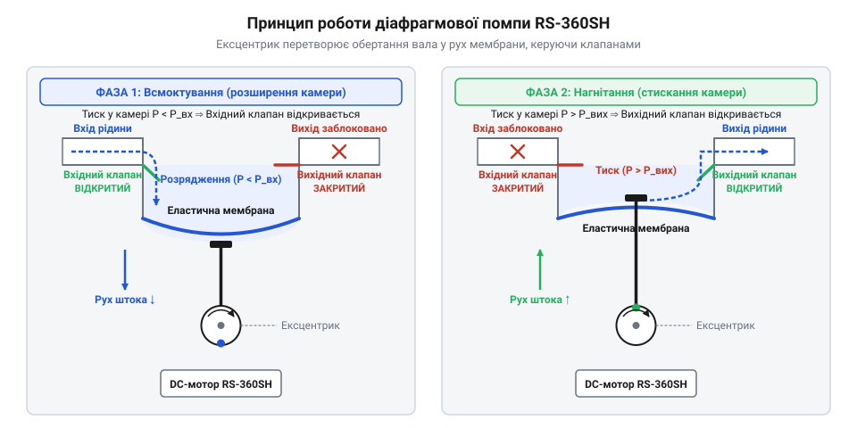
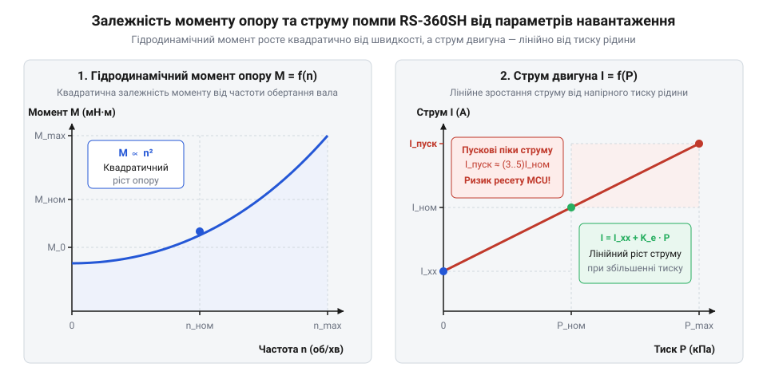
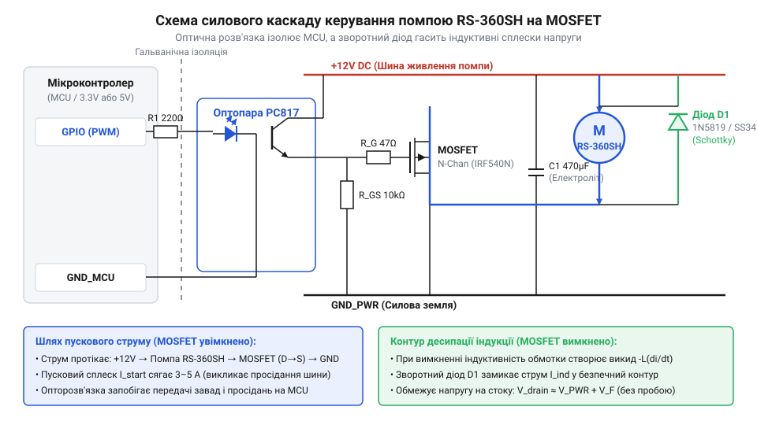
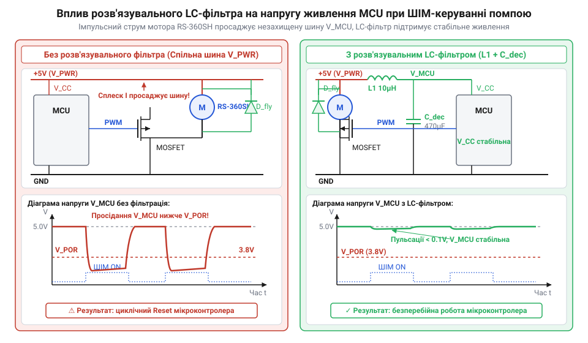
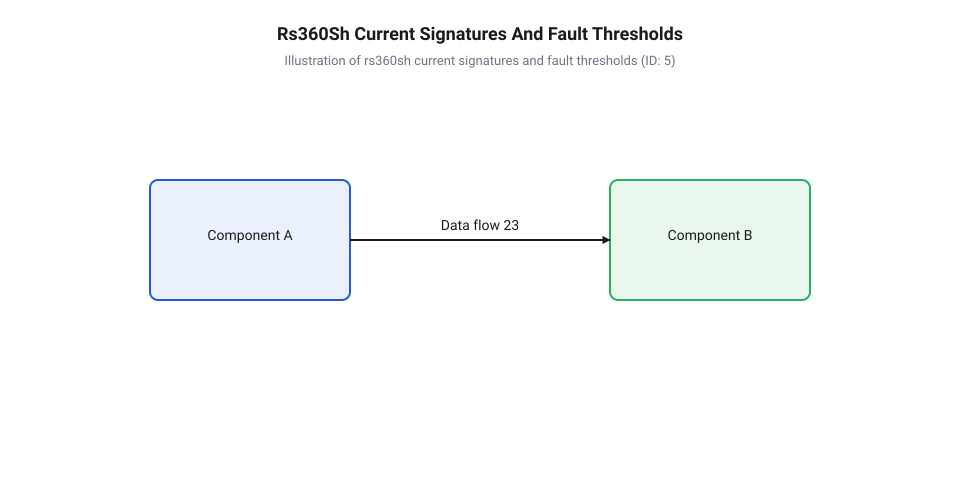

# Водяна помпа RS-360SH

<preknowlist>
- [Колекторний двигун типорозміру 130](root:cat-hw-actuators/dc-motor-130) — Принцип роботи колекторно-щіткового вузла, виникнення проти-ЕРС та електромагнітні характеристики колекторного DC-двигуна
</preknowlist>

## Герметизація та принцип дії діафрагмового механізму

Пряме занурення двигуна у рідину спричиняє коротке замикання щіток, а відцентрові насоси не засмоктують повітря з сухої магістралі. Помпа RS-360SH вирішує це герметичною робочою камерою змінного об'єму, яку приводить [колекторний двигун типорозміру 130](root:cat-hw-actuators/dc-motor-130).

На валу мотора закріплено @@la|ексцентриковий механізм@@ (лат. *excentricus* — поза центром), що зсуває центр кріплення шатуна еластомерної @@grc|діафрагми@@ (грец. *διάφραγμα* — перегородка). При обертанні вала @@la|ексцентрик@@ відтягує @@grc|діафрагму@@, збільшуючи об'єм камери та створюючи розрідження. Перепад тиску відкриває вхідний @@de|односторонній клапан@@ (нім. *Klappe* — заслінка), засмоктуючи рідину. Зсув вперед стискає вміст камери: вхідний @@de|клапан@@ притискається до сідла, а вихідний @@de|клапан@@ виштовхує рідину в магістраль.


*Принцип дії діафрагмового механізму RS-360SH: перетворення обертання вала на коливання мембрани з почерговим спрацьовуванням впускного та випускного клапанів.*

Гнучка @@grc|діафрагма@@ повністю відокремлює мотор від рідини, а розрідження в сухій магістралі забезпечує самоусмоктування без попереднього заповнення системи.

## Гідродинамічне навантаження та електрична поведінка

На відміну від приводів постійної швидкості на кшталт [N20 мікромотор з редуктором](root:cat-hw-actuators/n20-motor), опір рідини зростає квадратично від швидкості потоку. Момент опору `M_l` залежить від частоти обертання `ω` та гідравлічного опору магістралі `R_h`:

```
M_l = k · R_h · ω²
```

При старті нерухомий ротор не створює проти-ЕРС (`E = 0`), тому пусковий струм `I_start` обмежується лише опором обмотки `R_w`:

```
I_start = U_in / R_w
```

Через малий `R_w` струм `I_start` у 4–8 разів перевищує номінальний. Він просаджує шину VCC і спричиняє @@en|brownout@@-перезавантаження (англ. *brownout*, від *brown* — тьмяний) мікроконтролера.


*Гідродинамічні та електричні характеристики помпи: зростання моменту опору, пусковий струм та індуктивні сплески.*

При вимкненні індуктивність обмотки `L` вивільняє енергію магнітного поля `E_m = (1/2) · L · I²`, створюючи сплеск самоіндукції `u_L = L · (di / dt)`. Цей пік у сотні вольт здатний пробити керуючий транзистор.

## Силовий каскад керування та захист

Струм помпи комутують силовим ключем на N-канальному @@en|MOSFET-транзисторі@@ (англ. *metal-oxide-semiconductor*) у нижньому плечі, з логічним рівнем керування затвором для роботи від 3.3 V або 5 V мікроконтролера.

Стягувальний резистор `R_pd` (10 кОм) на GND утримує затвор закритим при скиданні мікроконтролера, а послідовний `R_g` (100–220 Ом) обмежує кидок струму заряджання ємності `C_iss`.


*Підключення помпи RS-360SH: N-канальний MOSFET, діод Шотткі та оптопара.*

Зворотний @@de|діод Шотткі@@ (нім. *Schottky*) паралельно помпі гасить струм самоіндукції при вимкненні @@en|MOSFET@@, а оптопара гальванічно розділяє силову й логічну землі.

## ШІМ-регулювання продуктивності та фільтрація живлення

Витрату рідини регулюють зміною середньої напруги через @@en|ШІМ-регулювання@@ (англ. *Pulse-Width Modulation*, @@en|ШІМ@@). При `D < 20–30%` виникає мертва зона пуску: моменту мотора бракує для подолання тертя @@la|ексцентрикового механізму@@ й пружності @@grc|діафрагми@@.

Частота @@en|ШІМ@@ становить 4–20 кГц: нижча (`< 1 кГц`) дає гул і пульсації струму, вища (`> 30 кГц`) — втрати в @@en|MOSFET-транзисторі@@. На відміну від [5V безколекторних вентиляторів](root:cat-hw-actuators/fan-5v), колекторний мотор RS-360SH генерує щіткові завади.


*Регулювання продуктивності та фільтрація: наявність пускової мертвої зони при низькому коефіцієнті заповнення ШІМ та використання LC-фільтра й буферних конденсаторів для стабілізації напруги.*

Паралельно помпі ставлять буферний конденсатор (`470–1000 мкФ`) від пускових просідань напруги, на клеми — керамічний (`0.1 мкФ`) від завад, а в лінію логіки — LC-фільтр.

## Діагностика загрози сухого ходу й кавітації

Робота без рідини — @@en|сухий хід@@ (англ. *dry run*) — позбавляє помпу охолодження та змащення, що спричиняє перегрів еластомеру, пересихання @@de|односторонніх клапанів@@ і знос щіток. Надмірний опір на вході провокує @@la|кавітацію@@ (лат. *cavitas* — порожнина): схлопування бульбашок закипілої пари низького тиску руйнує @@grc|діафрагму@@.

Аварійні режими виявляють за струмом мотора `I_sen`: при @@en|сухому ході@@ відсутність опору знижує струм нижче порогу `I_dry` (на 40–60%), а при заклинюванні струм зростає до `I_stall`.


*Струмові профілі помпи: розрізнення нормального режиму, сухого ходу та заклинювання.*

Струм вимірюють шунтом і АЦП мікроконтролера після плавного пуску та стабілізації гідродинаміки.

:::tabs
@tab C
:::code water-pump-rs360sh/c/pump-soft-start-and-monitor.c
@tab C++
:::code water-pump-rs360sh/cpp/pumpcontroller.cpp
:::