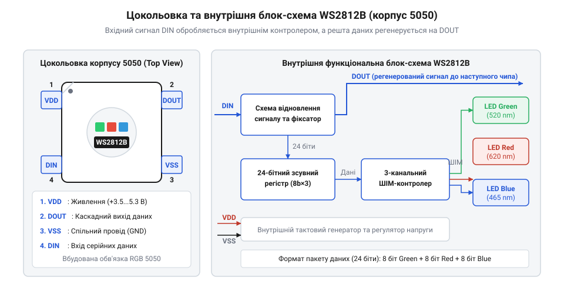
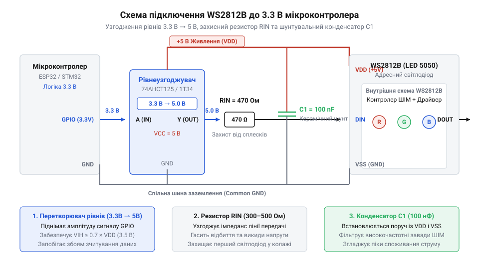

# Апаратні характеристики, цокольовка та рівні сигналів WS2812B

<preknowlist>
- [KY-009 — RGB SMD-модуль](root:cat-hw-actuators/ky-009-rgb-smd) — принцип фізичного суміщення трьох кристалів RGB в одному SMD-корпусі та особливості обмеження струму окремих світлодіодів
</preknowlist>

## Спонтанні збої та вихід з ладу

Коли розробник уперше підключає адресну світлодіодну стрічку чи окремий модуль @@en|WS2812B@@ напряму до виводів мікроконтролера, схема часто поводиться непередбачувано. Світлодіоди починають довільно блимати хаотичними кольорами, лінійка раптово «зависає» в одному стані, а інколи найперший піксель у лінії взагалі назавжди втрачає здатність світитися або передавати сигнал далі. На відміну від простих компонентів, як-от [пасивні триколірні світлодіоди](root:cat-hw-actuators/ky-016-rgb) або [SMD-модулі розпайки](root:cat-hw-actuators/ky-009-rgb-smd), де струм регулюється лише зовнішніми резисторами, @@en|WS2812B@@ містить усередині повноцінну цифро-аналогову мікросхему керування.

Причина таких спонтанних відмов криється не у програмних помилках, а у порушенні фізичних та електричних умов експлуатації шини живлення й сигналу. Адресний піксель очікує чітких часових інтервалів від [протоколу часового кодування](root:cat-hw-actuators/ws2812b-led/api-ws2812b-protocol-timing.md) та стабільної напруги живлення. Якщо напруга живлення відчуває просідання або виникає високочастотний шум від перемикання потужних кристалів @@en|RGB@@, внутрішня логіка контролера збивається з ритму і сприймає цифровий потік викривленим.

Найбільш підступною апаратною аварією є фізична руйнація вхідного каскаду першого світлодіода. Це відбувається під час подачі цифрового сигналу даних від мікроконтролера у момент, коли основне живлення стрічки вимкнене або ще не встигло піднятися до робочого рівня. Спроба подати високу напругу на вхід даних знеструмленої мікросхеми викликає проходження струму через внутрішні паразитні захисні діоди виводу на знеструмлену шину живлення. Цей процес, відомий як паразитне живлення microchip через сиґнальні кола, викликає локальний перегрів та незворотний пробій напівпровідникової структури виводу даних.

Крім того, довгі провідники живлення й сигналу володіють індуктивністю та ємністю. Під час гарячого підключення джерела живлення або швидких перехідних процесів у лінії виникають сплески напруги, які перевищують гранично допустимі значення для напівпровідників. Щоб уникнути виходу з ладу обладнання та забезпечити беззбійну роботу світлових ефектів, необхідно ретельно вивчити апаратну цокольовку корпусу, електричні пороги спрацьовування та правила застосування пасивних елементів захисту й узгодження рівнів.

## Цокольовка корпусу 5050 та призначення виводів

Маючи розуміння високої чутливості смарт-діода до електричних режимів, розглянемо його геометрію та внутрішню компоновку. Модуль @@en|WS2812B@@ виконано у стандартному @@en|SMD@@-корпусі (від @@en|Surface Mount Device|пристрій для монтажу на поверхню@@) розміром `5.0 × 5.0 мм` (тип 5050). В історичних пасивних діодах цей корпус використовували лише для розміщення трьох окремих напівпровідникових кристалів червоного, зеленого та синього світіння з виведенням шести контактних площадок, як це зроблено у [SMD-модулях типу KY-009](root:cat-hw-actuators/ky-009-rgb-smd). У випадку @@en|WS2812B@@ усередині одного корпусу суміщено три світловипромінювальні кристали та інтегральну мікросхему керування, що дозволило скоротити кількість зовнішніх виводів до чотирьох.

Призначення чотирьох виводів корпусу @@en|WS2812B@@ визначено чіткими функціональними ролями:
1. @@en|VDD@@ (від @@en|Voltage Drain Drain|напруга живлення стоків@@) — вивід живлення внутрішньої логіки microchip та напівпровідникових кристалів @@en|RGB@@. Сюди подається позитивний потенціал постійного струму. 2. @@en|VSS@@ (від @@en|Voltage Source Source|напруга джерела истоків@@) — спільний вивід заземлення (`0 В`), відносно якого відраховуються всі напруги живлення та логічні рівні сигналів. 3. @@en|DIN@@ (від @@en|Data In|вхід даних@@) — вхід послідовного цифрового сигналу, на який надходить потік кодованих імпульсів від мікроконтролера або від попереднього пікселя в лінії. 4. @@en|DOUT@@ (від @@en|Data Out|вихід даних@@) — вихід послідовного цифрового сигналу, призначений для передачі регенерованого потоку даних до входу @@en|DIN@@ наступного світлодіода.


*Підпис: Розташування виводів VDD, VSS, DIN, DOUT корпусу WS2812B 5050 та схема внутрішнього перенаправлення даних до кристалів.*

Усередині корпусу інтегрована мікросхема містить вхідний зсувний регістр, засувки даних, три незалежні канали @@en|PWM@@ (від @@en|Pulse-Width Modulation|широтно-імпульсна модуляція@@) та схемний блок регенерації сигналу. Коли цифровий потік надходить на вхід @@en|DIN@@, внутрішній контролер зчитує перші 24 біти інформації (по 8 біт на зелений, червоний та синій канали — формат GRB) та фіксує їх у своїх засувках для керування яскравістю відповідних кристалів. Усі наступні біти, що надходять у цьому ж кадрі, контролер не приймає на власні засувки, а пропускає через блок підсилення та формування фронтів, виводячи їх на контакт @@en|DOUT@@. Завдяки цьому інформаційний сигнал послідовно поширюється від пікселя до пікселя без спотворення амплітуди й форми імпульсів.

## Специфікації напруги та логічні рівні

Аналіз геометрії та функціоналу контактів дозволяє перейти до розрахунку електричних режимів пристрою. Стабільність роботи @@en|WS2812B@@ повністю залежить від дотримання специфікацій напруги живлення @@en|VDD@@ та відповідності амплітуди вхідного сигналу логічним порогам внутрішнього @@en|CMOS@@-каскаду (від @@en|Complementary Metal-Oxide-Semiconductor|комплементарна структура метал-оксид-напівпровідник@@).

Згідно з технічною документацією виробника, допустимий діапазон напруги живлення @@en|VDD@@ становить від `3.5 В` до `5.3 В`, а номінальним значенням є `5.0 В`. Логічні рівні вхідного сигналу прив'язані до поточної напруги живлення через пропорційні коефіцієнти. Високий логічний рівень `V_IH` (від @@en|Input High Voltage|вхідна напруга високого рівня@@) має становити не менше `0.7 × VDD`, а низький логічний рівень `V_IL` (від @@en|Input Low Voltage|вхідна напруга низького рівня@@) не повинен перевищувати `0.3 × VDD`.

Розрахуємо мінімальне значення високого логічного рівня `V_IH` при номінальній напрузі живлення `VDD = 5.0 В`.

```
V_IH = 0.7 × VDD
= 0.7 × 5.0 В            [підстановка номінальної напруги живлення]
= 3.5 В                  [обчислення мінімального порогу високого рівня]
```

З отриманого значення видно, що при живленні стрічки від `5.0 В` внутрішній контролер @@en|WS2812B@@ вважає логічною одиницею лише сигнал із напругою не нижче `3.5 В`. Це створює серйозну апаратну проблему при з'єднанні з сучасними мікроконтролерами (ESP32, STM32, RP2040), чий вихідний сигнал логічної одиниці `V_OH` становить близько `3.3 В`. Напруга `3.3 В` перебуває нижче порогу `3.5 В`, тому вхід @@en|DIN@@ може нестабільно розпізнавати імпульси або взагалі ігнорувати передачу даних.

Другим важливим чинником є струмове навантаження. Кожен із трьох внутрішніх напівпровідникових кристалів (@@en|RGB@@) при максимальній яскравості споживає близько `20 мА`. Визначимо піковий струм споживання одного світлодіодного модуля при максимальній яскравості білого кольору.

```
I_pixel = I_red + I_green + I_blue
= 20 мА + 20 мА + 20 мА  [додавання струмів трьох кристалів]
= 60 мА                  [пікове споживання одного пікселя]
```

Звідси випливає, що кожен модуль при навантаженні трьох каналів створює суттєве струмове навантаження `60 мА`. Обчислимо суммарний струмовий бюджет для гірлянди з 60 пікселів `N = 60`.

```
I_total = N × I_pixel
= 60 × 60 мА            [множення кількості пікселів на струм одного модулю]
= 3600 мА                [суммарний струм у міліамперах]
= 3.6 А                  [переведення значення в ампери]
```

Значення `3.6 А` показує, що така лінійка вимагає потужного зовнішнього джерела живлення. Спроба витягнути такий струм через тонкі доріжки друкованої плати або через вбудований стабілізатор мікроконтролера призводить до вигорання провідників та падіння напруги @@en|IR-drop@@ (від @@en|IR drop|падіння напруги на опорі провідника@@), через що на віддалених ділянках стрічки колір викривляється в бік червоного через найменшу пряму падучу напругу червоного кристала.

## Шунтувальні конденсатори та послідовний захист

Розуміння високих пікових струмів та імпульсного характеру споживання дозволяє спроєктувати пасивне коло захисту й стабілізації. Оскільки внутрішній контролер @@en|WS2812B@@ керує яскравістю кристалів за допомогою високочастотної @@en|PWM@@, струм споживання кожного пікселя змінюється стрибкоподібно з високою швидкістю. Послідовна індуктивність дротів живлення у поєднанні з такими стрибками струму створює локальні сплески напруги та пульсації шини, відомі як @@en|Ground Bounce@@ (від @@en|ground bounce|скачок потенціалу землі@@).

Для нейтралізації високочастотних завад використовують @@en|Decoupling Capacitor@@ (від @@en|decoupling capacitor|розв'язувальний конденсатор@@). Біля кожного корпусу @@en|WS2812B@@ безпосередньо між виводами @@en|VDD@@ та @@en|VSS@@ встановлюють керамічний конденсатор ємністю `0.1 мкФ` (100 нФ). Його розміщують на мінімальній відстані до контактних площадок (не далі кількох міліметрів). Цей конденсатор виконує роль локального джерела енергії, яке миттєво віддає струм під час відкриття @@en|PWM@@-ключів, гасячи високочастотні імпульсні завади і запобігаючи збоям внутрішнього зсувного регістра. На вході всієї лінії живлення додатково встановлюють згладжувальний електролітичний конденсатор ємністю від `100 мкФ` до `1000 мкФ` для компенсації повільних просідань напруги при різкій зміні яскравості всієї стрічки.

Другим критичним елементом захисту є @@en|Series Damping Resistor@@ (від @@en|series damping resistor|послідовний демпфувальний резистор@@). Його включено послідовно в розрив лінії даних @@en|DIN@@ перед першим пікселем стрічки. Номінал цього резистора добирають у діапазоні від `300 Ом` до `500 Ом` (найчастіше `330 Ом` або `470 Ом`).

Застосування послідовного резистора розв'язує дві важливі апаратні задачі:
1. Гасіння відбиттів сигналу @@en|Ringing@@ (від @@en|ringing|дзвінкі високочастотні коливання@@). Довгий провідник між мікроконтролером і стрічкою має властивості довгої лінії з певною хвильовою індуктивністю та ємністю. Круті фронти цифрового сигналу викликають відбиття хвилі від входу @@en|DIN@@ з високим імпедансом, що призводить до високовольтних викидів напруги. Резистор узгоджує імпеданс джерела та лінії, демпфуючи збурення. 2. Захист від аварійного пробою при ввімкненні. Якщо мікроконтролер подає сигнал на лінію @@en|DIN@@ раніше, ніж подано напругу `5.0 В` на @@en|VDD@@, захисний резистор обмежує струм через паразитні діоди вхідного каскаду до безпечного мікроамперного рівня, запобігаючи вигоранню першого пікселя.

## Узгодження рівнів та схема підключення

Озброївшись розрахованими електричними параметрами та пасивними елементами захисту, об'єднаємо їх у підсумкову принципову схему включення адресних світлодіодів. Головним завданням при узгодженні `3.3-вольтового` мікроконтролера з `5-вольтовим` модулем @@en|WS2812B@@ є надійне підвищення амплітуди сигналу даних до рівня, який гарантовано перевищує поріг `V_IH = 3.5 В`.

Для підвищення рівнів використовують спеціалізовані швидкісні мікросхеми @@en|Level Shifter@@ (від @@en|level shifter|перетворювач логічних рівнів@@). Найкращі результати забезпечують шинні буфери та трансивери серії 74AHCT125 або 74HCT245, які живляться від напруги `5.0 В`. Ці мікросхеми мають поріг вхідного високого рівня близько `2.0 В` (що ідеально сумісно з логікою `3.3 В`), а на своєму виході формують повноцінний push-pull сигнал амплітудою `5.0 В` з часом наростання фронту менше `10 нс`. Слід уникати використання двонаправлених перетворювачів на польових транзисторах BSS138 із підтягувальними резисторами, оскільки їхні повільні фронти перезаряду ємності лінії викривляють тривалість коротких імпульсів @@en|WS2812B@@.

Альтернативним спрощеним рішенням для невідповідальних схем є метод діодного зниження живлення (@@en|Diode-Drop@@). Перший світлодіод у лінії або проміжний буферний піксель живлять через послідовний випрямний діод (наприклад, 1N4001), який знижує його напругу @@en|VDD@@ приблизно на `0.7 В` — до значення `4.3 В`. Для напруги `VDD = 4.3 В` поріг високого рівня знижується:

```
V_IH = 0.7 × 4.3 В
= 3.01 В                 [розрахунок зниженого порогу високого рівня]
```

Оскільки `3.3 В > 3.01 В`, 3.3-вольтовий мікроконтролер надійно керує першим пікселем, а його вихід @@en|DOUT@@ вже видає регенерований сигнал амплітудою `4.3 В`, що цілком достатньо для керування наступними світлодіодами, які живляться від повних `5.0 В`.


*Підпис: Повна принципова схема підключення WS2812B до 3.3-вольтового мікроконтролера з буфером 74AHCT125, захисним резистором та конденсаторами обв'язки.*

Для забезпечення надійності при довготривалій експлуатації довгої світлодіодної стрічки застосовують схему паралельного підведення живлення @@en|Power Injection@@ (від @@en|power injection|додаткове підведення живлення@@). Товсті мідні провідники живлення (`+5V` та `GND`) прокладають паралельно стрічці та підпаюють до контактних площадок через кожні `1–2 метри`. Це компенсує опір тонких гнучких доріжок плати, усуває просідання напруги та гарантує рівномірне світіння всіх пікселів по всій довжині лінії.