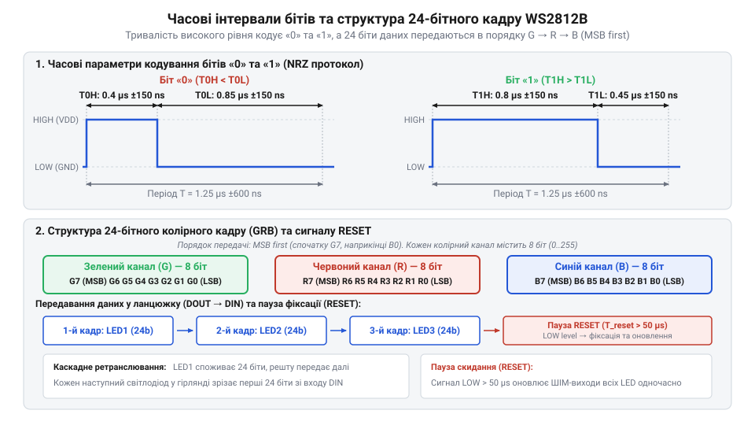
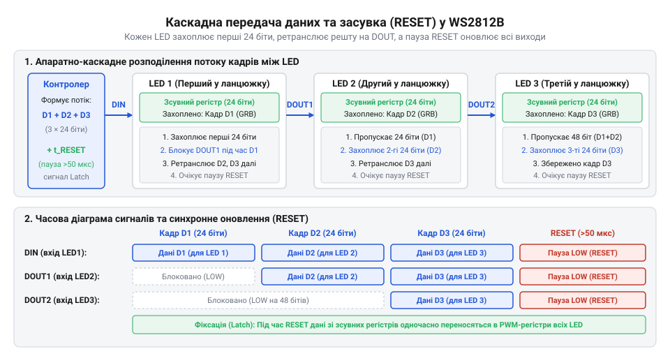

# Протокол передачі даних та часові інтервали WS2812B

<preknowlist>
- [KY-016 — RGB-світлодіод](root:cat-hw-actuators/ky-016-rgb) — принципи аддитивного змішування трьох базових кольорів (Red, Green, Blue) та формування відтінків через регулювання яскравості окремих каналів
- [KY-009 — RGB SMD-модуль](root:cat-hw-actuators/ky-009-rgb-smd) — особливості конструктивного поєднання трьох колірних кристалів у спільному корпусі та імпульсне регулювання їхньої яскравості
</preknowlist>

## Проблема керування світлодіодами однією лінією

Спроба побудувати великий динамічний світловий екран, матрицю або довгу декоративну стрічку на базових світловипромінювальних елементах швидко впирається у фізичне обмеження кількості виводів мікроконтролера. Коли класичні [окремі RGB-світлодіоди](root:cat-hw-actuators/ky-016-rgb) або дискретні [RGB SMD-модулі](root:cat-hw-actuators/ky-009-rgb-smd) потребують трьох незалежних каналів керування на кожен кристал (червоний, зелений та синій), навіть відносно невелика матриця з 10 елементів вимагає 30 окремих ліній сигналів. Якщо підключати їх безпосередньо до виводів @@en|GPIO@@ (англ. *General-Purpose Input/Output* — виводи загального призначення) з використанням апаратної широтно-імпульсної модуляції @@en|PWM@@ (англ. *Pulse-Width Modulation* — широтно-імпульсна модуляція), ресурси таймерів будь-якого мікроконтролера вичерпуються миттєво. На відміну від ситуації, де застосовується проста [звичайна світлодіодна збірка](root:cat-hw-actuators/led-5mm-kit) для статичної індикації, динамічна адресна гірлянда вимагає індивідуальної установки яскравості кожного світлодіода у довільний момент часу.

Спроба застосувати стандартні послідовні шини передачі даних також зустрічає суттєві перешкоди. Шина @@en|SPI@@ (англ. *Serial Peripheral Interface* — послідовний периферійний інтерфейс) вимагає окремої лінії вибору пристрою або додаткових зовнішніх регістрів зсуву, що різко збільшує кількість компонентів на друкованій платі та ускладнює трасування сигнальних доріжок. Шина @@en|I2C@@ (англ. *Inter-Integrated Circuit* — міжмікросхемна шина) спирається на унікальні 7-бітові або 10-бітові адреси пристроїв, що унеможливлює адресацію сотень однакових світлодіодних чипів без складних систем мультиплексування. Асинхронні послідовні протоколи на кшталт @@en|UART@@ (англ. *Universal Asynchronous Receiver-Transmitter* — універсальний асинхронний приймач-передавач) вимагають передачі додаткових службових стартових та стопових бітів для кожного байта, що марно витрачає пропускну здатність лінії.

Для вирішення цієї проблеми розробники інтегральних схем поєднали в одному корпусі RGB-світлодіод та інтелектуальний цифровий драйвер, створивши чип @@en|WS2812B@@. Щоб звести кількість сигнальних провідників до одного, у @@en|WS2812B@@ застосовано однопровідний часоімпульсний протокол @@en|NRZ@@ (англ. *Non-Return-to-Zero* — без повернення до нуля). На відміну від класичних шин із виділеною лінією тактування, де стан даних зчитується за перепадом тактового сигналу, в кодуванні @@en|NRZ@@ тактовий сигнал відсутній як окремий фізичний провідник. Замість цього кожен біт інформації передається протягом фіксованого часового інтервалу частотою 800 кГц (період 1.25 мкс), а логічне значення біта («0» чи «1») визначається співвідношенням тривалостей високого (напруга живлення) та низького (земля) рівнів сигналу всередині цього періоду. Такий підхід дозволяє керувати послідовним ланцюжком із сотень і тисяч світлодіодів через один-єдиний вивід мікроконтролера.

## Часові параметри бітів та GRB-структура

Передача даних однопровідним протоколом @@en|NRZ@@ вимагає від мікроконтролера суворого дотримання часових інтервалів, оскільки приймач усередині чипа @@en|WS2812B@@ визначає логічне значення біта за часом утримання лінії у високому стані. Згідно зі специфікацією виробника, один біт передається за базовий період `T = 1.25 мкс`, що відповідає частоті передачі 800 кГц. Для формування логічного нуля лінія спочатку переводиться у високий рівень на час `T0H = 0.4 мкс` (з припустимим допуском ±150 нс), після чого утримується в низькому рівні на час `T0L = 0.85 мкс` (допуск ±150 нс). Для формування логічної одиниці високий рівень утримується довше — на час `T1H = 0.8 мкс` (допуск ±150 нс), а низький рівень триває `T1L = 0.45 мкс` (допуск ±150 нс). Внутрішня порівняльна схема чипа розпізнає біт як «0», якщо тривалість високої фази становить від 250 нс до 550 нс, і як «1», якщо ця тривалість лежить у межах від 650 нс до 950 нс.


*Часова діаграма передачі бітів логічного нуля та одиниці у протоколі WS2812B та порядок розташування 24 бітів колірного кадру.*

Інформація для одного світлодіода @@en|WS2812B@@ кодується у вигляді 24-бітного кадру. Кожен із трьох колірних каналів отримує по 8 бітів, що забезпечує 256 градацій яскравості (від 0 до 255) для кожного кольору та дає загалом 16 777 216 можливих відтінків. Важливою особливістю @@en|WS2812B@@ є порядок прямування каналів: на відміну від загальноприйнятого стандарту RGB, у даному чипі застосовується послідовність @@en|GRB@@ (англ. *Green-Red-Blue* — зелений, червоний, синій). Першими передаються 8 бітів зеленого каналу, за ними 8 бітів червоного, і останніми — 8 бітів синього. Усередині кожного байта передача здійснюється у порядку @@en|MSB@@ (англ. *Most Significant Bit* — найстарший біт) first, тобто починаючи з найстаршого біта 7 і закінчуючи наймолодшим бітом 0.

Наприклад, якщо для світлодіода необхідно встановити оранжевий колір із параметрами яскравості Зелений = 160 (бінарно `10100000`), Червоний = 255 (бінарно `11111111`) та Синій = 0 (бінарно `00000000`), мікроконтролер мусить згенерувати послідовність із 24 часових імпульсів: спочатку 8 імпульсів для байта зеленого кольору, потім 8 для червоного і 8 для синього.

Розрахуємо тривалість передачі колірного кадру для одного світлодіода `T_frame1` при стандартному періоді біта `T_bit = 1.25 мкс`:

```
T_frame1 = N_bits × T_bit
= 24 × 1.25 мкс      [підстановка кількості бітів кадру та тривалості одного біта]
= 30 мкс              [обчислення загального часу передачі 24 бітів]
```

Значення `T_frame1 = 30 мкс` показує часові витрати на оновлення стану одного чипа. Розуміння структури 24-бітного кадру @@en|GRB@@ та наносекундних часових вимог є основою для аналізу того, як послідовний потік даних поширюється вздовж довгої світлодіодної стрічки.

## Механізм каскадування та фіксація RESET

Підключення великої кількості світлодіодів @@en|WS2812B@@ у послідовний ланцюжок здійснюється за допомогою каскадування, де вихід даних @@en|DOUT@@ (англ. *Data Out* — вихід даних) попереднього чипа з'єднується з входом даних @@en|DIN@@ (англ. *Data In* — вхід даних) наступного. Внутрішня апаратура кожного чипа містить 24-бітний shift-регістр зсуву та селектор потоку. Коли мікроконтролер починає передачу потоку бітів, перший світлодіод у ланцюжку приймає вхідні імпульси через свій вивід @@en|DIN@@. Внутрішній лічильник бітів першого чипа підраховує перші 24 біти й записує їх у свій shift-регістр. Протягом прийому цих перших 24 бітів вивід @@en|DOUT@@ першого чипа утримується в низькому рівні, не пропускаючи сигнал далі.


*Принцип апаратного захоплення перших 24 бітів кожним світлодіодом і ретрансляція решти потоку через вивід DOUT до паузи RESET.*

Починаючи з 25-го біта, внутрішня логіка першого чипа змінює свій стан: вона припиняє запис даних у власній пам'яті й починає напряму ретранслювати всі наступні біти зі входу @@en|DIN@@ на вихід @@en|DOUT@@. При цьому внутрішній підсилювач чипа регенерує крутизну фронтів імпульсів, усуваючи спотворення сигналу. Другий світлодіод у ланцюжку сприймає 25-й біт загального потоку як свій перший біт, відраховує свої 24 біти (з 25-го по 48-й) для власного регістра зсуву, після чого починає ретранслювати 49-й і наступні біти на свій вихід @@en|DOUT@@. Цей процес повторюється для всіх подальших чипів у гірлянді, завдяки чому потік колірних даних природно скорочується на 24 біти після проходження кожного світлодіода.

Під час проходження потоку даних фізичний стан світлодіодів (їхня яскравість та колір) залишається незмінним. Це необхідно для запобігання візуальному миготінню під час оновлення кадру. Щоб зафіксувати нові значення з внутрішніх регістрів зсуву у робочі регістри ШІМ-драйверів, використовується спеціальний сигнал @@en|RESET@@ (англ. *reset* — скидання або перезапуск). Сигнал @@en|RESET@@ являє собою паузу низького рівня на сигнальній лінії. Згідно зі специфікацією @@en|WS2812B@@, якщо лінія утримується в низькому стані протягом часу `t_RESET > 50 мкс` (у новіших ревізіях чипів рекомендовано утримувати паузу понад 280–300 мкс), внутрішній аналоговий таймер кожного чипа фіксує завершення кадру. Це призводить до одночасного копіювання завантажених 24-бітних значень у вихідні регістри керування ШІМ усіх світлодіодів гірлянди та скидає внутрішні лічильники бітів у початковий стан.

Розрахуємо максимально можливу частоту оновлення кадрів `FPS` для стрічки з `N = 100` світлодіодів при тривалості паузи `t_RESET = 300 мкс`:

```
T_total = (N × T_frame1) + t_RESET
= (100 × 30 мкс) + 300 мкс    [підстановка кількості світлодіодів та часових параметрів]
= 3000 мкс + 300 мкс         [обчислення часу передачі даних стрічки]
= 3300 мкс                    [загальний час одного повного кадру]

FPS = 1 ÷ T_total
= 1 ÷ 0.0033 с               [переведення тривалості кадру в секунди]
≈ 303 Гц                     [максимальна частота оновлення кадрів]
```

Отримане значення `FPS ≈ 303 Гц` показує високу швидкодію протоколу на коротких стрічках. Проте при збільшенні кількості світлодіодів `N` до 1000 елементів час передачі кадру зростає до `30.3 мс`, що знижує граничну частоту оновлення до 33 Гц.

## Формування сигналу та усунення часових збоїв

Формування часових інтервалів із точністю до десятків наносекунд ставить високі вимоги до апаратних засобів мікроконтролера. Найпростіший метод програмного керування виводом GPIO (так званий @@en|bit-banging@@) вимагає циклічного виконання інструкцій із блокуванням переривань. Якщо під час передачі кадру спрацює будь-яке апаратне переривання процесора, тривалість високого або низького рівня імпульсу перевищить допустимі допуски (150 нс). У результаті чип @@en|WS2812B@@ сприйме нульовий біт як одиничний або завчасно розпізнає паузу @@en|RESET@@, що призведе до хаотичного спотворення кольорів та миготіння стрічки.

Для створення надійного керуючого сигналу без залучення процесора застосовують апаратну периферію мікроконтролера: контролер шини @@en|SPI@@ або таймери з модулем широтно-імпульсної модуляції @@en|PWM@@ у поєднанні з прямою адресацією пам'яті @@en|DMA@@ (англ. *Direct Memory Access* — прямий доступ до пам'яті). При використанні @@en|SPI@@ із методом розширення бітів @@en|bit expansion@@ (англ. *bit expansion* — розширення бітів) тактову частоту шини налаштовують так, щоб один біт @@en|WS2812B@@ кодувався кількома бітами даних @@en|SPI@@. Наприклад, при частоті шини @@en|SPI@@ 2.4 МГц тривалість одного біта @@en|SPI@@ становить `1 ÷ 2.4 МГц ≈ 0.417 мкс`. Один біт @@en|WS2812B@@ (тривалістю 1.25 мкс) формується триплетом із 3 бітів @@en|SPI@@:
- Логічний «0» @@en|WS2812B@@ кодується як послідовність бітів `100` у шині @@en|SPI@@ (високий рівень ~0.417 мкс, низький рівень ~0.833 мкс). - Логічна «1» @@en|WS2812B@@ кодується як послідовність `110` у шині @@en|SPI@@ (високий рівень ~0.833 мкс, низький рівень ~0.417 мкс).

Завдяки використанню @@en|DMA@@ буфер у оперативній пам'яті передається у периферійний модуль @@en|SPI@@ або таймер автономно, повністю виключаючи часовий @@en|jitter@@ (англ. *jitter* — тремтіння часових інтервалів), викликаний перериваннями процесора.

:::tabs
:::code api-ws2812b-protocol-timing/c/esp-idf/encode-byte-to-spi.c
:::code api-ws2812b-protocol-timing/cpp/arduino/ws2812b-bitstuffer.cpp
:::

Окрім програмно-апаратних часових збоїв, при розгортанні довготривалих систем виникають фізичні проблеми спотворення сигналу. Паразитна ємність довгої сигнальної лінії та затухання на високих частотах призводять до закруглення фронтів прямокутних імпульсів. Для захисту входу першого чипа та узгодження імпедансу сигнальної лінії безпосередньо перед входом @@en|DIN@@ послідовно встановлюють резистор опором 330–470 Ом. Другою поширеною проблемою є розбіжність логічних рівнів: сучасні мікроконтролери працюють при напрузі 3.3 В, тоді як мінімальна напруга розпізнавання високого рівня `VIH` для чипа @@en|WS2812B@@ при живленні 5 В становить `0.7 × VCC = 3.5 В`. У такій ситуації необхідна установка швидкісного конвертера логічних рівнів (наприклад, 74AHCT125). Для правильної організації живлення та запобігання просіданню напруги розглядається окрема [схема живлення стрічки](root:cat-hw-actuators/ws2812b-led/proj-ws2812b-power-signal-conditioning.md), оскільки фізичні параметри живлення прямо впливають на стабільність логічних рівнів. Для порівняння з автономними світлодіодами можна згадати [автономні миготливі елементи](root:cat-hw-actuators/ky-034-flash) або [інтерактивні світлові збірки](root:cat-hw-actuators/ky-027-magic-cup), які не вимагають зовнішньої часової синхронізації, але й не дають можливості довільного вибору відтінків.