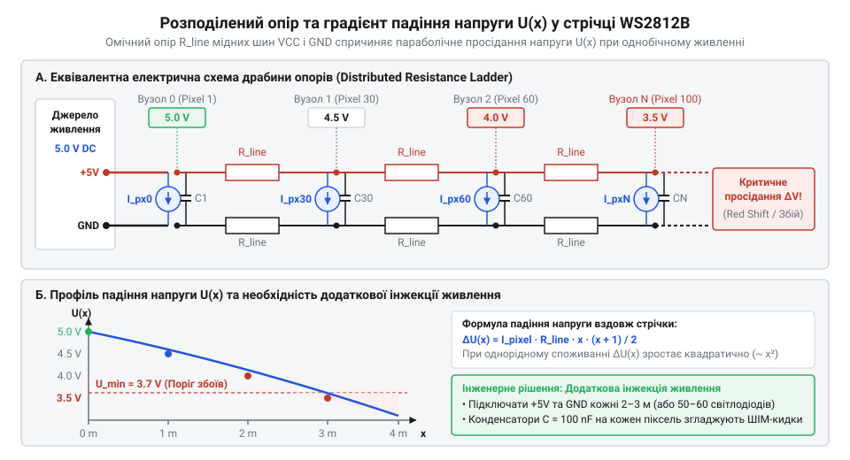
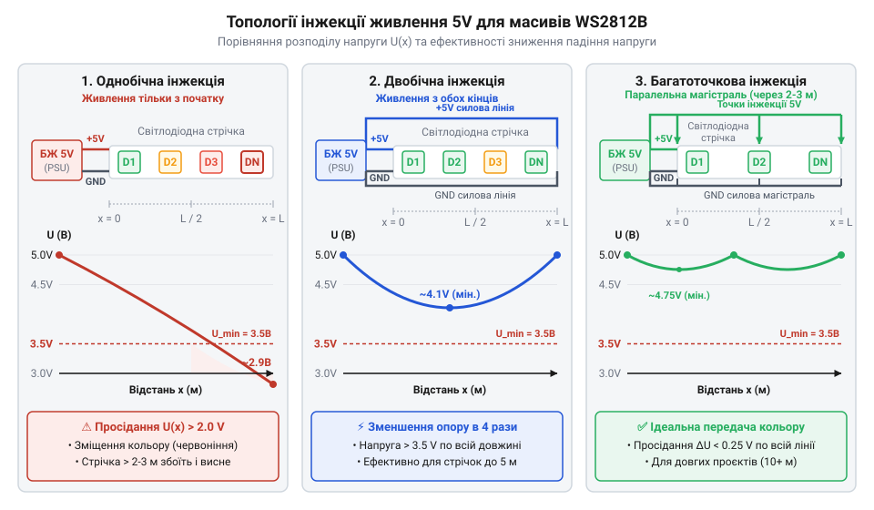

# Розрахунок струмового навантаження та падіння напруги в світлодіодних лініях

<preknowlist>
- [KY-016 — RGB-світлодіод](root:cat-hw-actuators/ky-016-rgb) — Принцип змішування кольорів у трьохканальних RGB-світлодіодах та залежність підсумкового струму від незалежного живлення кожного колірного каналу.
</preknowlist>

## Чому довга світлодіодна стрічка червоніє

Під час живлення довгого масиву адресованих світлодіодів @@en|WS2812B@@ від одного джерела 5 В проявляється характерне спотворення: пікселі на початку стрічки випромінюють біле світло, але далі уздовж лінії колірна температура зміщується в теплий спектр, а на кінці стрічка стає темно-червоною або хаотично миготить.

На відміну від дискретних [триканальних RGB-світлодіодів](root:cat-hw-actuators/ky-016-rgb) чи [SMD RGB-модулів](root:cat-hw-actuators/ky-009-rgb-smd), де струм подається товстими провідниками безпосередньо з плати, адресована стрічка містить сотні послідовних споживачів, живлених через тонку мідну доріжку гнучкої плати @@en|FPC@@ (від англ. *Flexible Printed Circuit* — гнучка друкована плата). Опір цих шин спричиняє падіння потенціалу на @@en|VCC@@ та підняття на @@en|GND@@, через що локальна напруга `U(x) = VCC(x) - GND(x)` зменшується з віддаленням від джерела.

Причина почервоніння криється у відмінності прямого падіння напруги `V_F` (від англ. *Forward Voltage*) світлодіодних кристалів усередині @@en|WS2812B@@:

* Червоний кристал на основі @@en|AlGaInP@@ має поріг `V_F ≈ 1.8 В – 2.1 В`. * Зелений та синій кристали на основі @@en|InGaN@@ вимагають вищої напруги `V_F ≈ 3.0 В – 3.3 В`.

З урахуванням падіння на внутрішньому генераторі струму (`V_sat ≈ 0.4 В – 0.5 В`), для стабільної роботи синього й зеленого каналів потрібна напруга не менше 3.5 В – 3.7 В. Коли `U(x)` падає нижче 3.5 В – 3.7 В, регулятори зеленого й синього каналів виходять із режиму стабілізації, а при 3.2 В – 3.3 В ці кристали повністю згасають. Червоний кристал працює навіть при 2.8 В, через що білий колір вироджується в чистий червоний. Падіння `U(x)` нижче 3.0 В порушує роботу логіки @@en|CMOS@@-контролера та передачу цифрового сигналу @@en|DIN@@/@@en|DOUT@@.

Оцінити це базовим законом Ома для одного резистора неможливо, оскільки струм відбирається розподілено уздовж лінії. Це викликає потребу в математичній моделі розподіленого споживання струму та оцінці градієнта напруги.

## Струмове навантаження пікселя та ШІМ-профілі

Обчислення втрат у провідниках починають із визначення струму споживання пікселя @@en|WS2812B@@. Струмове навантаження елемента складається з двох компонентів: постійного струму власного контролера та змінного струму трьох колірних каналів.

Постійна складова — це струм спокою `I_static` (від англ. static — статичний), який витрачається на внутрішню логіку @@en|CMOS@@ та контролер широтно-імпульсної модуляції @@en|PWM@@ (англ. pulse-width modulation). Цей струм споживається постійно при подачі напруги 5 В, навіть якщо всі світлодіоди вимкнені:

```
I_static ≈ 0.6 mA – 1.0 mA
```

Динамічна складова формується трьома джерелами струму для кристалів @@en|Red@@, @@en|Green@@ та @@en|Blue@@. Кожен генератор калібрують на максимальний струм `I_c_max ≈ 20 mA` для каналу `c ∈ {R, G, B}`. Яскравість регулюють 8-бітною модуляцією @@en|PWM@@, де коефіцієнт заповнення `D_c` визначається колірним байтом `C_c ∈ [0, 255]`:

```
D_c = C_c ÷ 255
```

Оскільки ШІМ перемикає струм із високою частотою, для розрахунку теплового режиму та падіння напруги використовують усереднений за часом струм пікселя `I_pixel`.

Формула усередненого струму одного пікселя `I_pixel` враховує струм спокою та підсумовує споживання трьох колірних каналів:

```
I_pixel = I_static + I_R_max · D_R + I_G_max · D_G + I_B_max · D_B
        = I_static + ∑ (I_c_max · (C_c ÷ 255))                       [підсумовування струмів каналів c ∈ {R, G, B}]
```

При випромінюванні чистого білого кольору на максимальній яскравості (`C_R = C_G = C_B = 255`, відповідно `D_R = D_G = D_B = 1.0`) отримаємо піковий струм елемента:

```
I_pixel_max = 1.0 mA + 20.0 mA + 20.0 mA + 20.0 mA
            = 61.0 mA                                                 [пікове споживання одного елемента]
```

Для масиву з `N` послідовно з'єднаних пікселів сумарний струм стрічки `I_total` дорівнює сумі струмів усіх елементів:

```
I_total = ∑ [k=1..N] I_pixel(k)
```

При однаковому кольорі всіх пікселів формула спрощується до добутку `I_total = N · I_pixel`.

**Розрахунок струмового навантаження для стрічки з 300 пікселів при різних світлових сценаріях**

Розглянемо практичний приклад для п'ятиметрової стрічки щільністю 60 світлодіодів на метр (`N = 300` пікселів).

Сценарій 1: Режим максимальної білої яскравості `(RGB: 255, 255, 255)`

```
I_total_white = 300 × 0.061 A
              = 18.3 A                                                [пікове струмове навантаження білого кольору]
```

Сценарій 2: Відображення помаранчевого кольору `(RGB: 255, 128, 0)`

```
D_R = 255 ÷ 255 = 1.0
D_G = 128 ÷ 255 ≈ 0.502
D_B = 0 ÷ 255 = 0
I_pixel = 0.001 A + (0.020 A × 1.0) + (0.020 A × 0.502) + (0.020 A × 0)
        = 0.03104 A                                                  [середній струм пікселя для помаранчевого кольору]

I_total_orange = 300 × 0.03104 A
               = 9.312 A                                              [сумарне струмове навантаження стрічки]
```

Сценарій 3: Режим очікування — усі світлодіоди вимкнені `(RGB: 0, 0, 0)`

```
I_total_idle = 300 × 0.001 A
             = 0.3 A                                                  [пасивне споживання мікросхем керування]
```

Навіть повністю вимкнена стрічка з 300 пікселів споживає 0.3 А струму спокою. У режимі ж максимального білого світіння струм сягає 18.3 А, що вимагає джерела живлення потужністю понад 90 Вт (при 5 В) і викликає суттєві втрати напруги на мідних доріжках плати.

## Модель розподіленого опору мідних доріжок

Щоб вирахувати локальну напругу на кожному світлодіоді, розглянемо гнучку плату стрічки як еквівалентну електричну ланцюгову лінію (@@en|ladder network@@, з англ. *ladder* — драбина, *network* — мережа).


*Еквівалентна ланцюгова схема світлодіодної лінії з розподіленим опором провідників VCC і GND між сусідніми вузлами та дискретними джерелами струму.*

Стрічка складається з двох паралельних мідних шин: позитивної @@en|VCC@@ та зворотної @@en|GND@@. Між сусідніми пікселями `k-1` та `k` ділянка кожної шини має омичний опір `r_trace_seg`. Оскільки струм тече від джерела через шину @@en|VCC@@, проходить через піксель і повертається через шину @@en|GND@@, сумарний опір лінії між сусідніми вузлами `R_line` обчислюється як сума опорів обох шин:

```
R_line = r_vcc_seg + r_gnd_seg                           [сума опорів двох шин живлення]
```

Опір прямокутного мідного провідника довжиною `Δx` обчислюється за виразом питомого опору:

```
r_trace_seg = ρ · Δx ÷ (b · h)                           [опір ділянки мідної доріжки]
```

де `ρ` — питомий опір міді (`ρ ≈ 1.72 × 10⁻⁸ Ом·м` при 20 °C), `b` — ширина доріжки (м), `h` — товщина мідного фольгування (м), `Δx` — відстань між сусідніми пікселями (м). У стандартних стрічках використовують фольгування 1 унція на квадратний фут (`1 oz/ft²`), що відповідає товщині `h ≈ 35 мкм = 35 × 10⁻⁶ м` (у високоякісних — `2 oz/ft²`, тобто `h ≈ 70 мкм`).

У дискретній моделі стрічки з `N` пікселів, що живиться з одного кінця (`k = 0`) напругою `U_0 = 5.0 В`, через провідник `R_line` між вузлами `k-1` та `k` тече струм `I_seg(k)`, який дорівнює сумі струмів усіх наступних пікселів від `k` до `N`:

```
I_seg(k) = ∑ [j=k..N] I_pixel(j)                         [струм через сегмент провідника]
```

Спадок напруги `ΔU(k)` на цій ділянці визначено законом Ома `ΔU(k) = I_seg(k) · R_line`. Напруга у вузлі `k` обчислюється відніманням спадів на всіх попередніх сегментах:

```
U(k) = U_0 - ∑ [m=1..k] ΔU(m)
     = U_0 - R_line · ∑ [m=1..k] ( ∑ [j=m..N] I_pixel(j) )   [напруга у k-му вузлі стрічки]
```

Для великої кількості пікселів дискретну лінію апроксимують безперервною моделлю довжиною `L` з погонним опором двох шин `r_line` (Ом/м) та погонною густиною струму `i_0 = (N · I_pixel) ÷ L` (А/м). Струм `I(x)` у перерізі на відстані `x` від початку становить `I(x) = i_0 · (L - x)`. Елементарний спад напруги дорівнює `dU = - r_line · i_0 · (L - x) dx`.

Інтегруванням цього виразу від `0` до `x` з початковою умовою `U(0) = U_0` отримують розподіл напруги вздовж однобічно живленої стрічки:

```
U(x) = U_0 - ∫ [0..x] r_line · i_0 · (L - τ) dτ
     = U_0 - r_line · i_0 · (L · x - x² ÷ 2)                 [інтегрування лінійного розподілу струму]
```

Максимальне падіння напруги `ΔU_max` виникає на кінці стрічки при `x = L`:

```
ΔU_max = U(0) - U(L)
       = r_line · i_0 · (L² ÷ 2)
       = (r_line · L) · (i_0 · L) ÷ 2
       = R_total · I_total ÷ 2                                [падіння напруги для розподіленого навантаження]
```

Звідси випливає ключовий висновок: падіння напруги зростає пропорційно **квадрату довжини стрічки** (`L²`). Збільшення довжини однобічно живленої лінії вдвічі збільшує і сумарний струм, і опір доріжок, що призводить до зростання спаду напруги у **4 рази**. Спад напруги при розподіленому навантаженні вдвічі менший, ніж при споживанні всього струму в одній кінцевій точці.

Для зменшення цього спаду застосовують [інжекції живлення](root:cat-hw-actuators/ws2812b-power-injection), які змінюють граничні умови диференціального рівняння й скорочують ефективну довжину сегментів.

**Розрахунок мінімальної напруги на кінці 5-метрової стрічки WS2812B (60 LED/m, 1 oz мідь)**

Обчислимо падіння напруги для п'ятиметрової стрічки (`L = 5.0 м`, `N = 300` пікселів) з фольгуванням `1 oz` (`h = 35 мкм`) і шириною доріжок `b = 2.0 мм = 2.0 × 10⁻³ м`.

Погонний опір двох шин `r_line`:

```
r_trace = ρ ÷ (b · h)
        = (1.72 × 10⁻⁸) ÷ (2.0 × 10⁻³ × 35 × 10⁻⁶)
        = 0.2457 Ом/м                                          [погонний опір однієї мідної шини]

r_line = 2 × 0.2457 Ом/м
       = 0.4914 Ом/м                                          [сумарний погонний опір шин VCC та GND]
```

Густина струму `i_0` при білому кольорі (`I_pixel = 0.060 А`):

```
I_total = 300 × 0.060 А = 18.0 А
i_0 = 18.0 А ÷ 5.0 м = 3.6 А/м                                [погонна густина струму споживання]
```

Максимальний теоретичний спад напруги `ΔU_max`:

```
ΔU_max = r_line · i_0 · (L² ÷ 2)
       = 0.4914 × 3.6 × (5.0² ÷ 2)                            [підстановка параметрів стрічки у формулу]
       = 0.4914 × 3.6 × 12.5
       = 22.11 В                                              [теоретичний спад напруги]
```

Значення 22.11 В доводить неможливість однобічного живлення 5-метрової стрічки на повній яскравості: реальна напруга падає нижче робочого порога в першій третині лінії, спричиняючи нелінійну деградацію струму.

Визначимо граничну довжину `L_max` однобічно живленого сегмента для допустимого спаду `ΔU_max = 0.8 В` (напруга на кінці не нижче 4.2 В):

```
L_max = √ ( (2 · ΔU_max) ÷ (r_line · i_0) )
      = √ ( (2 × 0.8) ÷ (0.4914 × 3.6) )                       [гранична довжина безперервної лінії]
      = √ ( 1.6 ÷ 1.769 )
      = √ 0.9044
      ≈ 0.95 м                                                [максимальна довжина без додаткової інжекції]
```

Без додаткових точок живлення 5-метрова стрічка щільністю 60 LED/м зберігає точну передачу білого кольору лише на перших 95 сантиметрах (приблизно 57 пікселів).

## Розрахунок точок додаткової інжекції живлення

Падіння напруги вздовж мідних шин гнучкої плати @@en|FPC@@ накладає жорсткі фізичні обмеження на максимальну довжину безперервної світлодіодної лінії. Коли напруга живлення на віддалених елементах знижується нижче критичного порогу `U_crit = 3.5 В` – `3.7 В`, генератори струму синього та зеленого каналів мікросхеми @@en|WS2812B@@ виходять із режиму стабілізації, спричиняючи спотворення кольору та збої логічного сигналу. Єдиним ефективним способом компенсації цих омичних втрат є створення додаткових точок підключення силових провідників безпосередньо у проміжні вузли світлодіодної стрічки.

Розрахунок топології живлення починається з визначення критичної довжини однобічно живленого сегмента `L_crit_single`. Спираючись на формулу падіння напруги для розподіленого навантаження, максимальний спад потенціалу `ΔU_max` на кінці лінії довжиною `L` при постійній погонній густині струму `i_0 = n · I_pixel` (де `n` — щільність пікселів на метр, `I_pixel` — усереднений струм одного елемента) описується квадратичною залежністю `ΔU_max = r_line · i_0 · (L² ÷ 2)`.

Задавши максимально допустиме падіння напруги `ΔU_allow = U_0 - U_crit` (де `U_0 = 5.0 В`), виводимо вираз для граничної довжини однобічного сегмента:

```
ΔU_allow = r_line · i_0 · (L_crit_single² ÷ 2)
L_crit_single² = (2 · ΔU_allow) ÷ (r_line · i_0)
L_crit_single = √ ( (2 · ΔU_allow) ÷ (r_line · i_0) )       [гранична довжина однобічно живленого сегмента]
```

Для забезпечення надійного запасу стабільності при підвищенні температури провідників зазвичай приймають `ΔU_allow = 0.8 В`, що відповідає мінімальній локальній напрузі `U_crit = 4.2 В`.

При подачі живлення з обох кінців стрічки (`x = 0` та `x = L`) з одного джерела `U_0` точка мінімальної напруги опиняється посередині `x = L ÷ 2`. Внаслідок цього кожна половина лінії працює як автономний однобічний сегмент довжиною `L ÷ 2`, що забезпечує чотириразове зниження втрат напруги та подвоює граничну довжину безперервної ділянки при збереженні порогу втрат:

```
L_crit_double = 2 · L_crit_single                             [гранична довжина двостороннього сегмента]
```

Якщо загальна довжина світлодіодного масиву `L_total` перевищує `L_crit_double`, необхідно застосовувати багатоточкову мережеву топологію підключення. У такій системі зовнішній силовий кабель прокладається паралельно стрічці, а окремі відпайки з'єднуються з шинами @@en|VCC@@ та @@en|GND@@ через рівні інтервали `S_inj`. Максимальний крок між сусідніми точками інжекції `S_inj` обчислюється за умовою:

```
S_inj ≤ 2 · L_crit_single = L_crit_double                     [максимально допустимий крок інжекції живлення]
```

Точки інжекції розташовуються вздовж лінії у координатах `x_k = k · S_inj`. При цьому кожна проміжна точка живить два суміжні півсегменти довжиною `S_inj ÷ 2` у протилежних напрямках. Струм `I_inj`, який має віддавати проміжне підключення, обчислюється як сума струмів цих двох ділянок:

```
I_inj = i_0 · S_inj                                           [струмове навантаження проміжного вузла інжекції]
```

Крайні точки (`x = 0` та `x = L_total`) живлять лише по одному півсегменту, тому їхнє струмове навантаження становить `I_inj_edge = i_0 · (S_inj ÷ 2)`.


*Порівняння схем однобічної, двобічної та багатоточкової інжекції живлення з епюрами напруги U(x) ілюструє суттєве зменшення просідання потенціалу в центрі стрічки та ефективність зниження еквівалентного опору магістралі.*

**Практичний розрахунок топології інжекцій для 10-метрового масиву**

Розглянемо покроковий обчислювальний приклад для світлодіодного масиву довжиною `L_total = 10.0 м` із щільністю 60 пікселів на метр (`N = 600` пікселів @@en|WS2812B@@). Вихідні параметри:
* Двошарова гнучка плата з товщиною міді `1 oz` (`h = 35 мкм`) та шириною шин `b = 2.0 мм` має погонний опір двох ліній `r_line = 0.4914 Ом/м`. * Профіль використання: змішана анімація з середньою колірною інтенсивністю, що відповідає струму одного пікселя `I_pixel = 40 мА = 0.040 А`. * Розрахункова погонна густина струму: `i_0 = 60 LED/м × 0.040 А = 2.4 А/м`. * Допустиме падіння напруги в стрічці: `ΔU_allow = 0.8 В`.

Обчислення граничної довжини однобічного плеча `L_crit_single`:

```
L_crit_single = √ ( (2 · ΔU_allow) ÷ (r_line · i_0) )
              = √ ( (2 × 0.8) ÷ (0.4914 × 2.4) )               [підстановка параметрів навантаження]
              = √ ( 1.6 ÷ 1.1794 )                            [обчислення знаменника]
              = √ 1.3566                                      [ділення під коренем]
              ≈ 1.165 м                                       [максимальна довжина однобічно живленої ділянки]
```

Обчислення максимального кроку між точками інжекції `S_inj`:

```
S_inj_max = 2 × 1.165 м = 2.33 м
```

Для практичного монтажу обираємо кратний крок `S_inj = 2.0 м` (що відповідає відрізкам по 120 пікселів). Кількість рівних проміжків становить `K = 10.0 м ÷ 2.0 м = 5`. Отже, точні координати інжекції живлення розміщуються на позначках `0 м, 2.0 м, 4.0 м, 6.0 м, 8.0 м` та `10.0 м` (усього 6 точок з'єднання).

Струм, що відбирається кожною з чотирьох проміжних точок:

```
I_inj = 2.4 А/м × 2.0 м = 4.8 А
```

Крайні точки підключення споживають `I_inj_edge = 4.8 А ÷ 2 = 2.4 А`.

Під час проектування підключень існує критична інженерна пастка: спроба заощадити на провідниках шляхом інжекції лише позитивного потенціалу @@en|VCC@@. Якщо підключити зовнішній силовий дріт 5 В до проміжних точок, але залишити зворотну шину заземлення @@en|GND@@ підключеною лише на початку стрічки, весь зворотний струм `I_total` буде змушений повертатися через тонку мідну доріжку @@en|GND@@ плати @@en|FPC@@.

Через опір шини заземлення потенціал @@en|GND@@ на віддалених пікселях зросте на величину `V_GND(x) = I_return · R_gnd`. У результаті амплітуда логічної одиниці цифрового сигналу даних `V_DIN`, який подається від мікроконтролера відносно його локальної землі, на вхідній ніжці віддаленого пікселя знизиться до значення `V_IN_eff = V_DIN - V_GND(x)`. Коли цей рівень впаде нижче порогу розпізнавання логічної одиниці `V_IH ≈ 0.7 · VCC`, керуюча мікросхема втратить здатність зчитувати кадри, що призведе до хаотичного мерехтіння або замирання світлодіодів.

Тому проектування схеми інжекції вимагає обов'язкового симетричного дублювання як шини @@en|VCC@@, так і шини @@en|GND@@ однаковим перерізом провідників у кожному вузлі підключення, що забезпечує стабільний [графік градієнта напруги](root:cat-hw-actuators/ws2812b-power-injection) по всій довжині масиву.

## Підбір магістральних дротів і блокираторних конденсаторів

Опір зовнішньої силової мережі може знецінити додаткову інжекцію живлення, викликавши спад напруги ще до потрапляння струму в стрічку. Крім того, високочастотні імпульси струму при ШІМ-комутації світлодіодів взаємодіють із паразитною індуктивністю магістралі, утворюючи сплески напруги.

Розрахунок перерізу провідника `S_wire` спирається на допустимий спад напруги `ΔU_wire ≤ 0.15`–`0.20 В` (щоб напруга у вузлі інжекції не опускалася нижче `4.8 В`). Оскільки струм прямує через лінію @@en|VCC@@ й повертається через @@en|GND@@, довжина мідного провідника в колі становить `2 · L_wire`. З формули опору `R_wire = ρ · (2 · L_wire) ÷ S_wire` для питомого опору міді `ρ ≈ 1.72 × 10⁻⁸ Ом·м` виводиться необхідний переріз:

```
ΔU_wire = I_inj · R_wire
        = I_inj · (2 · ρ · L_wire ÷ S_wire)
S_wire = (2 · ρ · L_wire · I_inj) ÷ ΔU_wire                   [необхідна площа перерізу мідної жили]
```

Отриманий переріз `S_wire` зіставляють із калібрами @@en|AWG@@ (від англ. *American Wire Gauge* — американський калібр провідників) та перевіряють за граничною густиною струму `j = I_inj ÷ S_wire ≤ 5.0 А/мм²` для відвернення перегріву ізоляції.

**Обчислення магістрального дроту для вузла інжекції**

Для проміжної точки інжекції зі струмом `I_inj = 4.8 А`, віддаленої від джерела 5 В на `L_wire = 2.5 м` при `ΔU_wire = 0.15 В`:

```
S_wire = (2 × 1.72 × 10⁻⁸ Ом·м × 2.5 м × 4.8 А) ÷ 0.15 В
       = (4.128 × 10⁻⁷ Ом·м·м·А) ÷ 0.15 В
       = 2.752 × 10⁻⁶ м²
       = 2.752 мм²                                            [теоретичний розрахунковий переріз провідника]
```

Найближчим більшим стандартом є дріт @@en|AWG 12@@ (`3.31 мм²`). Альтернативно використовують дві паралельні лінії @@en|AWG 16@@ (`2 × 1.31 мм² = 2.62 мм²`).

Під час роботи світлодіодів @@en|WS2812B@@ внутрішні генератори @@en|PWM@@ комутують струм із фронтами `dt ≈ 10`–`30 нс`. Паразитна індуктивність магістралі `L_wire` (приблизно `1 мкГн/м`) реагує на швидку зміну струму `dI ÷ dt` індуктивним кидком ЕРС:

```
e_ind = - L_wire · (dI ÷ dt)                                   [амплітуда індуктивного кидка напруги]
```

Такі кидки сягають 7–9 В або викликають просідання нижче 3.0 В, пошкоджуючи @@en|CMOS@@-контролери та збиваючи регістри зсуву.

Для захисту у вузлах інжекції паралельно встановлюють [блокувальні конденсатори](root:cat-hw-actuators/decoupling-capacitors-led) двох типів:
1. **Електролітичний конденсатор великої ємності** з низьким еквівалентним послідовним опором @@en|Low ESR@@ (від англ. *Equivalent Series Resistance* — еквівалентний послідовний опір) для віддачі струму під час ШІМ-фронтів. 2. **Керамічний конденсатор малої ємності** (`0.1 мкФ`) для шунтування високочастотних завад у мегагерцовому діапазоні.

Ємність електролітичного конденсатора `C_cap` розраховують з умови обмеження пульсацій `ΔU_ripple ≤ 0.1 В` за час реакції джерела `Δt_res ≈ 100 мкс`:

```
C_cap ≥ (I_inj · Δt_res) ÷ ΔU_ripple
```

Для струму `I_inj = 4.8 А`:

```
C_cap ≥ (4.8 А × 100 × 10⁻⁶ с) ÷ 0.1 В
      = (4.8 × 10⁻⁴ Кл) ÷ 0.1 В
      = 4.8 × 10⁻³ Ф
      = 4800 мкФ                                              [сумарна розрахункова ємність блокираторів]
```

У реальних схемах цю ємність розподіляють по лінії, встановлюючи конденсатори `1000 мкФ` (напругою від 6.3 В) класу @@en|Low ESR@@ у кожній із 5 точок інжекції разом із керамічним конденсатором `0.1 мкФ`.