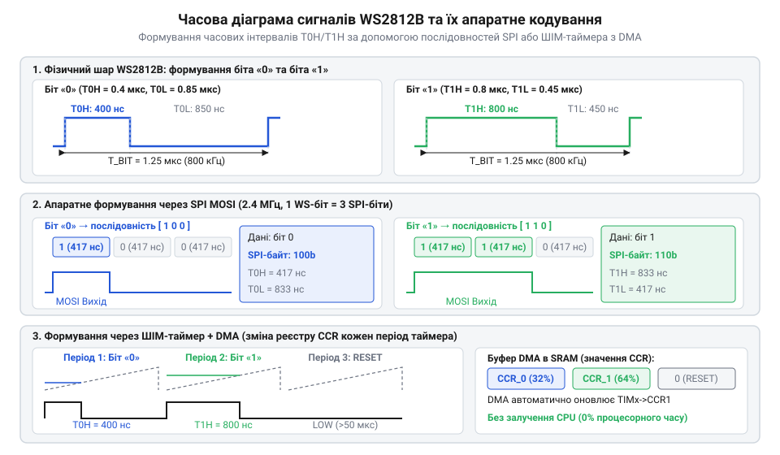
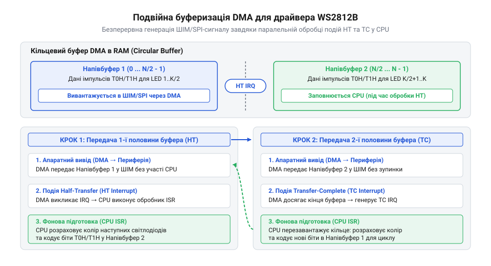

# Реалізація апаратного драйвера WS2812B через SPI/TIM з DMA

<preknowlist>
- [KY-016 — RGB-світлодіод](root:cat-hw-actuators/ky-016-rgb) — принципи аддитивного змішування кольорів у системі RGB та керування інтенсивністю окремих колірних каналів.
- [KY-009 — RGB SMD-модуль](root:cat-hw-actuators/ky-009-rgb-smd) — особливості електричного підключення та колірного кодування світлодіодів поверхневого монтажу.
</preknowlist>

## Обмеження програмного виводу часових сигналів

При спробі побудови світлодіодних масивів високої щільності розробники стикаються з фізичною межею кількості доступних виводів мікроконтролера. На відміну від класичних схем, де використоються [триколірні виводні світлодіоди](root:cat-hw-actuators/ky-016-rgb) чи поверхневі [RGB SMD-модулі](root:cat-hw-actuators/ky-009-rgb-smd), що вимагають трьох окремих ліній @@en|pulse-width modulation@@ (@@en|PWM@@) на кожен елемент, адресаційні світлодіоди WS2812B об'єднуються у послідовний ланцюг із керуванням через один-єдиний дріт даних. Усередині кожного світлодіодного корпусу розміщено трикристальний випромінювач та інтегровану мікросхему драйвера, яка витягує з вхідного потоку 24 біти колірних даних у форматі GRB (8 бітів для зеленого, 8 для червоного та 8 для синього каналу), а решту бітів трансполює далі за ланцюжком. Однак за цю мінімалістичність електричного підключення доводиться платити надзвичайно жорсткими вимогами до часової форми передавального сигналу.

Кожен біт колірної послідовності WS2812B кодується не просто логічним рівнем напруги, а строго визначеною тривалістю високого та низького станів у межах фіксованого періоду 1.25 мікросекунди (що відповідає частоті передачі 800 кілогерців). Логічний нуль кодується коротким високим імпульсом тривалістю `T0H` = 0.35 мкс (із допустимим відхиленням ±150 наносекунд) та довгим низьким рівнем `T0L` = 0.90 мкс. Натомість логічна одиниця вимагає довгого високого імпульсу `T1H` = 0.80 мкс та короткого низького рівня `T1L` = 0.45 мкс. Якщо ж лінія зв'язку утримується в низькому стані довше за паузу `T_RESET` (понад 50 мікросекунд), внутрішній контролер WS2812B засуває зсувний регістр у засувки ШІМ-генераторів і поновлює очікування нового кадру.

Найпростіший підхід до формування таких імпульсів полягає у прямому програмному маніпулюванні виводом процесора — так званому @@en|bit-banging@@ (від англ. *bit banging* — «програмне вибивання бітів»). У цьому режимі процесор у нескінченному циклі встановлює високий рівень на виводі @@en|GPIO@@ (від англ. *General-Purpose Input/Output* — «вивід загального призначення»), виконує серію порожніх інструкцій затримки `NOP`, перемикає вивід у низький рівень і знову очікує потрібну кількість тактів. Проте реальна ембеддед-система майже ніколи не працює в ізоляції: у фоновому режимі виконуються системні таймери, переривання від послідовних інтерфейсів та задачі операційної системи реального часу @@en|RTOS@@ (від англ. *Real-Time Operating System*).

Будь-яка асинхронна подія — наприклад, обробка вхідного байта UART чи квантування часу в @@en|RTOS@@ — миттєво перериває виконання лінії програмних затримок. Якщо переривання виникає в момент формування високого рівня `T0H` тривалістю 350 наносекунд, процесор призупиняє виконання циклу на кілька мікросекунд. Внутрішній таймер WS2812B сприймає такий затягнутий імпульс як логічну одиницю `T1H` замість нуля або інтерпретує надмірну паузу як сигнал скидання `T_RESET`. На практиці це призводить до хаотичного спотворення кольорів, спонтанного спалахування світлодіодів білим світлом або зміщення індексів пікселів у стрічці.

Спроба розв'язати проблему шляхом глобального вимкнення переривань (`__disable_irq()`) на час передачі кадру створює ще критичнішу проблему для усієї архітектури. Для світлодіодної стрічки з 300 елементів передача одного кадру вимагає 7200 бітів (300 × 24 біти), що за періоду біта 1.25 мкс займає щонайменше 9 мілісекунд суцільного блокування процесора. Протягом цього часу мікроконтролер стає повністю «глухим» до зовнішніх подій: втрачаються пакети мережевого обміну, пропускаються кроки крокових двигунів та порушуються інтервали регулювання. Це формує жорстку технічну вимогу: формування наносекундних часових інтервалів WS2812B має бути повністю відчужене від обчислювального ядра процесора та передане спеціалізованим апаратним блокам мікроконтролера.

## Кодування часових сіток SPI та ШІМ

Для усунення залежності від процесорного часу часові інтервали WS2812B відображають на внутрішню тактову сітку периферійних модулів мікроконтролера. Основними апаратними механізмами для цього є таймери у режимі широтно-імпульсної модуляції (@@en|PWM@@) та послідовні зсувні регістри інтерфейсу @@en|SPI@@ (від англ. *Serial Peripheral Interface* — «послідовний периферійний інтерфейс»). В обох випадках завдання зводиться до того, щоб перетворити кожен біт колірного байта на серію апаратних відліків, які периферія здатна випромінювати автономно за сигналом тактового генератора.

У разі використання таймера в режимі @@en|PWM@@ період таймера `ARR` (від англ. *Auto-Reload Register* — «регістр автоперезавантаження») налаштовують на точну частоту повторення бітів WS2812B — 800 кілогерців (період 1.25 мкс). Для кодування логічного нуля та одиниці змінюють значення регістра порівняння `CCR` (від англ. *Capture/Compare Register* — «регістр захоплення/порівняння»), яке визначає тривалість високого рівня в кожному періоді. Розрахунок параметрів таймера для частоти шини тактування 72 мегагерци виконують за такою послідовністю дій:

Розрахунок періоду повторення бітів та регістру автоперезавантаження таймера:
```
T_period
= 1 / f_pixel
= 1 / 800000 Гц        [частота передачі бітів WS2812B]
= 1.25 мкс             [період одного біта]
```
```
ARR
= (f_timer / f_pixel) - 1
= (72000000 Гц / 800000 Гц) - 1   [поділ частоти шини тактування]
= 90 - 1 = 89                     [значення регістра автоперезавантаження]
```
За загального значення періоду 90 відліків таймера тривалість тривалостей `T0H` та `T1H` розраховують через відносне значення шпаруватості (@@en|duty cycle@@, від англ. *duty cycle* — «коефіцієнт шпаруватості»):
```
CCR_0
= ARR_total × (T0H / T_period)
= 90 × (0.40 мкс / 1.25 мкс)      [коефіцієнт шпаруватості для нуля]
= 29                             [значення порівняння для біта 0]
```
```
CCR_1
= ARR_total × (T1H / T_period)
= 90 × (0.80 мкс / 1.25 мкс)      [коефіцієнт шпаруватості для одиниці]
= 58                             [значення порівняння для біта 1]
```
Таким чином, кожен біт колірного байта GRB перетворюється на одне 16-бітне значення у пам'яті (29 для нуля, 58 для одиниці). Для передачі одного 24-бітного пікселя готується масив із 24 елементів `uint16_t`.

Альтернативний підхід базується на використанні зсувного регістра модуля @@en|SPI@@. Якщо налаштувати подільник частоти тактування (@@en|prescaler@@, від англ. *prescaler* — «попередній подільник частоти») @@en|SPI@@ на частоту 2.4 мегагерци, тривалість виводу одного біта @@en|SPI@@ становитиме рівно `T_bit_spi` = 1 / 2.4 МГц ≈ 416.67 наносекунд. За такої частоти три біти @@en|SPI@@ утворюють один повний період WS2812B (3 × 416.67 нс = 1.25 мкс). Логічний нуль WS2812B формують послідовністю бітів `100` (високий рівень триває 416.67 нс, низький — 833.33 нс), а логічну одиницю — послідовністю `110` (високий рівень триває 833.33 нс, низький — 416.67 нс). При цьому один 8-бітний колірний байт розгортається у 3 байти буфера @@en|SPI@@ (24 біти @@en|SPI@@).


*Часова діаграма відображення часових інтервалів T0H та T1H на графіки зсувних регістрів SPI та пороги порівняння CCR ШІМ-таймера.*

Принципова різниця між двома підходами полягає у збалансованості використання пам'яті @@en|RAM@@ та навантаження на периферійні шини. Метод @@en|PWM@@ вимагає 48 байтів ОЗП на один піксель (24 відліки `uint16_t`), але забезпечує високу гнучкість налаштування таймінгів під будь-які частоти тактування процесора. Метод @@en|SPI@@ вимагає лише 9 байтів ОЗП на піксель (3 канали × 3 байти), але прив'язаний до фіксованих поділок системного генератора.

Розглянемо реалізацію алгоритму кодування бітів у структурах даних драйвера мовами C та C++:

:::tabs
@tab C
:::code proj-ws2812b-dma-driver/c/include/ws2812b.h 18-38
:::code proj-ws2812b-dma-driver/c/src/ws2812b.c 108-121
@tab C++
:::code proj-ws2812b-dma-driver/cpp/include/ws2812b.hpp 71-105
:::code proj-ws2812b-dma-driver/cpp/include/ws2812b.hpp 151-165
:::

Завдяки попередньому відображенню бітів GRB у кодові буфери периферії формується готовий масив пам'яті, який можна передавати апаратним контролерам без залучення інструкцій CPU.

## Конфігурація каналу DMA для фонової трансляції

Наявність кодованого буфера в оперативній пам'яті дозволяє повністю звільнити процесор від передачі даних за допомогою контролера прямого доступу до пам'яті — @@en|direct memory access@@ (@@en|DMA@@, від англ. *direct memory access* — «прямий доступ до пам'яті»). Контролер @@en|DMA@@ налаштовують у режимі «пам'ять-периферія» (@@en|Memory-to-Peripheral@@), де джерелом виступає масив кодових послідовностей у @@en|RAM@@, а приймачем — апаратний регістр даних периферії (`TIMx->CCR1` або `SPIx->DR`). Запитом на кожен наступний трансфер слугує подія оновлення таймера або вивільнення буфера передавача @@en|SPI@@, що гарантує сувору апаратну синхронізацію швидкості виводу.

Однак виділення суцільного буфера під усю світлодіодну стрічку (наприклад, 1000 пікселів у режимі @@en|PWM@@ вимагали б 48 кілобайтів @@en|RAM@@) є недопустимим марнотратством для мікроконтролерів із обмеженим обсягом пам'яті. Ефективним розв'язком цієї проблеми є техніка подвійної буферизації (@@en|double buffering@@, від англ. *double buffering* — «подвійна буферизація») у поєднанні з кільцевим режимом каналу @@en|DMA@@ (@@en|circular mode@@, від англ. *circular mode* — «кільцевий режим»). Виділяється компактний буфер всього на два пікселі (48 елементів `uint16_t` для @@en|PWM@@), розділений на дві рівні половини (ping-pong buffer).


*Схема функціонування кільцевого буфера DMA та послідовного виклику обробників HT/TC переривань для автономного фонового рендерингу.*

Робота конвеєра виводу базується на обробці двох апаратних переривань контролера @@en|DMA@@:
1. Подія половинної передачі — @@en|Half Transfer@@ (@@en|HT@@, від англ. *Half Transfer* — «половина передачі»): виникає, коли @@en|DMA@@ завершує вивантаження першої половини буфера (піксель `N`). Доки @@en|DMA@@ апаратно зчитує другу половину буфера (піксель `N+1`), процесор в обробнику `ws2812b_dma_ht_isr` кодує наступний піксель `N+2` у звільнену першу половину. 2. Подія повного завершення — @@en|Transfer Complete@@ (@@en|TC@@, від англ. *Transfer Complete* — «повне завершення»): виникає при досягненні кінця масиву буфера. Поки @@en|DMA@@ автоматично закольцовується на початок і вивантажує оновлену першу половину (піксель `N+2`), процесор в обробнику `ws2812b_dma_tc_isr` заповнює другу половину даними пікселя `N+3`.

Після відправлення останнього пікселя стрічки драйвер переходить у стан генерації паузи скидання (@@en|RESET pulse@@, від англ. *RESET pulse* — «імпульс скидання»). Для цього обробник переривання заповнює обидві половини буфера значеннями `0` (або `WS2812B_DUTY_RESET`) протягом щонайменше 64 бітових інтервалів (80 мікросекунд), що гарантовано перевищує поріг 50 мкс, необхідний для фіксації нового кадру засувками WS2812B. Після завершення паузи скидання канал @@en|DMA@@ зупиняється, а прапорець стану драйвера повертається у значення спокою `WS2812B_STATE_IDLE`.

Розглянемо практичну реалізацію низкорівневої конфігурації @@en|DMA@@ та обробників переривань у складі модульного C-драйвера та C++ об'єктно-орієнтованої обгортки на основі шаблонів і семантики @@en|RAII@@ (від англ. *Resource Acquisition Is Initialization* — «отримання ресурсу є ініціалізацією»):

:::tabs
@tab C
:::code proj-ws2812b-dma-driver/c/include/ws2812b_dma.h 16-54
:::code proj-ws2812b-dma-driver/c/src/ws2812b_dma.c 63-89
:::code proj-ws2812b-dma-driver/c/src/ws2812b.c 155-187
:::code proj-ws2812b-dma-driver/c/src/main.c 93-120
@tab C++
:::code proj-ws2812b-dma-driver/cpp/include/dma_spi_hardware.hpp 37-97
:::code proj-ws2812b-dma-driver/cpp/src/dma_spi_hardware.cpp 72-108
:::code proj-ws2812b-dma-driver/cpp/src/main.cpp 5-45
:::

Такий конвеєрний підхід дозволяє оновлювати світлодіодні масиви довільної довжини у фоновому режимі зі споживанням мінімального фіксованого обсягу оперативної пам'яті, залишаючи 99% обчислювальної потужності процесора для обрахунку складних 2D/3D графічних ефектів або обробки мережевих протоколів.

## Подвійна буферизація та обробка переривань DMA

Традиційна передача колірного кадру на адресовану світлодіодну стрічку вимагає безперервного потоку бітів без найменших пауз між символами. Якщо зберігати закодований буфер скважностей @@en|PWM@@ (від англ. *Pulse-Width Modulation* — широтно-імпульсна модуляція) для всіх світлодіодів повністю в оперативній пам’яті мікроконтролера, то для стрічки з 500 пікселів знадобиться `500 × 24 × 2 = 24000` байтів RAM лише під буфер @@en|DMA@@ (від англ. *Direct Memory Access* — прямий доступ до пам'яті). Для багатьох 32-бітних мікроконтролерів це неприпустима витрата ресурсів. 

Вирішенням цієї проблеми є @@en|подвійна буферизація@@ (від англ. *double buffering* — подвійна буферизація), або схема @@en|ping-pong@@. Вона полягає в тому, що DMA-буфер виділяється не під всю стрічку, а лише під 2 пікселі (разом 48 елементів скважності). Контролер DMA налаштовується у @@en|Circular Mode@@ (круговий режим), де після досягнення кінця масиву адреса автоматично скидається на початок.

Процес передачі кадру розбивається на послідовні асинхронні етапи під керуванням апаратних переривань:

1. **Перша половина буфера (HT ISR):** DMA починає передавати скважності першого пікселя (індекси 0..23). При досягненні середини масиву периферичний модуль генерує переривання @@en|Half-Transfer@@ (HT). У цей момент DMA автономно починає виводити другу половину (індекси 24..47, другий піксель). Процесор в обробнику HT викликає функцію кодування і записує скважності третього пікселя у звільнену першу половину. 2. **Друга половина буфера (TC ISR):** Після завершення виводу другої половини DMA генерує переривання @@en|Transfer-Complete@@ (TC) і повертається до першої половини. В обробнику TC процесор записує дані четвертого пікселя у другу половину DMA-буфера. 3. **Пауза скидання (RESET):** Коли колірний каповувач обробив усі пікселі стрічки, драйвер переводить автомат станів у режим `WS2812B_STATE_RESETTING`. Замість кодування кольорів процесор заповнює половини буфера нулями (0% скважності). Передача 64 послідовних нульових бітів створює низький рівень тривалістю понад 50 мкс, що змушує внутрішній @@en|latch@@ (фіксатор кадру) WS2812B оновити світимості діодів.

Порівняно з простими світлодіодами, як-от [KY-016 RGB SMD-модуль](root:cat-hw-actuators/ky-016-rgb) або [KY-009 RGB SMD-модуль](root:cat-hw-actuators/ky-009-rgb-smd), де кожен колірний канал вимагає окремої апаратної лінії ШІМ, адресні світлодіоди WS2812B потребують лише одного виводу мікроконтролера та чіткої синхронізації часових інтервалів.

Нижче наведено реалізацію обробки подій HT/TC та заповнення подвійного буфера в мовах C та C++:

:::tabs
@tab C
:::code proj-ws2812b-dma-driver/c/src/ws2812b_dma.c 63-88
:::code proj-ws2812b-dma-driver/c/src/ws2812b.c 155-187
@tab C++
:::code proj-ws2812b-dma-driver/cpp/src/dma_spi_hardware.cpp 96-108
:::code proj-ws2812b-dma-driver/cpp/include/ws2812b.hpp 239-248
:::

## Оптимізація пам'яті та налагодження драйвера

Використання кільцевого DMA-буфера з подвійною буферизацією дозволяє кардинально оптимізувати використання RAM у системах з адресованою світлодіодною периферією. Розглянемо розрахунок загальних витрат оперативної пам’яті для розробленого C-драйвера при керуванні стрічкою з `N` пікселів.

Колірний @@en|фреймбуфер@@ (від англ. *framebuffer* — буфер кадру) зберігає 3 байти на кожен світлодіод у форматі `ws2812b_color_t` (зелений, червоний, синій канали). Розмір кільцевого DMA-буфера не залежить від довжини стрічки і становить 48 елементів `uint16_t` (96 байтів). Загальний обсяг пам’яті визначається формулою:

```
RAM_total = (N × 3) + 96      [байтів]
```

Наприклад, для масиву зі 100 світлодіодів знадобиться `100 × 3 + 96 = 396` байтів RAM. Для C++ драйвера на базі периферії @@en|SPI@@ (від англ. *Serial Peripheral Interface* — послідовний периферичний інтерфейс), де кожен байт кольору конвертується у 3 байти SPI-послідовності, розмір буфера розраховується як `N × 9 + 24` байтів.

Для перевірки стабільності сформованого сигналу застосовують цифровий @@en|логічний аналізатор@@ (від англ. *logic analyzer* — прилад для запису цифрових часових діаграм). Підключивши щуп до лінії даних `DIN`, перевіряють відповідність часових параметрів специфікації WS2812B:
- Тривалість високого рівня логічного нуля `T0H`: 0.35–0.4 мкс. - Тривалість високого рівня логічної одиниці `T1H`: 0.8 мкс. - Загальний період біта `T`: 1.25 мкс. - Пауза скидання `RESET`: понад 50 мкс. Для детального ознайомлення з методикою підключення щупів, налаштуванням тригерів та вимірюванням часових інтервалів перегляньте статтю про [застосування логічних аналізаторів для аналізу цифрових шин](root:cat-hw-instruments/logic-analyzer).

Поширеною проблемою при розробці є фазовий @@en|джитер@@ (від англ. *jitter* — тремтіння сигналу), коли арбітраж шини RAM між CPU та DMA викликає затримки подачі значень скважності у регістр порівняння таймера `TIM_CCR`. Це призводить до викривлення тривалостей `T0H`/`T1H` та збоїв кольорів на далеких пікселях стрічки. Для усунення джитера пріоритет каналу DMA встановлюють у стан `Very High`, а також використовують узгоджувачі логічних рівнів з 3.3 В до 5.0 В. Щоб детальніше розібратися зі схемотехнікою та принципами роботи активних і пасивних конвертерів для високошвидкісних ліній даних, перегляньте матеріал про [узгодження логічних рівнів 3.3V та 5V в ембеддед-системах](root:hw-digital/level-shifter).

Приклад виклику асинхронного конвеєра оновлення кадрів із перевіркою стану драйвера в демонстраційних програмах:

:::tabs
@tab C
:::code proj-ws2812b-dma-driver/c/src/ws2812b.c 123-149
:::code proj-ws2812b-dma-driver/c/src/main.c 106-120
@tab C++
:::code proj-ws2812b-dma-driver/cpp/include/ws2812b.hpp 76-85
:::code proj-ws2812b-dma-driver/cpp/src/main.cpp 34-45
:::