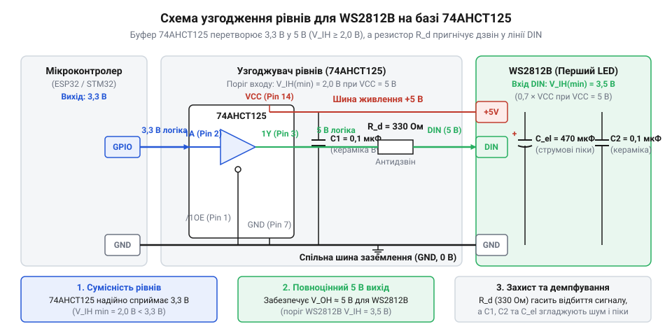
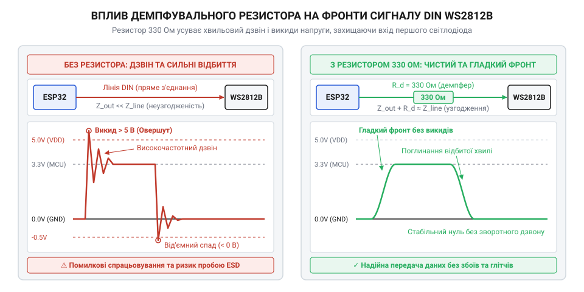
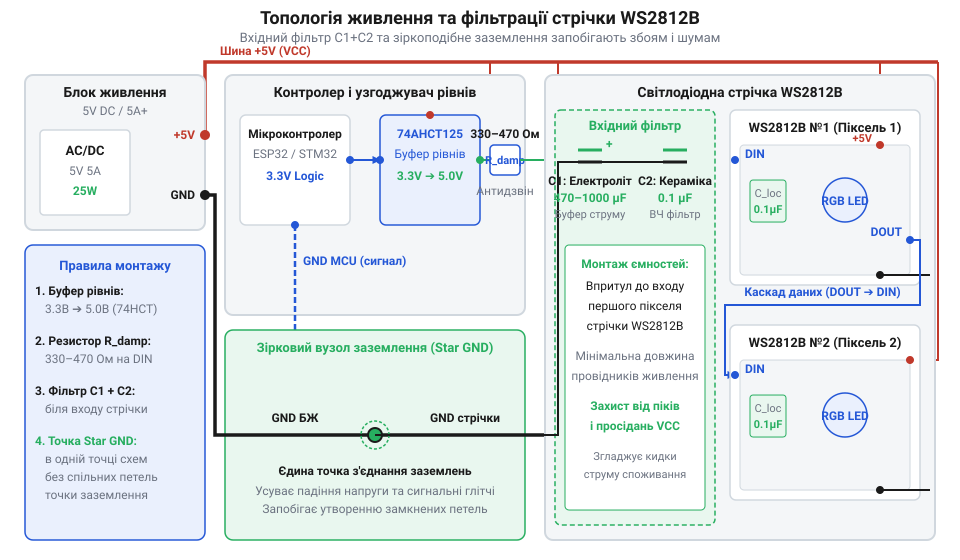

# Проектування схеми живлення та узгодження ліній даних WS2812B

<preknowlist>
- [KY-016 — RGB-світлодіод](root:cat-hw-actuators/ky-016-rgb) — принципи функціонування триколірних RGB-випромінювачів та змішування кольорів для отримання необхідного спектра
</preknowlist>

## Мерехтіння та збої при підключенні

Складання світлодіодного масиву на базі смарт-пікселів @@en|WS2812B@@ здається простим завданням: достатньо подати живлення 5 В, з'єднати спільну землю та підключити лінію даних `DIN` до виводу @@en|GPIO@@ мікроконтролера @@en|ESP32@@ або @@en|STM32@@. Проте при запуску анімації стрічка поводиться нестабільно: окремі світлодіоди мерехтять сторонніми кольорами, послідовність зависає, а пікселі світяться білим або не реагують на команди.

На відміну від звичайних [RGB-світлодіодів KY-016](root:cat-hw-actuators/ky-016-rgb) або [модулів RGB SMD](root:cat-hw-actuators/ky-009-rgb-smd), @@en|WS2812B@@ містить усередині цифровий чип керування. Він декодує часові інтервали високочастотних імпульсів для формування струмів трьох каналів. Спотворення сигналу на вході `DIN` змушує контролер зчитувати помилкові біти й втрачати синхронізацію.

Фізична причина збоїв криється у двох чинниках: недотриманні порогів логічних напруг та імпульсних сплесках струму. Вихідна напруга 3,3 В мікроконтролера перебуває на межі спрацьвування вхідного компаратора 5-вольтового @@en|WS2812B@@, тому найменша завада перетворює логічну одиницю на нуль.

Другий чинник — імпульсні просідання живлення. При перемиканні на білий колір струм одного пікселя зростає до 60 мА, що створює стрибок струму в кілька ампер для всієї стрічки. Опір провідників викликає падіння напруги `V_CC` та імпульсну різницю потенціалів на шині землі (англ. @@en|ground bounce@@, від @@en|ground@@ — земля, @@en|bounce@@ — відскок). Через це опорні потенціали мікроконтролера та світлодіода розходяться, погіршуючи розпізнавання сигналів.

Діагностувати характер збою можна за симптомами: якщо кольори спотворюються на першому пікселі на будь-якій яскравості — порушено цілісність сигналу `DIN`. Якщо ж стрічка працює на низькій яскравості, але збоїть на повній потужності — причиною є просідання живлення та завади на шинах заземлення.

## Аналіз логічних рівнів і завад

Пряме з'єднання мікроконтролера 3,3 В із 5-вольтовим світлодіодом @@en|WS2812B@@ спричиняє збої через несумісність логічних рівнів. Передача даних здійснюється по єдиному провідникові за однопровідним асинхронним протоколом із тактовою частотою 800 кГц, де бітовий період становить 1,25 мкс. Логічний нуль кодується високим імпульсом `T_0H` тривалістю 220–380 нс, а логічна одиниця — `T_1H` тривалістю 580–1000 нс. Наносекундні часові інтервали вимагають від вхідного компаратора точно визначати моменти наростання та спаду напруги на виводі `DIN`.

Вирішальним параметром надійності є мінімальна напруга логічної одиниці `V_IH_min`, яка жорстко прив'язана до напруги живлення `V_CC`.

Розрахуємо мінімальний поріг логічної одиниці `V_IH_min` відносно напруги живлення `V_CC`:

```
V_IH_min = 0.7 × V_CC
= 0.7 × 5.0 V      [підстановка номінальної напруги живлення]
= 3.5 V            [мінімальний поріг логічної одиниці]
```

З виведеного розрахунку видно, що при живленні 5 В чип @@en|WS2812B@@ сприймає сигнал як логічну одиницю лише тоді, коли напруга на вході `DIN` досягає або перевищує 3,5 В.

Водночас мікроконтролери @@en|ESP32@@ або @@en|STM32@@ живляться від 3,3 В. Вихідна напруга логічної одиниці `V_OH` на виводах @@en|GPIO@@ під навантаженням становить лише 3,1–3,3 В.

Обчислимо різницю між вихідною напругою мікроконтролера `V_OH` та мінімальним порогом `V_IH_min`:

```
V_OH - V_IH_min = 3.3 V - 3.5 V
= -0.2 V           [дефіцит амплітуди логічного сигналу]
```

Отриманий від'ємний результат показує дефіцит напруги 0,2 В. Сигнал мікроконтролера потрапляє в невизначену зону між логічним нулем `V_IL_max` (`0.3 × V_CC = 1.5 V`) та одиницею `V_IH_min` (3,5 В). У цій зоні компаратор працює нестабільно: високочастотні шуми чи наводки перетворюють тривалий імпульс логічної одиниці `T_1H` на короткий спалах, який розпізнається як `T_0H`.

Паразитна ємність та індуктивність лінії погіршують ситуацію. На частоті 800 кГц круті фронти викликають відбиття сигналу та високочастотний дзвін (англ. @@en|ringing@@, від @@en|ring@@ — дзвеніти). Від'ємні півхвилі дзвону провалюють амплітуду 3,3 В нижче порогу спрацьвування, спотворюючи часові інтервали.

Оскільки світлодіоди з'єднані ланцюговим підключенням (англ. @@en|daisy chain@@, від @@en|daisy@@ — маргаритка, @@en|chain@@ — ланцюг), перший піксель приймає потік, забирає 24 біти для власних кристалів @@en|RGB@@ і ретранслює решту через вивід `DOUT` з амплітудою 5 В. Помилка зчитання на першому пікселі через дефіцит напруги спотворює дані для всієї стрічки.

## Узгодження рівнів на 74AHCT125

Для усунення розбіжності напруг між 3,3-вольтовим мікроконтролером та 5-вольтовою сигнальною лінією необхідний активний перетворювач логічних рівнів (англ. @@en|level shifter@@, від @@en|shift@@ — зсувати). Модулі на пасивних польових транзисторах (англ. @@en|MOSFET@@, від @@en|metal-oxide-semiconductor field-effect transistor@@) затягують фронти: їхній підтягувальний резистор (англ. @@en|pull-up resistor@@, від @@en|pull@@ — тягнути, @@en|up@@ — вгору) з ємністю лінії створює постійну часу `RC`. На частоті 800 кГц фронт затримується на 200–500 нс, спотворюючи `T_0H` та `T_1H`.

Надійне рішення — активний буфер `74AHCT125` (англ. @@en|AHCT@@, Advanced High-Speed CMOS with TTL-compatible inputs). Завдяки TTL-сумісним входам при живленні `V_CC = 5,0 В` поріг високого рівня `V_IH min` становить 2,0 В.

Обчислимо запас завадостійкості `V_margin` при поєднанні виходу мікроконтролера 3,3 В (`V_OH`) із входом буфера (`V_IH min`):

```
V_margin = V_OH - V_IH_min_AHCT
= 3.3 V - 2.0 V    [обчислення різниці напруг]
= 1.3 V            [гарантований запас завадостійкості]
```

Запас 1,3 В забезпечує надійне розпізнавання логічної одиниці. Потужний вихідний каскад типу @@en|push-pull@@ (англ. @@en|push-pull@@, від @@en|push@@ — штовхати, @@en|pull@@ — тягнути) формує 5-вольтний сигнал із фронтами менше 5 нс.


*Схема активного узгодження рівнів 3,3 В в 5 В на базі буфера 74AHCT125 із заземленим виводом дозволу OE та послідовним демпфувальним резистором на лінії DIN.*

Мікросхема `74AHCT125` містить чотири буфери. Один канал підключають за схемою:
- `VCC` (ніжка 14) — до +5 В, `GND` (ніжка 7) — до спільної землі. - Вхід дозволу `1OE` (англ. @@en|Output Enable@@, від @@en|enable@@ — уможливлювати, ніжка 1) — до `GND` (активний низький рівень). - Інформаційний вхід `1A` (ніжка 2) — до виводу @@en|GPIO@@ 3,3 В. - Вихід `1Y` (ніжка 3) — на вхід `DIN` першого світлодіода через послідовний резистор `R_s` (33–470 Ом, типово 330 Ом).

Невикористані входи (2A, 3A, 4A, 2OE, 3OE, 4OE) підключають до землі або `VCC`, запобігаючи плаваючому стану КМОН-структур і наскрізним струмам. Резистор `R_s` біля виходу `1Y` узгоджує низький вихідний опір буфера (20–50 Ом) із хвильовим опором лінії (100–150 Ом), гасячи відбиття сигналу та захищаючи вхід @@en|WS2812B@@. Для детального аналізу електричних параметрів, часових затримок та схемотехніки застосування буферів дивіться статтю про [логіку серії 74AHCT у системній схемотехніці](root:cat-hw-parts/74ahct-logic-family).

## Демпфування сигналу та гасіння відбиттів

При з’єднанні виходу буфера @@en|74AHCT125@@ із входом `@@en|DIN@@` масиву `@@en|WS2812B@@` провідником довжиною понад 15–20 см світлодіоди можуть хаотично блимати навіть при коректному логічному рівні 5 В.

Двотактний вихід (англ. @@en|push-pull@@, від *push* — штовхати та *pull* — тягнути) буфера @@en|74AHCT125@@ має час наростання фронту `t_r` лише 2–5 нс (високий @@en|slew rate@@). Якщо тривалість фронту стає сумірною з подвійним часом проходження імпульсу вздовж дроту, провідник перетворюється на лінію передачі (англ. @@en|transmission line@@) із хвильовим опором `Z_0 = 50–120 Ом`.

Вхід `@@en|DIN@@` мікросхеми `@@en|WS2812B@@` є комплементарним польовим входом (англ. @@en|CMOS@@, *Complementary Metal-Oxide-Semiconductor*) із високим опором (`R_in > 1 МОм`) та малою ємністю (`C_in ≈ 5–10 пФ`). Для високочастотного фронту такий вхід є розірваним колом, від якого сигнальна хвиля відбивається назад. Інтерференція хвиль викликає сплески перенапруги (англ. @@en|overshoot@@), від'ємні просідання (англ. @@en|undershoot@@) та загасаючий дзвін (англ. @@en|ringing@@).

Ці коливання призводять до двох проблем:
1. Сплески понад 7–8 В можуть пробити внутрішні діоди захисту від електростатичного розряду (англ. @@en|ESD@@, *Electrostatic Discharge*) або підзатворний діелектрик вхідного @@en|CMOS@@-транзистора. 2. Повторні переходи напруги через пороговий рівень сприймаються декодером `@@en|WS2812B@@` як хибні імпульси, порушуючи таймінги протоколу 800 кГц та зсуваючи біти.

Для гасіння відбиттів застосовують демпфування (англ. @@en|damping@@, від нім. *Dämpfung* — глушіння) — послідовне увімкнення резистора `R_s` біля виходу буфера. Оптимальний опір демпфувального резистора `R_s` обчислюють як різницю між хвильовим опором лінії `Z_0` та внутрішнім вихідним опором буфера `R_out`:

```
R_s = Z_0 - R_out
    = 75 Ом - 15 Ом          [підстановка типового хвильового опору лінії та вихідного опору push-pull]
    = 60 Ом                 [обчислення оптимального демпфувального опору]
```

Вирахований опір поглинає відбиту хвилю під час її повернення до джерела. На практиці номінал `R_s` обирають у діапазоні 33–470 Ом (найчастіше 68–330 Ом). Для [триколірних світлодіодів](root:cat-hw-actuators/ky-016-rgb) або елементів з [набору 5мм світлодіодів](root:cat-hw-actuators/led-5mm-kit) це забезпечує узгодження імпедансу (англ. @@en|impedance matching@@) і повністю пригнічує дзвін при збереженні крутизни фронту.


*Порівняльна осцилограма сигналу DIN показує високочастотний дзвін без демпфувального резистора та усунення відбиттів із збереженням крутих фронтів після встановлення резистора 330 Ом.*

Вибір номіналу `R_s` вимагає балансу:
- Занадто малий опір (< 22 Ом) недостатньо гасить відбиту хвилю, залишаючи @@en|ringing@@. - Занадто великий (> 470 Ом) разом із `C_in` утворює RC-фільтр з постійною часу `τ = R_s · C_in`. Це збільшує `t_r > 150 нс`, спотворюючи тривалість імпульсів (`T_0H`, `T_1H`) або спричиняючи хибне скидання (RESET). Докладніше про фізичні принципи поширення високочастотних сигналів та узгодження імпедансів читайте у матеріалі про [хвильовий опір та узгодження ліній передачі](root:com-medium/characteristic-impedance).

## Фільтрація живлення та топологія шин

Навіть за узгодженої лінії даних `@@en|DIN@@` масив `@@en|WS2812B@@` може поводитися нестабільно: мерехтіти чи зависати через динаміку споживання струму. Кожен піксель містить RGB-випромінювачі та драйвер `@@en|PWM@@`, що споживає від 20 мА (один колір) до 60 мА (біле світло). У масиві зі 100 світлодіодів одночасне перемикання створює стрибок струму до 6 А за мікросекунди.

Паразитна індуктивність `L_line` та опір `R_line` провідників перетворюють цей стрибок `ΔI / Δt` на імпульсне просідання живлення нижче 3.5 В, що скидає цифрове ядро `@@en|WS2812B@@`. Зворотний струм через шину `@@en|GND@@` викликає підскок потенціалу землі `@@en|ground bounce@@`, зміщуючи пороги логічних рівнів на вході `@@en|DIN@@` і спричиняючи спотворення бітів.

Для компенсації цих завад використовують двокаскадне декуплювання (англ. @@en|decoupling@@, від фр. *coupler* — з'єднувати).

Перший каскад — локальні керамічні конденсатори ємністю 100 нФ, розміщені біля виводів `@@en|VCC@@` та `@@en|GND@@` кожного `@@en|WS2812B@@` чи групи на [світлодіодних модулях](root:cat-hw-actuators/ky-009-rgb-smd). Завдяки низьким еквівалентному послідовному опору `@@en|ESR@@` та індуктивності `@@en|ESL@@` вони миттєво віддають заряд під час перемикань `@@en|PWM@@`, пригнічуючи високочастотні шуми.

Другий каскад — накопичувальний електролітичний конденсатор `@@en|bulk capacitor@@` ємністю 100–1000 мкФ на вхідному роз'ємі живлення масиву. Він слугує резервуаром енергії, що згладжує низькочастотні кидки струму при зміні яскравості стрічки.

Необхідну накопичувальну ємність `C_bulk` розраховують за максимально допустимим просіданням напруги `ΔV` при стрибку струму `ΔI` тривалістю `Δt`.

**Розрахунок ємності `C_bulk` для масиву з 75 світлодіодів (`ΔI` = 4.5 А, `Δt` = 100 мкс, `ΔV` = 0.2 В):**
```
C_bulk = (ΔI × Δt) ÷ ΔV
       = (4.5 А × 100 мкс) ÷ 0.2 В      [підстановка параметрів масиву]
       = 0.00045 А·с ÷ 0.2 В             [обчислення заряду]
       = 0.00225 Ф                        [обчислення ємності у фарадах]
       = 2250 мкФ                         [переведення в мікрофаради]
```

Для компенсації кидка 4.5 А потрібна ємність ~2200 мкФ. На практиці паралельно шині 5 В ставлять електролітичний конденсатор на 1000–2200 мкФ із робочою напругою від 6.3 В.

При послідовному живленні `@@en|daisy chain@@` струм усього масиву протікає через тонкі доріжки стрічки. Через їхній омічний опір напруга наприкінці стрічки з 5.0 В може впасти до 3.5 В, спричиняючи спотворення кольорів (білий колір жовтіє).

Рішенням є зіркова топологія `@@en|star topology@@` або паралельне інжектування живлення.


*Схема топологічного розведення шин живлення та заземлення з поєднанням локальних керамічних конденсаторів та вхідної електролітичної ємності.*

Для реалізації топології провідники `@@en|VCC@@` та `@@en|GND@@` перерізом 0.75 мм² (AWG 18) підключають до стрічки кожні 1–2 метри з обох боків. Лінію `@@en|DIN@@` прокладають паралельно та впритул до `@@en|GND@@`: петлі між сигналом і землею утворюють антену, що ловить завади й підсилює `@@en|ground bounce@@`. Це забезпечує стабільність роботи як [автономних світлодіодів](root:cat-hw-actuators/ky-034-flash) і [сенсорних модулів](root:cat-hw-actuators/ky-027-magic-cup), так і довгих матрицій. Докладніше про вибір конденсаторів та проєктування схеми розведення шин живлення дивіться у статті про [топологію живлення та фільтрацію масивів WS2812B](root:cat-hw-actuators/ws2812b-led/proj-ws2812b-power-signal-conditioning.md).