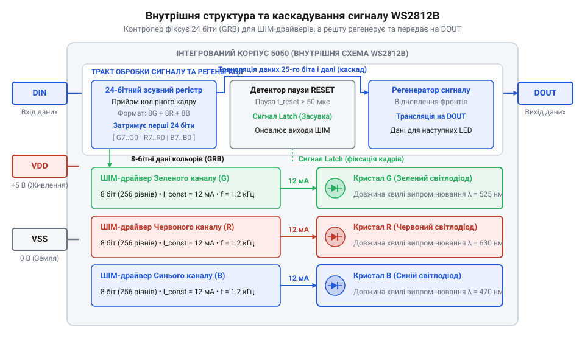
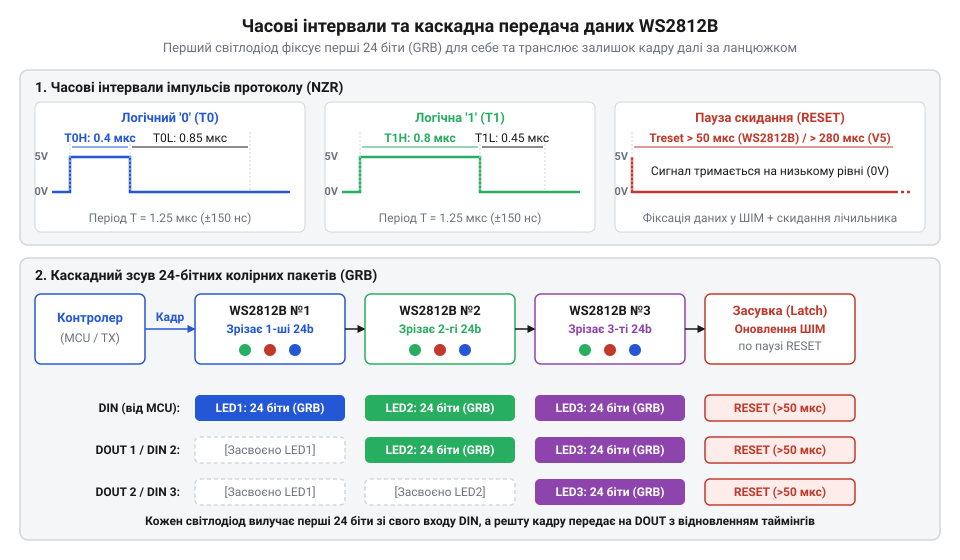
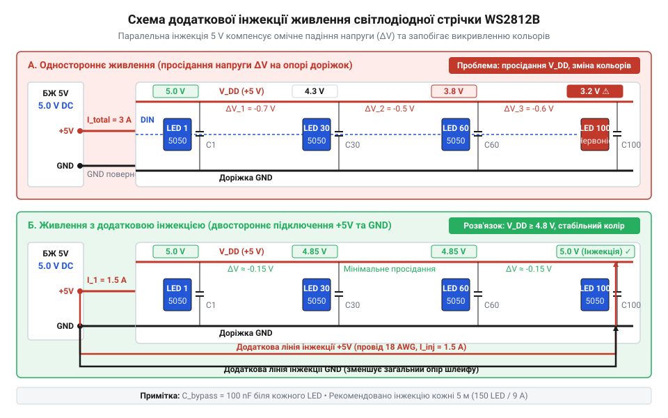
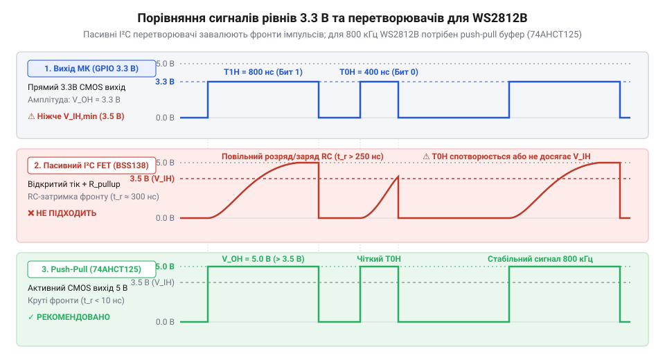

# WS2812B — адресний RGB-світлодіод (5050)

<preknowlist>
- [KY-016 — RGB-світлодіод](root:cat-hw-actuators/ky-016-rgb) — Принцип змішування кольорів аддитивної моделі RGB через трьохкристальну структуру та індивідуальне керування каналами.
- [KY-009 — RGB SMD-модуль](root:cat-hw-actuators/ky-009-rgb-smd) — Особливості поверхневого монтажу (SMD) RGB-світлодіодів, їхні електричні параметри та загальний анод/катод.
</preknowlist>

## Проблема масштабування колірної індикації пристроїв

Уявіть практичну задачу розробки електронного пристрою: вам необхідно створити динамічний світлодіодний індикатор, матричний дисплей або систему підсвічування, що здатна відображати багатоколірні анімації та сповіщати користувача про стан системи. Перше інтуїтивне рішення, до якого вдається інженер, — це використання класичних дискретних світлодіодів. Якщо для одноколірних сигналів достатньо застосувати [простий 5-міліметровий світлодіод](root:cat-hw-actuators/led-5mm-kit), де один вивід мікроконтролера керує одним джерелом світла, то для повноколірного змішування потрібні складніші компоненти.

Для отримання довільних колірних відтінків традиційно використовують дискретні RGB-модулі — наприклад, вивідний [KY-016 RGB світлодіод](root:cat-hw-actuators/ky-016-rgb) або поверхневий [KY-009 RGB SMD модуль](root:cat-hw-actuators/ky-009-rgb-smd). Усі вони побудовані на принципі адитивного змішування трьох основних кольорів: червоного (англ. @@en|Red@@), зеленого (англ. @@en|Green@@) та синього (англ. @@en|Blue@@). Усередині корпусу такого світлодіода розміщено три окремі напівпровідникові кристали, об'єднані спільним анодом або катодом. Щоб сформувати необхідний колір, мікроконтролер повинен подавати індивідуальні сигнали широтно-імпульсної модуляції (англ. @@en|pulse-width modulation@@, @@en|PWM@@) на кожен із трьох виводів кристалів, регулюючи відносну яскравість кожного каналу.

Поки у вашому пристрої використовується один або два RGB-світлодіоди, таке керування є простим і прозорим. Однак під час спроби масштабувати систему до десятки або сотні світлодіодів розробник негайно стикається з фізичним і системним глухим кутом. Розрахуємо кількість необхідних виводів (англ. @@en|GPIO pins@@) мікроконтролера `N_pins` для безпосереднього керування масивом із `N` дискретних RGB-світлодіодів:

```
N_pins = 3 × N                            [кількість виводів для N дискретних RGB-світлодіодів]
```

При звичайному прямому підключенні для 10 світлодіодів знадобиться 30 керуючих виводів мікроконтролера, а для матриці 8×8 (64 світлодіоди) — 192 окремі лінії. Жоден стандартний мікроконтролер у компактному корпусі не має такої кількості вільних портів введення-виведення.

Більше того, обмеження полягає не лише у кількості ніжок. Кожен кристал вимагає окремого апаратного каналу ШІМ-генератора для плавного регулювання яскравості. Більшість мікроконтролерів мають лише від 4 до 12 апаратних таймерів-ШІМ. Якщо ж реалізовувати ШІМ-регулювання програмним способом (англ. @@en|software PWM@@), мікроконтролер повинен генерувати переривання з частотою у кілька кілогерців для кожного каналу, щоб уникнути людського помітного миготіння (англ. @@en|flicker@@). При обробці десятків каналів процесорний час (англ. @@en|CPU execution time@@) буде повністю вичерпано обслуговуванням таймерних переривань, не залишаючи ресурсів для виконання основної логіки програми.

Додатково виникає проблема фізичного розведення друкованої плати (англ. @@en|PCB routing nightmare@@). Величезна кількість паралельних провідників створює громіздкі джгути або вимагає багатошарових плат, підвищуючи паразитичну індуктивність та рівень електромагнітних завад (англ. @@en|electromagnetic interference@@, @@en|EMI@@).

Апаратні спроби вирішити цю проблему через матричне сканування (англ. @@en|multiplexing@@) або зовнішні зсувні регістри (наприклад, 74HC595 чи спеціалізовані мікросхеми TLC5940) суттєво ускладнюють принципову схему та зменшують максимальну яскравість світлодіодів за рахунок низького коефіцієнта заповнення робочого циклу.

Радикальним розв'язанням цієї проблеми стала концепція смарт-пікселя (англ. @@en|smart pixel@@ — розумний піксель). Ідея полягає у тому, щоб винести керуючу електронну логіку безпосередньо в корпус світлодіода. Замість трьох аналогово-ШІМ ліній керування на кожен піксель, смарт-піксель приймає цифрові дані колірного кадру через єдиний послідовний цифровий провідник (англ. @@en|single-wire data bus@@). Усередині корпусу смарт-пікселя розміщується власна пам'ять та автономні ШІМ-драйвери: мікроконтролер надсилає колірний код один раз, після чого інтегрована мікросхема самостійно й безперервно підтримує задану яскравість усіх трьох кристалів.

Шлях до інтегрованих смарт-пікселів пройшов кілька еволюційних етапів у мікроелектроніці. Спочатку розробники відокремлювали керуючий драйвер від світлодіодів, створивши спеціалізовані мікросхеми на кшталт @@en|WS2801@@, які використовували двопровідний інтерфейс (лінію тактування та лінію даних) для керування зовнішніми дискретними RGB-випромінювачами. Наступним кроком стала мікросхема @@en|WS2811@@, яка впровадила високошвидкісний однопровідний часоімпульсний протокол з частотою 800 кГц, що дозволило повністю відмовитися від окремої тактової лінії, хоча драйвер все ще монтувався як окремий корпус поруч із світлодіодами. Справжнім технологічним проривом стало об'єднання кристал-драйвера @@en|WS2811@@ та трьох високояскравих напівпровідникових випромінювачів RGB в єдиному стандартному корпусі поверхневого монтажу SMD 5050 (габаритами 5.0 × 5.0 мм), що дало початок першому поколінню адресних світлодіодів @@en|WS2812@@. Подальша оптимізація привела до створення модифікації @@en|WS2812B@@, де було оптимізовано внутрішню топологію кремнієвого кристала, зменшено кількість зовнішніх виводів із шести до чотирьох (усунуто дубльовані лінії живлення), покращено відведення тепла за рахунок збільшеної площі підкладки, підвищено оптичну яскравість кристалів та інтегровано вбудований захист від переполюсовки живлення, що запобігає вигоранню мікросхеми при помилковому підключенні напруги. Про наступні покоління чипів із резервуванням лінії даних та підвищеною напругою живлення читайте в матеріалі про [адресні світлодіоди WS2813 та WS2815 із резервним каналом даних та підвищеною напругою живлення](root:cat-hw-actuators/ws2813-and-ws2815-redundant-addressable-leds).

Завдяки архітектурі смарт-пікселя кількість керуючих виводів мікроконтролера `N_pins_smart` для послідовного ланцюжка будь-якої довжини зменшується до одиниці:

```
N_pins_smart = 1                          [єдина цифрова лінія даних DIN від мікроконтролера]
```

Оцінимо інформаційне навантаження на шину даних при керуванні послідовним масивом адресних світлодіодів. Для одного смарт-пікселя потрібно передати 24 біти колірної інформації (по 8 біт на кожен із трьох каналів). Якщо ланцюжок містить `N_led` світлодіодів, а частота оновлення кадрів становить `f_frame` Гц, то необхідна інформаційна швидкість передачі даних `B_payload` (у бітах за секунду) обчислюється за формулою:

```
B_payload = N_led × 24 × f_frame          [обсяг колірних даних за секунду]
```

Обчислимо необхідну інформаційну швидкість для стрічки з `N_led = 60` світлодіодів при стандартній частоті оновлення `f_frame = 30` кадрів/с:

```
B_payload = 60 × 24 × 30                  [підстановка кількості пікселів, біт та частоти кадрів]
          = 43200 біт/с                   [результуюча інформаційна швидкість шини]
          = 43.2 кбіт/с
```

Як видно з розрахунку, інформаційний потік у 43.2 кбіт/с легко забезпечується навіть найпростішими мікроконтролерами, а головне — після завершення передачі кадру мікроконтролер повністю звільняється від завдання підтримання яскравості. Ширший огляд різновидів адресних світлодіодних компонентів та стрічок ви можете знайти в [огляді родини адресних світлодіодів](root:cat-hw-actuators/addressable-led-family-overview).

Зрозумівши концепцію смарт-пікселя, розглянемо внутрішню фізичну будову корпусу @@en|WS2812B@@ та функціональні блоки його вбудованого контролера.

## Будова корпусу та функціональні блоки

Адресний світлодіод @@en|WS2812B@@ виконано у стандартному термостійкому пластиковому корпусі для поверхневого монтажу SMD 5050 з зовнішніми габаритами 5.0 × 5.0 × 1.6 мм. Корпус виготовлено з термопласту PPA білого кольору та залито прозорою компаундною епоксидною смолою (англ. @@en|epoxy resin@@), яка захищає внутрішні напівпровідникові кристали від механічних пошкоджень та вологи, одночасно слугуючи оптичним лінзовим дифузором.

На відміну від попередніх версій, корпус @@en|WS2812B@@ має лише чотири зовнішні металеві виводи:
1. `VDD` — вивід живлення внутрішньої логіки та світлодіодних кристалів (номінальна напруга +5.0 В, допустимий діапазон від +3.5 В до +5.3 В). 2. `VSS` — спільний вивід заземлення (0 В / GND). 3. `DIN` — вхідний вивід цифрових даних (англ. @@en|Data Input@@). 4. `DOUT` — вихідний вивід цифрових даних (англ. @@en|Data Output@@) для каскадування наступного пікселя.

Детальні електричні параметри, допустимі струми та напруги виводів наведено в [апаратному довіднику характеристик WS2812B](root:cat-hw-actuators/ws2812b-led/api-ws2812b-hardware-spec.md).

Усередині корпуса на єдиній рамці-підкладці (англ. @@en|lead frame@@) розташовано чотири окремі кремнієві та напівпровідникові кристали, з'єднані між собою золотими мікропровідниками методом ультразвукового зварювання:
- Кристал червоного випромінювання (структура InGaAlP, довжина хвилі `λ_R ≈ 620...630 нм`). - Кристал зеленого випромінювання (структура InGaN, довжина хвилі `λ_G ≈ 515...530 нм`). - Кристал синього випромінювання (структура InGaN, довжина хвилі `λ_B ≈ 465...475 нм`). - Кремнієва інтегральна мікросхема керування (мікроконтролер / чіп-контролер, англ. @@en|Control IC@@).

Інтегрована мікросхема керування містить п'ять основних функціональних блоків:

1. **Вхідний буфер і компаратор рівнів** (англ. @@en|input buffer and comparator@@): Вхідний блок підключається безпосередньо до виводу `DIN`. Він здійснює фільтрацію високочастотних завад та порівнює вхідну напругу з внутрішніми опорними порогами логічного нуля та одиниці (`V_IH ≥ 0.7 · VDD`, `V_IL ≤ 0.3 · VDD`).

2. **Часоімпульсний декодер** (англ. @@en|timing decoder@@): Оскільки протокол @@en|WS2812B@@ є однопровідним, логічний стан нуля '0' чи одиниці '1' кодується тривалістю високого рівня напруги на виводі `DIN`. Вбудований декодер містить високостабільний генератор тактової частоти (англ. @@en|internal oscillator@@) з частотою близько 12 МГц. Декодер вимірює тривалість станів імпульсу та визначає, яке значення прийнято (для '0' тривалість високого рівня `T_0H ≈ 220...380 нс`, для '1' — `T_1H ≈ 580...1000 нс`). Також декодер розпізнає паузу скидання (RESET) тривалістю понад 50 мкс (у новіших ревізіях понад 280 мкс). Часові допуски сигналів детально описано в [описі протоколу передачі даних WS2812B](root:cat-hw-actuators/ws2812b-led/api-ws2812b-protocol-timing.md).

3. **24-бітний зсувний регістр** (англ. @@en|24-bit shift register@@): Послідовний потік бітів із декодера надходить у внутрішній 24-бітний зсувний регістр. Дані записуються у чітко визначеній послідовності GRB: спочатку 8 біт зеленого кольору (від старшого біта `G7` до молодшого `G0`), потім 8 біт червоного кольору (`R7...R0`), і нарешті 8 біт синього кольору (`B7...B0`).

4. **24-бітний регістр-фіксатор (засувка даних)** (англ. @@en|24-bit data latch@@): Щоб під час передачі даних уздовж ланцюжка світлодіод не змінював свою яскравість і не миготів, приймальний зсувний регістр ізольовано від вихідних драйверів. Лише коли на вхід `DIN` надходить пауза низького рівня RESET, внутрішня логіка генерує сигнал strobe, і всі 24 біти одночасно копіюються зі зсувного регістра у 24-бітний регістр-фіксатор.

5. **Три 8-бітні ШІМ-драйвери та стабілізатори струму** (англ. @@en|PWM drivers and constant current sources@@): З регістра-фіксатора 8-бітні цифрові значення подаються на три незалежні ШІМ-генератори. Кожен канал забезпечує `2⁸ = 256` дискретних рівнів яскравості (від 0 до 255). 

Загальна кількість відтворюваних колірних комбінацій `N_colors` TrueColor обчислюється як добуток градацій трьох каналів:

```
N_colors = 256 × 256 × 256            [комбінація 8-бітних рівнів Green, Red, Blue]
         = 16777216                   [кількість відображуваних відтінків TrueColor]
```

ШІМ-генератори керують вбудованими джерелами стабілізованого струму (англ. @@en|constant current driver@@). Кожен кристал отримує фіксований струм близько 12 мА (у деяких модифікаціях до 18 мА) у відкритому стані ШІМ. Завдяки генераторам стабільного струму яскравість і колір кристалів залишаються незмінними навіть при невеликих просіданнях напруги живлення `VDD`. Внутрішня частота ШІМ-модуляції становить близько 400 Гц (у ревізії WS2812B-V5 підвищена до 2 кГц), що забезпечує злиття імпульсів світла в суцільний колір без видимого пульсування.

6. **Схема регенерації та формування сигналу** (англ. @@en|signal reshaping circuit / shaping amplifier@@): Це один із найважливіших функціональних блоків @@en|WS2812B@@. При проходженні цифрового сигналу через довгі провідники друкованої плати імпульси спотворюються під дією паразитної ємності й опору ліній: фронти завалюються, а тривалість високого рівню змінюється. Схема регенерації підключається між внутрішнім селектором даних та вихідним виводом `DOUT`. Вона повністю відновлює прямокутну форму імпульсу, відновлює крутизну фронтів та підсилює амплітуду напруги до повного рівня `VDD`. Завдяки цьому кожен світлодіод працює як активний цифровий ретранслятор (англ. @@en|active signal repeater@@).

Внутрішню топологію корпусу, розташування кристалів та схему з'єднання функціональних блоків контролера показано на принциповій схемі.


*Внутрішня архітектура WS2812B: інтеграція вхідного буфера, зсувного регістра, регістрів-фіксаторів, ШІМ-драйверів кристалів RGB та регенеративного каскаду DOUT у корпусі 5050.*

Простежимо повний алгоритм проходження колірного кадру через внутрішні блоки світлодіода:

1. **Фаза прийому власного пакета**: Після подачі живлення або завершення паузи RESET внутрішній лічильник бітів чіпа скидається в 0. Сигнал із виводу `DIN` спрямовується у 24-бітний зсувний регістр. Перші 24 біти (послідовність GRB), що надходять від мікроконтролера, послідовно заповнюють регістр даного світлодіода.

2. **Фаза перемикання селектора та ретрансляції**: Як тільки внутрішній лічильник відраховує рівно 24 біти, внутрішній мультиплексор чіпа автоматично перемикає вхідний потік. Усі наступні біти (з 25-го і далі), що продовжують надходити на `DIN`, більше не потрапляють у внутрішній регістр поточного світлодіода. Вони спрямовуються безпосередньо на вход схеми регенерації сигналу і виходять через вивід `DOUT` на вхід `DIN` наступного за ланцюжком світлодіода.

3. **Фаза фіксації та оновлення кадру (RESET)**: Коли мікроконтролер передав колірні пакети для всіх світлодіодів стрічки, він утримує лінію даних у низькому стані (0 В) протягом часу `T_RESET > 50 мкс`. Часоімпульсний декодер кожного світлодіода фіксує тривалу паузу і генерує внутрішній імпульс засувки. Дані з 24-бітного зсувного регістра копіюються у регістр-фіксатор, і ШІМ-драйвери миттєво змінюють коефіцієнт заповнення для кристалів G, R, B. Одночасно внутрішній лічильник бітів скидається в 0, і чіп повертається у стан очікування нового кадру.

Правильне проектування плати, вибір захисних резисторів сигналу та обхідних конденсаторів живлення розглянуто в [проекті схеми живлення та узгодження ліній](root:cat-hw-actuators/ws2812b-led/proj-ws2812b-power-signal-conditioning.md), а організацію високоефективного керування через периферійні модулі мікроконтролера висвітлено у [практичній реалізації апаратного DMA-драйвера](root:cat-hw-actuators/ws2812b-led/proj-ws2812b-dma-driver.md).

## Часоімпульсний протокол і каскадний зсув

Уявіть фізичну задачу передачі колірної інформації на сотні незалежних світлодіодів у складі єдиної стрічки. Якщо застосувати класичну шину SPI з окремим провідником тактування (англ. @@en|Clock@@), пристрій вимагатиме щонайменше двох цифрових ліній та відповідних апаратних контролерів у кожному корпусі. Щоб мінімізувати кількість фізичних провідників, розробники @@en|WS2812B@@ відмовилися від окремого тактового сигналу на користь однопровідної шини даних. Проте відсутність спільної тактової лінії створює принциповий виклик: як приймач (інтегрована мікросхема в корпусі світлодіода) може розпізнати межі окремих бітів та відрізнити логічний нуль '0' від логічної одиниці '1', спираючись лише на один цифровий провідник? Для проєктів, де критичні висока частота оновлення та відсутність жорстких часових допусків, розгляньте [двопровідні адресні світлодіоди APA102 та SK9822 з окремою лінією тактування](root:cat-hw-actuators/apa102-and-sk9822-two-wire-leds).

Розв'язанням цієї задачі стало часоімпульсне кодування (англ. @@en|pulse-width encoding@@) за принципом без повернення до нуля (англ. @@en|Non-Return-to-Zero@@, @@en|NRZ@@; від англійського *non* — ні, *return* — повернення, *zero* — нуль). Кожен біт інформації передається протягом суворо фіксованого часового інтервалу (періоду біта `T_BIT ≈ 1.25 мкс`, що відповідає інформаційній швидкості передачі 800 кбіт/с). Логічне значення біта визначається не рівнем напруги само по собі, а пропорцією (коефіцієнтом заповнення) тривалості високого рівня напруги `T_H` відносно тривалості низького рівня `T_L` у межах одного періоду `T_BIT`:

- **Логічний нуль ('0')**: передається коротким імпульсом високої напруги тривалістю `T_0H ≈ 220...380 нс` (типове значення 350 нс), після чого лінія переводиться в низький рівень на час `T_0L ≈ 580...1000 нс` (типове значення 900 нс). - **Логічна одиниця ('1')**: передається тривалим імпульсом високого рівня `T_1H ≈ 580...1000 нс` (типове значення 900 нс), за яким слідує короткий паузовий інтервал низького рівня `T_1L ≈ 220...380 нс` (типове значення 350 нс).

Вбудований часоімпульсний декодер світлодіода за допомогою внутрішнього 12-мегагерцового генератора тактів безперервно вимірює тривалість високого рівня `T_H`. Якщо високий стан триває коротше ніж 500 нс, чіп розпізнає біт як '0'; якщо ж тривалість перевищує 500 нс — як '1'. Суворі часові специфікації та діаграми допустимих відхилень імпульсів докладно наведено в [довіднику протоколу та часових інтервалів WS2812B](root:cat-hw-actuators/ws2812b-led/api-ws2812b-protocol-timing.md).

Особливу увагу при кодуванні слід приділити порядку прямування бітів у колірному пакеті. Кожен світлодіод @@en|WS2812B@@ потребує рівно 24 біти даних (по 8 біт на кожен із трьох кольорів), які надсилаються строго від старшого біта (англ. @@en|Most Significant Bit@@, @@en|MSB@@) до молодшого біта (англ. @@en|Least Significant Bit@@, @@en|LSB@@). Однак порядок проходження каналів у @@en|WS2812B@@ відрізняється від звичного колірного простору RGB: першим надсилається байт зеленого кольору (англ. @@en|Green@@, `G7...G0`), другим — байт червоного кольору (англ. @@en|Red@@, `R7...R0`), і лише третім — байт синього кольору (англ. @@en|Blue@@, `B7...B0`).

Ця послідовність отримала назву @@en|GRB format@@. Якщо програміст передасть дані у традиційній послідовності RGB, світлодіод переплутає червоний та зелений канали: при спробі увімкнути червоний колір пристрій засвітиться зеленим.

Розрахуємо тривалість передачі колірного пакета `T_pixel` для одного смарт-пікселя:

```
T_pixel = 24 × T_BIT                      [тривалість 24 бітів при періоді T_BIT = 1.25 мкс]
        = 24 × 1.25 мкс                   [підстановка тривалості одного біта]
        = 30 мкс                          [час передачі кадру для одного пікселя]
```

Таким чином, повна передача 24-бітного колірного коду для одного світлодіода займає рівно 30 мікросекунд.

Тепер простежимо, як здійснюється каскадне керування послідовним ланцюжком із `M` світлодіодів через єдину лінію даних `DIN`. Механізм базується на принципі послідовного зсуву та зрізання колірних пакетів (англ. @@en|data truncation@@, @@en|data slicing@@; від англійського *truncation* — усічення, обрізання).

Коли мікроконтролер починає передавати довгий покілобітний потік даних для всього ланцюжка, перший світлодіод (`LED1`) перебуває у стані прийому. Його внутрішній 24-бітний зсувний регістр (англ. @@en|shift register@@; від латинського *registrum* — список, запис) почергово приймає перші 24 біти із входу `DIN`. Протягом цього часу вихідний вивід `DOUT` першого світлодіода залишається у низькому стані, ізолюючи наступні елементи ланцюжка.

Як тільки `LED1` приймає 24-й біт, його внутрішній лічильник бітів фіксує заповнення регістра. У той же мікросекундний момент чіп-контролер `LED1` перемикає свій внутрішній цифровий селектор: власне приймальне ядро "замикається", а всі наступні біти (починаючи з 25-го і далі), що продовжують надходити на вхід `DIN`, спрямовуються безпосередньо на вхід схеми регенерації сигналу й виходять через вивід `DOUT`.

Для другого світлодіода (`LED2`) цей ретрансльований потік із 25-го біта виглядає як абсолютно новий початковий потік даних. `LED2` безперешкодно захоплює свої 24 біти (які для мікроконтролера були бітами з 25-го по 48-й), після чого аналогічно перемикає свій вихід `DOUT`. Цей процес просування даних повторюється за принципом "падаючого доміно" вздовж усіх `M` світлодіодів стрічки: кожен наступний піксель "зрізає" перші 24 біти із потоку, що дійшов до нього, і передає решту даних далі.

При цьому активна схема регенерації сигналу на виході `DOUT` кожного смарт-пікселя повністю відновлює прямокутну форму імпульсів та їхній амплітудний рівень до `VDD`, компенсуючи згасання й завалювання фронтів (англ. @@en|slew rate degradation@@) у довгому провіднику.


*Часові інтервали однопровідного протоколу WS2812B, формування бітів '0' та '1', механізм зрізання 24-бітних GRB-пакетів при каскадуванні та фіксація кадру за паузою RESET.*

Незважаючи на те, що колірні дані вже заповнили зсувні регістри всіх світлодіодів стрічки, світлодіоди все ще випромінюють старий колір. Це необхідно для того, щоб під час динамічного просування 24-бітних пакетів вздовж стрічки спостерігач не бачив хаотичного блимання й миготіння кристалів.

Щоб синхронно оновити зображення на всьому масиві, використовується механізм фіксації за допомогою паузи скидання (англ. @@en|RESET pause@@). Після закінчення передачі `24 × M` бітів для всіх світлодіодів мікроконтролер припиняє генерацію імпульсів і утримує лінію даних `DIN` у стані логічного нуля (0 В) протягом тривалого часу `T_RESET`.

Часоімпульсні декодери всіх світлодіодів у ланцюжку одночасно відстежують тривалість низького рівня. У перших ревізіях @@en|WS2812B@@ поріг розпізнавання паузи `T_RESET` становив понад 50 мікросекунд (`T_RESET > 50 мкс`). Однак у новіших модифікаціях (зокрема @@en|WS2812B-V5@@) мінімальну тривалість паузи було збільшено до `T_RESET > 280 мкс` для підвищення завадостійкості проти випадкових довготривалих сплесків на лінії.

Під час перевищення часу `T_RESET` внутрішня логіка кожного чіпа виконує дві послідовні дії:
1. Генерується внутрішній імпульс стробування (англ. @@en|strobe pulse@@; від грецького *strobos* — обертання, кружіння). Усі 24 біти, накопичені у зсувному регістрі, паралельно копіюються у внутрішній регістр-фіксатор (англ. @@en|data latch@@; від англійського *latch* — засувка, фіксатор). З цього моменту ШІМ-драйвери негайно змінюють коефіцієнт заповнення для кристалів зеленого, червоного та синього кольорів, і весь світлодіодний масив оновлює колір абсолютно одночасно. 2. Внутрішній лічильник прийнятих бітів у кожному світлодіоді скидається у початковий стан `0`. Вхідний селектор перемикається назад на внутрішній зсувний регістр, і світлодіоди переходять у стан очікування нового кадру.

Розрахуємо тривалість повного циклу оновлення кадру `T_frame` та максимально можливу частоту кадрів (англ. @@en|frame rate@@, `f_max`) для послідовного ланцюжка з `N_led` світлодіодів:

```
T_frame = N_led × T_pixel + T_RESET       [загальний час передачі кадру та паузи скидання]
        = N_led × 30 мкс + T_RESET        [підстановка часу передачі одного 24-бітного пікселя]
```

Приклад обчислення: розрахуємо максимальну частоту кадрів `f_max` для стрічки з `N_led = 144` світлодіоди при тривалості паузи скидання `T_RESET = 300 мкс`:

```
T_frame = 144 × 30 мкс + 300 мкс           [розрахунок часу передачі для 144 пікселів]
        = 4320 мкс + 300 мкс               [додавання часу зсуву та паузи скидання]
        = 4620 мкс
        = 4.62 мс

f_max = 1 / T_frame                        [формула максимальної частоти оновлення кадрів]
      = 1 / 0.00462 с                      [підстановка тривалості кадру в секундах]
      ≈ 216.45 Гц                          [максимальна кількість кадрів за секунду]
```

Як показує розрахунок, навіть при високій щільності 144 пікселі на метр стрічка здатна оновлюватися з частотою понад 216 кадрів/с, що значно перевищує поріг сприйняття людського ока (60 Гц) і забезпечує абсолютно плавну анімацію.

Водночас забезпечення жорстких наносекундних часових допусків (відхилення тривалості імпульсів не повинно перевищувати `±150 нс`) створює серйозну проблему при програмному формуванні сигналу (англ. @@en|bit-banging@@; від англійського *bit* — біт, *bang* — удар, пряме маніпулювання). Якщо під час передачі біта мікроконтролер буде перервано обробником переривання (англ. @@en|interrupt service routine@@, @@en|ISR@@), тривалість високого рівня `T_H` вийде за припустимі межі, і світлодіод зчитає логічну одиницю замість нуля, що призведе до спалаху помилкового кольору (англ. @@en|glitch@@).

Щоб уникнути подібних збоїв без блокування переривань, у сучасній мікроконтролерній техніці застосовують апаратне формування часових послідовностей. Для цього використовують периферійні модулі таймерів або інтерфейсу SPI у зв'язці з прямим доступом до пам'яті (англ. @@en|Direct Memory Access@@, @@en|DMA@@). Технологію [генерації високоточних імпульсних послідовностей через DMA](root:hw-arch/dma-precise-pulse-generation) детально розглянуто в системних матеріалах, а практичне проектування та програмний код для таймерного DMA-драйвера описано у [практичній реалізації апаратного DMA-драйвера](root:cat-hw-actuators/ws2812b-led/proj-ws2812b-dma-driver.md).

## Фізичні обмеження живлення та інжекція

Уявіть ситуацію: ви збираєте світлодіодну інсталяцію й підключаєте довгу гнучку стрічку з трьохсот адресних пікселів @@en|WS2812B@@ до п'ятивольтового джерела живлення. На самому початку стрічки світлодіоди випромінюють сліпучо-чистий білий колір. Проте в міру віддалення вздовж лінії колір починає помітно змінюватися: двісті п'ятдесятий піксель набуває виразного жовтуватого відтінку, а останні світлодіоди на кінці п'ятиметрового відрізка світяться тьмяним червоно-оранжевим світлом. При спробі різко змінити динамічний візерунок стрічка взагалі починає хаотично мерехтіти або зависає.

Цей ефект не є браком самих світлодіодів чи контролера — це прямий наслідок фундаментальних законів електротехніки. Джерело живлення справді видає стабільні `5.0 В` на своєму виході, але струм до далеких пікселів має пройти крізь тонкі мідні доріжки гнучкої друкованої плати (англ. *flexible printed circuit*, @@en|FPC@@). Будь-який реальний провідник має власний @@el|паразитний опір@@ (від грец. *parasitos* — співтрапезник), і при значних струмах споживання цей опір перетворюється на вирішальний деструктивний чинник.

Щоб зрозуміти масштаб проблеми, необхідно розрахувати пікове споживання струму масивом. Усередині кожного корпусу @@en|WS2812B@@ розміщено три окремі кристали випромінювання (червоний, зелений та синій) і мікросхему керування з трьома стабілізаторами струму. При випромінюванні білого кольору на максимальній яскравості кожен із трьох колірних каналів споживає струм `I_channel ≈ 20 мА` (`0.020 А`). До цього додається власний струм споживання внутрішнього цифрового контролера `I_ic ≈ 1 мА`. Отже, один смарт-піксель у режимі повного білого випромінювання створює струмове навантаження:

`I_pixel = 3 × 0.020 A + 0.001 A = 0.061 A` (або усереднено `60 мА`).

Якщо стрічка містить `N = 300` світлодіодів (стандартна щільність 60 пікселів на метр для 5-метрового відрізка), сумарний піковий струм `I_total` обчислюється так:

```
I_total = N × I_pixel
        = 300 × 0.060 A      [множення кількості пікселів на струм одного світлодіода]
        = 18 A               [підсумковий піковий струм масиву]
```

Струм у `18 А` — це суттєве електричне навантаження. Двошарова мідна доріжка гнучкої плати @@en|FPC@@ завширшки `2–3 мм` та завтовшки `35 мкм` має омічний опір (від імені нім. фізика G. Ohm) порядку `0.1–0.2 Ом` на кожен метр довжини (ураховуючи як лінію живлення `+5 В`, так і зворотну лінію заземлення @@en|GND@@). Згідно із законом Ома, падіння напруги `ΔV` на ділянці провідника з опором `R_line` прямо пропорційне струму, що протікає через нього:

```
ΔV = I_total × R_line
   = 18 A × 0.15 Ohm        [обчислення падіння напруги на загальному опорі лінії]
   = 2.7 V                  [падіння напруги вздовж провідників]
```

У результаті напруга `V_line`, яка доходить до останніх пікселів стрічки, стрімко падає:

`V_line = 5.0 V - 2.7 V = 2.3 V`.

Чому ж при просіданні живлення колір стрічки змінюється саме на червоний? Причина криється у фізиці напівпровідникових P-N переходів різних колірних кристалів. Кожен кристал вимагає власної прямої спадної напруги (англ. *forward voltage*, `V_F`) для виникнення електронно-діркової рекомбінації та емісії фотонів:
- Червоний кристал (на основі арсеніду галію-алюмінію `AlGaAs` або `InGaAlP`): `V_F ≈ 1.8…2.1 В`. - Зелений кристал (на основі нітриду галію-індію `InGaN`): `V_F ≈ 3.0…3.3 В`. - Синій кристал (на основі `InGaN`): `V_F ≈ 3.1…3.4 В`.

Вбудовані у мікросхему @@en|WS2812B@@ джерела стабілізованого струму працюють як лінійні регулятори. Для їхньої коректної роботи необхідний певний мінімальний запас напруги понад пряме падіння `V_F` на кристалі. Коли локальна напруга живлення `V_line` на віддаленій ділянці стрічки просідає нижче `3.5 В`, внутрішнім стабілізаторам зеленого та синього каналів бракує напруги для утримання робочого струму `20 мА`. Вони виходять із режиму стабілізації, і струм через зелений та синій кристали різко падає. Водночас червоному кристалу для повноцінного світіння достатньо напруги `2.1 В`. В результаті зелений та синій компоненти гаснуть, а червоний продовжує світити з повною яскравістю, перекошуючи адитивний баланс кольорів.

При подальшому падінні напруги нижче `3.0–3.3 В` збоїв зазнає вже сама цифрова логіка контролера @@en|WS2812B@@. Внутрішній часоімпульсний декодер втрачає здатність розрізняти тривалість високих та низьких рівнів вхідного сигналу @@en|DIN@@, що призводить до викривлення переданих 24-бітних колірних пакетів і зависання регістрів-засувок.

Для проведення точного розрахунку втрат енергії та побудови математичної моделі варто оцінити [математичний апарат споживання](root:cat-hw-actuators/ws2812b-led/math-ws2812b-power-and-drop.md) залежно від колірної гами.

Єдиним технічно грамотним способом подолання омічного падіння напруги є @@lat|інжекція живлення@@ (від лат. *injectio* — впорскування), тобто підведення напруги від джерела живлення безпосередньо до проблемних точок стрічки за допомогою додаткових товстих мідних провідників (перетином `1.5–2.5 мм²`). Оскільки опір зовнішнього кабелю в десятки разів менший за опір доріжок @@en|FPC@@, струм тече паралельною низькоомною магістраллю.

Правила проектування додаткових ліній інжекції:
- **Двостороннє підключення**: Для відрізків довжиною від `2` до `5` метрів (120–300 пікселів) інжекцію живлення `+5 В` та заземлення @@en|GND@@ необхідно виконувати з обох кінців стрічки. Це зменшує максимальний шлях струму мідною доріжкою вдвічі, що знижує падіння напруги в чотири рази. - **Проміжні точки інжекції**: Для довгих світлодіодних масивів (понад 5 метрів або при високій щільності 144 пікселі/м) інжекційні лінії підпаюють кожні `1.5–2` метри уздовж усієї довжини. - **Спільна земля** (англ. *common ground*): Усі точки інжекції заземлення @@en|GND@@, виходи джерел живлення та контакт @@en|GND@@ мікроконтролера повинні мати жорстке гальванічне з'єднання з мінімальним опором. Якщо заземлення мікроконтролера та стрічки розірвано або з'єднано тонким провідником, різниця потенціалів між «землями» під навантаженням змістить опорний рівень логічного сигналу @@en|DIN@@, що спричинить постійні помилки зчитування даних.

Для наочного розуміння шляхів проходження струму розглянемо принципову топологію підключення масиву:


*Схема розподілу струму та падіння напруги впродовж світлодіодної стрічки разом із точками підключення додаткових ліній живлення (інжекції) та розташуванням обхідних конденсаторів.*

Крім статичного падіння напруги, у світлодіодних масивах виникають динамічні високочастотні завади. Кожен піксель @@en|WS2812B@@ керує випромінювачами за допомогою внутрішніх ШІМ-генераторів, які перемикають струм кристалів на частоті близько `400 Гц` (у новіших ревізіях — до `2 кГц`). Одночасне комутування струму сотнями пікселів створює короткі імпульсні кидки струму з крутими фронтами, які генерують високочастотні наводки на шині живлення.

Для нейтралізації цих завад застосовують двобар'єрне @@en|decoupling@@ (від англ. *decoupling* — роз'єднання, розв'язка):
- **Локальні керамічні обхідні конденсатори**: Біля кожного корпусу @@en|WS2812B@@ безпосередньо між виводами `VDD` та `VSS` встановлюють керамічний конденсатор ємністю `0.1 мкФ` (`100 нФ`, тип @@en|SMD 0805/0603@@ з низькою власною індуктивністю). Він слугує локальним резервуаром енергії, який компенсує наносекундні кидки струму під час перемикання ШІМ-ключів і не дає високочастотним завадам поширюватись шиною. - **Магістральний електролітичний конденсатор**: На вході лінії живлення стрічки (біля першого пікселя та точок підключення живлення) паралельно шині `+5 В` і @@en|GND@@ встановлюють згладжувальний електролітичний конденсатор ємністю від `100 мкФ` до `1000 мкФ` (на робочу напругу `6.3–10 В`) з низьким еквівалентним послідовним опором (англ. *Equivalent Series Resistance*, @@en|ESR@@). Цей конденсатор гасить низькочастотні коливання напруги при різких змінах колірних кадрів (наприклад, при спалаху з темного стану в повністю білий) та захищає вхідні кола пікселів від індуктивних викидів напруги при гарячому підключенні живлення.

Практичні рекомендації щодо вибору перетину провідників та топології розведення викладено у практичній розробці [схеми живлення масивів](root:cat-hw-actuators/ws2812b-led/proj-ws2812b-power-signal-conditioning.md) для надійного функціонування. Детальні електричні межі та цокольовку корпусів зведено в документі про [апаратні характеристики пікселів](root:cat-hw-actuators/ws2812b-led/api-ws2812b-hardware-spec.md) для проектирования друкованих плат. Загальні принципи побудови багатоелементних гірлянд розглядаються в огляді, присвяченому [родині адресних світлодіодів](root:cat-hw-actuators/addressable-led-family-overview) та стрічок.

## Узгодження рівнів та апаратна генерація

Навіть за умови ідеально спроектованої системи живлення із потужним джерелом `5 В` та правильними точками інжекції, спроба підключити лінію даних `DIN` світлодіода @@en|WS2812B@@ напряму до виводу сучасного мікроконтролера (наприклад, `ESP32`, `STM32` або `RP2040`) дуже часто завершується невдачею. Світлодіоди або взагалі не реагують на команди, або довільно хаотично мерехтять яскравими кольоровими спалахами.

Джерелом цієї проблеми є подвійний бар'єр: електрична несумісність логічних рівнів напруги та надзвичайно суворі часові допуски часоімпульсного протоколу передачі даних.

Сучасна мікроконтролерна техніка масово перейшла на низьковольтне живлення ядер та периферійних @@en|GPIO@@ виводів напряму від напруги `3.3 В`. Відповідно, логічна одиниця на виході мікроконтролера має напругу `V_OH ≈ 3.3 В` (а при навантаженні струмом виходу може просідати до `3.0 В`).

Водночас смарт-піксель @@en|WS2812B@@ живиться від напруги `V_DD = 5.0 В`. Згідно зі специфікацією виробника, вхідний поріг розпізнавання логічної одиниці `V_IH` (англ. *High-level Input Voltage*) для компаратора першого пікселя жорстко нормується як частка від напруги живлення:

```
V_IH = 0.7 × V_DD
     = 0.7 × 5.0 V        [множення коефіцієнта вхідного порогу на напругу живлення]
     = 3.5 V              [мінімальна напруга логічної одиниці]
```

Порівняння очевидне: вихідний рівень мікроконтролера `3.3 В` є нижчим за мінімально необхідний вхідний поріг `3.5 В`. Вхідний @@en|buffer@@ (англ. *buffer* — амортизатор, проміжний підсилювач) першого світлодіода опиняється в зоні невизначеності. Найменша завада на лінії або незначна пульсація заземлення призводить до того, що внутрішній компаратор пікселя приймає високий рівень `3.3 В` за логічний нуль або пропускає біти.

Важливо зазначити: ця проблема виникає лише на вхідному виводі `DIN` першого пікселя ланцюжка. Усі наступні пікселі отримують сигнал через вивід `DOUT` попереднього світлодіода, де вбудована схема регенерації відновлює амплітуду імпульсів до повного рівня живлення `5.0 В`.

Першою інтуїтивною думкою розробника є застосування двоспрямованих перетворювачів логічних рівнів на польових транзисторах (наприклад, плати з транзисторами @@en|BSS138@@ та підтягувальними резисторами `10 кОм`, які масово використовуються для шини @@en|I2C@@). Проте для шини даних @@en|WS2812B@@ така схема категорично непридатна.

Річ у тім, що середня частота передачі бітів у протоколі @@en|WS2812B@@ становить `800 кГц` (тривалість одного біта — лише `1.25 мкс`). Схема з відкритим стоком та підтягувальним резистором `10 кОм` формує наростаючий фронт сигналу за рахунок заряджання паразитної ємності лінії через опір підтяжки. Часова константа `RC` такого кола призводить до тривалості фронту `t_r > 500 нс`. Імпульс логічної одиниці тривалістю `800 нс` перетворюється на пологий трикутник, а короткий імпульс логічного нуля (`400 нс`) взагалі розчиняється, що повністю руйнує декодування.

Для надійного перетворення рівнів імпульсного сигналу @@en|WS2812B@@ необхідно застосовувати виключно активні двотактні перетворювачі (англ. *push-pull*, від *push* — штовхати, *pull* — тягнути). Найкращим стандартом є спеціалізовані мікросхеми серій @@en|74AHCT125@@, @@en|74HCT245@@ або одноканальні буфери @@en|SN74LV1T34@@. Буфери родин `HCT` та `AHCT` живляться від `5.0 В` і мають спеціально зміщені вхідні пороги, сумісні з TTL-рівнями (де мінімальний вхідний поріг логічної одиниці `V_IH = 2.0 В`), а їхні виходи формують потужний симетричний push-pull сигнал амплітудою `5.0 В` із затримкою поширення менше `10 нс` та фронтами швидшими за `2 нс`.


*Порівняння сигнальних діаграм ілюструє завалювання фронту в пасивному I2C-перетворювачі та збереження крутизни прямокутних 5-вольтних імпульсів буфером 74AHCT125.*

Різноманітні варіанти схемотехніки транзисторних та мікросхемних ключів наведено у спеціалізованому матеріалі про [перетворювачі логічних рівнів](root:hw-digital/level-shifter) для високошвидкісних шин.

Однак надзвичайно круті фронти на виході перетворювача `74AHCT125` створюють іншу проблему — хвильові відбиття в сигнальній лінії. Довгий провідник від плати керування до першого пікселя працює як лінія з розподіленими параметрами (індуктивністю та ємністю). Крутий фронт сигналу викликає резонансні коливання — @@de|демпфування@@ (від нім. *dämpfen* — приглушувати) яких відсутнє, що призводить до «дзвеніння» (англ. *ringing*) з викидами напруги понад `6–7 В` та від'ємними сплесками.

Для усунення хвильових відбиттів безпосередньо біля виводу `DIN` першого пікселя (або одразу на виході буфера) послідовно в розрив сигнального провідника впаюють демпфувальний резистор `R_s ≈ 300…500 Ом`. Цей резистор узгоджує вихідний опір драйвера з хвильовим опором лінії, розсіює енергію високочастотних відбиттів та додатково захищає вхідний компаратор пікселя від статичних розрядів.

Другим фундаментальним бар'єром підключення є наносекундні часові інтервали однопровідного часоімпульсного протоколу без повернення до нуля (англ. *Non-Return-to-Zero*, @@en|NRZ@@). Для передачі кожного біта контролер формує прямокутний імпульс:
- Логічний `0`: високий рівень `T_0H = 400 нс ± 150 нс`, низький рівень `T_0L = 850 нс ± 150 нс`. - Логічна `1`: високий рівень `T_1H = 850 нс ± 150 нс`, низький рівень `T_1L = 400 нс ± 150 нс`. - Пауза скидання `RESET`: низький рівень тривалістю $T_{RESET} > 50\,\mu\text{s}$ (у новіших ревізіях — понад $280\,\mu\text{s}$).

Точні часові допуски сигнальних імпульсів та тривалість паузи синхронізації зібрано в довіднику про [часові інтервали протоколу](root:cat-hw-actuators/ws2812b-led/api-ws2812b-protocol-timing.md) для налаштування периферії.

Спроба реалізувати генерацію таких імпульсів програмним шляхом (англ. *bit-banging*, від *bit* — біт та *bang* — бити, ударяти) через звичайні цикли з затримками на кшталт `delayMicroseconds()` виявляється вкрай ненадійною у реальних проектах. Будь-яке апаратне переривання (англ. *Interrupt Service Routine*, @@en|ISR@@), фонове обслуговування шин `Wi-Fi` / `Bluetooth`, або перемикання задач в операційній системі реального часу (`FreeRTOS`) призупиняє виконання програмного циклу на кілька мікросекунд. Затримка високого рівня біта `0` понад `550 нс` перетворює його на біт `1`, а розрив низького рівня понад $50\,\mu\text{s}$ викликає передчасну фіксацію кадру `RESET`, розриваючи масив даних напівдорозі.

Єдиним шляхом забезпечення гарантованих наносекундних таймінгів є використання апаратних периферійних модулів мікроконтролера в поєднанні з можливістю прямого доступу до пам'яті (англ. *Direct Memory Access*, @@en|DMA@@).

Основні апаратні стратегії генерації:
1. **Модуль SPI з DMA**: Період одного біта `WS2812B` (`1.25 мкс`) розбивається на 3 або 4 підбіти шини @@en|SPI@@. При налаштуванні тактової частоти `SPI` на `2.4 МГц` (тривалість одного тактового імпульсу `416.6 нс`):
   - Біт `0` кодується байтом `SPI`, у якому високому рівню відповідає один біт, а низькому — два біти (патерн `100`b: `416 нс` HIGH, `833 нс` LOW). - Біт `1` кодується патерном `110`b (`833 нс` HIGH, `416 нс` LOW). Модуль @@en|DMA@@ самостійно зчитує підготовлений колірний буфер із оперативної пам'яті й передає його в регістр передачі `SPI` без жодного залучення процесора, що виключає вплив переривань. 2. **Апаратні таймери TIM з PWM та DMA**: У мікроконтролерах `STM32` генератор ШІМ апаратного таймера налаштовується на період `1.25 мкс`. Канал @@en|DMA@@ під час кожного оновлення таймера перезавантажує значення регістра порівняння `CCR` (англ. *Capture/Compare Register*), змінюючи коефіцієнт заповнення ШІМ між `33%` (для `0`) та `66%` (для `1`). 3. **Спеціалізовані периферійні блоки**:
   - В `ESP32` вбудовано спеціалізований модуль @@en|RMT@@ (англ. *Remote Control Peripheral*), який містить апаратні таймери-кодувальники, що самостійно генерують точні часові імпульси заданої тривалості з пам'яті буфера. - В `RP2040` застосовують програмовані автоматами блоки @@en|PIO@@ (англ. *Programmable I/O*), де крихітний апаратний копроцесор виконує інструкції генерації фронтів із точністю до одного такту системного ядра (`7.5 нс`).

Апаратний підхід до формування сигнальних хвиль описується в дослідженні про [імпульсні послідовності DMA](root:hw-arch/dma-precise-pulse-generation) без залучення ядер процесора. Приклади налаштування регістрів та організації кільцевих буферів розкрито в розробці [драйвера через SPI](root:cat-hw-actuators/ws2812b-led/proj-ws2812b-dma-driver.md) для мікроконтролерних систем.

Ніжче наведено приклад побудови байтового масиву підготовки колірного кадру під апаратний вивід `SPI + DMA`:

:::tabs
:::code ws2812b-led-d/c/esp-idf/encode-pixel-grb.c
:::code ws2812b-led-d/cpp/arduino/ws2812bufferformatter.cpp
:::