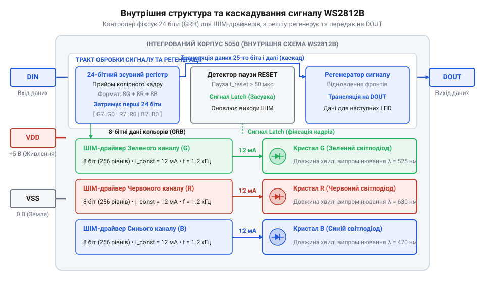
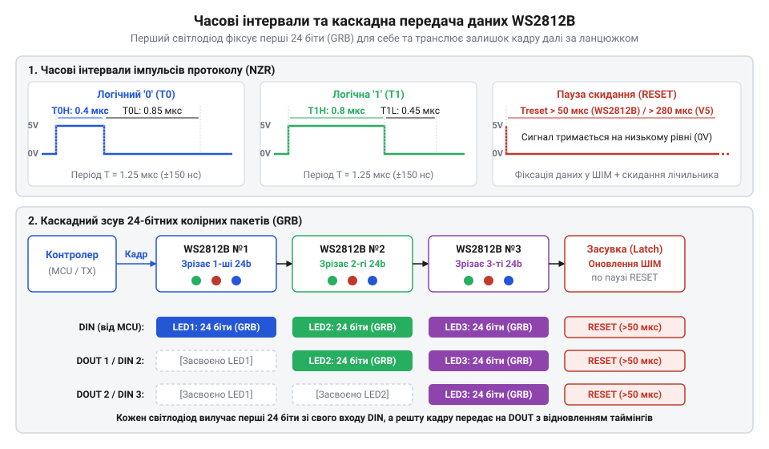
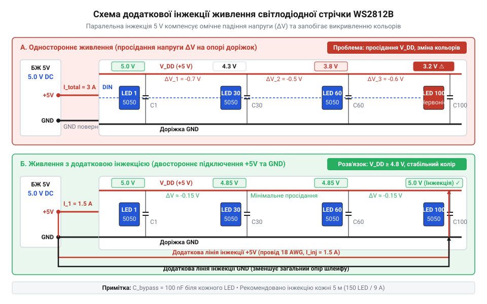
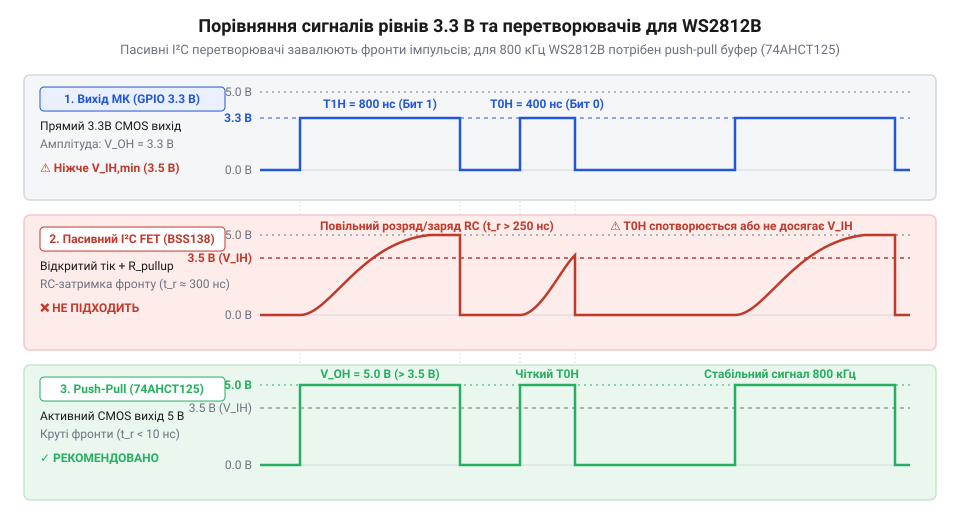

# WS2812B — адресний RGB-світлодіод (5050)

<preknowlist>
- [KY-016 — RGB-світлодіод](root:cat-hw-actuators/ky-016-rgb) — Принцип змішування кольорів адитивної моделі RGB через трьохкристальну структуру та індивідуальне керування каналами
- [KY-009 — RGB SMD-модуль](root:cat-hw-actuators/ky-009-rgb-smd) — Особливості поверхневого монтажу SMD RGB-світлодіодів, їхні електричні параметри та спільний анод або катод
</preknowlist>

## Проблема масштабування світлодіодних масивів

Незалежне керування одним [класичним RGB-світлодіодом](root:cat-hw-actuators/ky-016-rgb) або дискретним [5мм світлодіодом](root:cat-hw-actuators/led-5mm-kit) вимагає трьох каналів широтно-імпульсної модуляції (@@en|PWM@@). Для масиву зі 100 елементів знадобилося б 300 фізичних виводів і 300 апаратних таймерів.

Зовнішні ключі для [SMD RGB-модулів](root:cat-hw-actuators/ky-009-rgb-smd) захаращують розводку плати, а програмний @@en|PWM@@ вичерпує процесорний час. На відміну від некерованого [7-кольорового LED](root:cat-hw-actuators/ky-034-flash) чи [Magic Light Cup](root:cat-hw-actuators/ky-027-magic-cup), динамічний масив вимагає індивідуального адресування кожного елемента.

Проблему розв'язує концепція @@en|smart pixel@@ (від англ. *smart* — розумний, *pixel* — елемент зображення): чип керування інтегрують у корпус світлодіода поруч із кристалами, скорочуючи шину даних до одного цифрового виводу.

## Внутрішня будова та функціональні блоки

Адресний світлодіод @@en|WS2812B@@ об'єднує в корпусі @@en|SMD@@ 5050 три напівпровідникові кристали (червоний, зелений, синій) та кремнієву мікросхему контролера.


*Функціональні блоки інтегрованого контролера WS2812B у корпусі SMD 5050: від вхідного декодера до 8-бітних ШІМ-драйверів.*

Цифровий потік надходить на вхід `DIN`. Вхідний буфер зчитує часові інтервали сигналу, а 24-бітний зсувний регістр накопичує байти кольору. По 8 бітів на канал задають 256 рівнів яскравості (16,7 млн відтінків @@en|TrueColor@@). Вбудовані стабілізатори утримують струм (~12 мА) через кожен кристал незалежно від коливань живлення. Каскад регенерації відновлює форму імпульсів і транслює залишкові байти на вивід `DOUT`.

## Часоімпульсний протокол та каскадна передача

Для передачі колірних даних використовується однопровідний часоімпульсний протокол @@en|NRZ@@ (від англ. *Non-Return-to-Zero* — без повернення до нуля) на частоті 800 кГц (період `T = 1.25 мкс`). Логічні '0' та '1' кодуються тривалістю високого рівня: `T₀ₕ ≈ 0.4 мкс` для '0' та `T₁ₕ ≈ 0.8 мкс` для '1' (з допуском ±150 нс).


*Часоімпульсна кодограма бітів і послідовність передачі GRB-кадрів через каскадний зсувний регістр масиву WS2812B.*

Передача здійснюється 24-бітними пакетами у форматі @@en|GRB@@, починаючи зі старшого біта (@@en|MSB@@). Перший світлодіод у ланцюжку захоплює перші 24 біти у свій зсувний регістр, а решту бітів перенаправляє з `DIN` на `DOUT` для наступних пікселів. Пауза низького рівня @@en|RESET@@ (`T_RESET > 50 мкс`) змушує всі чипи одночасно перенести дані у регістри-фіксатори, оновлюючи свічення всієї стрічки синхронно.

## Падіння напруги та інжекція живлення

При повній яскравості кожен піксель @@en|WS2812B@@ споживає 60 мА струму (по 20 мА на канал), створюючи 6 А на 100 пікселів. Паразитний опір `R_trace` доріжок гнучкої плати (@@en|FPC@@, від англ. *flexible printed circuit* — гнучка друкована схема) викликає падіння напруги:

```
U_drop = I · R_trace
```

Просідання живлення нижче 3.5 В зміщує колір у червоний спектр. Пряма спадна напруга `V_f` червоного кристала становить 1.8–2.1 В, а зеленого й синього — 3.0–3.2 В. Коли напруга падає нижче порогу стабілізаторів струму зеленого й синього каналів, їхня яскравість згасає, перетворюючи білий колір на червонуватий.


*Схема компенсації падіння напруги на платі @@en|FPC@@ за допомогою двосторонньої інжекції живлення та локальних конденсаторів.*

Ефект усувають інжекцією живлення — паралельним підключенням ліній 5 В та спільної землі @@en|GND@@ через кожні 1–2 м для збереження опорного потенціалу сигналу. Завади ШІМ (@@en|PWM@@) біля пікселів фільтрують керамічними конденсаторами 100 нФ, а низькочастотні кидки струму — електролітичним конденсатором 1000 мкФ на вході.

## Узгодження рівнів та апаратна генерація

Поріг розпізнавання логічної одиниці `V_IH` входу `DIN` чипа @@en|WS2812B@@ становить `0.7 · V_CC` (3.5 В при живленні 5 В). Вихідний сигнал 3.3 В мікроконтролера є нижчим за цей поріг, що викликає збої прийому. Пасивні перетворювачі рівнів на MOSFET-транзисторах не підходять через завалювання фронтів імпульсів паразитною ємністю лінії.


*Спотворення фронтів у пасивних схем та прямокутні імпульси активного буфера 74AHCT125.*

Для узгодження застосовують активні @@en|push-pull@@ буфери (наприклад, `74AHCT125` з TTL-входом `V_IH ≥ 2.0 В`), які формують круті 5 В фронти з часом наростання менше 10 нс. Послідовно з лінією `DIN` першого пікселя ставлять демпфувальний резистор номіналом 33–100 Ом для гасіння хвильових відбіттів. Детальніше про схемотехнічні відмінності між пасивними транзисторними ключами та активними буферами читайте в [огляді перетворювачів логічних рівнів](root:hw-digital/level-shifter).

Програмне формування сигналу (@@en|bit-banging@@) чутливе до переривань процесора, які порушують наносекундні часові допуски. Тому кадр передають апаратно — через периферію @@en|SPI@@ або @@en|RMT@@ у поєднанні з прямим доступом до пам'яті (@@en|DMA@@), що виводить дані з ОЗП у фоновому режимі.

:::tabs
:::code ws2812b-led/c/esp-idf/init-ws2812b-hardware-rmt.c
:::code ws2812b-led/cpp/arduino/setup.cpp
:::