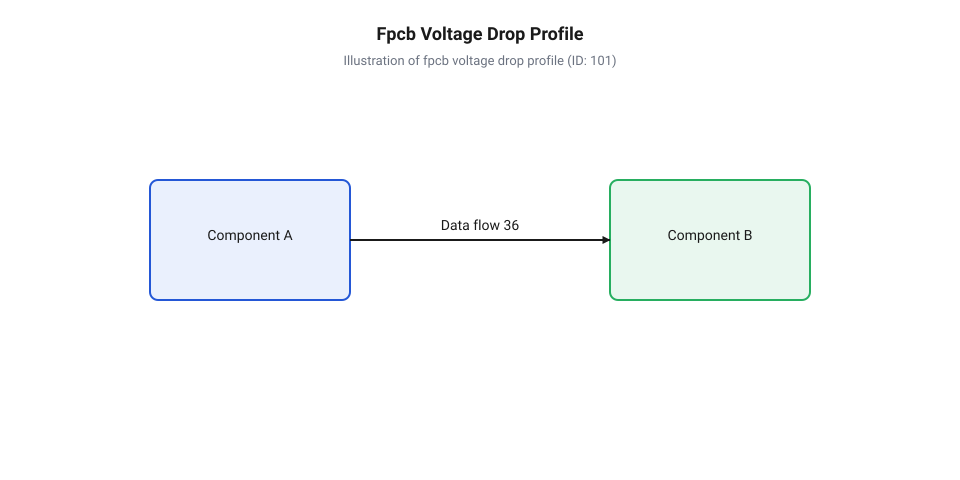
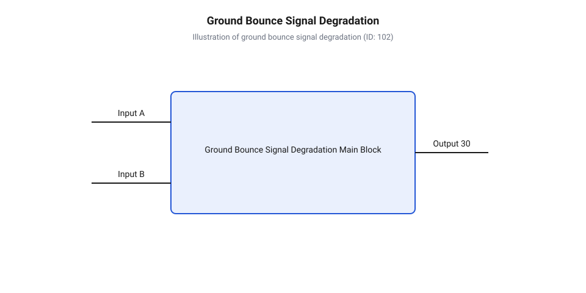
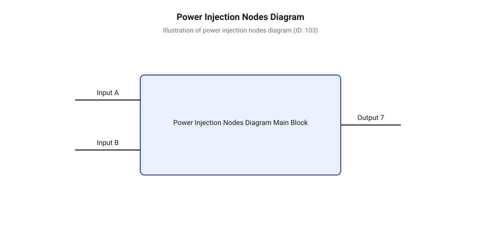
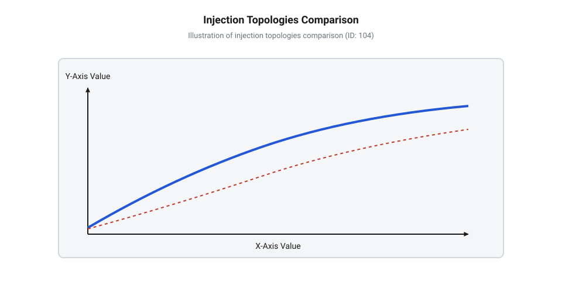
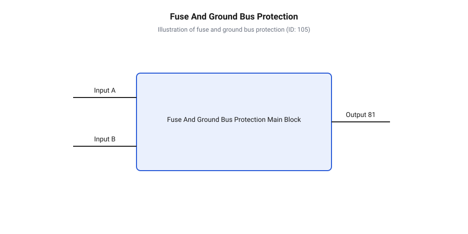
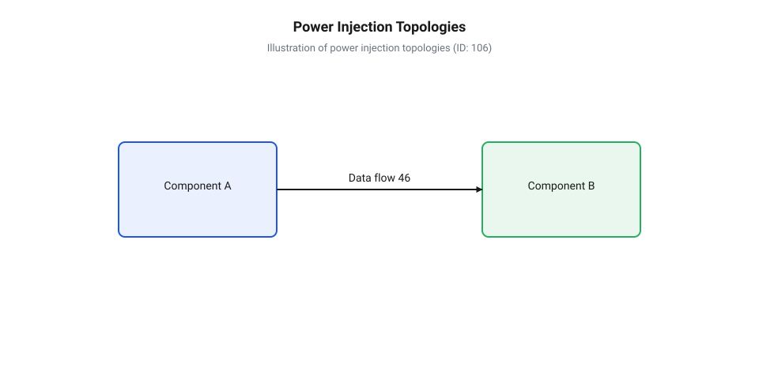
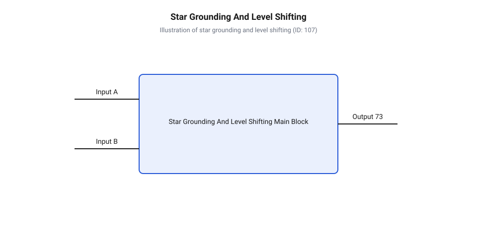

# Інжекція живлення світлодіодних стрічок

<preknowlist>
- [WS2812B — адресний RGB-світлодіод (5050)](root:cat-hw-actuators/ws2812b-led) — принципи адресованого керування, внутрішню структуру інтегрованого контролера та триканальне RGB-споживання струму окремим пікселем.
- [Блокувальні конденсатори в лініях живлення LED](root:cat-hw-actuators/decoupling-capacitors-led) — механізм згладжування високочастотних кидків струму ШІМ-регуляторів та фільтрації завад у шині VCC.
- [Родина адресних світлодіодів та світлодіодних стрічок](root:cat-hw-actuators/addressable-led-family-overview) — конструкцію гнучкої плати FPCB, конструктивне поєднання лінії даних з шинами живлення та залежність сумарного струму від щільності розміщення пікселів.
</preknowlist>

## Падіння напруги у довгій стрічці

Уяви проблему: до одного кінця 10-метрової світлодіодної стрічки на 600 пікселів підключено джерело живлення 5 В. Коли контролер дає команду ввімкнути чисто білий колір на максимальну яскравість, перші метри стрічки світять сліпучо білим світлом. Проте вже на третій-четвертий метр біле світло набуває теплого жовтуватого відтінку, біля шостого метра воно стає тьмяно-помаранчевим, а на дальньому кінці світлодіоди світять лише слабким червоним кольором або взагалі починають хаотично блимати й перезавантажуватися. Така поведінка здається дивною, адже всі пікселі підключені паралельно до одних і тих самих провідників живлення.

Фізична причина цього явища криється у конструкції гнучкої друкованої плати (англ. @@en|flexible printed circuit board@@, @@en|FPCB@@). На відміну від жорстких плат із товстим мідним покриттям, @@en|FPCB@@ використовує мікроскопічно тонкі мідні доріжки (англ. @@en|power rails@@: @@en|VCC@@ та @@en|GND@@), товщина яких становить зазвичай 1 oz/ft² (близько 35 мкм) або навіть 0.5 oz (18 мкм). При ширині всієї стрічки 8–10 мм ширину силової доріжки фізично неможливо зробити більшою за 1.5–2.5 мм. Хоча мідь має низький питомий опір, силова доріжка такої малої площі перерізу володіє відчутним електричним опором (англ. @@en|electrical resistance@@). Для типової мідної доріжки шириною 2 мм опір одного метра становить близько 0.25–0.35 Ом. Оскільки струм протікає по шині @@en|VCC@@ до світлодіода і повертається назад по шині @@en|GND@@, загальний опір контуру (англ. @@en|loop resistance@@) сягає 0.5–0.7 Ом на кожен метр стрічки.

Еволюція живлення світлодіодних стрічок пояснює, чому ця проблема стала критичною саме в сучасних пристроях. У класичних 12-вольтових аналогових стрічках світлодіоди з'єднувалися послідовно-паралельними групами по три штуки з обмежувальним резистором, завдяки чому при однаковій споживаній потужності струм у магістральних доріжках був у кілька разів меншим. Перехід до низьковольтних 5-вольтових стрічок із паралельним підключенням інтегрованих смарт-пікселів [родини світлодіодів WS2812B](root:cat-hw-actuators/ws2812b-led) кардинально змінив картинку: кожен піксель живиться безпосередньо від 5 В, а загальний струм долгої лінії зростає до десятків ампер. При фіксованій мікроскопічній товщині міді @@en|FPCB@@ таке струмове навантаження перетворює внутрішній провідник плати на розподілений резистор високого опору.

Світлодіодна стрічка являє собою ланцюг із розподіленим навантаженням (англ. @@en|distributed load@@). Кожен піксель споживає певний струм `I_px`. Перший сегмент провідника @@en|FPCB@@ (від джерела живлення до першого пікселя) несе крізь себе сумарний струм усіх `N` пікселів стрічки. Другий сегмент несе струм `(N - 1)` пікселів, третій — `(N - 2)`, і так далі. Оскільки струм зменшується вздовж лінії лінійно, падіння напруги (англ. @@en|voltage drop@@) на кожному наступному сегменті накопичується за квадратичним законом.

Обчислимо сумарне падіння напруги `U_drop(k)` у довільному пікселі `k` вздовж стрічки з `N` світлодіодів, де `R_seg` — опір провідника між двома сусідніми пікселями:

```
U_drop(k) = R_seg · ∑ [i = 1 .. k] (N - i + 1) · I_px
          = R_seg · I_px · (k · N - k · (k - 1) / 2)     [формула суми арифметичної прогресії]
```

З цієї формули видно, що наприкінці стрічки довжиною `N` пікселів сумарне падіння напруги досягає значення `U_drop(N) ≈ 0.5 · R_total · I_total`, де `R_total` — повний опір доріжки FPCB від початку до кінця, а `I_total` — повний струм споживання всіх світлодіодів. Отже, спад напруги зростає пропорційно квадрату довжини стрічки `L²`. Детальніший аналіз неперервного розподілу потенціалу розглянуто у [математичній моделі падіння напруги](root:cat-hw-actuators/ws2812b-power-injection/math-voltage-drop-distributed-load.md).


*Розподіл напруги вздовж гнучкої плати FPCB та виникнення червоного зсуву кольору через вихід драйверів синього й зеленого каналів з режиму стабілізації струму.*

Чому ж при спаді напруги колір стрічки змінюється саме на червоний, а не просто тьмяніє? Усередині кожного корпусу WS2812B інтегровано три окремих напівпровідникових кристали (червоний, зелений та синій) і мікросхему керування зі стабілізаторами струму (англ. @@en|constant current driver@@), регульованими за допомогою широтно-імпульсної модуляції (англ. @@en|pulse-width modulation@@, @@en|PWM@@). Пряма напруга (англ. @@en|forward voltage@@, `V_F`), необхідна для відкриття p-n переходу світлодіода, залежить від ширини забороненої зони напівпровідника:
- Червоний кристал (GaAsP/GaP): `V_F ≈ 1.8 В - 2.1 В`;
- Зелений кристал (InGaN): `V_F ≈ 3.0 В - 3.3 В`;
- Синій кристал (InGaN): `V_F ≈ 3.0 В - 3.3 В`.

Внутрішній стабілізатор струму мікросхеми вимагає додаткового запасу напруги (англ. @@en|dropout voltage@@) близько 0.5–0.7 В над значенням `V_F` для утримання робочого струму 20 мА. Коли локальна напруга живлення `V_CC` на віддаленому пікселі падає нижче 3.8–4.0 В, стабілізатори синього й зеленого каналів виходять із режиму насичення і більше не можуть забезпечити номінальний струм. Випромінювання синього та зеленого кристалів стрімко згасає. У той же час червоний кристал вимагає лише `V_F + V_dropout ≈ 2.5 В`, тому він продовжує світити на повну потужність навіть при просіданні живлення до 3.0 В. У результаті змішування кольорів порушується, і біле світло послідовно перетворюється на жовте, помаранчеве та насичено червоне (англ. @@en|red shift@@).

Окрім викривлення кольоропередачі, просідання живлення створює серйозні апаратні збої керувальної електроніки. Якщо напруга `V_CC` падає нижче критичного порогу 3.5 В, усередині цифрового ядра пікселя спрацьовує схема скидання при ввімкненні (англ. @@en|Power-On Reset@@, @@en|POR@@). Світлодіод скидає зсувний регістр і перестає реагувати на команди.

Крім того, виникає ефект зсуву потенціалу землі (англ. @@en|ground bounce@@). Оскільки зворотний струм кількох ампер протікає через опір доріжки @@en|GND@@, потенціал локальної землі (англ. @@en|local GND@@) віддаленого пікселя зростає відносно землі мікроконтролера на 1.0–1.5 В. Логічний сигнал даних (англ. @@en|data signal@@, `DIN`), що передається від контролера з рівнями 0 В та 5 В, зчитується віддаленим пікселем відносно його піднятої локальної землі. У результаті високий логічний рівень сприймається як понижений (`5.0 В - 1.5 В = 3.5 В`), а низький рівень — як підвищений (`0 В + 1.5 В = 1.5 В`), що спричиняє спотворення цифрових бітів, хаотичне блимання та зависання світлодіодного масиву, як показано в [загальному огляді світлодіодів](root:cat-hw-actuators/addressable-led-family-overview).


*Падіння напруги на шині заземлення зміщує опорний потенціал local GND відносно контролера, викликаючи збої в зчитуванні цифрового сигналу DIN.*

## Механізм та параметри інжекції живлення

Зрозумівши обмеження провідності внутрішніх доріжок @@en|FPCB@@, постає питання: як забезпечити стабільну роботу довгої стрічки, не змінюючи її конструкцію? Розв'язком є інжекція живлення (лат. @@la|injectio@@ — вприскування; англ. @@en|power injection@@).

Сутність інжекції живлення полягає у прокладанні паралельно до стрічки зовнішніх низькоомних силових кабелів великого перерізу та підключенні їх до контактних майданчиків @@en|VCC@@ та @@en|GND@@ стрічки у кількох точках вздовж лінії. Замість того щоб змушувати струм 20–30 Ампер проходити крізь тоненьку мідну фольгу завдовжки 10 метрів, зовнішній кабель доправляє струм безпосередньо у проміжні вузли з мінімальними втратами. З кожної точки інжекції струм розходиться у внутрішні доріжки @@en|FPCB@@ в обох напрямках лише на короткі дистанції (1–2 метри), що зменшує ефективний опір лінії у десятки разів і утримує напругу в межах норми.

Перед проєктуванням силово-сигнальної мережі необхідно розрахувати піковий струм споживання масиву світлодіодів. Кожен смарт-піксель WS2812B містить цифровий контролер та три світлодіодні кристали:
- Струм спокою цифрового ядра: `I_idle ≈ 1 мА`;
- Струм червоного каналу R: `I_R ≈ 20 мА`;
- Струм зеленого каналу G: `I_G ≈ 20 мА`;
- Струм синього каналу B: `I_B ≈ 20 мА`.

При виведенні 100% білого кольору піковий струм одного пікселя становить:

```
I_px = I_R + I_G + I_B + I_idle
     = 20 мА + 20 мА + 20 мА + 1 мА      [додавання струмів каналів та ядра]
     = 61 мА ≈ 0.060 А
```

Загальний піковий струм `I_total` для масиву з `N` пікселів обчислюється за формулою:

```
I_total = N · I_px
        = N · 0.060 А            [підстановка пікового струму одного пікселя]
```

**Розрахунок пікового струму для стрічки довжиною 10 метрів із щільністю 60 світлодіодів на метр (всього N = 600 пікселів):**

```
I_total = 600 · 0.060 А
        = 36 А                   [піковий струм при 100% білому кольорі]
P_total = I_total · V_CC
        = 36 А · 5 В
        = 180 Вт                 [максимальна споживана потужність]
```

Хоча у динамічних світлових ефектах середнє споживання становить 30–50% від пікового, джерело живлення (англ. @@en|switched-mode power supply@@, @@en|SMPS@@), кабелі та захисна апаратура повинні розраховуватися виключно на 100% пікове навантаження (`36 А`). При випадковому спалаху білого кольору слабкий блок живлення перейде в режим захисту від перевантаження за струмом (англ. @@en|over-current protection@@, @@en|OCP@@), з урахуванням [параметрів імпульсного джерела](root:cat-hw-power/switch-mode-power-supply-selection).

Допустима відстань між точками інжекції визначається гранично допустимим падінням напруги `ΔV_max = 0.5 В` (напруга живлення будь-якого пікселя не повинна опускатися нижче `4.5 В`). Для типової стрічки 60 LED/м при односторонньому підключенні критична довжина становить лише 1.5–2.0 метри. Підключення живлення з обох кінців 5-метрової стрічки зменшує ефективну відстань до найвіддаленішого центрального пікселя вдвічі, що завдяки квадратичній залежності знижує падіння напруги у 4 рази. Тому для стандартних 5-метрових сегментів двостороння інжекція є базовою вимогою, розрахованою за допомогою [методики вибору дротів](root:cat-hw-actuators/ws2812b-power-injection/math-power-injection-wire-gauge-and-fuses.md).


*Розподіл струмового навантаження між внутрішніми доріжками плати та зовнішніми силовими кабелями при підключенні живлення з двох кінців та в проміжних точках.*

Залежно від геометрії об'єкта обирають одну з трьох основних топологій розведення силових дротів від джерела живлення:
1. **Радіальна топологія («Зірка»)**: Від центрального розподільного блоку до кожної точки інжекції прокладається окрема пара силових дротів. Забезпечує ідеальну симетрію напруг, але вимагає найбільшої витрати кабелю. 2. **Шинна топологія (Силова магістраль)**: Уздовж всієї стрічки прокладається товстий магістральний кабель (+5 В та GND), від якого робляться короткі відвідні відгалуження до точок підключення FPCB. Це найбільш практичний варіант для лінійних ділянок великої довжини. 3. **Кільцева топологія**: Силова магістраль замкнена у кільце й підключена до клем джерела живлення з обох боків, що створює дубльовані шляхи проходження струму.

Практичні приклади розведення силово-сигнальних ліній для плоских панелей наведено у [інструкції з розведення матриць](root:cat-hw-actuators/ws2812b-power-injection/proj-matrix-power-bus-distribution.md).


*Конструктивні відмінності радіального підключення, силової магістралі та кільцевого шинопроводу для живлення довгих світлодіодних ліній.*

Проєктуючи вузли інжекції, необхідно забезпечити апаратний захист та фільтрацію завад. Потужне джерело живлення 5 В 40 А при короткому замиканні у доріжках стрічки здатне розплавити мідну фольгу FPCB й викликати займання раніше, ніж спрацює захист самого блоку живлення. - Кожне плече інжекції обов'язково захищають окремим плавким запобіжником (англ. @@en|fuse@@) на 5 А – 7.5 А. - У кожній точці підключення живлення між @@en|VCC@@ та @@en|GND@@ встановлюють електролітичний згладжувальний конденсатор (англ. @@en|decoupling capacitor@@) ємністю 470–1000 мкФ (на напругу 6.3 В або 10 В) для компенсації імпульсних кидків струму при ШІМ-регулюванні, як детально пояснено у [огляді блокувальних конденсаторів](root:cat-hw-actuators/decoupling-capacitors-led). - Заземлення контролера та джерела живлення об'єднують в єдиній точці (Star GND) біля входу першого пікселя, щоб уникнути утворення земляних контурів (англ. @@en|ground loop@@).

Для захисту цифрової лінії даних `DIN` при довжині кабелю від контролера понад 0.5 м рекомендується встановлювати [активний перетворювач рівнів](root:hw-digital/level-shifter) з 3.3 В до 5.0 В для надійної роботи [внутрішнього драйвера пікселя](root:cat-hw-actuators/ws2812b-led). Альтернативою 5-вольтовим стрічкам із високими вимогами до інжекції є світлодіоди з підвищеною робочою напругою 12 В, розглянутими у матеріалах про [двопровідні стрічки APA102](root:cat-hw-actuators/apa102-and-sk9822-two-wire-leds) та [високовольтні пікселі WS2815](root:cat-hw-actuators/ws2813-and-ws2815-redundant-addressable-leds).

Щоб перейти до покрокової збірки системи, слід переглянути [практичний монтаж лінії](root:cat-hw-actuators/ws2812b-power-injection/proj-ws2812b-strip-power-injection-assembly.md) та переглянути [повну принципову схему](root:cat-hw-actuators/ws2812b-power-injection/api-power-injection-wiring-schematic.md).


*Захист окремих сегментів стрічки запобіжниками, локальна фільтрація завад конденсаторами та усунення контурів заземлення в єдиній точці Star GND.*

## Топології силових магістралей та дротів

Розрахунок необхідної кількості точок підживлення ставить перед розробником наступне фізичне завдання: як саме доправити струм у десятки ампер від центрального @@en|імпульсне джерело живлення@@ (англ. switch-mode power supply, від лат. *impulsus* — поштовх) до обраних точок на гнучкій платі. Якщо розвести зовнішні кабельними магістралями без урахування їхнього власного опору, напруга просяде ще до того, як струм досягне світлодіодної стрічки. Геометрія прокладання дротів — @@en|топологія розведення@@ (англ. wiring topology, від грец. *topos* — місце) — визначає рівномірність розподілу потенціалів, підсумковий обсяг кабельної продукції та стійкість системи до локальних аварій.


*Порівняння електричних конфігурацій силових магістралей для інжекції живлення адресованих стрічок.*

Першою та найстійкішою конфігурацією є @@en|радіальна топологія@@ (англ. radial topology, від лат. *radius* — промінь), яку також називають схемою «зірка». У цьому разі від центрального джерела живлення або від товстих розподільних шин до кожної точки інжекції прокладають окрему парну лінію VCC та GND. Оскільки кожне плече є ізольованою електричною гілкою, струм одного сегмента не протікає по дротах сусіднього. Це повністю усуває взаємний вплив навантажень: пошкодження або обрив одного кабелю не призводить до перевантаження інших. Основний обмежний чинник радіальної схеми — значна матеріаломісткість. Якщо точки інжекції розташовані на різній відстані від джерела живлення, довжини кабелів відрізнятимуться. Щоб уникнути дисбалансу напруг між точками підживлення, для довших променів необхідно збільшувати @@en|переріз провідника@@ (англ. conductor cross-section), що ускладнює жгут дротів.

Двопровідною альтернативою є @@en|магістральна топологія@@ (англ. bus topology, від лат. *omnibus* — для всіх), або схема з головним стовбуром. Вдовж світлодіодної лінії прокладають один товстий силовий кабель великого перерізу, від якого за допомогою коротких відгалужувальних дротів («крапель») струм подається на контактні майданчики FPCB. Така схема потребує найменшого обсягу кабелів і зручно монтується в лінійних алюмінієвих профілях. Проте магістраль має суттєвий недолік: початкова ділянка головного кабелю проводить сумарний струм усіх наступних точок інжекції:

```
I_trunk = I_1 + I_2 + ... + I_n
```

Через це на початковому відрізку магістралі виникає наибольший спад напруги та підвищене тепловиділення. Точки інжекції, розташовані в кінці магістралі, отримують нижчу напругу, ніж перші точки, оскільки втрати в товстому кабелі накопичуються впродовж усієї довжини лінійного трасування.

Для замкнених або кільцевих конструкцій (наприклад, контурного освітлення приміщень чи круглих світлодіодних конструкцій) застосовують @@en|кільцева топологія@@ (англ. ring topology, від англ. *ring* — коло). Силові лінії VCC та GND виходять із джерела живлення, підключаються до початку стрічки, проходять крізь усі точки інжекції та повертаються назад до клем джерела живлення, замикаючи кільце. Завдяки двосторонньому підведенню струму еквівалентний опір силового контуру для будь-якого пікселя зменшується приблизно в чотири рази порівняно з одностороннім підключенням. Захисні характеристики кільця дуже високі, однак при трасуванні сигнального дроту GND разом із силовим заземленням утворюється великий замкнений контур, який може працювати як рамкова антена для електромагнітних завад.

Окрему складність становлять двовимірні світлодіодні матриці та панелі високої щільності. Спроба подати живлення на матрицю 16×16 або 32×32 послідовним зигзагом через доріжки гнучкої плати призводить до перегріву FPCB та катастрофічного падіння яскравості в центрі панелі. Для таких систем застосовують сітчасту або гребінчасту топологію. Перпендикулярно до ліній пікселів монтують товсті мідні шини, які інжектують живлення на початку та в кінці кожного рядка матриці. Детальні алгоритми розрахунку та приклади монтажу силових сіток розкрито у [довіднику двовимірних шин](root:cat-hw-actuators/ws2812b-power-injection/proj-matrix-power-bus-distribution.md).

Незалежно від обраної топології, ключовим етапом проєктування є розрахунок необхідного перерізу зовнішніх мідних дротів. Питомий опір мідного провідника розраховують за базовим фізичним співвідношенням:

```
R_wire = ρ · (2 · L) / S
```

де `ρ = 0.0175 Ом·мм²/м` — питомий опір міді при 20 °C, `L` — відстань від джерела живлення до точки інжекції в метрах (множник `2` враховує повну петлю струму по провідниках VCC та GND), а `S` — площа перерізу провідника у мм².

Якщо допустиме падіння напруги на зовнішній лінії живлення обмежити величиною `ΔV_max` (зазвичай не більше 0.20–0.25 В, щоб на контактні майданчики стрічки приходило щонайменше 4.75–4.80 В), то мінімально необхідний переріз дріт `S` визначається з виразу:

```
ΔV_wire = I_branch · R_wire
= I_branch · ρ · (2 · L) / S             [підстановка виразу опору провідника]

S ≥ (2 · L · ρ · I_branch) / ΔV_max     [виведення площі перерізу]
```

Розглянемо практичний розрахунок для одного променя радіальної інжекції.

**Умова:** Відстань від джерела живлення до точки підживлення `L = 3.5 м`. Максимальний струм даного плеча `I_branch = 6.0 А`. Допустиме падіння напруги `ΔV_max = 0.20 В`.

```
S = (2 · 3.5 · 0.0175 · 6.0) / 0.20
= (7.0 · 0.0175 · 6.0) / 0.20           [обчислення добутку довжини та опору петлі]
= 0.735 / 0.20                         [загальний добуток струму та опору]
= 3.675 мм²                            [розрахована мінімальна площа перерізу]
```

Отримане значення `3.675 мм²` показує, що стандартний кабель перерізом `2.5 мм²` (відповідник 14 @@en|American Wire Gauge@@, скорочено `@@en|AWG@@`) створить падіння напруги `0.294 В`, що перевищує наш ліміт. Для цієї лінії слід обрати кабель перерізом `4.0 мм²` (AWG 11) або зменшити довжину лінії трасування. Повний вивід математичних моделей та стандартну таблицю відповідності калибрів AWG наведено у [розрахунку силових магістралей](root:cat-hw-actuators/ws2812b-power-injection/math-power-injection-wire-gauge-and-fuses.md). Конкретні схеми підключення та клемних колодок доступні у [довіднику апаратних схем](root:cat-hw-actuators/ws2812b-power-injection/api-power-injection-wiring-schematic.md). При виборі живлення слід також спиратися на критерії у [виборі імпульсного джерела живлення](root:cat-hw-power/switch-mode-power-supply-selection). Огляд конструкцій та методів монтування клемних блоків для безпечної комутації високих струмів висвітлюють [розподільні силові шини та клемні колодки постійного струму](root:cat-hw-parts/dc-power-distribution-busbars).

## Захист ліній та спільне заземлення

Розгалуження потужного джерела живлення струмом у 30–60 Ампер по багатьох тонких гілках інжекції створює приховану апаратну загрозу. Якщо внаслідок механічного пошкодження або пробою ізоляції виникне коротке замикання на контактних майданчиках FPCB чи всередині підвідного дроту перерізом `0.75 мм²`, опір цієї замкненої ділянки обмежить струм короткого замикання на рівні, наприклад, 15–20 Ампер. Для центрального блоку живлення потужністю 300 Вт цей струм є штатним робочим навантаженням. Блок живлення не вимкнеться за перевантаженням, і струм у 20 Ампер продовжуватиме безперервно протікати через тонкий дріт або мідну доріжку FPCB. Це призводить до виділення понад 100 Ватт теплової потужності на обмеженій ділянці (`P = I² · R`), миттєвого розплавлення ізоляції та займання плати.


*Організація єдиного потенціалу землі (Star GND) та захисту ліній для усунення зсуву потенціалу та аварійних струмів.*

Щоб відвернути загрозу займання, кожне плече інжекції повинен захищати індивідуальний @@en|плавкий запобіжник@@ (англ. fuse, від лат. *fusus* — розплавлений). Головне правило вибору номіналу запобіжника полягає в тому, що він має розраховуватися на максимальний робочий струм конкретної гілки з невеликим технологічним запасом:

```
I_fuse = 1.25 · I_branch_max
```

де `I_branch_max` — пікове споживання даного сегмента стрічки при 100% яскравості білого кольору. У разі виникнення короткого замикання запобіжник розплавляється за лічені мілісекунди, повністю знеструмлюючи лише аварійний сегмент та залишаючи решту системи в робочому стані.

Плавкі запобіжники обов'язково встановлюють на початку силово-розподільної лінії — безпосередньо біля вихідних клем блоку живлення або на спеціальному дистриб'юторному щитку. Якщо встановити запобіжник біля самої світлодіодної стрічки, дріт живлення, що йде від блоку живлення до стрічки, залишиться незахищеним від замикання на корпус чи сусідній провідник. Для 5В систем найзручнішими є автомобільні ножові запобіжники (типорозміри ATO/ATC або Mini) завдяки їхньому мізерному внутрішньому опору та надійному контакту. Застосування самовідновлювальних PTC-полімерів обмежене, оскільки в замкненому стані вони мають відчутний опір, який додає небажане падіння напруги. Математику вибору плавких елементів детально подано у [розрахунку силових магістралей](root:cat-hw-actuators/ws2812b-power-injection/math-power-injection-wire-gauge-and-fuses.md).

Другим обов'язковим елементом захисту є компенсація високочастотних кидків струму, зумовлених ШІМ-регулюванням світлодіодів. Контролери пікселів [архітектури WS2812B](root:cat-hw-actuators/ws2812b-led) перемикають струм внутрішніх світлодіодів із частотою близько 800 кГц. При одночасному перемиканні сотень пікселів у силових провідниках виникають імпульсні стрибки струму `di/dt`. Через наявність паразитної індуктивності дротів `L_wire` ці кидки викликають імпульсні сплески напруги:

```
V_spike = L_wire · (di / dt)
```

Ці сплески здатні викликати збої у внутрішніх регістрах WS2812B або навіть пробити CMOS-структуру мікросхеми. Для пригнічення завад у кожній точці підживлення паралельно шинам VCC та GND підключають електролітичний @@en|згладжувальний конденсатор@@ (англ. decoupling capacitor) ємністю 1000–4700 мкФ з низьким еквівалентним послідовним опором (Low ESR) та робочою напругою 6.3–10 В. Конденсатор працює як локальний буфер енергії, віддаючи струм у момент імпульсного фронту ШІМ та згладжуючи просідання напруги. Фізичні принципи фільтрації докладніше розкрито у статті про [блокувальні конденсатори](root:cat-hw-actuators/decoupling-capacitors-led).

Найбільш підступною апаратною проблемою в системах з інжекцією живлення є @@en|зсув потенціалу землі@@ (англ. ground bounce, від англ. *bounce* — відскок). Сигнальний дріт даних (DIN) передає цифрові імпульси від мікроконтролера до першого пікселя стрічки. Логічні рівні 0 та 1 вимірюються відносно потенціалу шини GND. Якщо через силовий дріт заземлення стрічки протікає великий струм, на його опорі виникає спад напруги `ΔV_GND = I_total · R_GND`. Внаслідок цього локальний потенціал землі на стрічці підвищується відносно землі мікроконтролера:

```
V_GND_strip = V_GND_mcu + ΔV_GND
```

Якщо потенціал землі стрічки підніметься хоча б на 0.7–1.0 В, керувальний сигнал HIGH напругою 3.3 В від мікроконтролера сприйматиметься вхідним каскадом WS2812B як напруга:

```
V_in_effective = V_signal - V_GND_strip
= 3.3 - 0.8                            [приклад підвищення потенціалу землі на 0.8 В]
= 2.5 В                                [ефективна напруга сигналу відносно землі стрічки]
```

Оскільки поріг розпізнавання логічної одиниці для WS2812B при живленні 5 В становить близько `0.7 · VCC = 3.5 В`, ефективна напруга 2.5 В потрапляє в неокреслену зону, що призводить до хаотичного миготіння, спотворення кольорів або повної втрати синхронізації.

Для запобігання зсуву потенціалу землі застосовують топологію @@en|зіркоподібне заземлення@@ (англ. @@en|Star GND@@). Усі силові провідники GND від точок інжекції та сигнальний дріт GND від мікроконтролера зводять в одну спільну точку безпосередньо на вихідній клемі блоку живлення. Силові зворотні струми повертаються через товсті силові магістралі, не протікаючи через сигнальний дріт заземлення мікроконтролера. Якщо мікроконтролер має окреме джерело живлення (наприклад, USB), його шину VCC ні в якому разі не з'єднують із силовою шиною 5В стрічки, проте їхні шини GND обов'язково об'єднують у точці входу даних. Для надійної передачі сигналів від 3.3В мікроконтролерів обов'язково застосовують [узгодження логічних рівнів](root:hw-digital/level-shifter).

Вичерпний порядок випробувань та монтажу викладено у [проєкті збірки інжекції](root:cat-hw-actuators/ws2812b-power-injection/proj-ws2812b-strip-power-injection-assembly.md), а розводку клем та сигнальних шин подано у [довіднику апаратних схем](root:cat-hw-actuators/ws2812b-power-injection/api-power-injection-wiring-schematic.md). Для ліній з підвищеною напругою чи резервуванням дані порівнюють із [дубльованими світлодіодами WS2815](root:cat-hw-actuators/ws2813-and-ws2815-redundant-addressable-leds) або [двопровідними світлодіодами APA102](root:cat-hw-actuators/apa102-and-sk9822-two-wire-leds).

## Цілісність цифрового сигналу та завади

Припустимо, силові провідники живлення розраховані й підключені правильно: колір стрічки стабільний, а напруга на світлодіодах не просідає нижче критичних 4.5 В. Однак під час подачі яскравих динамічних ефектів перші або віддалені пікселі починають довільно мерехтіти, міняти кольори або втрачати синхронізацію. Джерелом цієї проблеми є не просідання силового VCC, а втрата цілісності цифрового сигналу (від англ. @@en|signal integrity@@ — збереження форми та амплітуди імпульсу).

Цифровий інтерфейс керування адресованими пікселями є однопровідним послідовним протоколом без зсуву тактового сигналу. Передача даних здійснюється тривалістю високого та низького рівнів напруги (так зване кодування без повернення до нуля, @@en|Non-Return-to-Zero@@, NRZ). Керувальний мікроконтролер передає послідовність високих та низьких рівнів напруги відносно власного виводу землі (`GND_MCU`). Вхідний каскад кожного пікселя вимірює напругу сигнального провідника `DIN` відносно своєї локальної точки землі (`GND_pixel`). Якщо в системі виникає різниця потенціалів між `GND_MCU` та `GND_pixel`, логічні пороги сприйняття цифрового сигналу зміщуються. Детальний розбір часової діаграми формування бітів та чутливості до відхилень подано у матеріалі про [часові інтервали та протокол передачі даних WS2812B](root:com-devices/ws2812b-protocol-timing).

Цей ефект називається зсувом потенціалу землі (від англ. @@en|ground bounce@@: *ground* — земля, *bounce* — відскок). Він виникає через те, що великий зворотний струм споживання світлодіодів (який при білому кольорі 600 пікселів сягає 36 А) повертається до джерела живлення через мідну шину `GND` гнучкої плати @@en|FPCB@@ (від англ. *Flexible Printed Circuit Board* — гнучка друкована плата). Оскільки мідні доріжки плати мають скінченний опір `R_GND`, проходження силового струму `I_load` створює на шині землі спад напруги:

```
ΔV_GND = I_load × R_GND
```

В результаті потенціал `GND_pixel` на першому або проміжному пікселі зростає на величину `ΔV_GND` відносно нуля мікроконтролера.

Специфікація [адресного RGB-світлодіода](root:cat-hw-actuators/ws2812b-led) вказує, що мінімальна вхідна напруга високого логічного рівня `V_IH` обчислюється як:

```
V_IH = 0.7 × VCC
```

При напрузі живлення `VCC = 5.0 В` поріг розпізнавання одиниці становить `V_IH = 3.5 В`. Якщо керувальний мікроконтролер з логікою 3.3 В (наприклад, ESP32, STM32 або RP2040) видає сигнал високого рівня `V_OH ≈ 3.3 В`, цей сигнал вже перебуває нижче мінімально допустимого порогу. Коли ж через великий струм навантаження потенціал `GND_pixel` піднімається хоча б на `0.4 В`, реальна різниця потенціалів між сигнальною лінією та землею пікселя падає до:

```
V_sig_eff = V_OH - ΔV_GND
= 3.3 В - 0.4 В
= 2.9 В
```

Значення 2.9 В лежить суттєво нижче порогу 3.5 В. Внаслідок цього внутрішній компаратор пікселя зрізає тривалість високого імпульсу, перетворюючи логічну одиницю (тривалість 700 нс) на логічний нуль (тривалість 350 нс), або повністю втрачає біти даних. Це викликає викривлення RGB-байтів, хаотичне миготіння та «замирання» кадрів.

Для відновлення цілісності цифрового сигналу застосовують три схемотехнічні рішення:

1. **Застосування високошвидкісних перетворювачів логічних рівнів (@@en|level shifter@@)**:
Щоб усунути амплітудний дефіцит, сигнал 3.3 В від мікроконтролера необхідно піднімати до амплітуди 5.0 В. Для цього не можна використовувати двонапрямлені транзисторні модулі з підтягувальними резисторами (типу BSS138), оскільки їхній час наростання фронту через паразитичну ємність занадто великий для частоти 800 кГц. Необхідно застосовувати високошвидкісні однонапрямлені буфери з виходом @@en|push-pull@@ (від англ. *push-pull* — виштовхувати-тягнути) серій `74AHCT125` або `74HCT245`. Серія AHCT має вхідні пороги TTL (`V_IH_min = 2.0 В`), що ідеально узгоджується з виходом 3.3 В мікроконтролера, та потужний вихідний каскад 5.0 В. При амплітуді сигналу 5.0 В навіть за наявності зсуву землі `ΔV_GND = 0.5 В` ефективний рівень `5.0 В - 0.5 В = 4.5 В` із запасом перевищує поріг `V_IH = 3.5 В`. Детальний вибір буферних елементів висвітлює схемотехнічне [узгодження логічних рівнів](root:hw-digital/level-shifter).

2. **Демпфування та узгодження імпедансу лінії (@@en|impedance matching@@)**:
Вихідний опір мікросхеми `74AHCT125` становить близько 15…20 Ом, тоді як хвильовий опір долгого сигнального провідника становить 100…120 Ом. Через вихідну розбіжність імпедансів на крутих фронтах імпульсів (часи наростання < 5 нс) виникають відбиття сигналу від входу пікселя. Це призводить до дзвону (від англ. @@en|ringing@@ — осциляція на фронтах імпульсу) та викидів напруги (від англ. @@en|overshoot@@), які можуть досягати 6.5 В і викликати засувку (від англ. @@en|latch-up@@ — паразитна провідність) вхідного каскаду. Для придушення дзвону безпосередньо біля виходу мікроконтролера або буфера послідовно в лінію `DIN` впаюють демпфувальний резистор опором 33…470 Ом (оптимально 68…220 Ом). Цей резистор разом із паразитною ємністю лінії утворює фільтр низьких частот, що згладжує викиди та усуває відбиття.

3. **Сигнальна топологія та виділений провідник землі**:
Найважливішим правилом є прокладання сигнального провідника `DIN` поруч із виділеним сигнальним провідником `GND_signal` у вигляді зкрученої пари (від англ. @@en|twisted pair@@). Це мінімізує площу контуру завад (від англ. @@en|loop area@@) та зменшує індуктивність сигнальної лінії. Сигнальний провідник `GND_signal` з'єднує землю мікроконтролера із землею першого пікселя, не переносячи силових струмів живлення. Силові ж струми повертаються до джерела живлення через окремі товсті магістралі `GND_power`. Детальна [схема апаратних з'єднань](root:cat-hw-actuators/ws2812b-power-injection/api-power-injection-wiring-schematic.md) описує точну топологію підключення сигнальних та силових провідників.

Крім того, для придушення високочастотних завад у шинах живлення встановлюють [блокувальні конденсатори](root:cat-hw-actuators/decoupling-capacitors-led), розміщені поблизу кожного вузла інжекції. Якщо ж силова лінія прокладається на десятки метрів у промислових умовах із високим рівнем завад, замість однопровідного протоколу застосовують [двопровідні адресні світлодіоди](root:cat-hw-actuators/apa102-and-sk9822-two-wire-leds) із виділеною лінією тактування, стійкішою до часових викривлень.

## Апаратні ризики та граничні режими

Навіть якщо топологія інжекції розрахована правильно, а сигнальна лінія захищена від завад, під час тривалої експлуатації світлодіодної системи можуть виникати приховані апаратні відмови. Вони пов'язані з граничними електротепловими режимами FPCB, перехідними індуктивними процесами під час комутації струмів та взаємним впливом силового каскаду на керувальну електроніку.

### 1. Локальний перегрів гнучкої плати (FPCB)
Товщина мідного провідника в стандартних гнучких платах FPCB становить лише 1 oz/ft² (приблизно 35 мкм) або 0.5 oz/ft² (18 мкм). Ширина силових доріжок `VCC` та `GND` у стрічках шириною 10 мм рідко перевищує 3…4 мм. Відповідно до закону Джоуля-Ленца, потужність теплових втрат на одиницю довжини провідника дорівнює:

```
P_heat = I_segment² × R_trace
```

Опір мідної доріжки FPCB шириною 4 мм і товщиною 35 мкм становить приблизно 0.125 Ом/м. Якщо крізь один нерозривний сегмент FPCB пропустити струм понад 4 А, щільність струму в міді перевищує безпечну межу 50 А/мм². Це призводить до виділення тепла понад 2 Вт на метр лише у мідних доріжках, накладаючись на власне тепловиділення світлодіодів (до 15 Вт/м при білому кольорі).

Температура плати без алюмінієвого тепловідвідного профілю швидко перевищує 85…100 °C. Наслідки локального перегріву:
- Розм'якшення та руйнування монтажного клейового шару 3M;
- Термічна деградація та пожовтіння силіконової герметичної оболонки;
- Механічне розтріскування припаяних контактів пікселів через різницю коефіцієнтів теплового розширення міді та силікону;
- Тепловий розгін (від англ. @@en|thermal runaway@@: *thermal* — тепловий, *runaway* — розгін), адже питомий опір міді зростає на 0.39% на кожний градус Цельсія, підвищуючи опір та подальше нагрівання.

Щоб уникнути цього ризику, струм, що протікає безпосередньо по доріжках FPCB, обмежують на рівні не більше 3 А на сегмент. Сумарний струм системи транспортується зовнішніми силовими кабелями великого перерізу (16…18 AWG), з яких інжектується в стрічку через кожні 1.5…2 метри (або кожні 300 пікселів).

### 2. Індуктивні кидки напруги та перехідні процеси (@@en|transient voltage spikes@@)
Під час відтворення динамічних світлових ефектів (наприклад, стробоскопу або різкого спалаху), коли споживання 600 пікселів миттєво змінюється від 0.5 А у стані спокою до 36 А при 100% білому кольорі, швидкість зміни струму `dI/dt` сягає величезних значень.

Зовнішні силові кабелі інжекції маютьзитну індуктивність `L_cable` (приблизно 1 мкГн на кожен метр довжини). При різкому вимкненні струму на індуктивності виникає ЕРС самоіндукції:

```
V_spike = L_cable × (dI / dt)
```

При вимкненні струму 20 А за 1 мкс на двох метрах кабелю виникає імпульс перенапруги амплітудою понад 8…10 В. Оскільки абсолютний максимум напруги живлення для WS2812B становить 6.0 В, такі повторювані перехідні кидки викликають пробій внутрішніх ШІМ-ключів драйвера у найближчих до точки інжекції пікселях.

При різкому ввімкненні струму індуктивність кабелю, навпаки, протидіє наростанню струму, викликаючи короткочасне глибоке просідання напруги (від англ. @@en|brownout@@ — зниження напруги). Для нейтралізації перехідних процесів у кожній точці інжекції живлення встановлюють низькоімпедансні електролітичні згладжувальні конденсатори (від англ. @@en|Low-ESR capacitor@@) ємністю 470…2200 мкФ на напругу 10…16 В, а безпосередньо біля кожного пікселя — керамічні блокувальні конденсатори 0.1 мкФ.

### 3. Просідання живлення та перезавантаження мікроконтролера
Якщо мікроконтролер живиться від тієї ж 5-вольтової лінії, що й світлодіодна стрічка, імпульсні просідання напруги нижче 4.2 В викликають спрацьовування внутрішнього детектора зниження напруги (від англ. @@en|brown-out reset@@, BOR) у мікроконтролері. Це призводить до циклічного перезавантаження процесора в момент увімкнення максимальної яскравості.

Вибираючи [імпульсні джерела живлення](root:cat-hw-power/switch-mode-power-supply-selection) для системи, необхідно організувати розв'язання живлення електроніки. Живлення мікроконтролера подається через діод Шотткі та окремий LDO-стабілізатор (5В → 3.3В) із власною буферною ємністю (220…470 мкФ). Діод Шотткі запобігає розряджанню конденсатора мікроконтролера назад у силову лінію стрічки під час просідань VCC.

### 4. Програмно-апаратне обмеження споживання струму
Найбільш надійним захистом є поєднання апаратних інжекцій із програмним контролем споживання. Прошивка мікроконтролера аналізує RGB-значення кадру перед відправкою у стрічку та обчислює прогнозований струм. Якщо струм перевищує допустимий ліміт джерела живлення або запобіжників, яскравість кадру пропорційно зменшується.

Нижче наведено ідіоматичні приклади реалізації програмного обмеження струму для платформ Arduino / FastLED (C++) та ESP-IDF (C).

:::tabs
:::code ws2812b-power-injection-d/cpp/arduino/setup.cpp
:::code ws2812b-power-injection-d/c/esp-idf/calculate-frame-current-ma.c
:::

У складних світлодіодних масивах та матрицях розрахунки доповнюють матеріалами вставок: виконується точний [розрахунок силових магістралей](root:cat-hw-actuators/ws2812b-power-injection/math-power-injection-wire-gauge-and-fuses.md), аналізується [математична модель падіння напруги](root:cat-hw-actuators/ws2812b-power-injection/math-voltage-drop-distributed-load.md), а також проектується [силова сітка живлення](root:cat-hw-actuators/ws2812b-power-injection/proj-matrix-power-bus-distribution.md). Збірка та первинний пуск проводяться згідно з інструкцією [монтаж та апаратне налагодження](root:cat-hw-actuators/ws2812b-power-injection/proj-ws2812b-strip-power-injection-assembly.md). Якщо ж вимога до надійності є критичною, використовують [світлодіоди WS2813 та WS2815](root:cat-hw-actuators/ws2813-and-ws2815-redundant-addressable-leds), які мають дубльований канал даних та напругу живлення 12 В, що знижує робочий струм у 2.4 раза при збереженні тієї ж потужності.