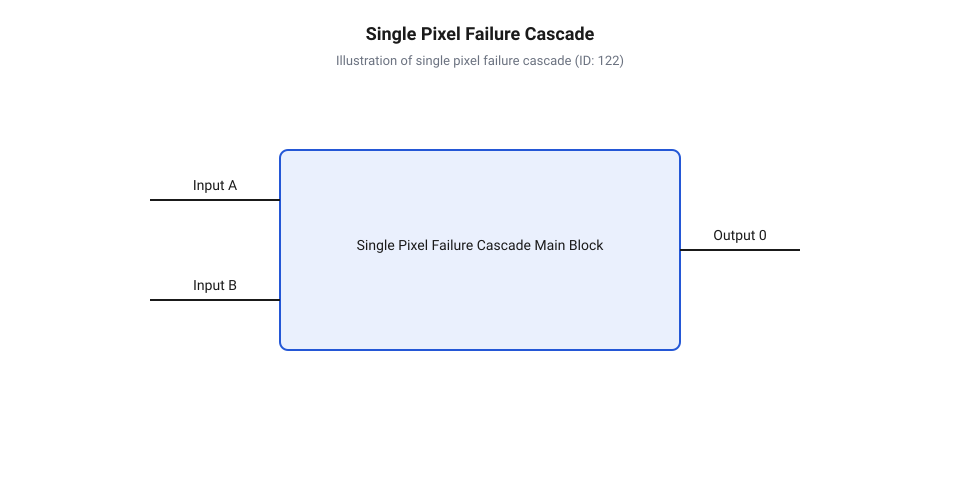
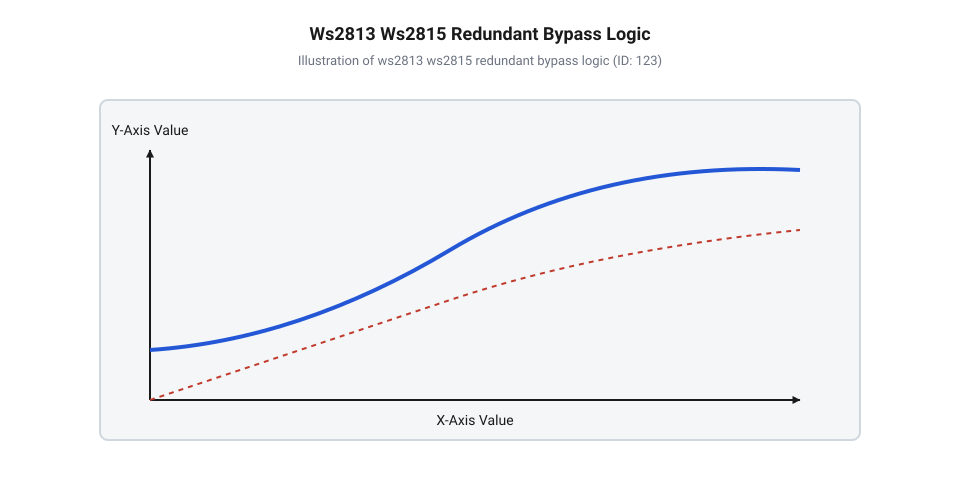
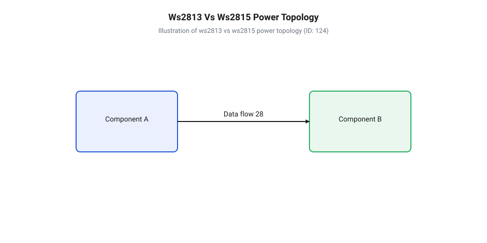
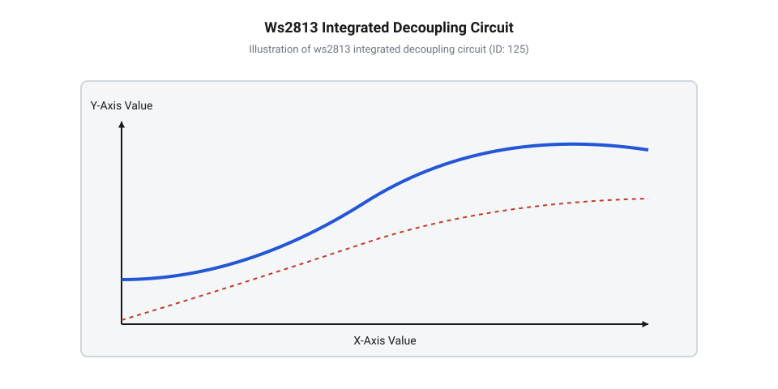
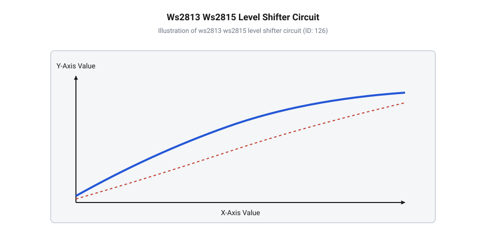
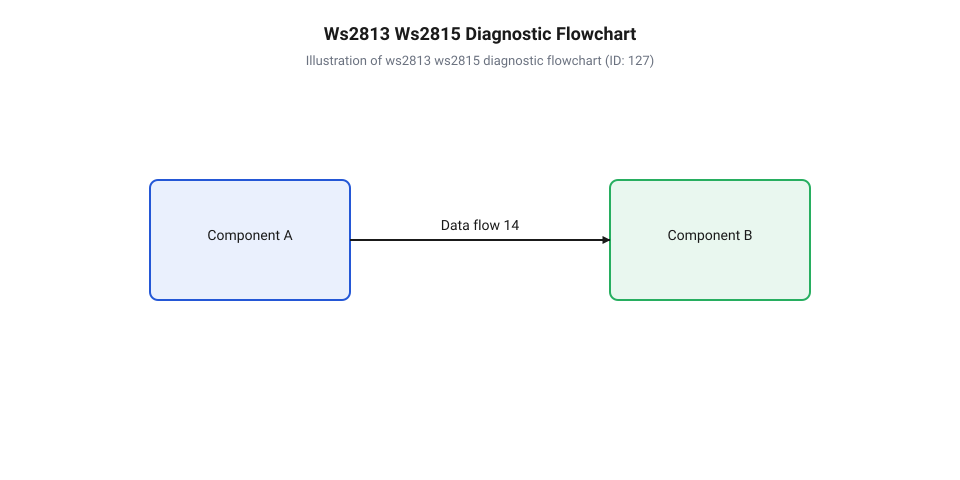

# Адресні світлодіоди WS2813 та WS2815 із резервним каналом даних та підвищеною напругою живлення

<preknowlist>
- [WS2812B — адресний RGB-світлодіод (5050)](root:cat-hw-actuators/ws2812b-led) — базову архітектуру смарт-пікселя 5050, 24-бітний протокол NZR та регенерацію сигналу.
- [Інжекція живлення світлодіодних стрічок](root:cat-hw-actuators/ws2812b-power-injection) — причини падіння напруги на провідниках стрічки та фізичні обмеження класичних 5-вольтових шин.
- [Блокувальні конденсатори в лініях живлення LED](root:cat-hw-actuators/decoupling-capacitors-led) — принципи фільтрації високочастотних завад по живленню та роль роль локальної ємності біля кожного пікселя.
- [Родина адресних світлодіодів та світлодіодних стрічок](root:cat-hw-actuators/addressable-led-family-overview) — загальні принципи побудови адресованих LED-систем та еволюційне позиціонування однопровідних чипів.
</preknowlist>

## Критичні відмови адресованих світлодіодних масивів

При спроектуванні масштабних світлодіодних екранів, архітектурного підсвічування чи складних робототехнічних систем інженери неодмінно стикаються з фундаментальною уразливістю класичних однопровідних шин: відмова бодай одного активного елемента в послідовному ланцюзі призводить до повної зупинки передачі даних для всіх наступних пристроїв. На відміну від паралельних інформаційних шин на кшталт @@en|I2C@@ чи @@en|RS-485@@, де всі приймачі підключені до спільних ліній паралельно й пасивно прослуховують ефір, стрічка з @@en|адресний світлодіод@@ (англ. @@en|addressable LED@@, від @@en|addressable@@ — той, що має адресу) будується за принципом активного послідовного каскаду. Кожен @@en|смарт-піксель@@ (англ. @@en|smart pixel@@, від @@en|smart@@ — інтелектуальний та @@en|pixel@@ від @@en|picture element@@ — елемент зображення) являє собою не просто фізичний випромінювач світла, а повноцінну інтегральну мікросхему драйвера, упаковану разом із трьома напівпровідниковими кристалами (Червоним, Зеленим та Синім) у спільний пластиковий корпус SMD 5050 розміром 5.0×5.0 мм. Всередині цього мікроскопічного корпусу розгортається складна цифро-аналогова система, що містить власний @@en|зсувний регістр@@ (англ. @@en|shift register@@), цифрові регістри-засувки (англ. @@en|latches@@), триканальний генератор @@en|широтно-імпульсна модуляція@@ (англ. @@en|Pulse-Width Modulation@@, @@en|PWM@@, від @@en|pulse width@@ — ширина імпульсу) для регулювання яскравості кожного каналу, а також активний вихідний драйвер-повторювач.

Фізична конструкція корпусу 5050 вимагає розміщення кремнієвого кристала драйвера та трьох світловипромінювальних кристалів на спільній металевій рамці-підкладці (англ. @@en|leadframe@@), з'єднаній з виводами мікростібковими золотими провідниками (англ. @@en|bond wires@@) діаметром близько 25 мкм. Під час інтенсивної роботи пристрою тривалі температурні цикли створюють механічний стрес через різницю коефіцієнтів теплового розширення пластикового компаунда, металевої рамки та тонких золотих ниток. Додатковий електричний стрес спричиняють високочастотні імпульсні кидки струму та статична електрика. Сукупність цих факторів створює постійний ризик фізичного дефекту в окремо взятому корпусі.

Щоб осягнути фізику виникнення каскадної відмови, необхідно детально простежити шлях інформаційного пакета крізь внутрішню структуру смарт-пікселя. Управління масивом здійснюється за допомогою однопровідного @@en|протокол NZR@@ (англ. @@en|Non-Return-to-Zero@@ — кодування без повернення до нуля), де логічні нулі та одиниці кодуються тривалістю високопотенційного імпульсу при стабільній частоті проходження бітів близько 800 кГц (з періодом біта 1.25 мкс). Логічний нуль визначається коротким імпульсом тривалістю 220–380 нс з наступною павзою, а логічна одиниця — довгим імпульсом тривалістю 580–1000 нс. Коли від керуючого мікроконтролера на основний вхід даних `DI` (англ. @@en|Data In@@) першого пікселя надходить серія серійних імпульсів, внутрішній цифровий автомат смарт-пікселя спрямовує перші 24 біти інформації (по 8 біт на кожен із трьох кольорів: Зелений, Червоний та Синій) у власний 24-бітний @@en|зсувний регістр@@. Після того як власний регістр повністю заповнюється, режим роботи цифрового автомата внутрішньо перемикається: всі наступні біти, що продовжують надходити на вхід `DI`, більше не захоплюються даним пікселем, а транслюються на його основний вихід `DO` (англ. @@en|Data Out@@).

Критично важливо розуміти, що вихід `DO` не є пасивним мідним провідником або мостом. Мікросхема драйвера здійснює активну @@en|регенерація сигналу@@ (англ. @@en|signal regeneration@@, від @@en|re-generation@@ — відновлення): вона заново формує фронти напруги за допомогою внутрішнього підсилювача з гістерезисом тригера Шмітта та двотактного вихідного каскаду (англ. @@en|push-pull driver@@). При цьому мікросхема усуває часовий @@en|джиттер@@ (англ. @@en|jitter@@ — тремтіння фази), відновлює крутизну наростання сигналу та прив'язує тривалість імпульсів до свого внутрішнього тактового RC-генератора. Завдяки цій активній регенерації інформаційний потік може без втрат долати сотні послідовно з'єднаних світлодіодів, не страждаючи від згасання та спотворення фронтів через паразитну ємність (близько 50–100 пФ/м) і індуктивність друкованих доріжок.

Однак саме ця активна роль кожного пікселя як послідовного ретранслятора перетворює кожен елемент ланцюга на критичну точку відмови (англ. @@en|single point of failure@@). Якщо всередині пікселя `N` виникає апаратне пошкодження — наприклад, термічний розрив золотого розварювального провідника між кристалом мікросхеми та виводом `DO`, локальний пробій підкладки статичною електрикою (англ. @@en|ESD@@), деградація кремнію через перегрів або зупинка внутрішнього RC-генератора — ланцюжок ретрансляції розривається остаточно. Вихід `DO` пошкодженого пікселя `N` зависає в постійному логічному нулі (0 В), логічній одиниці або переходить у високоімпедансний стан. У результаті пікселі `N+1`, `N+2` та всі подальші елементи масиву повністю втрачають зв'язок із джерелом даних. Як тільки в сигнальній лінії виникає пауза низького рівня тривалістю понад 50 мкс (або 280 мкс залежно від ревізії чипа), що сприймається як @@en|RESET-імпульс@@ (англ. @@en|reset pulse@@), усі пікселі фіксують отримані дані в регістрах відображення та скидають лічильник бітів для прийому нового кадру.

Еволюція адресованих світлодіодів починалася з дискретних контролерів серії @@en|WS2811@@, де одна мікросхема в корпусі DIP-8 або SOP-8 керувала трьома окремими зовнішніми світлодіодами через виходи стабілізаторів струму. Наступним етапом став вихід популярних смарт-пікселів @@en|WS2812@@ та @@en|WS2812B@@, які об'єднали мікросхему драйвера та RGB-кристали в єдиному корпусі SMD 5050 на класичних [адресних RGB-світлодіодах](root:cat-hw-actuators/ws2812b-led). Попри високу щільність монтажу та зручність керування по одному проводу, вироби перших поколінь мали два критичні недоліки. Першим була схильність до повного виходу з ладу всього масиву при поламці бодай одного елемента в послідовному ланцюзі, а другим — суттєве падіння напруги живлення 5 В на омічному опорі гнучких мідних доріжок стрічки. Усвідомлення цих обмежень спонукало розробників створити нове покоління чипів: у мікросхемі @@en|WS2813@@ впровадили дубльований резервний канал даних `BI` для захисту від каскадних відмов, а в чипі @@en|WS2815@@ підвищили напругу живлення до 12 В, що дозволило зменшити робочий струм лінії у кілька разів та будувати довгі світлодіодні масиви без частої інжекції живлення.

Для наочного аналізу каскадного руйнування інформаційного потоку в однопровідних системах розглянемо функціональну схему послідовного масиву:


*Каскадна відмова класичної однопровідної шини: вихід з ладу одного активного повторювача блокує проходження кадрів до решти масиву.*

Як видно зі схеми, обрив внутрішньої сигнальної лінії у будь-якій точці ланцюга створює неприпустимий бар'єр для інформаційного кадру. Проблема ускладнюється тим, що у критичних застосуваннях (архітектурна підсвітка фасадів, сценічні декорації, автомобільна світлотехніка) заміна одного SMD-компонента вимагає демонтажу всієї конструкції. Більш детальний аналіз еволюційного шляху однопровідних масивів розглядається у матеріалі про [еволюційні етапи розвитку](root:cat-hw-actuators/addressable-led-family-overview) світлодіодних технологій. Зацікавлені розробники також можуть ознайомитися з [програмним кодуванням сигналів](root:cat-hw-actuators/ws2813-and-ws2815-redundant-addressable-leds/api-ws2813-ws2815-protocol-and-driver-api.md) для глибшого розуміння часових інтервалів NZR-протоколу.

## Двоканальна логіка обходу пошкодженого пікселя

Щоб усунути уразливість однопровідного каскаду без ускладнення зовнішньої схемотехніки додатковими зовнішніми логічними вентилями чи маршрутизаторами, розробники чипів @@en|WS2813@@ та @@en|WS2815@@ впровадили апаратну логіку обходу дефектних елементів безпосередньо у кристал драйвера. Кожен смарт-піксель нового покоління оснащений трьома сигнальними виводами замість двох: основним входом даних `DI` (Data In), основним виходом даних `DO` (Data Out) та додатковим резервним входом даних `BI` (англ. @@en|Backup In@@, від @@en|backup input@@ — резервний вхід). На відміну від класичного чипа @@en|WS2812B@@, який приймає інформацію виключно від свого безпосереднього сусідка ліворуч, чип із дубльованим інтерфейсом здатний аналізувати потоки даних одразу від двох попередніх пікселів у масиві.

Схемотехнічна ідея @@en|резервування@@ (англ. @@en|redundancy@@, від лат. @@en|redundantia@@ — надлишковість) полягає у формуванні перехресних сигнальних зв'язків між каскадами. Вихід `DO` кожного пікселя `N` підключається паралельно до двох наступних пристроїв: до основного входу `DI` пікселя `N+1` та до резервного входу `BI` пікселя `N+2`. Усередині кожного драйвера інтегровано цифровий @@en|мультиплексор@@ (англ. @@en|multiplexer@@, від лат. @@en|multiplex@@ — багатократний) та апаратний детектор наявності валідного часоімпульсного сигналу.

Усередині мікросхеми аналізатор сигналу безперервно відстежує наявність високочастотних перепадів напруги на вході `DI`. Доки на основному вході `DI` пікселя `N+1` присутні регулярні фронти імпульсів частотою 800 кГц, його внутрішній цифровий автомат працює у звичайному режимі, вихоплюючи власні 24 біти та регенеруючи решту кадру зі свого вихода `DO` на вхід `DI` пікселя `N+2`. Одночасно з цим піксель `N+2` отримує той самий дубльований потік даних на свій резервний вхід `BI` безпосередньо з виходу `DO` пікселя `N`.

Якщо ж піксель `N+1` зазнає фізичного пошкодження і його вихід `DO` повністю замолкає (переходить у постійний стан 0 В або High-Z), апаратний сторожовий детектор пікселя `N+2` миттєво фіксує відсутність перепадів логічних рівнів на своєму вході `DI`. Не чекаючи додаткових команд від мікроконтролера, внутрішній @@en|мультиплексор@@ пікселя `N+2` автоматично перемикає внутрішній @@en|зсувний регістр@@ з аварійного входу `DI` на резервний вхід `BI`, який з'єднаний безпосередньо з виходом `DO` пікселя `N`.

Оскільки піксель `N` вже вихопив свої власні 24 біти з початку пакета, сигнал на його виході `DO` починається саме з тих бітів, які призначалися для наступних пікселів. Потрапляючи на вхід `BI` пікселя `N+2`, цей потік обходить згорілий піксель `N+1`. Піксель `N+2` вихоплює перші 24 біти з отриманої порції та регенерує решту даних для наступних елементів. У результаті весь масив продовжує стабільно працювати без втрати синхронізації: дефектний елемент `N+1` просто гасне, а всі наступні світлодіоди висвітлюють потрібну анімацію.

Водночас обхідна @@en|байпасна лінія@@ (англ. @@en|bypass line@@, від @@en|bypass@@ — обхідний шлях) має сувору фізичну межу: вона здатна компенсувати відмову лише одного ізольованого пікселя. Якщо у масиві одночасно або послідовно виходять з ладу два суміжні пікселі `N+1` та `N+2`, сигнальний ланцюг переривається остаточно. Адже резервний вхід `BI` пікселя `N+3` підключений до виходу `DO` пікселя `N+1`, який також виведений з ладу. Щоб мінімізувати ризик групових аварій через імпульсні перенапруги в шинах живлення, на стрічках обов'язково монтують локальні [блокувальні конденсатори](root:cat-hw-actuators/decoupling-capacitors-led) поруч із кожним корпусом.

Критично важливим правилом для інженерів є правильне підключення резервної лінії на першому пікселі масиву. Оскільки перший піксель `Pixel_1` не має перед собою попередніх елементів `Pixel_0` чи `Pixel_-1`, виникає питання обробки його входу `BI1`. Основний вхід `DI1` з'єднується з сигнальним виходом мікроконтролера через послідовний @@en|демпферний резистор@@ (англ. @@en|damping resistor@@, номіналом 33–100 Ом) для згашення високочастотних перевідбиттів у лінії. Вивід же `BI1` першого пікселя обов'язково підключається безпосередньо до спільної шини заземлення `GND`.

Якщо залишити `BI1` невикористаним (у вільно плаваючому стані), високий вхідний імпеданс КМОН-входу (англ. @@en|CMOS@@) вловлюватиме зовнішні електромагнітні наводки від імпульсних блоків живлення. Це спричинить хибні спрацьовування внутрішнього детектора та хаотичне перемикання мультиплексора на першому пікселі, що виллється у спотворення перших кадрів анімації. Для другого пікселя `Pixel_2` резервний вхід `BI2` підключається паралельно до входу `DI1` першого пікселя (або безпосередньо до сигнального виходу мікроконтролера), завдяки чому стрічка зберігає працездатність навіть при повній відмові найпершого світлодіода.

При розводці гнучких друкованих плат (англ. @@en|FPCB@@) світлодіодних стрічок шини `DI`, `DO` та `BI` прокладаються паралельними доріжками мінімальної довжини. Для запобігання ємнісним перехресним наводкам (англ. @@en|crosstalk@@) між суміжними сигнальними лініями доріжки сигналів розділяють вузькими провідниками заземлення або розносять по різних шарах плати, що гарантує високу завадозахищеність обхідного каналу на довжинах стрічок до кількох метрів.

Розглянемо схемотехнічну топологію з'єднання дубльованого сигнального інтерфейсу між сусідніми елементами стрічки:


*Двоканальна топологія з резервним входом BI: при пошкодженні пікселя N наступний елемент N+1 перемикається на зчитування даних безпосередньо з виходу DO пікселя N-1.*

Завдяки двоканальній логіці чипи @@en|WS2813@@ та @@en|WS2815@@ стали стандартом для створення надійних світлодіодних масивів. Повний опис електричних режимів, цокольовки виводів та специфікацій живлення 5 В проти 12 В наведено у довіднику з [параметрами цокольовки та специфікацією](root:cat-hw-actuators/ws2813-and-ws2815-redundant-addressable-leds/api-ws2813-ws2815-hardware-interface.md). Практичні методики розрахунку падіння напруги та перерізу провідників викладено у системі [математичними розрахунками струмів](root:cat-hw-actuators/ws2813-and-ws2815-redundant-addressable-leds/math-ws2813-ws2815-power-and-drop-calc.md). А приклади побудови готових промислових модулів та матриць можна знайти у практичній інструкції по [практичній збірці відмовостійкої матриці](root:cat-hw-actuators/ws2813-and-ws2815-redundant-addressable-leds/proj-fault-tolerant-ws2815-matrix-system.md).

## Фізика живлення та внутрішня стабілізація

Коли розробник виходить за межі настільних експериментів і приступає до проєктування масштабних світлодіодних масивів — від кількаметрових підсвіток до гігантських медіафасадів, — головним обмежувальним фактором стає не швидкість сигнального інтерфейсу, а фізика розподілу електричної енергії. Навіть найдосконаліший смарт-піксель із резервним каналом даних втрачає здатність регенерувати імпульси та випромінювати задану колірну гаму, якщо потенціал на його виводах живлення падає нижче критичного порогу. У класичних 5-вольтових системах на базі @@en|WS2812B@@ та @@en|WS2813@@ струм, що протікає через гнучку друковану плату, сягає десятків ампер. Омічний опір тонких мідних доріжок створює суттєве @@en|падіння напруги@@ (англ. @@en|voltage drop@@, від @@en|voltage@@ — напруга та @@en|drop@@ — падіння), яке прогресує в міру віддалення від джерела живлення і спричиняє викривлення передачі кольору та аварійні скидання внутрішньої цифрової логіки.

Щоб зрозуміти причину такої енергетичної уразливості 5-вольтових стрічок, необхідно зіставити схемотехнічну топологію підключення світловипромінювальних кристалів усередині чипів @@en|WS2813@@ та @@en|WS2815@@. У 5-вольтовому чипі WS2813 три напівпровідникові кристали (Червоний, Зелений і Синій) підключені паралельно до спільної шини живлення `VDD = 5 В`. Кожен кристал живиться через свій власний @@en|лінійний стабілізатор@@ (англ. @@en|linear regulator@@, від @@en|linear@@ — лінійний та @@en|regulator@@ — регулятор) струму, який утримує робочий струм каналу на рівні близько 15 мА. При випромінюванні чистого білого кольору, коли всі три канали працюють на повну потужність, загальний струм споживання одного пікселя складається зі струмів трьох паралельних гілок і становить `I_pixel = 15 мА + 15 мА + 15 мА = 45 мА` (або `0.045 А`).

Принципово інший підхід реалізовано в 12-вольтовому чипі WS2815. Вводячи високу напругу живлення `VDD = 12 В`, інженери змінили внутрішнє розварювання кристалів у корпусі SMD 5050: Червоний, Зелений та Синій напівпровідники з'єднано послідовно в єдиний струмовий ланцюг. Пряме падіння напруги на Червоному кристалі становить `V_f_R ≈ 2.0 В`, а на Зеленому та Синьому — по `V_f_G ≈ V_f_B ≈ 3.1 В`. Сумарне падіння напруги на трьох послідовно ввімкнених світлодіодах складає `V_f_total = 2.0 В + 3.1 В + 3.1 В = 8.2 В`. Оскільки шина живлення надає 12 В, цієї напруги з запасом вистачає для того, щоб єдине @@en|струмове навантаження@@ (англ. @@en|current load@@, від @@en|current@@ — струм та @@en|load@@ — навантаження) пропустити послідовно крізь усі три кристали. У результаті при максимальній яскравості білого кольору чип WS2815 споживає з лінії 12 В струм лише одного ланцюга — близько `10–12 мА` (абсолютний максимум не перевищує `15 мА`), що в 3–4 рази менше порівняно з 5-вольтовим WS2813.

Зменшення робочого струму лінії у 3–4 рази забезпечує колосальний виграш у стабільності живлення завдяки законам електродинаміки. Відповідно до @@en|закон Ома@@ (англ. @@en|Ohm's law@@, від імені Георга Ома) спад напруги `ΔV` на ділянці мідного провідника з опором `R_trace` прямо пропорційний струму `I`. Водночас втрати потужності на нагрів провідників `P_loss` визначаються @@en|закон Джоуля — Ленца@@ (англ. @@en|Joule's law@@, від імен Джеймса Джоуля та Емілія Ленца) і зростають пропорційно квадрату струму `I²`.

Передбачити спад напруги та втрати потужності для довжини стрічки можна за допомогою формульного розрахунку:

```
ΔV = I · R_trace                 [закон Ома для спаду напруги]
P_loss = I² · R_trace            [закон Джоуля — Ленца для теплових втрат]
```

де `I` — сумарний струм споживання світлодіодного масиву, а `R_trace` — опір мідних доріжок стрічки.

Розглянемо покрокове обчислення електричних режимів для 5-метрового масиву зі 300 смарт-пікселів при опорі ліній `R_trace = 0.2 Ом`:

**Розрахунок струму, спаду напруги та теплових втрат для WS2813 (5 В) проти WS2815 (12 В)**
```
I_WS2813 = 300 · 0.045 А
         = 13.5 А                [сумарний струм 300 пікселів WS2813]

ΔV_WS2813 = 13.5 А · 0.2 Ом
          = 2.7 В                [спад напруги на доріжках для WS2813]

V_end_WS2813 = 5.0 В - 2.7 В
             = 2.3 В             [напруга наприкінці стрічки WS2813]

P_loss_WS2813 = (13.5 А)² · 0.2 Ом
              = 36.45 Вт         [потужність нагріву провідників WS2813]

I_WS2815 = 300 · 0.012 А
         = 3.6 А                 [сумарний струм 300 пікселів WS2815]

ΔV_WS2815 = 3.6 А · 0.2 Ом
          = 0.72 В               [спад напруги на доріжках для WS2815]

V_end_WS2815 = 12.0 В - 0.72 В
             = 11.28 В           [напруга наприкінці стрічки WS2815]

P_loss_WS2815 = (3.6 А)² · 0.2 Ом
              = 2.59 Вт          [потужність нагріву провідників WS2815]
```

Як видно з розрахунку, при переході з 5 В на 12 В напруга наприкінці 5-метрового відрізка залишається на рівні 11.28 В, що повністю перекриває робочий діапазон чипа, а теплові втрати в міді знижуються у `36.45 / 2.59 ≈ 14` разів.

Для підтримки однакової яскравості всіх елементів уздовж лінії у чипах WS2813 та WS2815 застосовуються внутрішньочипові @@en|джерело стабільного струму@@ (англ. @@en|constant-current source@@, від @@en|constant current@@ — стабільний струм та @@en|source@@ — джерело). Усередині кремнієвого кристала драйвера сформовано генератори струму на базі токових дзеркал, опорна напруга для яких задається прецизійним внутрішнім джерелом опорної напруги (англ. @@en|bandgap reference@@). Кожен аналоговий канал виходу працює в режимі насичення: доки напруга живлення `VDD` перевищує мінімальний поріг стабілізації, струм через кристали залишається незмінним із точністю до ±1%.

Для 5-вольтового WS2813 мінімальна напруга стабілізації визначається як `V_min = V_f + V_sat ≈ 3.1 В + 0.4 В = 3.5 В` (де `V_sat` — @@en|напруга насичення@@, англ. @@en|saturation voltage@@, від @@en|saturation@@ — насичення та @@en|voltage@@ — напруга, транзисторного ключа). Якщо через спад напруги в лініях потенціал `VDD` опускається нижче 3.5 В, стабілізатори струму виходять із режимів регулювання. Оскільки напівпровідникові матеріали кристалів мають різну ширину забороненої зони (Червоний кристал виготовляється на основі AlInGaP із `V_f ≈ 2.0 В`, а Зелений та Синій — на основі InGaN із `V_f ≈ 3.1 В`), при просіданні живлення нижче 3.5 В першими згасають Синій та Зелений канали. У результаті біле світло викривляється і набуває неприємного рудувато-червоного відтінку.

У 12-вольтовому чипі WS2815 внутрішній лінійний стабілізатор знижує напругу 12 В до робочого рівня цифрового ядра (близько 5 В). Мінімальна напруга живлення шини, за якої чип зберігає повну працездатність, складає близько `9.0–9.5 В`. Усі надлишки напруги `V_excess = 12 В - 8.2 В - V_sat ≈ 3.0 В` розсіюються внутрішніми транзисторними стабілізаторами струму у вигляді тепла. Теплова потужність, що виділяється одним пікселем WS2815 у режимі максимального білого світіння, обчислюється як `P_heat = V_excess · I_pixel = 3.0 В · 0.012 А = 0.036 Вт`. Таке незначне теплове навантаження легко відводиться металевою рамкою-підкладкою корпусу SMD 5050 через паяльні виводи на мідні доріжки плати, що запобігає перегріву напівпровідників та продовжує термін їхньої служби.

Для унаочнення відмінностей у побудові силових ланцюгів розглянемо порівняльну схемотехніку живлення двох типів смарт-пікселів:


*Порівняльна топологія живлення WS2813 та WS2815: паралельне підключення кристалів при 5 В проти послідовного ланцюга із внутрішнім знижувальним регулятором при 12 В.*

З аналізу схеми стає очевидно, чому WS2815 є ідеальним вибором для протяжних світлодіодних ліній. У той час як для WS2813 потрібна часта [інжекція живлення в лінію](root:cat-hw-actuators/ws2812b-power-injection) через кожні 2–3 метри стрічки, масиви WS2815 здатні стабільно працювати від однієї точки підключення на довжинах до 5–10 метрів. Більш детальні математичні моделі та алгоритми розрахунку перерізу силових провідників наведені у спеціалізованому матеріалі з [математичного розрахунку втрат](root:cat-hw-actuators/ws2813-and-ws2815-redundant-addressable-leds/math-ws2813-ws2815-power-and-drop-calc.md). Приклади практичного проєктування силової шини для 12-вольтових систем описані в [проєктній розробці матриць](root:cat-hw-actuators/ws2813-and-ws2815-redundant-addressable-leds/proj-fault-tolerant-ws2815-matrix-system.md).

## Інтеграція внутрішньої обв'язки смарт-пікселів

Схемотехнічна надійність світлодіодного масиву визначається не лише топологією сигнальних чи силових ліній, але й стійкістю системи до високочастотних завад, що виникають під час комутації струму. У класичних адресованих стрічках на базі чипів WS2812B кожен смарт-піксель потребував обов'язкового монтажу зовнішнього керамічного @@en|блокувальний конденсатор@@ (англ. @@en|decoupling capacitor@@, від @@en|decoupling@@ — розв'язка та @@en|capacitor@@ — конденсатор) ємністю 0.1 мкФ безпосередньо біля виводів живлення `VDD` і `GND`. Внутрішня @@en|широтно-імпульсна модуляція@@ (англ. @@en|Pulse-Width Modulation@@, @@en|PWM@@), яка працює на частотах 2–4 кГц із крутими наносекундними фронтами перемикання ключових транзисторів, генерує потужні імпульсні кидки струму `di/dt`.

Паразитна індуктивність доріжок гнучкої плати (яка становить близько `L_trace ≈ 1 нГн/мм`) при різких перепадах струму створює імпульсну проти-ЕРС за формулою `V_spike = L_trace · (di/dt)`. За відсутності локальної фільтруючої ємності ці високочастотні викиди створюють просідальний @@en|перехідний процес@@ (англ. @@en|transient process@@, від @@en|transient@@ — перехідний та @@en|process@@ — процес), що призводить до збоїв внутрішнього RC-генератора, зависання регістрів та видимого хаотичного миготіння світлодіодів.

Прагнучи спростити монтаж та підвищити підсумкову надійність світлодіодних стрічок, розробники чипів WS2813 та WS2815 інтегрували елементи фільтрації та захисту безпосередньо у внутрішню структуру смарт-пікселя. Усередині пластикового корпусу SMD 5050 поруч із кристалом мікросхеми драйвера розміщено мікроскопічний високочастотний керамічний конденсатор або інтегровану МОН-ємність (англ. @@en|MOS capacitor@@), підключену паралельно до шин живлення чипа. Додатково на вході сигнальних шин `DI` та `BI` всередині кремнієвої матриці сформовано послідовні @@en|демпферний резистор@@ (англ. @@en|damping resistor@@, від @@en|damping@@ — демпфування та @@en|resistor@@ — резистор) опором близько 33–50 Ом та двонаправлені діоди захисту від статичної електрики @@en|ESD@@.

Внутрішні демпферні резистори виконують критичну роль в узгодженні вольового опору сигнальних ліній. Вхідні каскади цифрових логічних вентилів КМОН володіють високим імпедансом і паразитною ємністю порядку `C_in ≈ 5–10 пФ`. Коли високочастотний фронт імпульсу NZR-протоколу з часом наростання менше 10 нс поширюється мідною доріжкою, стрибок імпедансу на вході чипа спричиняє перевідбиття хвилі (англ. @@en|signal reflection@@). Внутрішній демпферний опір гасить енергію відбитої хвилі, запобігаючи виникненню дзвіна (англ. @@en|ringing@@) та хибних спрацьовувань вхідних тригерів Шмітта.

Монолітна інтеграція пасивної обв'язки корінним чином змінює технологію виробництва друкованих плат та гнучких стрічок. Зменшення кількості дискретних компонентів на кожен піксель з двох (світлодіод + конденсатор) до одного (лише корпус 5050) дає виражений схемотехнічний та економічний ефект. На 5-метровій стрічці щільністю 60 LED/м це усуває необхідність пайки 300 додаткових SMD-конденсаторів та 600 паяних з'єднань. У результаті суттєво знижується ризик виникнення дефектів поверхневого монтажу — таких як @@en|холодний спай@@ (англ. @@en|cold solder joint@@, від @@en|cold@@ — холодний, @@en|solder@@ — припій та @@en|joint@@ — з'єднання), розрив контактів через вібрацію чи мікротріщини в кераміці при згинанні гнучкої плати. Відсутність дискретних конденсаторів також виключає ризик відриву паяльних площадок (англ. @@en|pad cratering@@) при багаторазовому вигинанні стрічки під час монтажу у криволінійні алюмінієві профілі. Крім того, відсутність зовнішніх площадок під конденсатори дозволяє звузити ширину гнучкої плати до 5 мм, що критично важливо для тонких світлодіодних профілів.

Конструктивні особливості інтегрованого смарт-пікселя з вбудованою обв'язкою представлені на принциповій схемі:


*Внутрішня схемотехніка обв'язки смарт-пікселя: інтеграція фільтруючих ємностей та демпферних опорів прямо в корпус 5050 спрощує розводку друкованої плати.*

Як показано на схемі, внутрішні ємності та резистори створюють компактну захищену систему, яка нейтралізує локальні @@en|імпульсні завади@@ (англ. @@en|impulse noise@@, від @@en|impulse@@ — імпульс та @@en|noise@@ — шум) безпосередньо у місці їх виникнення.

Попри високий рівень внутрішньої інтеграції, інженер повинен чітко усвідомлювати межі застосування вбудованої обв'язки і не нехтувати системними зовнішніми компонентами. Внутрішній мікроконденсатор пікселя володіє невеликою ємністю (порядку кількох нанофарад) і здатний придушувати лише високочастотні джиттерні шуми комутації ШІМ. Він не спроможний компенсувати низькочастотні просідання напруги, що виникають при різкому ввімкненні всього масиву з нульового стану в режим максимального білого світіння, коли струм у лінії стрибкоподібно зростає від нуля до кількох ампер.

Тому на рівні всієї світлодіодної системи обов'язковим залишається встановлення зовнішнього згладжувального електролітичного або танталового конденсатора ємністю `100–470 мкФ` (на робочу напругу 16 В для WS2813 або 25 В для WS2815) безпосередньо на клемах підключення джерела живлення до стрічки. Крім того, на вході керуючого сигналу від мікроконтролера до першого пікселя масиву слід зберігати зовнішній демпферний резистор номіналом `33–100 Ом` для узгодження хвильового опору довгої сполучної лінії та захисту виходу контролера. Детальніше про роль системних ємностей викладено у статті про [блокувальні конденсатори в лініях](root:cat-hw-actuators/decoupling-capacitors-led) живлення LED. Електричні специфікації виводів та рівні керування описані у довіднику з [залізного інтерфейсу та цокольовки](root:cat-hw-actuators/ws2813-and-ws2815-redundant-addressable-leds/api-ws2813-ws2815-hardware-interface.md), а порівняння з іншими типами адресованих світлодіодів можна знайти у матеріалі про [двопровідні світлодіодні чипи](root:cat-hw-actuators/apa102-and-sk9822-two-wire-leds) з окремим тактуванням.

## Діагностика та проектування стійких систем

Створення високонадійних світлодіодних систем на базі смарт-пікселів @@en|WS2813@@ та @@en|WS2815@@ вимагає комплексного інженерного підходу, який охоплює не лише схемотехнічне розведення дубльованого каналу, але й строге @@en|узгодження логічних рівнів@@ (англ. @@en|level shifting@@, від @@en|level@@ — рівень та @@en|shifting@@ — зсув) керуючого сигналу, правильну топологію заземлення й ефективні алгоритми локалізації несправностей. Світлодіодний масив може мати ідеальну силову шину та дубльовані лінії даних, проте працюватиме нестабільно або взагалі відмовиться приймати кадри, якщо керуючий мікроконтролер не здатний сформувати круті прямокутні імпульси необхідної амплітуди, або якщо у системі виникне @@en|зсув потенціалу землі@@.

Головна схемотехнічна проблема при сполученні сучасних мікроконтролерів (на базі @@en|ESP32@@, @@en|STM32@@, @@en|RP2040@@ чи @@en|Raspberry Pi Pico@@) зі смарт-пікселями полягає у розбіжності логічних рівнів напруги. Сучасні керуючі чипи працюють від напруги живлення `3.3 В` і формують на своїх вихідних @@en|GPIO@@-пінах логічну одиницю амплітудою `V_OH ≈ 3.0–3.3 В`. Водночас вхідні КМОН-каскади `DI` та `BI` чипів WS2813 (що живляться від `5 В`) і WS2815 (чиє цифрове ядро також прив'язане до внутрішнього порогу `5 В`) розраховані на логічний поріг розпізнавання одиниці `V_IH ≥ 0.7 · VDD ≈ 3.5 В`. Вхідний тригер Шмітта смарт-пікселя, отримуючи керуючий сигнал амплітудою `3.3 В`, опиняється у граничній зоні невизначеності. На коротких провідниках при кімнатній температурі система може частково працювати, проте найменший джиттер, просідання живлення чи температурне відхилення призводять до хибних спрацьовувань, зсуву кольорів або повного зависання першого пікселя.

Для подолання цього бар'єра застосовують активний @@en|шифтер рівнів@@ (англ. @@en|level shifter@@). На практиці інженери початківці часто припускаються помилки, використовуючи пасивні резистивні дільники напруги або двонаправлені транзисторні модулі на польових транзисторах (наприклад, @@en|BSS138@@ із підтягувальними резисторами). Такі схеми чудово працюють у повільних інтерфейсах @@en|I2C@@, проте абсолютно непридатні для часоімпульсного @@en|протокол NZR@@ на частоті 800 кГц. Паразитна ємність підтягувальних опорів створює тривалий час наростання фронту `RC`, завалюючи наносекундні імпульси `T0H` (тривалістю 220–380 нс) і перетворюючи їх на трапецеподібні хвилі, які дешифратор чипа сприймає як хаотичний шум.

Єдиним професійним рішенням для узгодження ліній у часоімпульсних однопровідних протоколах є застосування спеціалізованих високошвидкісних буферних мікросхем із повноцінним push-pull виходом (англ. @@en|push-pull driver@@), що живляться від напруги `5 В`. Стандартом індустрії стали мікросхеми логічних родин @@en|74AHCT125@@, @@en|74HCT245@@ або одноканальні транслятори @@en|SN74LV1T34@@. Символ `T` у маркуванні серій `HCT` та `AHCT` вказує на сумісність вхідних каскадів із логікою @@en|TTL@@: поріг розпізнавання високого рівня складає всього `V_IH = 2.0 В`. Таким чином, сигнал `3.3 В` від мікроконтролера гарантовано сприймається мікросхемою як чиста логічна одиниця, а її потужний @@en|двотактний вихідний каскад@@ формує круті фронти амплітудою `5.0 В` із часом наростання менше 5 нс.

На виході буферної мікросхеми безпосередньо перед довгою сполучною лінією встановлюють послідовний @@en|демпферний резистор@@ номіналом `33–100 Ом`. Він узгоджує вихідний імпеданс драйвера з хвильовим опором лінії передачі, пригнічуючи перевідбиття та дзвін сигналу. Також критично важливо організувати @@en|зіркоподібне заземлення@@ (англ. @@en|star ground@@, від @@en|star@@ — зірка та @@en|ground@@ — земля) між джерелом живлення стрічки, мікроконтролером та буферним шифтером. Якщо через спільний дріт заземлення мікроконтролера протікатиме високий імпульсний струм живлення світлодіодів, омічний опір дроту створить @@en|зсув потенціалу землі@@ (англ. @@en|ground bounce@@, від @@en|ground@@ — земля та @@en|bounce@@ — стрибок), що модулюватиме керуючий сигнал завадами і спричинятиме збої синхронізації.

При проєктуванні топології стійкого світлодіодного масиву необхідно суворо дотримуватися правил розводки дубльованого каналу. Вихід `DO` кожного пікселя `N` з'єднують із входом `DI` пікселя `N+1` та входом `BI` пікселя `N+2`. На першому елементі масиву `Pixel_1` вивід `DI1` отримує узгоджений сигнал від шифтера рівнів, а вивід `BI1` підключають безпосередньо до спільної шини `GND` для фіксації логічного нуля та захисту від наводок. Щоб первинна ланка не залишалася єдиною точкою відмови, резервний вхід `BI2` другого пікселя підключають паралельно до входу `DI1` першого пікселя (після демпферного резистора). За такої схеми навіть повне фізичне руйнування першого чипа не призведе до зупинки всієї стрічки — другий піксель автоматично переключить свій мультиплексор на входження сигналу через `BI2`.

Схемотехнічна топологія узгодження логічних рівнів та організації заземлення представлена на схемі:


*Схема підключення мікроконтролера 3.3 В до стрічки WS2813/WS2815 через активний шифтер 74AHCT125: забезпечення точності часових інтервалів NZR-протоколу та захист від зсуву землі.*

Завдяки дубльованому каналу система набуває стійкості до одиничних відмов. Проте під час експлуатації реальних інсталяцій інженеру необхідно відрізняти поодинокі дефекти від системних аварій. Апаратна діагностика світлодіодного масиву базується на аналізі характерних візуальних та електричних ознак:

1. **Поодинока відмова пікселя** (`Pixel N` виведено з ладу): піксель `N` залишається повністю темним або замороженим у довільному кольорі. Наступний піксель `N+1` отримує потік даних через свій вхід `BI` з виходу `DO` пікселя `N-1` і продовжує повноцінно відтворювати анімацію. Візуальний синдром — один темний елемент усередині справного працюючого масиву. 2. **Подвійна суміжна відмова** (англ. @@en|double adjacent failure@@, від @@en|double@@ — подвійний, @@en|adjacent@@ — суміжний та @@en|failure@@ — відмова): одночасний або послідовний вихід з ладу двох розташованих поруч чипів `Pixel N` та `Pixel N+1`. Оскільки резервний вхід `BI` пікселя `N+2` підключений до виходу `DO` пікселя `N` (який також згорів), дубльований канал втрачає джерело регенерованого сигналу. Сигнальний ланцюг переривається остаточно: пікселі від `N+2` до кінця масиву повністю згасають або замирають у стані скидання. 3. **Системне просідання живлення**: масив працює коректно при низькій яскравості, але при виведенні максимального білого кольору починає викривляти відтінки в бік червоного або довільно миготіти. Це свідчить про спад напруги на доріжках нижче порогу стабілізації внутрішніх джерел струму.

Для швидкої локалізації несправностей в умовах об'єкта розроблено діагностичний алгоритм:


*Діагностичний алгоритм пошуку несправностей: від візуального аналізу зламу анімації до інструментальної перевірки сигналів логічним аналізатором.*

При інструментальній перевірці використовують двоканальний @@en|осцилограф@@ (англ. @@en|oscilloscope@@, від лат. @@en|oscillo@@ — коливаюсь та грец. @@en|skopeo@@ — дивлюсь) або портативний @@en|логічний аналізатор@@ (англ. @@en|logic analyzer@@). Щоб локалізувати точку зламу, щупи підключають до виводів `DI` та `BI` першого непрацюючого пікселя `Pixel N+2`. Наявність імпульсів NZR-протоколу амплітудою `4.5–5.0 В` на вході `BI` при відсутності сигналу на `DI` підтверджує спрацьовування апаратного байпасу та вихід з ладу пікселя `N+1`. Якщо ж імпульси відсутні на обох входах `DI` та `BI`, це однозначно вказує на подвійну суміжну відмову чипів `N` та `N+1` або на механічний розрив шини заземлення чи живлення на цій ділянці.

Програмне забезпечення контролера також може включати діагностичні процедури: періодичне проганяння поодинокого рухомого пікселя (англ. @@en|chaser pattern@@) дозволяє візуально виявляти несправні елементи та визначати точні індекси згорілих модулів.

Детальні інструкції щодо розрахунку перерізу силових провідників наведені у спеціалізованому матеріалі з [формульного розрахунку втрат](root:cat-hw-actuators/ws2813-and-ws2815-redundant-addressable-leds/math-ws2813-ws2815-power-and-drop-calc.md). Повний опис електричних часових параметрів NZR-сигналу та структури кадру міститься в довіднику з [програмного кодування драйвера](root:cat-hw-actuators/ws2813-and-ws2815-redundant-addressable-leds/api-ws2813-ws2815-protocol-and-driver-api.md), а специфікацію виводів та цокольовку корпусів можна переглянути у посібнику із [залізного інтерфейсу сигналів](root:cat-hw-actuators/ws2813-and-ws2815-redundant-addressable-leds/api-ws2813-ws2815-hardware-interface.md). Покроковий приклад проєктування та монтажу промислової 12-вольтової матриці викладено у практичному [керівництві зі збірки](root:cat-hw-actuators/ws2813-and-ws2815-redundant-addressable-leds/proj-fault-tolerant-ws2815-matrix-system.md) відмовостійких систем.