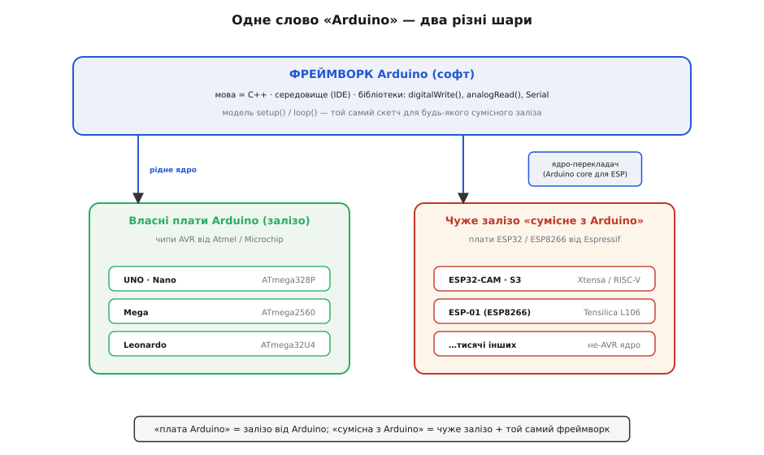
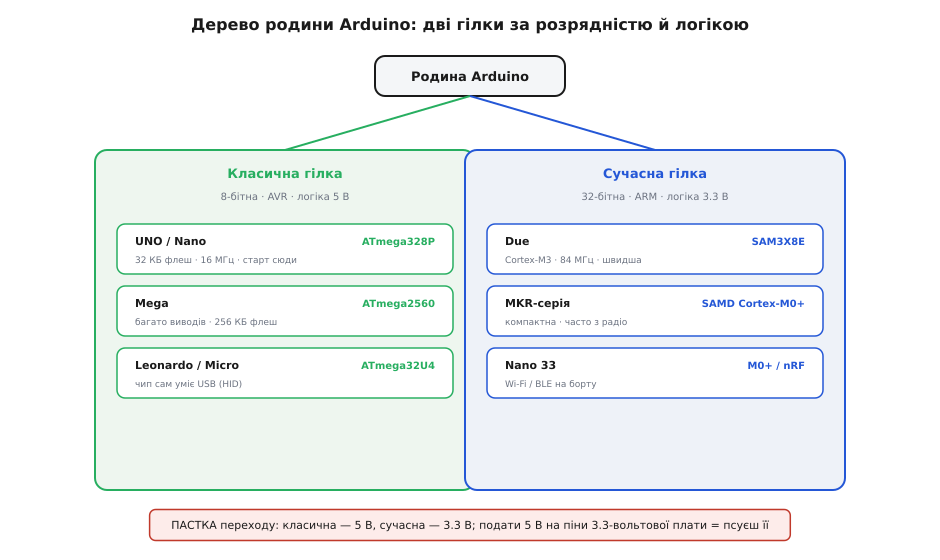

# Родина Arduino

<preknowlist>
- [Родина ESP32/ESP8266 (Espressif)](root:cat-hw-boards/esp32-family) — розуміння того, що фреймворк Arduino працює й на чужому залізі
</preknowlist>

## Два значення слова «Ардуїно»

Слово «Ардуїно» означає одразу дві різні речі, які часто плутають. По-перше, це родина мікроконтролерних плат із характерним розташуванням контактів. По-друге, це програмний @@en|framework@@ — набір бібліотек та інструментів, що робить програмування мікроконтролерів простішим.

*Слово Arduino об'єднує дві сутності: фізичні плати та екосистему для розробки коду.*
Головна перевага фреймворку в тому, що він працює не лише на оригінальних платах. Завдяки ядрам-перекладачам (@@en|core@@), написаний код можна запускати на абсолютно іншому залізі, наприклад, на платах [родини ESP32](root:cat-hw-boards/esp32-family). Коли програма викликає стандартну функцію на кшталт `digitalWrite` чи `pinMode`, саме ядро бере на себе переклад: воно перетворює універсальний виклик на специфічні для конкретного мікроконтролера дії. Для одних чипів це буде прямий запис в апаратні регістри, для інших — звернення до низькорівневих функцій від виробника кристала. Цей шар абстракції приховує фізичну різницю між мікроконтролерами, тому один і той самий код успішно керує контактами на зовсім різних архітектурах.

## Звідки взялася платформа Arduino

Проєкт з'явився в місті Іврея (Італія) як інструмент для студентів, яким потрібен був простий спосіб керувати електронікою. Творці зробили платформу максимально доступною: вони не лише спростили мову програмування, а й відкрили схеми самих плат.
Відкрита архітектура (@@en|open-source hardware@@) призвела до появи тисяч сумісних пристроїв. Сьогодні ринок пропонує як оригінальні плати від розробників, так і численні клони. Клони часто коштують дешевше і можуть мати інші роз'єми чи додаткові компоненти, але завдяки спільній схемі вони повністю сумісні з екосистемою.

## Як працює завантаження коду

У класичному програмуванні мікроконтролерів для запису коду потрібен окремий пристрій — програматор. Arduino змінила цей підхід, помістивши в пам'ять мікроконтролера спеціальну програму — завантажувач (@@en|bootloader@@). Після подачі живлення завантажувач кілька секунд чекає на нову програму через USB-кабель. Якщо вона надходить, він записує її в пам'ять; якщо ні — запускає наявний код.
Під капотом програм Arduino працює звичайна мова C++. Але для зручності базову модель спрощено до двох функцій. У `setup` відбувається початкове налаштування, яке виконується один раз, а `loop` постійно крутиться по колу, виконуючи основну логіку роботи пристрою. Фізично ж у прошивці завжди існує прихована головна функція `main`. Вона спочатку викликає `setup`, а потім запускає нескінченний цикл `while (1)`, усередині якого постійно викликає `loop`. Оскільки на голому залізі (@@en|bare metal@@) мікроконтролер не має операційної системи, куди програма могла б завершитися й повернути керування, цей цикл ніколи не переривається природним шляхом. Зупинити його можна лише ззовні: вимкнути живлення, перезавантажити мікроконтролер апаратним скиданням (@@en|hardware reset@@) або перевести його у сплячий режим (@@en|sleep mode@@).

## Дві гілки плат Arduino

Залежно від складності завдання, плати родини діляться на дві великі гілки, які різняться за архітектурою та робочою напругою.

*Дві основні гілки еволюції плат: класичні на 5 В та потужні на 3.3 В.*
Перша гілка — це класичні 8-бітні плати (такі як UNO, Nano, Mega). Вони працюють із логікою 5 В, прості в освоєнні, але мають обмежену пам'ять і швидкість.
Друга гілка — сучасні 32-бітні плати на базі архітектури ARM. Вони працюють із логікою 3.3 В, мають значно більшу обчислювальну потужність і часто оснащені модулями для радіозв'язку. Вибір гілки залежить від того, чи потрібні вам висока швидкість і зв'язок, чи достатньо базового керування простими сенсорами.
