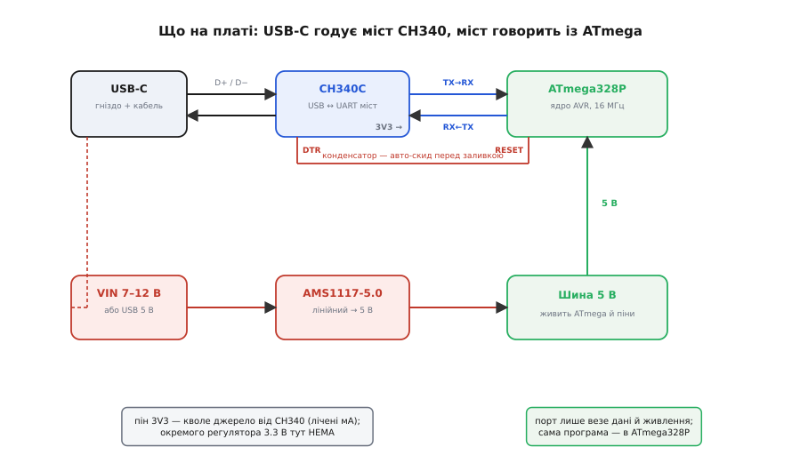
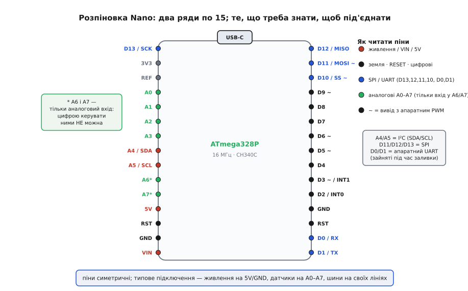
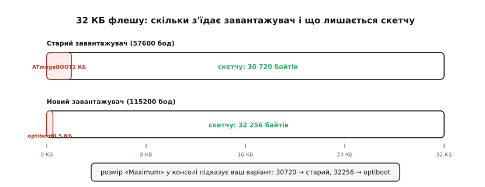

# Arduino Nano (ATmega, USB-C)

<preknowlist>
- [Arduino UNO R3 (CH340)](root:cat-hw-boards/arduino-uno) — розуміння того, що Nano несе той самий чип ATmega328P у компактнішому корпусі.
</preknowlist>

## Три головні мікросхеми плати

Плата Arduino Nano — це компактний варіант контролера, який містить ті самі ключові компоненти, що й більша плата [Arduino UNO R3 (CH340)](root:cat-hw-boards/arduino-uno), але займає набагато менше місця на макетній платі. Головним її мозком є мікроконтролер @@en|ATmega328P@@, у якому зберігається та виконується ваша програма. Щоб комп'ютер міг спілкуватися з цим мікроконтролером через сучасний роз'єм @@en|USB-C@@, на платі встановлено спеціальну мікросхему — міст @@en|USB-UART@@, найчастіше це @@en|CH340C@@. Вона перетворює сигнали від комп'ютера у зрозумілий контролеру формат і навпаки.

*Головні компоненти плати: контролер виконує код, міст забезпечує зв'язок з комп'ютером, а стабілізатор знижує напругу.*

Третя важлива мікросхема — стабілізатор напруги @@en|AMS1117@@. Його завдання полягає у зниженні зовнішньої вхідної напруги до 5 вольтів, які потрібні для безпечної роботи контролера. 

## Розпіновка та особливості виводів

Для підключення зовнішніх пристроїв Nano має два ряди виводів по краях плати, що дозволяє зручно вставляти її безпосередньо в макетну плату. Більшість цих виводів повторюють контакти більших плат, але через інший тип корпусу мікроконтролера Nano пропонує більше можливостей для вимірювання сигналів. 

*Два ряди контактів зручно стають у макетну плату, а додаткові аналогові входи знаходяться з одного краю.*

Плата має 8 аналогових входів замість звичних 6. Додаткові виводи `A6` та `A7` не можуть працювати як цифрові входи чи виходи — вони призначені виключно для вимірювання напруги з аналогових датчиків.

## Способи живлення та слабкий 3V3

Живити Nano можна трьома основними способами. Найпростіший — підключити кабель до роз'єму USB-C. Якщо плата працює автономно, можна подати від 7 до 12 вольтів на контакт `VIN` — тоді напругу знизить вбудований стабілізатор. Також можна подати рівно 5 вольтів безпосередньо на контакт `5V`, якщо ви маєте стабільне зовнішнє джерело.

Проте плата має одне слабке місце, пов'язане з виводом `3V3`. На відміну від більших плат, де для 3.3 В стоїть окремий потужний стабілізатор, ця версія Nano отримує 3.3 В від внутрішнього регулятора мікросхеми CH340C. Цей регулятор може видати струм не більше 30-50 міліампер. Якщо підключити до нього енергоємний пристрій, наприклад, модуль Wi-Fi або дисплей, мікросхема перегріється і згорить, або напруга просяде й контролер почне перезавантажуватися.

## Завантаження коду та типи завантажувача

Коли ви натискаєте кнопку завантаження в середовищі розробки, плата має перезавантажитися, щоб прийняти нову програму. За це відповідає лінія @@en|DTR@@, яка йде від USB-моста. Вона автоматично скидає мікроконтролер, після чого вбудована програма-завантажувач (@@en|bootloader@@) перехоплює управління і записує новий код у пам'ять.

*Завантажувач займає невелику частину пам'яті, лишаючи решту для вашої програми.*

Сучасні плати постачаються з новим типом завантажувача. Якщо під час прошивання виникає помилка, найчастіше це означає, що середовище розробки намагається зв'язатися з платою на неправильній швидкості. У такому разі в налаштуваннях середовища потрібно вибрати опцію @@en|Old Bootloader@@ (старий завантажувач), яка використовує нижчу швидкість передачі даних.
