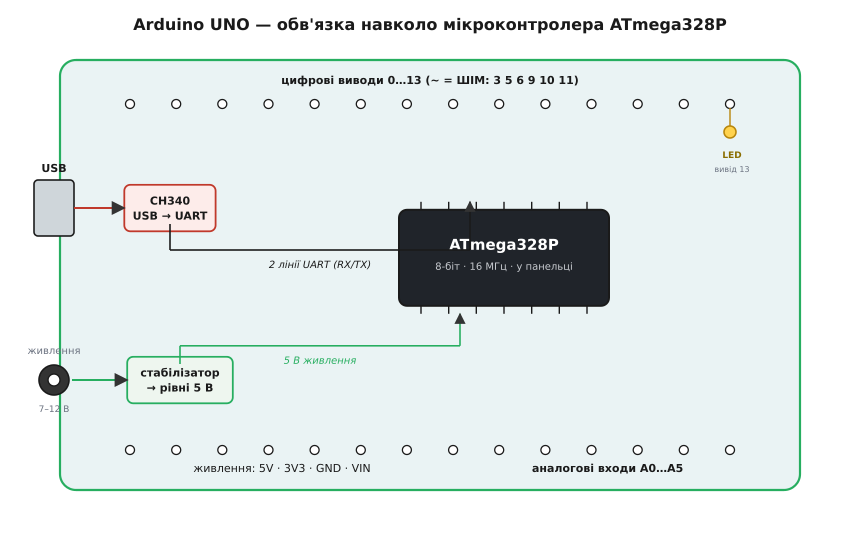
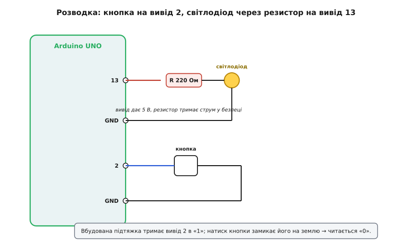

# Arduino UNO R3 (CH340)

<preknowlist>
- [Arduino Nano (ATmega, USB-C)](root:cat-hw-boards/arduino-nano) — розуміння архітектури чипа ATmega328P та принципу 5-вольтової логіки.
</preknowlist>

## Що таке плата Arduino UNO

Самого мікроконтролера зазвичай недостатньо для зручної роботи: до нього потрібно підводити стабільне живлення, підключати програматор та розпаювати зовнішні компоненти. Плата Arduino UNO — це зручна обв'язка навколо чипа @@en|ATmega328P@@, яка дозволяє відразу писати код і підключати периферію.

*Головні вузли плати: чип ATmega328P, мікросхема зв'язку з комп'ютером, стабілізатори напруги та гребінки для підключення зовнішніх пристроїв.*

UNO використовує 5-вольтову логіку. Це означає, що логічна одиниця на її виводах дорівнює 5 вольтам. Чип ATmega328P має жорсткі обмеження пам'яті, з яких найвідчутніше — лише 2 КБ оперативної пам'яті (@@en|SRAM@@). Якщо програма спробує виділити більше, контролер просто перезавантажиться або почне поводитися непередбачувано. Детальніше про сам мікроконтролер та його архітектуру можна дізнатися в темі про [Arduino Nano](root:cat-hw-boards/arduino-nano).

## Міст CH340 та завантаження коду

Мікроконтролер не вміє безпосередньо спілкуватися з комп'ютером через USB-порт. Щоб вони зрозуміли одне одного, на платі встановлено мікросхему-перекладач, яка перетворює сигнали USB на зрозумілий чипу послідовний протокол @@en|UART@@. У багатьох клонах UNO для здешевлення використовують чип @@en|CH340@@. 

Щоб комп'ютер побачив цей чип як віртуальний COM-порт, операційній системі потрібен відповідний драйвер. Коли код написано, середовище розробки відправляє його через USB на CH340, який передає байти до ATmega328P. Там їх приймає спеціальна програма — завантажувач (@@en|bootloader@@), що вже записана в пам'яті контролера. Завантажувач зчитує нову програму й записує її в постійну пам'ять, після чого передає їй керування.

## Правила живлення та межі струму

Плату можна живити трьома способами. Перший — через USB, що дає 5 вольт прямо від комп'ютера. Другий — через круглий роз'єм або пін VIN, куди можна подавати від 7 до 12 вольт; вбудований стабілізатор сам знизить напругу до потрібних 5 вольт. Третій — подати рівно 5 вольт безпосередньо на пін 5V. 

Найбільша пастка лежить у межах струму. Цифрові виводи створені винятково для передачі сигналів, а не для живлення потужних навантажень. Кожен вивід може безпечно віддати не більше ніж 20 мА. Якщо спробувати підключити мотор напряму до виводу контролера, чип просто згорить. Навіть звичайний світлодіод миттєво спалить пін, якщо підключити його без струмообмежувального резистора.

## З'єднання з зовнішнім світом

Для взаємодії зі світом плата має три типи виводів: цифрові, аналогові та шини зв'язку. Цифрові виводи можуть лише вмикати або вимикати напругу (0 або 5 вольт). Аналогові входи вміють вимірювати проміжну напругу, перетворюючи її на число, що корисно для читання датчиків. Для складних модулів, таких як екрани чи гіроскопи, використовують шини передачі даних I2C та SPI, які дозволяють підключати кілька пристроїв до одних і тих самих виводів.

*Безпечне підключення базових компонентів: світлодіод обмежений резистором, а потенціометр ділить напругу для аналогового входу.*

Щоб не возитися з дротами на макетній платі під час навчання, зручно використовувати готові плати розширення, наприклад, [Multi-function Shield](root:cat-hw-boards/multifunction-shield), який одразу містить кнопки, світлодіоди та індикатори. Головне правило при з'єднанні модулів — завжди перевіряти, чи їхня логіка працює від 5 вольт, інакше знадобиться перетворювач логічних рівнів. Для узгодження сигналів між пристроями з різною напругою використовується [Перетворювач логічних рівнів](root:cat-hw-parts/logic-level-converter).
