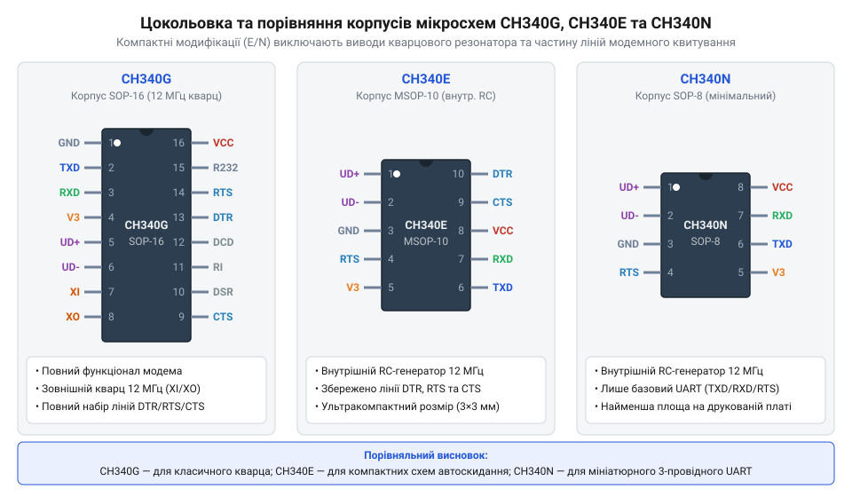
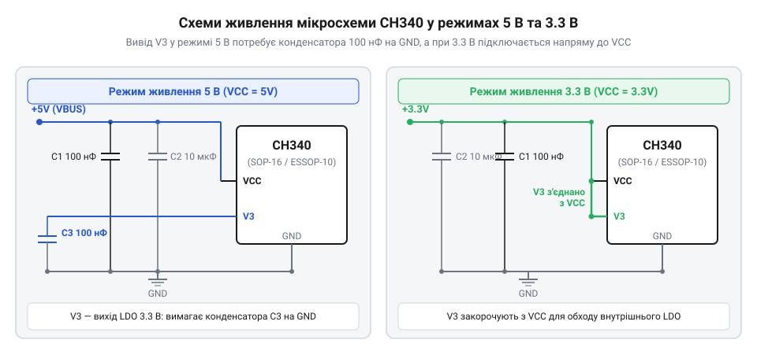
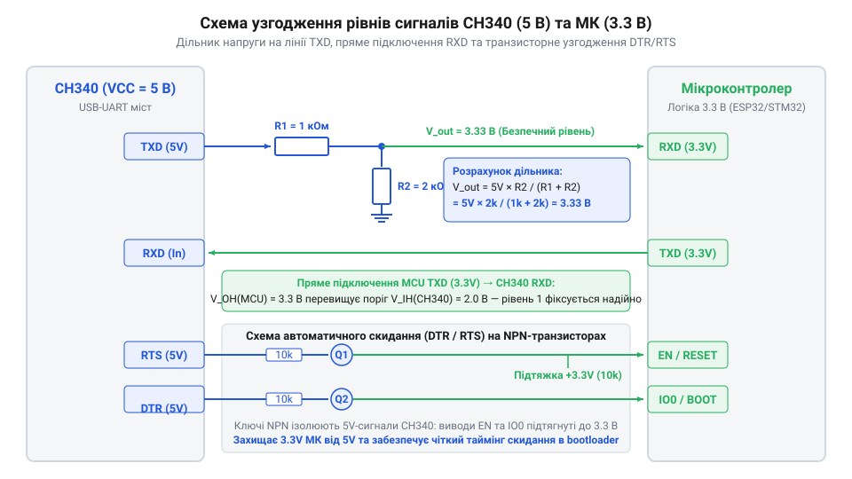
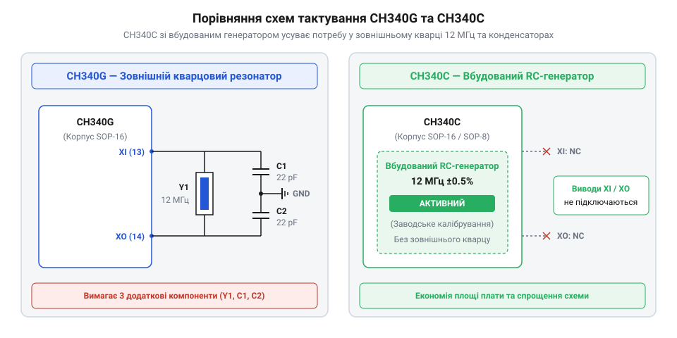

# Апаратний інтерфейс, цокольовка та варіанти включення CH340

<preknowlist>
- [USB-UART адаптер CP2102 (Micro-USB)](root:cat-hw-boards/cp2102-usb-uart) — Загальні принципи обміну даними через віртуальний послідовний порт та призначення ліній TXD/RXD.
- [Плата-адаптер для ESP32-CAM (CH340, Type-C)](root:cat-hw-boards/esp32-cam-programmer) — Практичний приклад застосування мікросхеми CH340 для прошивки та зневадження мікроконтролерних плат.
</preknowlist>

## Проблеми апаратного підключення USB-UART мостів

Під час проєктування розширених електронних пристроїв та зв'язку мікроконтролерів із ПК виникає потреба обміну даними через послідовні інтерфейси. Сучасні комп'ютери не мають фізичних портів @@en|RS-232@@ чи прямого виходу асинхронного приймача-передавача (англ. @@en|UART@@, від @@en|Universal Asynchronous Receiver-Transmitter@@ — універсальний асинхронний приймач-передавач), замінивши їх високошвидкісною шиною @@en|USB@@ (англ. @@en|Universal Serial Bus@@, від @@en|universal serial bus@@ — універсальна послідовна шина). Спроба прямого з'єднання диференційних ліній `D+` та `D-` шини @@en|USB@@ з виводами `TXD` і `RXD` мікроконтролера є неможливою: шина @@en|USB@@ використовує імпульсну передачу зі складним кадровим пакетом та специфічними логічними рівнями напруги, тоді як @@en|UART@@ очікує стабільні рівні 0 В та 3.3 В / 5 В. Пряме підключення викликає повну відсутність зв'язку та створює ризик пошкодження портів введення-виведення через різницю електричних потенціалів та струмові навантаження.

Для подолання цього бар'єра застосовують спеціалізовані мікросхеми-мости (англ. @@en|bridge@@ — міст), які на апаратному рівні декодують пакети шини @@en|USB@@ та перетворюють їх у послідовний потік бітів. Фізична відмінність сигналізації полягає у принципі передавання: шина @@en|USB@@ використовує диференційну пару `D+` та `D-` із кодуванням @@en|NRZI@@ (від англійського @@en|Non-Return-to-Zero Inverted@@ — без повернення до нуля з інверсією), де стан біта визначається різницею потенціалів між провідниками з хвильовим опором 90 Ом. Водночас асинхронний інтерфейс @@en|UART@@ передає однополярні рівні напруги (відносно спільного виводу землі @@en|GND@@) із кадруванням стартовими та стоповими бітами без окремого тактового сигналу. Вбудований трансивер мікросхеми @@en|CH340@@ перехоплює диференційні імпульси шини, перевіряє контрольні суми пакета та записує розпаковані байти у внутрішній апаратний буфер @@en|FIFO@@ (англ. @@en|First In, First Out@@, від @@en|first@@ — перший). Власний генератор тактової частоти чипа вичитує дані з цього буфера і послідовно стробує виводи `TXD` і `RXD` зі швидкістю заданого baud rate, формуючи кадр із 1 стартовим бітом, 8 бітами даних та стоповим бітом. Таке розв'язування тактування ізолює високошвидкісні пачки пакетів шини USB (12 Мбіт/с) від повільнішого безперервного потоку UART, упереджуючи втрату байтів. Завдяки цьому з боку ПК пристрій відображається як віртуальний послідовний порт, що дозволяє використовувати мікросхему в готових модулях, таких як [плата-адаптер для ESP32-CAM](root:cat-hw-boards/esp32-cam-programmer) або програматорах на зразок [адаптера CP2102](root:cat-hw-boards/cp2102-usb-uart). Розуміння цієї різниці у сигналізації пояснює, чому прямо підключити виводи мікроконтролера до USB неможливо і чому апаратний міст є неминучим елементом схеми.

## Призначення виводів та модифікації корпусів

Мікросхема @@en|CH340@@ випускається у кількох апаратних модифікаціях корпусів, що різняться габаритами, кількістю виводів та доступним функціоналом. Найбільш повнофункціональним є корпус @@en|SOP-16@@ версії @@en|CH340G@@, який має 16 ніжок та містить повний набір сигналів керування модемом. Для компактних пристроїв розробники обирають корпуси @@en|CH340E@@ у форматі @@en|MSOP-10@@ або @@en|CH340N@@ у корпусі @@en|ESSOP-10@@, де кількість виводів зменшено до 10 за рахунок відмови від допоміжних modem-сигналів. Найдешевшою та найменшою є версія @@en|CH340K@@ у корпусі @@en|SOP-8@@, призначена виключно для двохпровідного обміну `TXD`/`RXD`.

*Призначення та розташування сигнальних виводів у різних конструктивних виконаннях мікросхеми CH340.*

Основними виводами для будь-якої модифікації @@en|CH340@@ є лінії дифпари `UD+` (вивід 6 у SOP-16) та `UD-` (вивід 5 у SOP-16), які підключаються безпосередньо до роз'єму @@en|USB@@. Лінії передачі даних `TXD` (вивід 2) та прийому `RXD` (вивід 3) з'єднуються з відповідними виводами мікроконтролера за схемою «хрест-навхрест» (`TXD` -> `RX`, `RXD` -> `TX`). Вхідний порт `RXD` містить вбудований внутрішній підтягувальний резистор (англ. @@en|pull-up resistor@@ — резистор підтяжки) опором близько 150 кОм до внутрішньої шини живлення, який гарантує стабільний високий логічний рівень у стані спокою та запобігає виникненню фальшивих стартових бітів при відключеному чи плаваючому зовнішньому провіднику. У модифікаціях @@en|CH340G@@ та @@en|CH340E@@ доступні керуючі сигнали `DTR` (англ. @@en|Data Terminal Ready@@ — готовність термінала) та `RTS` (англ. @@en|Request to Send@@ — запит на передачу), які часто застосовують для автоматичного скидання та переведення у режим завантажувача плат на зразок [адаптера ESP-01](root:cat-hw-boards/esp-01-adapter). Решта модемних ліній (від англійського @@en|modem@@ — модулятор-демодулятор) у повнофункціональному корпусі @@en|SOP-16@@ реалізують апаратний контроль потоку (англ. @@en|hardware flow control@@ — апаратне керування потоком даних) та опитування стану промислового обладнання. Згідно з діаграмою станів (англ. @@en|state diagram@@) модемних ліній, при заповненні вхідного FIFO-буфера чип знімає активний низький рівень із виводу `RTS` (переводячи його у високий рівень 1), що змушує передавач передавального пристрою призупинити відправку байтів, тоді як сигнал `CTS` (англ. @@en|Clear to Send@@ — дозвіл передачі) опитується самим чипом @@en|CH340@@: логічний нуль на вході `CTS` дозволяє відправку байта хостом, а логічна одиниця блокує передавання до звільнення буфера. Допоміжні лінії `DSR` (англ. @@en|Data Set Ready@@ — готовність модема) підтверджують активний стан з'єднаного пристрою, `RI` (англ. @@en|Ring Indicator@@ — індикатор виклику) сигналізує хосту про вхідний дзвінок чи зовнішнє переривання, а `DCD` (англ. @@en|Data Carrier Detect@@ — виявлення несучої) контролює наявність фізичного з'єднання в лініях зв'язку.

## Схемотехніка живлення та конфігурація V3

Надійність роботи USB-UART мосту @@en|CH340@@ першочергово залежить від правильної конфігурації його вузла живлення. Внутрішнє ядро мікросхеми та трансивер шини @@en|USB@@ розраховані на напругу 3.3 В, однак апаратні розробки часто живляться як від шини @@en|USB VBUS@@ напругою 5 В, так і від автономних джерел 3.3 В. Для підтримки двох стандартів у кристал вбудовано лінійний стабілізатор (від латинського @@la|stabilis@@ — стійкий) типу @@en|LDO@@ (від англійського @@en|Low Dropout Regulator@@ — регулятор із малим падінням напруги), вихід якого виведено на зовнішній контакт @@en|V3@@. Помилка у підключенні цього виводу призводить або до виходу чипа з ладу, або до збоїв ідентифікації пристрою в операційній системі.

При живленні схеми від напруги 5 В основним входом є вивід @@en|VCC@@, куди подається напруга шини @@en|USB@@ у припустимому діапазоні від 4.5 В до 5.5 В. Внутрішній стабілізатор знижує її до 3.3 В і виводить на контакт @@en|V3@@, причому мінімально припустиме падіння напруги (англ. @@en|dropout voltage@@) на регуляторі становить близько 0.4 В — якщо напруга @@en|VCC@@ опуститься нижче 3.7 В, вихідна напруга @@en|V3@@ просяде нижче допустимого порогу 3.0 В, спричиняючи збої в роботі внутрішнього @@en|USB@@-трансивера. У цьому режимі на вивід @@en|V3@@ заборонено подавати зовнішню напругу — його необхідно лише зашунтувати на землю @@en|GND@@ керамічним конденсатором (від латинського @@la|condensare@@ — згущувати) ємністю 100 нФ. Цей конденсатор фільтрує пульсації внутрішнього опорного джерела та забезпечує стабільну роботу @@en|USB@@-передавача. Якщо ж пристрій живиться від джерела 3.3 В (у межах від 3.0 В до 3.6 В), внутрішній стабілізатор вимикають шляхом прямого з'єднання виводу @@en|V3@@ з виводом @@en|VCC@@ та зовнішньою шиною 3.3 В.

*Схеми організації живлення CH340: у режимі 5 В вивід V3 шунтується конденсатором 100 нФ, а в режимі 3.3 В виводи VCC та V3 об'єднуються.*

Для пригнічення високочастотних імпульсних завад по шині живлення безпосередньо біля виводу @@en|VCC@@ мікросхеми розміщують керамічний блокувальний конденсатор 100 нФ з низьким еквівалентним послідовним опором (від англійського @@en|Equivalent Series Resistance@@, @@en|ESR@@). Його доповнюють танталовим або електролітичним конденсатором ємністю 4.7...10 мкФ, що компенсує просідання напруги під час сплесків струму споживання. Нехтування якісною фільтрацією спричиняє раптові просідання @@en|VCC@@, які дестабілізують роботу внутрішнього фазового автопідлаштовувача частоти @@en|PLL@@ (англ. @@en|Phase-Locked Loop@@, від @@en|phase@@ — фаза) та призводять до зриву фазової синхронізації тактування USB-пакетів. Крім того, критично важливими є вимоги до заземлення блокувального конденсатора 100 нФ на виводі @@en|V3@@: його земляну обкладку слід з'єднувати з спільним полігоном @@en|GND@@ короткою широкою трасою з мінімальною індуктивністю. Паразитний опір чи індуктивність у контурі заземлення V3 наводить високочастотні завади на аналогові каскади USB-трансивера, викликаючи помилки розпізнавання кадру на ПК або раптові скидання мосту під час активного передавання даних.

Коли мікросхема @@en|CH340@@ живиться від 5 В, її виходи @@en|TXD@@, @@en|DTR@@ та @@en|RTS@@ формують 5-вольтові амплітуди сигналів. При підключенні до мікроконтролерів із 3.3-вольтовою периферією пряме з'єднання може пошкодити вхідні каскади цільового чипа. У таких випадках застосовують резистивні дільники напруги або схеми узгодження рівнів на транзисторах. Подібна схемотехніка широко використовується у [платах для ESP32-CAM](root:cat-hw-boards/esp32-cam-programmer) та спеціалізованих [модулях прошивки ESP-01](root:cat-hw-boards/esp-01-adapter), де стабільність сигналів @@en|DTR@@ та @@en|RTS@@ є критичною для автоматичного скидання.

*Схема узгодження логічних рівнів сигнальних ліній TXD, RXD, DTR та RTS через резистивні дільники напруги під час живлення мосту від 5 В.*

## Тактування та кварцовий резонатор 12 МГц

Стандарт @@en|USB Full-Speed@@ вимагає високої точності тактової частоти 12 МГц для надійної синхронізації пакетів даних. За способом генерації тактового сигналу ревізії мікросхем родини @@en|CH340@@ поділяються на дві групи. Класична ревізія @@en|CH340G@@ вимагає підключення зовнішнього кварцового резонатора (від латинського @@la|resonare@@ — відгукуватися) на частоту 12 МГц між виводами @@en|XI@@ та @@en|XO@@, а також двох нагрузочних керамічних конденсаторів ємністю 22 пФ на землю. Натомість сучасні ревізії @@en|CH340C@@, @@en|CH340E@@ та @@en|CH340N@@ містять інтегрований генератор (від латинського @@la|generator@@ — той, що створює) на базі точного @@en|RC@@-кола, що дає змогу повністю відмовитися від зовнішнього резонатора й задіяти вільну площу плати.

*Порівняння обв'язки тактування CH340G та CH340C: версія CH340C усуває потребу у зовнішньому кварці 12 МГц та двох конденсаторах по 22 пФ.*

Під час проектування друкованих плат із ревізією @@en|CH340G@@ критично дотримуватися правил трасування високочастотного вузла. Провідники від виводів @@en|XI@@ та @@en|XO@@ до обкладок кварцового резонатора мають бути найкоротшими (довжиною не більше 5...10 мм), а нагрузочні конденсатори розміщують безпосередньо біля виводів резонатора із коротким шляхом повернення струму на суцільний шар землі. Ємність цих дискретних конденсаторів `C₁` та `C₂` розраховують виходячи з паспортної нагрузочної ємності резонатора `C_L` та паразитної ємності друкованого монтажу й виводів чипа `C_stray` (яка зазвичай становить 3...5 пФ). Натомість у безкварцевих ревізіях @@en|CH340C@@, @@en|CH340E@@ та @@en|CH340N@@ замість зовнішнього кварцу працює внутрішній резистивно-ємнісний генератор (від англ. @@en|RC oscillator@@, резистивно-ємнісний генератор), стабільність якого залежить від навколишньої температури: у робочому діапазоні від -20 °C до +70 °C температурний дрейф утримується в межах безпечної похибки для швидкостей до 115200 бод, але за межами цього діапазону або на високих швидкостях понад 460800 бод відхилення частоти перевищує допустимий допуск 2.5%, спричиняючи кадрові помилки. Оскільки в схемах тактування конденсатори `C₁` та `C₂` увімкнені послідовно відносно виводів резонатора, підсумкову нагрузочну ємність `C_L` описує формула:

        C_L = (C₁ × C₂) ÷ (C₁ + C₂) + C_stray
        = (22 × 22) ÷ (22 + 22) + 4          [підстановка ємностей конденсаторів 22 пФ і паразитної ємності 4 пФ]
        = 15                                 [обчислення еквівалентної нагрузочної ємності у пікофарадах]

Отримане значення 15 пФ точковісінько відповідає стандартному паспортному значенню `C_L` більшості 12-мегагерцових резонаторів. Заборонено проводити сигнальні лінії шини @@en|USB@@ або @@en|UART@@ безпосередньо під корпусом резонатора, адже високочастотне випромінювання на частоті 12 МГц створює наводки та погіршує цілісність сигналів.

Вибір ревізії визначає компроміс між вартістю компонента та надійністю в екстремальних температурних умовах. Кварцовий резонатор у ревізії @@en|CH340G@@ забезпечує термостабільність частоти в межах PPM (від англійського @@en|Parts Per Million@@ — частинок на мільйон), що важливо для промислових пристроїв. Водночас для компактних аматорських плат перевагу віддають безкварцевій версії @@en|CH340C@@, яка за щільністю компонування наближається до виробів на [адаптерах CP2102](root:cat-hw-boards/cp2102-usb-uart) і суттєво спрощує трасування плати.

## Узгодження логічних рівнів та ліній UART

Безпосереднє підключення сигнальних ліній пристроїв із різними рівнями живлення становить одну з найпоширеніших причин виходу з ладу вхідних каскадів мікроконтролерів. Коли мікросхема @@en|CH340@@ живиться від напруги 5 В, амплітуда логічної одиниці на її виході @@en|TXD@@ становить близько 5 В, що є критичним для 3.3-вольтових входів периферії. Найпростішим та надійним розв'язком є застосування резистивного дільника (від латинського @@la|divisio@@ — ділення) напруги з двох послідовно з'єднаних резисторів. Для зниження амплітуди сигналу @@en|TXD@@ з 5 В до 3.3 В у нижче плече дільника до землі ставлять резистор опором `R₂ = 2.2 кОм`, а у верхнє плече — `R₁ = 1.0 кОм`. Точний вихідний рівень описує формула розрахунку напруги:

        V_out = V_in × R₂ ÷ (R₁ + R₂)
        = 5.0 × 2200 ÷ (1000 + 2200)      [підстановка номіналів резисторів]
        = 3.437                           [обчислення вихідної напруги]

Отримане значення напруги 3.44 В безпечно вкладається у допуск вхідного рівня логічної одиниці більшості 3.3-вольтових мікроконтролерів. Зворотна лінія від цільового пристрою до @@en|CH340@@ (вхід @@en|RXD@@) додаткового дільника не потребує, адже порт @@en|RXD@@ мосту надійно розпізнає високий рівень від 2.0 В і вище.

Крім основних ліній прийому й передачі даних, розробка програматорів вимагає узгодження додаткових сигналів керування @@en|DTR@@ та @@en|RTS@@. У сучасних відлагоджувальних платах ці лінії використовуються для автоматичного переведення цільового чипа в режим завантажувача. Оскільки виходи @@en|DTR@@ та @@en|RTS@@ мікросхеми @@en|CH340@@ активні низьким рівнем, їх підключають через двотранзисторні (від англійського @@en|transistor@@ — перетворювач опору) ключі на @@en|NPN@@-транзисторах або польових @@en|MOSFET@@-ключах. Така схема запобігає хаотичному скиданню мікроконтролера під час відкриття послідовного порту прикладними програмами в операційній системі.

Спеціалізована схема з двома транзисторами формує чітку часову послідовність імпульсів: коли програмний завантажувач переводить вивід @@en|DTR@@ у низький логічний рівень при високому @@en|RTS@@, перший транзистор притягує лінію @@en|GPIO0@@ до землі. На наступній фазі програмного циклу вивід @@en|RTS@@ також опускається в нуль, завдяки чому другий транзистор формує короткий негативний імпульс скидання на лінію @@en|RST@@ тривалістю в кілька десятків мілісекунд. Тривалість цього імпульсу визначається часовою сталою резистивно-ємнісного ланцюга (від англ. @@en|RC circuit@@, резистивно-ємнісний ланцюг) на лінії скидання, яка розраховується як добуток опору підтяжки `R` та ємності конденсатора `C` за формулою `τ = R × C`. Для типових номіналів `R = 10 кОм` та `C = 100 нФ` стала часу становить `τ = 10⁴ × 10⁻⁷ = 1 мс`, що забезпечує повну перезарядку за час `3τ = 3 мс` і гарантує чітке фіксування рівня нуля завантажувачем мікроконтролера; однак при збільшенні ємності до `1 мкФ` затримка `3τ` зростає до 30 мс, через що надмірний опір або ємність можуть призвести до того, що лінія @@en|RST@@ залишатиметься в нулі навіть після відпускання @@en|GPIO0@@, збиваючи режим завантаження. У момент відпускання лінії @@en|RST@@ назад до високого рівня вивід @@en|GPIO0@@ утримується в нулі, що змушує мікроконтролер під час зчитування стану ніжок при старті завантажити внутрішньосхемний флеш-програматор замість основної прошивки. Це уможливлює автоматичне прошивання коду в один клік без необхідності ручного натискання кнопок на платі. Дане рішення широко застосовується в апаратних [перетворювачах для ESP32-CAM](root:cat-hw-boards/esp32-cam-programmer) та спеціалізованих [адаптерах для ESP-01](root:cat-hw-boards/esp-01-adapter). Правильне узгодження рівня сигналів разом із надійним фільтруванням живлення гарантує безвідмовну апаратну роботу @@en|USB@@-@@en|UART@@ мосту в будь-яких прикладних розробках.
