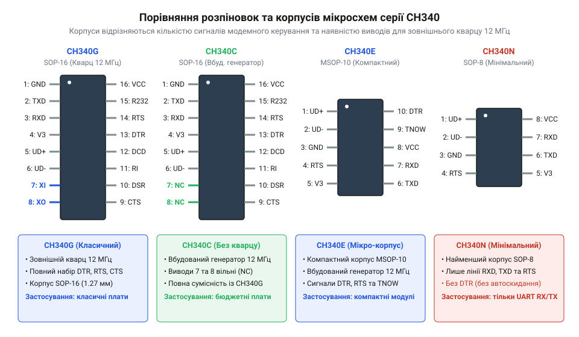
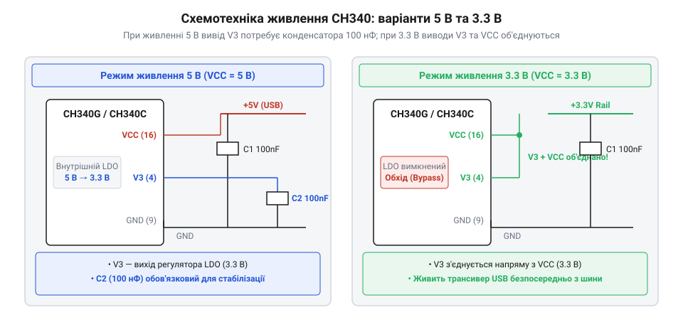

# Апаратний інтерфейс, цокольовка та схемотехніка обв'язки CH340

<preknowlist>
- [USB-UART адаптер CP2102 (Micro-USB)](root:cat-hw-boards/cp2102-usb-uart) — Загальні принципи перетворення інтерфейсів USB на асинхронний послідовний порт UART та призначення сигналів RX/TX.
- [Плата-адаптер для ESP32-CAM (CH340, Type-C)](root:cat-hw-boards/esp32-cam-programmer) — Схема автозавантаження з використанням ліній DTR та RTS для автоматичного переведення мікроконтролера у режим прошивання.
</preknowlist>

## Апаратні проблеми зв'язку та прошивання

При розробці електронних пристроїв розробники часто стикаються зі збоями під час автоматичного прошивання мікроконтролерів або довільним втрачанням з'єднання через послідовний порт. Пристрій успішно розпізнається в операційній системі як віртуальний @@en|COM-порт@@ (англ. @@en|Communication Port@@), проте спроба завантажити прошивку завершується помилкою @@en|timeout@@ (англ. @@en|time out@@ — вичерпання часу очікування). Іншою поширеною проблемою є циклічне перезавантаження мікроконтролера в момент відкриття термінала на комп'ютері. Для усунення проблем розпізнавання віртуального порту виконайте [встановлення драйверів CH340](root:cat-hw-boards/ch340-driver-setup).

Причина таких розбіжностей полягає в електричних та функціональних особливостях моста @@en|USB-UART@@ (англ. @@en|Universal Serial Bus@@ — універсальна послідовна шина), зокрема популярного сімейства мікросхем @@en|CH340@@. На відміну від дорожчих рішень, таких як [адаптер CP2102](root:cat-hw-boards/cp2102-usb-uart), різні модифікації CH340 мають суттєві відмінності у розпіновці, вимогах до зовнішнього кварцового резонатора та схемах живлення. Спроба застосувати єдину типову схему підключення для різних варіантів корпусу призводить до відсутності генерації осцилятора або невірного підтягування логічних рівнів.

Не менш критичним є забезпечення стабільного живлення та ефективної фільтрації електричних завад. Шина живлення @@en|USB@@ часто містить імпульсні завади від перетворювачів комп'ютера, які через високий внутрішній опір підводящих провідників спричиняють високочастотний шум на шині VCC. Помилки при виборі конфігурації опорної напруги чи невірна обв'язка виводу внутрішнього регулятора спричиняють просідання напруги під час активного обміну даними. Такий імпульсний шум порушує синхронізацію фазового автопідстроювання частоти внутрішнього осцилятора, що призводить до втрати пакетів і раптового відключення віртуального @@en|COM-порту@@. Для усунення цих проблем необхідно чітко дотримуватися специфікації конкретного корпусу, встановлювати керамічні фільтруючі конденсатори безпосередньо біля виводів живлення чипа, правильно проектувати коло живлення та узгоджувати логічні рівні ліній @@en|TXD@@ (англ. @@en|Transmit Data@@ — передача даних) і @@en|RXD@@ (англ. @@en|Receive Data@@ — прийом даних).

## Розпіновка та особливості корпусів CH340

Мікросхеми сімейства CH340 випускаються у кількох варіантах корпусів, які відрізняються кількістю виводів та апаратною конфігурацією. Найбільш поширеною є модифікація @@en|CH340G@@ у корпусі @@en|SOP-16@@ (англ. @@en|Small Outline Package@@). Ця версія вимагає обов'язкового підключення зовнішнього кварцового резонатора частотою 12 МГц до виводів @@en|XI@@ (англ. @@en|Crystal Input@@) та @@en|XO@@ (англ. @@en|Crystal Output@@) з двома керамічними конденсаторами ємністю 22 пФ на землю.

Модифікації @@en|CH340C@@, @@en|CH340E@@ та @@en|CH340N@@ мають вбудований тактовий генератор, що дозволяє виключити зовнішній кварц зі принципової схеми. Модифікація CH340C виготовляється у корпусі SOP-16 і повністю збігається по цокольовці з CH340G, проте виводи XI та XO у ній відключені або використовуються як додаткові лінії. Компактні модифікації CH340E (корпус @@en|MSOP-10@@ або @@en|ESSOP-10@@) та CH340N (корпус @@en|SOP-8@@) розроблені для пристроїв із обмеженою площею плати.

*Розпіновка корпусів CH340G, CH340C, CH340E та CH340N із зазначенням шин USB, UART та системних виводів.*

Кожен корпус містить диференційну пару ліній шини USB: @@en|UD+@@ (англ. @@en|USB Data Plus@@) та @@en|UD-@@ (англ. @@en|USB Data Minus@@), які підключаються безпосередньо до роз'єму USB. Лінії послідовного інтерфейсу включають TXD, RXD, а також службові сигнали модемного керування @@en|DTR@@ (англ. @@en|Data Terminal Ready@@) та @@en|RTS@@ (англ. @@en|Request To Send@@). У корпусі SOP-8 через обмежену кількість ніжок виведені лише базові лінії TXD, RXD та керуючі лінії шини USB, тоді як сигналів модемного керування DTR і RTS там немає.

Окремою специфікою володіє модифікація CH340E у компактному корпусі @@en|ESSOP-10@@ (англ. @@en|Exposed Small Outline Package@@), де через обмежену кількість виводів застосовано суміщення сигнальних ліній та інтегровано внутрішній резистор підтяжки на лінії UD+. На відміну від класичної схеми з зовнішнім резистором 1.5 кОм на сигнальному виводі D+ для ініціалізації @@en|Full-Speed USB@@ (англ. @@en|Full-Speed Universal Serial Bus@@ — повношвидкісна універсальна послідовна шина), у CH340E цей резистор вже підключено до внутрішнього регулятора напруги 3.3 В. Це спрощує схемотехніку обв'язки, проте вимагає враховувати особливості нумерації ніжок ESSOP-10, у якому виводи керування покажчиком зв'язку суміщені або відсутні, що робить його оптимальним виключно для двопровідних шин обміну даними.

## Конфігурація живлення та обв'язка V3

Мікросхема CH340 підтримує два основних режими живлення: від джерела 5 В та від джерела 3.3 В. Головним елементом узгодження внутрішніх вузлів є вивід @@en|V3@@, який підключений до внутрішнього регулятора напруги 3.3 В, що живить внутрішні цифрові кола та фазове автопідстроювання частоти @@en|PLL@@ (англ. @@en|Phase-Locked Loop@@). Режим роботи виводу V3 залежить від напруги, поданої на вивід @@en|VCC@@ (англ. @@en|Voltage at the Common Collector@@).

При живленні мікросхеми від VCC = 5 В внутрішній регулятор знижує напругу до 3.3 В і виводить її на ніжку V3. У цьому режимі забороняється подавати на V3 зовнішню напругу або з'єднувати його з VCC. Для забезпечення стабільної роботи PLL до виводу V3 необхідно підключити керамічний фільтруючий конденсатор ємністю 100 нФ, другий вивід якого з'єднується з заземленням @@en|GND@@ (англ. @@en|Ground@@). Відсутність або недостатня ємність цього конденсатора призводить до зриву внутрішньої тактової частоти й втрати USB-з'єднання.

*Принципові схеми обв'язки виводів VCC та V3 для режимів живлення 5 В та 3.3 В.*

Якщо пристрій живиться від напруги @@en|VCC@@ = 3.3 В, внутрішній стабілізатор напруги не здатний працювати через недостатній перепад напруги. У цьому випадку вивід @@en|V3@@ необхідно з'єднати напряму з шиною живлення @@en|VCC@@ 3.3 В. Фільтруючий конденсатор ємністю 100 нФ залишається підключеним між об'єднаною лінією @@en|VCC@@/@@en|V3@@ та землею @@en|GND@@. Якщо ж помилково залишити це пряме з'єднання й подати на @@en|VCC@@ напругу 5 В, потенціал 5 В потрапить безпосередньо на вихідний вузол внутрішнього регулятора @@en|LDO@@ (від @@en|Low-DropOut@@ — стабілізатор малого падіння напруги) та внутрішню 3.3-вольтну логіку. Це викликає електричний пробій тонкого підзатворного діелектрика транзисторів та виникає катастрофічне електричне перевантаження (від @@en|Electrical Overstress@@, @@en|EOS@@): надмірний зворотний струм через регулятор моментально спричиняє тепловий пробій напівпровідникових переходів та незворотне вигоряння кремнієвого кристала.

## Сигнали керування та схема автозавантаження

Для автоматичного завантаження прошивки в мікроконтролери використовуються лінії модемного керування DTR та RTS. За середовищ розробки ці лінії змінюють свій логічний стан, формуючи послідовність сигналів скидання @@en|RESET@@ та вибору режиму завантаження @@en|BOOT0@@. Складна схема транзисторного ключа необхідна для того, щоб уникнути одночасного утримання обох ліній у низькому логічному рівні під час відкриття послідовного порту.

Схема автоматичного скидання побудована на двох @@en|NPN-транзисторах@@ (або @@en|MOSFET-ключах@@). Коли лінія DTR переходить у низький рівень, а RTS залишається у високому, перший транзистор підтягує лінію RESET до землі, підготовлюючи мікроконтролер до перезавантаження. Коли лінія RTS стає низькою при високому DTR, другий транзистор примусово переводить лінію BOOT0 у високий логічний стан, як це реалізовано у [програматорі ESP32-CAM](root:cat-hw-boards/esp32-cam-programmer). Якщо ж обидві лінії DTR і RTS одночасно переходять у низький стан, транзисторна пара блокує сигнальні кола, запобігаючи помилковому скиданню.

Передача даних між мостом @@en|CH340@@ та мікроконтролером здійснюється перехресним з'єднанням сигнальних ліній: вивід @@en|TXD@@ моста підключається до виводу @@en|RXD@@ мікроконтролера, а вивід @@en|RXD@@ моста — до виводу @@en|TXD@@ мікроконтролера. При різниці напруг живлення @@en|CH340@@ (5 В) та мікроконтролера (3.3 В) вихідний рівень на лінії @@en|TXD@@ моста необхідно зменшити для запобігання пошкодженню вхідних буферів. Для цього застосовують резистивний дільник напруги з двох послідовних резисторів: `R1` (між @@en|TXD@@ @@en|CH340@@ та @@en|RXD@@ мікроконтролера) і `R2` (між @@en|RXD@@ мікроконтролера та @@en|GND@@). При номіналах `R1` = 1 кОм та `R2` = 2 кОм вихідна напруга розраховується за формулою `Vout` = 5 В × (`R2` ÷ (`R1` + `R2`)) = 3.33 В, що відповідає логічній одиниці 3.3 В @@en|CMOS@@-входу. На високих швидкостях передачі (понад 115200 @@en|baud rate@@) сумарний опір дільника має бути обмежений одиницями кілоом, оскільки паразитна ємність монтажу утворює @@en|RC-фільтр@@ низьких частот: збільшення опору понад 10 кОм завалює фронти прямокутних імпульсів і спричиняє помилки кадрування, а надто малий опір викликає струмове перевантаження вихідного драйвера @@en|CH340@@.
