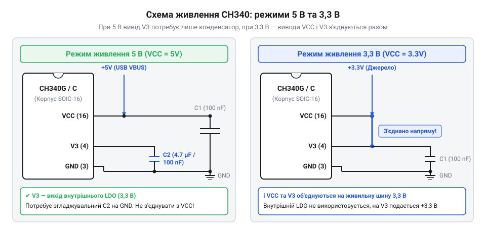

# Специфікація цокольовки, живлення та електричних сигналів CH340

<preknowlist>
- [USB-UART адаптер CP2102 (Micro-USB)](root:cat-hw-boards/cp2102-usb-uart) — загальні принципи роботи мостів USB-UART та виводів TXD, RXD, DTR і RTS.
</preknowlist>

## Виклики сполучення USB з мікроконтролером

Коли виникає потреба з'єднати мікроконтролер із персональним комп'ютером для обміну даними чи завантаження прошивки, розробник стикається з фундаментальною несумісністю апаратних інтерфейсів. Сучасний комп'ютер взаємодіє із зовнішніми пристроями через послідовну шину @@en|USB@@ (англ. *Universal Serial Bus* — універсальна послідовна шина), яка використовує високошвидкісну диференціальну сигналізацію по двох лініях D+ та D-. Більшість базових мікроконтролерів не мають убудованого апаратного контролера @@en|USB@@ і надають лише стандартний асинхронний послідовний периферійний інтерфейс @@en|UART@@ (англ. *Universal Asynchronous Receiver-Transmitter* — універсальний асинхронний приймач-передавач) з окремими односпрямованими лініями прийому та передачі.

Пряме фізичне з'єднання ліній D+ та D- шини @@en|USB@@ з виводами @@en|UART@@ мікроконтролера призводить до повної відсутності зв'язку, а у найгіршому випадку — до виходу з ладу логічних входів через невідповідність напруг та електричних рівнів. Шина @@en|USB@@ передає дані кодуванням NRZI зі зміщенням потенціалів, тоді як @@en|UART@@ працює на базі стандартних логічних рівнів TTL чи CMOS, де високий рівень відповідає напрузі живлення, а низький — потенціалу землі. Крім того, комп'ютер очікує від пристрою підтримки специфічного протоколу ініціалізації та узгодження швидкості.

Для подолання цього апаратного бар'єру застосовують спеціалізовану мікросхему-міст @@en|CH340@@. Вона бере на себе апаратне обчислення диференціальних сигналів @@en|USB@@, підтримку специфічних системних команд шини й перетворення даних у прості логічні імпульси @@en|UART@@. Порівнюючи її з іншими рішеннями, наприклад з [адаптерами на базі CP2102](root:cat-hw-boards/cp2102-usb-uart), мікросхему @@en|CH340@@ вирізняє низька вартість та наявність різноманітних варіантів корпусів під різні вимоги компактності друкованої плати.

## Корпуси та призначення виводів CH340

Мікросхема @@en|CH340@@ випускається у кількох модифікаціях, кожна з яких адаптована під конкретні габарити та функціональні потреби проекту. Найпоширенішими на ринку є модифікації @@en|CH340G@@, @@en|CH340C@@, @@en|CH340E@@ та @@en|CH340N@@. Головна відмінність між ними полягає у типах корпусів, кількості доступних сигнальних виводів та потребі у зовнішньому кварцевому резонаторі.

Модифікація @@en|CH340G@@ виготовляється у класичному 16-вивідному корпусі @@en|SOP-16@@ (англ. *Small Outline Package* — малогабаритний корпус). Вона вимагає зовнішнього кварцового резонатора на 12 МГц, підключеного до виводів XI та XO. Натомість версія @@en|CH340C@@ виконана у такому ж корпусі @@en|SOP-16@@, але містить вбудований генератор тактової частоти, що звільняє місце на платі від зовнішнього кварца та керамічних конденсаторів.

Для надкомпактних пристроїв розроблено версії у корпусах @@en|ESSOP-10@@, @@en|MSOP-10@@ та @@en|QFN-16@@. Зокрема, @@en|CH340E@@ у корпусі @@en|MSOP-10@@ та @@en|CH340N@@ у корпусі @@en|ESSOP-10@@ зменшують кількість виводів до десяти за рахунок відмови від допоміжних сигналів модемного керування (RI, DCD, DSR, CTS), залишаючи лише основні лінії передачі даних TXD, RXD та лінії керування RTS і DTR.

Призначення виводів 16-вивідних корпусів @@en|CH340G@@ та @@en|CH340C@@ охоплює повний спектр сигналів:
- Виводи 1 та 2 (GND, TXD): загальна земля та вихід послідовних даних.
- Вивід 3 (RXD): вхід послідовних даних.
- Вивід 4 (V3): вихід внутрішнього регулятора 3.3 В або вхід живлення ядер 3.3 В.
- Виводи 5 та 6 (UD+ та UD-): диференціальна пара ліній шини @@en|USB@@.
- Виводи 7 та 8 (XI, XO): виводи для підключення кварцевого резонатора 12 МГц (у @@en|CH340G@@; у @@en|CH340C@@ вивід XI з'єднується з землею чи залишається вільним).
- Виводи 9–14 (CTS, DSR, RI, DCD, DTR, RTS): лінії модемного інтерфейсу та квитування.
- Вивід 15 (R232): вибір режиму RS232 (при підключенні до землі вмикає режим @@en|UART@@).
- Вивід 16 (VCC): основна лінія живлення мікросхеми.

У 10-вивідних версіях розпіновку оптимізовано для мінімальної обв'язки: виводи @@en|UD+@@ та @@en|UD-@@ розташовано поруч із @@en|VCC@@ та @@en|GND@@, а вивід @@en|V3@@ залишається критичним вузлом стабілізації внутрішньої схеми. Основна конструктивна відмінність між модифікаціями @@en|CH340E@@ у корпусі @@en|MSOP-10@@ та @@en|CH340N@@ у корпусі @@en|ESSOP-10@@ полягає у способах розсіювання тепла та топології припаювання. Корпус @@en|ESSOP-10@@ оснащено виведеним на черевце мікросхеми відкритим металевим майданчиком @@en|Thermal Pad@@ (від англ. *thermal pad* — теплопровідний контактний майданчик), який припаюється до полігону заземлення на друкованій платі через перехідні отвори. Це забезпечує значно нижчий термічний опір і ефективне відведення тепла під час тривалої роботи на високих швидкостях обміну, тоді як корпус @@en|MSOP-10@@ не має такого контактного майданчика й спирається лише на тепловідведення через стандартні виводи. Неякісне припаювання @@en|Thermal Pad@@ у корпусах @@en|ESSOP-10@@ призводить до перегріву внутрішнього регулятора напруги та періодичних збоїв зв'язку.

## Конфігурація живлення та виводу V3

Електрична схема @@en|CH340@@ розрахована на роботу від двох стандартних напруг живлення: 5 В або 3.3 В. Вибір напруги на виводі VCC визначає не лише режим роботи внутрішніх вузлів чіпа, але й амплітуду логічних сигналів на виводах @@en|UART@@.

При живленні VCC від джерела 5 В (наприклад, безпосередньо від шини VBUS порта @@en|USB@@) внутрішній лінійний регулятор напруги мікросхеми формує опорне значення 3.3 В на виводі V3. Ця напруга необхідна для внутрішніх фізичних трансиверів шини @@en|USB@@. У цьому режимі вивід V3 не можна з'єднувати з VCC чи іншими джерелами живлення; до нього підключають лише керамічний фільтруючий конденсатор ємністю 100 нФ (0.1 мкФ), другий вивід якого з'єднують із землею GND. Відсутність цього конденсатора призводить до нестабільної роботи інтерфейсу @@en|USB@@ та помилок розпізнавання пристрою операційною системою.

Якщо вся система працює від напруги 3.3 В, вивід VCC підключають до лінії 3.3 В, і в цьому випадку вивід V3 обов'язково з'єднують безпосередньо з VCC. Таке з'єднання подає живлення 3.3 В безпосередньо на внутрішні вузли вминувши лінійний стабілятор.

*Два варіанти схеми живлення CH340 для напруг 5 В та 3.3 В і режим роботи виводу V3.*

## Сигнальні лінії та логічні рівні

Логічні рівні сигналів на виводах TXD, RXD, DTR та RTS мікросхеми @@en|CH340@@ прив'язані до напруги, поданої на вивід VCC. При живленні 5 В високий логічний рівень на виході TXD становить близько 4.5–5 В, а при живленні 3.3 В — близько 3.0–3.3 В. Низький логічний рівень у всіх режимах не перевищує 0.4 В.

Вивід RXD мікросхеми @@en|CH340@@ має пороги спрацьовування: низький рівень розпізнається при напрузі нижче 0.8 В, а високий — вище 2.0 В. Завдяки цьому при живленні @@en|CH340@@ від 5 В вхід RXD здатний впевнено приймати сигнали 3.3 В від мікроконтролерів без додаткових дільників напруги. Проте зворотний напрямок (вивід TXD мікросхеми 5 В до входу RXD мікроконтролера 3.3 В) вимагає обережності: якщо входи мікроконтролера не є толерантними до 5 В, необхідно встановлювати резистивний дільник напруги або послідовний обмежувальний резистор.

Сигнальні лінії DTR (англ. *Data Terminal Ready*) та RTS (англ. *Request to Send*) відіграють ключову роль в автоматичному перезавантаженні мікроконтролерів під час завантаження коду. Наприклад, як це реалізовано в [програматорах для ESP32-CAM](root:cat-hw-boards/esp32-cam-programmer), лінії DTR та RTS керують входами EN (Reset) та GPIO0 мікроконтролера. При відкритті послідовного порту програмним забезпеченням комп'ютера лінія DTR переходить у низький логічний рівень. Цей спад напруги через розділювальний керамічний конденсатор ємністю 100 нФ формує короткий імпульс скидання на виводі Reset мікроконтролера.

Аналогічно працюють схеми скидання в [адаптерах для модулів ESP-01](root:cat-hw-boards/esp-01-adapter), де комбінація сигналів DTR та RTS переводить мікроконтролер у режим завантажувача прошивки.

## Схема підключення CH340 до мікроконтролера

Правильне з'єднання мосту @@en|CH340@@ з мікроконтролером вимагає дотримання перехресної топології сигнальних ліній прийому та передачі. Вихід TXD (передача) мікросхеми @@en|CH340@@ з'єднується з входом RXD (прийом) мікроконтролера, а вхід RXD мікросхеми @@en|CH340@@ — з виходом TXD мікроконтролера. З'єднання однойменних виводів є класичною помилкою, яка унеможливлює обмін даними й створює конфлікт виходів.

Важливим нюансом під час проективання схем є явище паразитного живлення мікроконтролера через сигнальні лінії @@en|UART@@. Коли мікроконтролер знеструмлено, а мікросхема @@en|CH340@@ залишається підключеною до USB-порта комп'ютера, на виході TXD мікросхеми @@en|CH340@@ утримується високий логічний рівень. Струм через внутрішні захисні діоди виводу RXD мікроконтролера починає протікати у його внутрішню шину VCC, викликаючи частковий неконтрольований запуск мікроконтролера. Для запобігання цьому на лініях TXD та RXD встановлюють послідовні захисні резистори номіналом 1 кОм або застосовують схеми з виділеними буферними каскадами.

*Типова принципова схема підключення мосту CH340 до мікроконтролера з узгодженням сигналів.*

Диференціальну пару UD+ та UD- з'єднують із відповідними контактами USB-роз'єму найкоротшими провідниками однакової довжини. Рекомендовано встановлювати послідовні резистори 22 Ом для узгодження імпедансу лінії та захисні супресорні діоди для захисту від електростатичного розряду.
