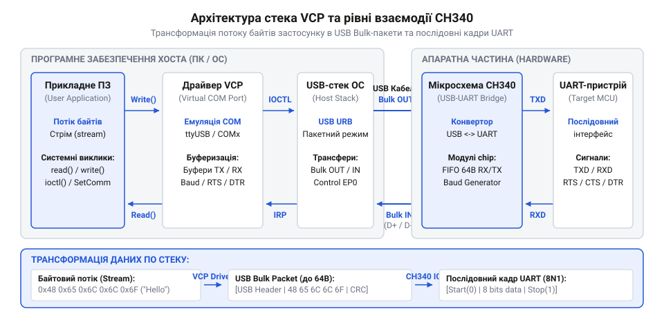

# Програмний інтерфейс CH340: налаштування Virtual COM Port, швидкості та драйвери

<preknowlist>
- [Плата-адаптер для ESP32-CAM (CH340, Type-C)](root:cat-hw-boards/esp32-cam-programmer) — Принцип фізичної взаємодії CH340 з мікроконтролером через лінії UART та використання ліній DTR і RTS для автозавантаження.
- [USB-UART адаптер CP2102 (Micro-USB)](root:cat-hw-boards/cp2102-usb-uart) — Загальні засади функціонування мостів USB-UART та емуляції послідовних портів у системі.
</preknowlist>

## Проблема узгодження USB та UART

Прикладне програмне забезпечення прагне надсилати та отримувати послідовний потік байтів через фізичний інтерфейс @@en|UART@@. Однак мікросхема @@en|CH340@@ під'єднана до комп'ютера через шину @@en|USB@@, яка принципово відрізняється від послідовної лінії. Пристрої @@en|USB-UART bridge@@ (англ. *@@en|bridge@@* — міст) передають дані не безперервним потоком біт з фіксованим часовим інтервалом, а пакетно, через так звані кінцеві точки (англ. *@@en|endpoints@@*). Коли операційна система виявляє підключений адаптер @@en|CH340@@ за ідентифікаторами обладнання @@en|VID/PID@@, шина бачить лише пристрій з універсальними буферами. Якщо прикладна програма спробує записати байти безпосередньо в низькорівневий USB-пакет, передача зламається: пакети не містять інформації про швидкість передачі, кількість стоп-бітів чи стан службових ліній.

Для усунення цієї невідповідності між пакетною шиною та символьним потоком використовується спеціальний шар програмної абстракції — драйвер @@en|Virtual COM Port@@ (англ. *@@en|virtual@@* — віртуальний, *@@en|communication port@@* — порт зв'язку), або @@en|VCP@@. Без такого драйвера прикладна програма мала б самостійно надсилати низькорівневі прямі запити виробника @@en|vendor request@@ (англ. *@@en|vendor@@* — виробник, *@@en|request@@* — запит) до пристрою з ідентифікаторами @@en|VID/PID@@ `0x1A86`/`0x7523`, самостійно керуючи внутрішніми регістрами мікросхеми @@en|CH340@@ через шину @@en|USB@@. Драйвер @@en|VCP@@ бере цю роботу на себе: він прив'язується до пристрою за його @@en|VID/PID@@, перехоплює стандартні системні запити читання й запису послідовного порту та прозоро перетворює їх на службові командні пакети, транзакції шини @@en|USB@@ і відповідні запити @@en|vendor request@@. З погляду операційної системи та прикладного коду мікросхема @@en|CH340@@ перетворюється на звичайний апаратний послідовний порт, тоді як [альтернативні послідовні мости](root:cat-hw-boards/cp2102-usb-uart) функціонують за аналогічною схемою.


*Багаторівнева архітектура трансляції системних викликів COM-порту в USB-пакети моста CH340.*

## Ініціалізація Virtual COM Port

При підключенні мікросхеми @@en|CH340@@ операційна система зчитує USB-дескриптори пристрою та завантажує відповідний драйвер @@en|VCP@@. У системі Linux ядерний модуль створює файл пристрою виду `/dev/ttyUSB0`, у macOS утворюється вузол `/dev/tty.usbserial-*`, а у Windows пристрою призначається порт на зразок `COM3`. Програмна ініціалізація полягає у відкритті файлового дескриптора (англ. *@@en|file@@* — файл, *@@en|descriptor@@* — описувач) або системного хендла для отримання каналу прямого обміну.

У POSIX-сумісних системах (Linux та macOS) для отримання дескриптора порту застосовують системний виклик `open()`. Порт відкривається в режимі читання та запису `O_RDWR` із прапорами `O_NOCTTY` (щоб пристрій не ставав керуючим терміналом процесу) та `O_NDELAY` (щоб запобігти блокуванню виклику до підняття сигналів лінії несучої). Для запобігання безкінечному завісанню виклику `read()` або холостому циклу очікування в POSIX налаштовують таймаути читання (англ. *@@en|timeout@@* — вичерпання часу): через елементи `VMIN` (мінімальна кількість символів) та `VTIME` (часовий інтервал очікування в десятому долі секунди) масиву `c_cc` у структурі @@en|termios@@. У Windows @@en|Win32 API@@ для ініціалізації порту використовується функція `CreateFileA()` із прапорами `GENERIC_READ | GENERIC_WRITE` та `OPEN_EXISTING`, де ім'я порту `COM10` і вище вимагає префікса `\\\\.\\COM10`. Отриманий дескриптор перевіряється на валідність: значення `-1` у POSIX або `INVALID_HANDLE_VALUE` у Windows свідчать про відсутність моста в системі або брак прав доступу. Після створення хендла в Windows таймаути читання конфігуруються за допомогою структури @@en|COMMTIMEOUTS@@ та функції `SetCommTimeouts()`, де параметри `ReadIntervalTimeout` і `ReadTotalTimeoutConstant` задають затримку між байтами й граничний час очікування кадру.

:::tabs
@tab C (POSIX)
:::code api-ch340-software-interface/c/posix/termios.c
@tab C++ (POSIX)
:::code api-ch340-software-interface/cpp/posix/termios.cpp
@tab C (Win32)
:::code api-ch340-software-interface/c/win32/open-ch340-port-win32.c
@tab C++ (Win32)
:::code api-ch340-software-interface/cpp/win32/open-ch340-port-win32.cpp
:::

:::tabs
@tab C (POSIX)
```c|posix
#include <fcntl.h>
#include <unistd.h>
#include <stdio.h>

int open_ch340_port(const char *port_path) {
    int fd = open(port_path, O_RDWR | O_NOCTTY | O_NDELAY);
    if (fd < 0) {
        perror("Помилка відкриття файлового дескриптора CH340");
        return -1;
    }
    fcntl(fd, F_SETFL, 0);
    return fd;
}
```
@tab C++ (POSIX)
```cpp|posix
#include <fcntl.h>
#include <unistd.h>
#include <system_error>
#include <string>

int open_ch340_port(const std::string &port_path) {
    int fd = ::open(port_path.c_str(), O_RDWR | O_NOCTTY | O_NDELAY);
    if (fd < 0) {
        throw std::system_error(errno, std::generic_category(), 
                               "Не вдалося ініціалізувати Virtual COM Port CH340");
    }
    ::fcntl(fd, F_SETFL, 0);
    return fd;
}
```
:::

## Налаштування швидкості та кадру

Після успішного отримання дескриптора порту необхідно сконфігурувати фізичні параметри синхронізації. Ключовим параметром є @@en|baud rate@@ (англ. *@@en|baud@@* — бод, на честь Еміля Бодо, *@@en|rate@@* — швидкість), що визначає кількість символьних інтервалів на секунду. Мікросхема @@en|CH340@@ містить внутрішній генератор тактової частоти та програмно керовані дільники. Вона підтримує як стандартні швидкості (9600, 19200, 57600, 115200 біт/с), так і нестандартні значення аж до 2 Мбіт/с. Отримуємо ідеальний коефіцієнт дільника `D` діленням базової частоти тактування `F` (12 000 000 Гц) на добуток коефіцієнта опитання 16 та цільової швидкості `B`:

```
D = F ÷ (16 × B)                 [ідеальний дільник частоти]
= 12000000 ÷ (16 × B)            [підстановка базової частоти 12 МГц]
```

Оскільки апаратні регістри приймають лише цілочисельний коефіцієнт `D_int`, утворений округленням `D`, фактична апаратна швидкість `B_act` розраховується так:

```
B_act = 12000000 ÷ (16 × D_int)  [фактично згенерована швидкість]
```

Відносна похибка `E` визначається як відхилення фактичної швидкості від цільової:

```
E = (|B_act - B| ÷ B) × 100%     [відносна похибка синхронізації]
```

Якщо відносна похибка `E` не перевищує 2.5%, передача даних залишається стабільною і позбавленою помилок синхронізації. Для задання довільної нестандартної швидкості у Linux стандартні значення структури @@en|termios@@ (англ. *@@en|termios@@*, від *@@en|terminal I/O structure@@*) є недостатніми. У цьому разі використовують розширену структуру @@en|termios2@@ (англ. *@@en|termios2@@*, від *@@en|terminal I/O structure v2@@*) із прапором @@en|BOTHER@@ (англ. *@@en|BOTHER@@*, від *@@en|Baud rate OTHER@@*). У структурі @@en|termios2@@ скидають маску `CBAUD`, встановлюють прапор `BOTHER` у полі `c_cflag` та записують точне значення швидкості у поля `c_ispeed` і `c_ospeed`. Після цього конфігурацію застосовують через системний виклик `ioctl()` з кодом `TCSETS2`. У Windows керування довільною швидкістю реалізовано через блок керування пристроєм @@en|DCB@@ (англ. *@@en|DCB@@*, від *@@en|Device Control Block@@*). Точне числове значення швидкості записують безпосередньо у поле `BaudRate` структури @@en|DCB@@, після чого системний виклик `SetCommState()` передає параметр драйверу VCP для автоматичного розрахунку дільників чипа. Така довільна настройка швидкості є критичною під час прошивки й обміну даними з мікроконтролерами на [адаптерах ESP32-CAM](root:cat-hw-boards/esp32-cam-programmer).

Крім швидкості, конфігурується структура кадру: кількість бітів даних (зазвичай 8), наявність біта парності (None, Even, Odd) та кількість стоп-бітів (1 або 2). У POSIX-системах це виконується через структуру @@en|termios@@ за допомогою функцій `tcgetattr()` та `tcsetattr()`. У Windows конфігурація задається блоком керування пристроєм @@en|DCB@@ (англ. *@@en|Device Control Block@@*) через системний виклик `SetCommState()`. Для успішної роботи з мікроконтролерами на [спеціалізованих програматорах плати](root:cat-hw-boards/esp-01-adapter) точне налаштування кадру в драйвері є обов'язковою умовою для запобігання викривленню байтів.

:::tabs
@tab C (POSIX)
:::code api-ch340-software-interface/c/posix/termios-2.c
@tab C++ (POSIX)
:::code api-ch340-software-interface/cpp/posix/termios-2.cpp
:::

## Апаратне та програмне керування потоком

Під час високошвидкісної передачі даних виникає ризик явищ, коли прийомне обладнання не встигає обробляти вхідні байти з внутрішнього FIFO-буфера чипа @@en|CH340@@. Для запобігання втраті даних застосовують механізми @@en|flow control@@ (англ. *@@en|flow@@* — потік, *@@en|control@@* — керування). Апаратний метод використовує додаткові лінії сигналів: @@en|RTS/CTS@@ (англ. *@@en|Request to Send / Clear to Send@@*) або @@en|DTR/DSR@@ (англ. *@@en|Data Terminal Ready / Data Set Ready@@*). Коли буфер приймача заповнюється, рівень лінії RTS або DTR змінюється, примушуючи мост @@en|CH340@@ призупинити передачу кадру. Програмний метод @@en|XON/XOFF@@ надсилає керівні символи `0x11` та `0x13` безпосередньо через лінії даних, але він непридатний для бінарного обміну, де ці байти можуть траплятися в корисній вибірці.

Службові лінії @@en|DTR@@ та @@en|RTS@@ моста @@en|CH340@@ мають ще одне критичне застосування в роботі з мікроконтролерами: на [адаптерах для автономних камер](root:cat-hw-boards/esp32-cam-programmer) ці лінії підключаються до виводів скидання (RESET) та вибору режиму завантаження (GPIO0). Для введення мікроконтролера в режим завантаження (англ. *@@en|bootloader@@* — початковий завантажувач) програма керує лініями послідовно: активує @@en|RTS@@ для притиснення GPIO0 до нуля, після чого короткий імпульс на лінії @@en|DTR@@ скидає процесор. У системах @@en|Linux@@ та @@en|macOS@@ це реалізують через виклик `@@en|ioctl@@` (англ. *@@en|input/output control@@* — керування вводом-виводом) із масками `@@en|TIOCMBIS@@` (англ. *@@en|Terminal I/O Control Modem Bit Set@@* — встановлення бітів модема) та `@@en|TIOCMBIC@@` (англ. *@@en|Terminal I/O Control Modem Bit Clear@@* — очищення бітів модема), а у @@en|Windows@@ — за допомогою функції `@@en|EscapeCommFunction@@`.

:::tabs
:::code api-ch340-software-interface/c/ch340-enter-bootloader.c
:::code api-ch340-software-interface/cpp/ch340enterbootloader.cpp
:::

Схема узгодження вимагає витримувати часові затримки між змінами сигналів для розряджання конденсаторів кола скидання. Крім того, при відкритті порту системний драйвер @@en|CH340@@ може довільно змінювати стан ліній @@en|DTR@@ та @@en|RTS@@, що викликає спонтанний перезапуск підключеного пристрою — це слід враховувати при періодичному опитуванні [модулів точного часу](root:cat-hw-boards/ds1302-rtc).


*Часова діаграма сигналів DTR, RTS, TXD та RXD при ініціалізації з'єднання та апаратному керуванні потоком.*

## Обробка винятків та від'єднання USB

У процесі обміну даними програмне забезпечення повинне обробляти апаратні та системні винятки. Апаратні помилки каналу охоплюють @@en|framing error@@ (англ. *@@en|frame@@* — кадр, *@@en|error@@* — помилка), коли стоп-біт кадру не розпізнається через розсинхронізацію швидкостей, помилки парності та апаратне @@en|buffer overflow@@ (англ. *@@en|buffer@@* — буфер, *@@en|overflow@@* — переповнення), якщо приймальний фрейм втрачається в FIFO-буфері. Драйвер @@en|VCP@@ фіксує ці події в статусному регістрі, дозволяючи програмі зчитувати прапори помилок або скидати некоректні байти з черги.

Найбільш критичною ситуацією є гаряче від'єднання USB-кабелю під час активного сеансу зв'язку. При витягуванні пристрою чип @@en|CH340@@ миттєво зникає з шини, а файл пристрою в операційній системі інвалідується. Наступні спроби системних викликів `read()` або `write()` у POSIX повертають коди помилок з `errno = EIO` (Input/Output error) або `ENODEV`, а в Windows функції `ReadFile()` та `WriteFile()` завершуються помилкою `ERROR_DEVICE_NOT_CONNECTED`. Програма повинна негайно закрити невалідний дескриптор, зупинити циклічні спроби читання для уникнення стовідсоткового завантаження процесора та перейти в режим очікування повторного підключення пристрою.
