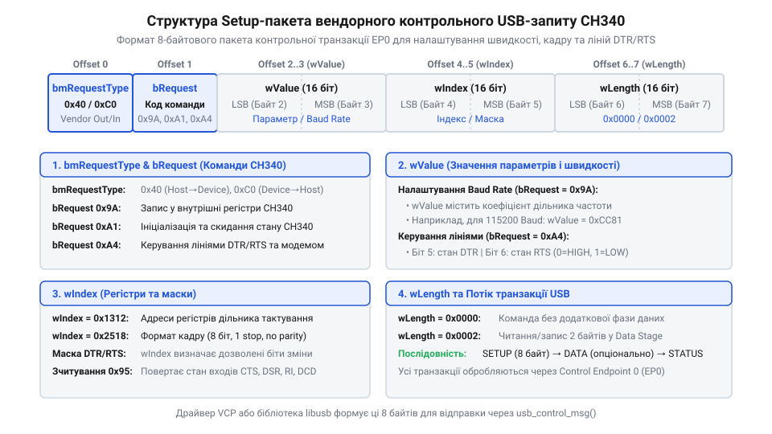
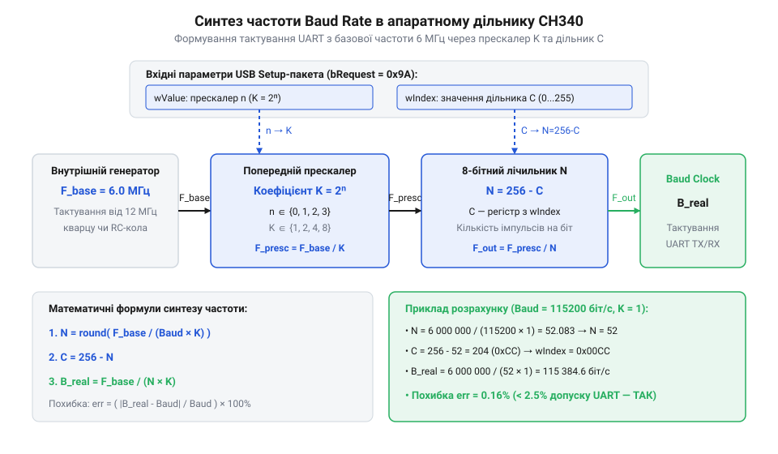
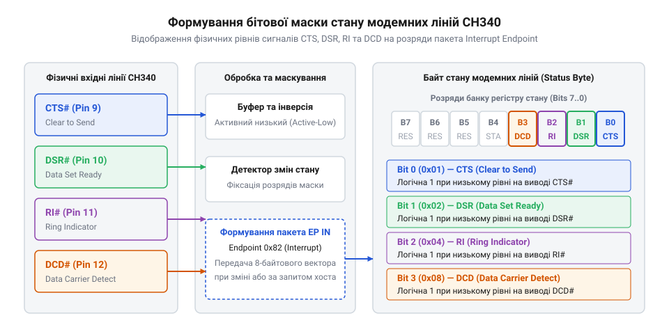

# Програмний інтерфейс VCP-драйвера та контрольні USB-запити CH340

<preknowlist>
- [Плата-адаптер для ESP32-CAM (CH340, Type-C)](root:cat-hw-boards/esp32-cam-programmer) — схемотехніка підключення виводів DTR та RTS до ліній автоматичного скидання та прошивки
- [USB-UART адаптер CP2102 (Micro-USB)](root:cat-hw-boards/cp2102-usb-uart) — базові принципи організації USB-UART мостів та віртуальних послідовних портів у системі
</preknowlist>

## Неможливість прямого керування мостом через VCP

Спроба виконати нестандартне налаштування послідовного зв'язку через стандартні засоби операційної системи часто завершується неочікуваною відмовою. Операційна система ховає будь-який пристроєво-залежний інтерфейс за загальною абстракцією `@@en|Virtual COM Port@@` (від латинського *virtus* — уявний, та англійського *communication* — зв'язок; скорочено `@@en|VCP@@`). Ця абстракція надає уніфікований інтерфейс для роботи з потоком даних, але повністю блокує прямий доступ до внутрішніх регістрів пристрою. Коли застосунок надсилає стандартний виклик для конфігурування обміну, системний драйвер перетворює його на визначений набір системних команд. Зокрема, під час спроби задати нестандартну швидкість передачі у структурі `@@en|DCB@@` для Windows системна функція `@@en|SetCommState@@` відхиляє конфігурацію з кодом помилки `@@en|ERROR_INVALID_PARAMETER@@` (код 87), а в системі Linux системний виклик `@@en|tcsetattr@@` для структури `@@en|termios@@` з прапором `@@en|BOTHER@@` завершується з системним кодом `@@en|EINVAL@@` (код 22) або мовчки ігнорує нові параметри, залишаючи апаратний дільник незмінним. Якщо ж завдання вимагає точного мікросекундного маніпулювання виводами, системний драйвер або відхиляє запит, або додає непередбачувані затримки операційної системи.

Обмеження абстракції VCP стають очевидними при спробі реалізувати апаратне скидання та переведення мікроконтролера у режим завантажувача. Наприклад, спеціалізована [плата-адаптер для ESP32-CAM](root:cat-hw-boards/esp32-cam-programmer) використовує лінії керування мосту для формування чіткої часової послідовності сигналів. Стандартні системні виклики керування лініями у Windows чи Linux не гарантують фіксованого часу виконання, оскільки системний драйвер групує виклики та чергує їх у загальному потоці команд шини `@@en|USB@@`. Будь-яка затримка в декілька мілісекунд між зміною станів виводів порушує часову діаграму та робить процес автоматичного завантаження прошивки нестабільним.

Подібна проблема виникає і при порівнянні різних мостів, таких як [USB-UART адаптер CP2102](root:cat-hw-boards/cp2102-usb-uart) та CH340. Кожен виробник застосовує власну внутрішню логіку розподілу регістрів та формування дільників частоти. Драйвер VCP транслює лише стандартний набір параметрів, позбавляючи розробника можливості використовувати специфічні апаратні функції CH340. Щоб отримати повний контроль над апаратними можливостями мікросхеми, необхідне пряме формування контрольних USB-транзакцій у користувацькому просторі без посередництва системного VCP-драйвера.

Пряме формування вендорних USB-запитів у користувацькому просторі повністю усуває посередництво операційної системи та знімає обмеження абстракції VCP. Це дозволяє утилітам записувати точні значення апаратних дільників частоти безпосередньо у внутрішні регістри CH340, миттєво змінювати стани ліній DTR і RTS без джиттеру системного драйвера та гарантувати однакову поведінку пристрою в будь-якій операційній системі.

## Структура вендорних контрольних USB-запитів CH340

Пряме керування мікросхемою CH340 здійснюється через нульову контрольну кінцеву точку `@@en|Control Endpoint@@` (від англійського *control* — керування, та *endpoint* — кінцева точка) за допомогою спеціальних вендорних транзакцій. Будь-який запит починається з формування восьмибайтового керувального пакета `@@en|Setup Packet@@`. Цей пакет визначає напрямок передачі даних, тип запиту, конкретну команду та її параметри у вигляді двобайтових полів.


*Формат восьмибайтового Setup-пакета для передачі вендорних команд ініціалізації та конфігурування регістрів мосту CH340.*

Поле `@@en|bmRequestType@@` визначає категорію запиту та напрямок обміну даними. Для запису параметрів у CH340 це поле приймає значення `0x40` (вендорний запит від хоста до пристрою), а для зчитування стану регістрів — `0xC0` (вендорний запит від пристрою до хоста). Поле `@@en|bRequest@@` містить конкретну код-команду мікросхеми. Наприклад, команда `0x9A` використовується для запису параметрів кадру та дільника швидкості, команда `0xA4` виконує встановлення станів ліній керування, а команда `0x95` зчитує поточний стан внутрішніх регістрів.

Параметри команди розгортаються у полях `@@en|wValue@@` та `@@en|wIndex@@`. У кожній конкретній транзакції ці два двобайтові поля несуть різне смислове навантаження. При налаштуванні швидкості вони містять коефіцієнти апаратного дільника, а при керуванні лініями — бітові маски стану виводів. Поле `@@en|wLength@@` вказує довжину додаткового блоку даних, який слідує за Setup-пакетом. Більшість вендорних запитів CH340 передають усі параметри безпосередньо всередині `wValue` та `wIndex`, тому поле `wLength` для них дорівнює нулю.

Процес ініціалізації мосту вимагає послідовного надсилання декількох Setup-пакетів. Спершу хост надсилає запит перевірки присутності пристрою з кодом `0x5F`, у відповідь на який CH340 повертає свій версійний ідентифікатор. Після цього надсилається запит скидання внутрішнього стану з кодом `0x18`, що готує мостову логіку до прийому конфігураційних параметрів кадру та швидкості.

Для коректної ідентифікації контрольних транзакцій контролером шини бітова структура поля `@@en|bmRequestType@@` розкладається на три окремі функціональні зони. Найвищий біт `D7` задає напрямок руху даних: значення `0` вказує на передачу від хоста до пристрою (`@@en|Host-to-Device@@`), а значення `1` — від пристрою до хоста (`@@en|Device-to-Host@@`). Біти `D6..D5` визначають тип запиту, де комбінація `01` призначена саме для вендорних команд (`@@en|Vendor Request@@`), на відміну від стандартних системних запитів USB (`00`). Нижні п'ять бітів `D4..D0` задають отримувача транзакції: значення `00000` адресує пакет усьому пристрою (`@@en|Device@@`). Завдяки такому розкладу значення `0x40` (в двійковому записі `01000000₂`) означає вихідну вендорну команду пристрою, а значення `0xC0` (`11000000₂`) — вхідний вендорний запит зчитування регістрів.

Для початкового зв'язку з мостом драйвер використовує два первинні Setup-пакети, структури яких відображають вимоги специфікації @@en|USB@@. Перший запит перевірки версії `0x5F` виконується у форматі читання: поле `bmRequestType` дорівнює `0xC0`, поле `bRequest` містить код `0x5F`, посилання `wValue` та `wIndex` обнулені `0x0000`, а поле `wLength` дорівнює `0x0002`, оскільки контролер повертає двобайтовий вектор версії чипа (наприклад, байт `0x30` для ревізії CH340G). Наступна команда ініціалізації мосту `0x18` надсилається у форматі запису: поле `bmRequestType` приймає значення `0x40`, `bRequest` отримує код `0x18`, поля `wValue` та `wIndex` заповнюються нулями `0x0000`, а `wLength` дорівнює `0x0000` через відсутність додаткового байтового поля. Саме ця комбінація скидає накопичувальні буфери @@en|FIFO@@ (від англ. @@en|First In, First Out@@ — буфер першим прийшов, першим вийшов) та готує мікросхему до подальшого налаштування швидкості при керуванні з пристроїв на кшталт [плати-адаптера для ESP32-CAM](root:cat-hw-boards/esp32-cam-programmer).

## Обчислення апаратного дільника швидкості Baud Rate

Формування необхідної швидкості передачі `@@en|Baud Rate@@` (від прізвища інженера Жана Бодо, фр. *Baudot*, та англійського *rate* — темп) у мікросхемі CH340 виконується за допомогою двохкомпонентного апаратного дільника. На відміну від стандартних послідовних портів, де встановлюється лише один коефіцієнт ділення, генератор тактової частоти CH340 містить попередній прескалер та 8-бітовий зворотно-рахувальний дільник.


*Структурна схема синтезу тактової частоти UART із базового кварцового резонатора за допомогою прескалера та регістра дільника CH340.*

Базова частота внутрішнього генератора мосту `F_base` становить `6000000` Гц. Для отримання заданої швидкості обміну `B` система обирає коефіцієнт прескалера `K = 2ⁿ`, де `n` — індекс прескалера від `0` до `3`. Число імпульсів тактування `N`, яке мусить відрахувати дільник за один бітовий інтервал, визначається відношенням базової частоти до добутку швидкості та коефіцієнта прескалера.

Далі обчислюється доповняльне значення регістра `C`, яке безпосередньо записується в мікросхему. Отримання значення `N` та доповнення `C` виконується за покроковим формульним розрахунком:

N = F_base / (B × K)          [ділення базової частоти на розрахований темп]
C = 256 - N                   [обчислення доповняльного значення 8-бітного регістру]

Кожен символ у цій формулі має чітке фізичне значення: `F_base` відповідає частоті внутрішньої тактової шини моста в герцах, `B` виражає необхідну швидкість обміну в бітах за секунду, `K` визначає коефіцієнт попереднього ділення частоти, `N` показує необхідну кількість тактових імпульсів на один біт, а `C` є підсумковим значенням для запису в контрольний регістр. Отримане число `C` пакується у поле `wIndex` Setup-пакета, а індекс прескалера `n` разом із прапорами конфігурації утворює двобайтове поле `wValue`.

**Обчислення дільника для швидкості 115200 біт/с при K = 1 та аналіз похибки**

Обчислення коефіцієнтів дільника для цільової швидкості 115200 біт/с виконується за базовою частотою генератора `F_base = 6000000` Гц та прескалером `K = 1`:

```
N = 6000000 / (115200 × 1)     [підстановка базової частоти 6 МГц та швидкості 115200 біт/с]
= 6000000 / 115200            [обчислення знаменника при прескалері K = 1]
= 52.0833                     [точне дробове значення кількості тактових імпульсів]
≈ 52                          [математичне заокруглення до найближчого цілого]

C = 256 - 52                  [обчислення 8-бітного доповняльного значення дільника]
= 204                         [значення регістра в десятковій системі числення]
```

Записане в шістнадцятковому форматі число `204` дорівнює `0xCC`. Через те що 8-бітний лічильник здатний відраховувати лише ціле число тактових імпульсів `N = 52`, реальна згенерована апаратним дільником швидкість `B_real` відхиляється від цільового значення. Реальна швидкість та відносна похибка генерації `err` у відсотках обчислюються так:

```
B_real = 6000000 / (52 × 1)   [розрахунок фактично згенерованої швидкості]
= 115384.6                    [фактична швидкість обміну в бітах за секунду]

err = (|115384.6 - 115200| / 115200) × 100
= (184.6 / 115200) × 100      [відносна різниця швидкостей]
= 0.16%                       [відносна похибка синтезу частоти у відсотках]
```

Отримана відносна похибка `0.16%` значно менша за гранично припустимий допуск асинхронного інтерфейсу @@en|UART@@ в `2.5%`, що забезпечує надійне зчитування байтів без апаратних помилок кадрування. Проте для гранично високих швидкостей (наприклад, 2 000 000 біт/с, де `N = 3`) заокруглення до цілого створює похибку понад `3.5%`. У таких умовах хост повинен обирати вищі значення прескалера або застосовувати специфічні підтяжки синхронізації при роботі з пристроями на платах на зразок [адаптера ESP32-CAM](root:cat-hw-boards/esp32-cam-programmer). Для видачі команди хост надсилає вендорний контрольний запит з кодом `bRequest = 0x9A`, де у полі `wValue` передає значення `0x1312` (код конфігурації дільника та прескалера `n = 0`), а у полі `wIndex` — обчислене значення `0x00CC`.

Для низьких швидкостей обміну (наприклад, 9600 біт/с) використання одиничного прескалера `K = 1` стає неможливим через обмеження розмірності 8-бітного лічильника: значення `N = 6000000 / 9600 = 625` перевищує максимальну ємність 255 одиниць. У таких випадках алгоритм вибору перебирає вищі індекси прескалера `n`, збільшуючи коефіцієнт `K` (наприклад, до `K = 8`), що дає допустиме значення `N = 6000000 / (9600 × 8) = 78.125 ≈ 78` та відповідно доповнення `C = 256 - 78 = 178` (`0xB2`). Нижня межа діапазону синтезу швидкостей обмежена максимально можливим добутком `K_max × N_max`, за межами якого опускання швидкості стає апаратно неможливим, тоді як у верхньому діапазоні (понад 2 000 000 біт/с) обмеженням виступає дискретність ділення `N < 4`, де квантування кроку призводить до перевищення 2.5% допуску похибки.

N = 6000000 / (115200 × 1)     [підстановка базової частоти 6 МГц та швидкості 115200 біт/с]
= 6000000 / 115200            [обчислення знаменника при прескалері K = 1]
= 52                          [математичне заокруглення результату до найближчого цілого]

C = 256 - 52                  [обчислення 8-бітного доповняльного значення дільника]
= 204                         [значення регістра в десятковій системі числення]

Записане в шістнадцятковому форматі число `204` дорівнює `0xCC`. Хост надсилає вендорний контрольний запит з кодом `bRequest = 0x9A`, де у полі `wValue` передає значення `0x1312` (код конфігурації дільника та прескалера `n = 0`), а у полі `wIndex` — обчислене значення `0x00CC`. При виникненні апаратних похибок або відхилень частоти кварцового резонатора розробник може точково коригувати константу `C`, забезпечуючи точну синхронізацію навіть із нестандартними швидкостями обміну.

## Пряме маніпулювання лініями DTR та RTS

Пряме керування станом виходів `@@en|DTR@@` (від англійського *data terminal ready* — готовність термінала даних) та `@@en|RTS@@` (від англійського *request to send* — запит на передачу) у мікросхемі CH340 виконується за допомогою вендорного контрольного запиту з кодом `bRequest = 0xA4`. Застосування цього запиту повністю обходить системну чергу VCP-драйвера, дозволяючи формувати точні часові інтервали керування виводами моста без затримок операційної системи.

Бітовий стан виводів пакується у двобайтове поле `wValue` Setup-пакета. Мікросхема CH340 використовує інверсну логіку для вихідних ліній: встановлення біта в нуль переводить відповідний фізичний вивід у високий логічний рівень, а біт зі значенням одиниця виставляє низький рівень. Поле `wValue` об'єднує як нові значення сигналів, так і маску дозволу їх зміни: біт `0` керує лінією DTR, біт `1` керує лінією RTS, а біти `4` та `5` слугують маскою оновлення відповідних сигналів.

Наприклад, для одночасного встановлення обох виходів у низький логічний рівень (активний стан інверсної логіки) необхідно встановити біти стану `0` та `1` в одиницю, а також активувати маски оновлення в бітах `4` та `5`. Сумарне значення молодшого байта `wValue` дорівнюватиме `0x33` (`0b00110011`), де старший напівбайт `0x3` (`0b0011`) дозволяє перезапис обох ліній, а молодший напівбайт `0x3` (`0b0011`) формує низький рівень на фізичних виводах @@en|DTR@@ та @@en|RTS@@. Якщо ж потрібно виставити комбінований стан — низький рівень на лінії DTR (значення біта `1`) та високий на лінії RTS (значення біта `0`) при збереженні дозволу зміни обох сигналів, маска `wValue` набуде значення `0x31` (`0b00110001`). Такий комбінований формат контрольного запиту дозволяє сформувати атомарну транзакцію в шині @@en|USB@@ без виникнення проміжних неузгоджених станів на ніжках мікросхеми, що вкрай важливо, коли використовується [плата-адаптер для ESP32-CAM](root:cat-hw-boards/esp32-cam-programmer) для надійного переведення мікроконтролера у режим прошивки.

Таке розділення дозволяє точково змінювати стан однієї лінії, не торкаючись рівня іншої. При створенні систем автоматичного скидання, які використовує [esp-01-breadboard-adapter](root:cat-hw-boards/esp-01-adapter) або [плата-адаптер для ESP32-CAM](root:cat-hw-boards/esp32-cam-programmer), керувальний застосунок спочатку переводить лінію DTR у низький стан для генерації імпульсу `@@en|Reset@@`, а потім маніпулює лінією RTS для вибору режиму `@@en|bootloader@@`. Пряма передача запиту `0xA4` через роз'єм USB гарантує витримування часових інтервалів між послідовними змінами станів у межах кількох мікросекунд.

Після завершення сеансу програмування керувальний застосунок зобов'язаний повернути обидва виходи у вихідний пасивний стан, надіславши контрольну транзакцію з маскою `wValue = 0x30` (`0b00110000`). Це знімає прапорці інверсного низького рівня з виводів @@en|DTR@@ та @@en|RTS@@, переводячи фізичні ніжки мосту у високий логічний рівень 3.3 В. Відновлення пасивного стану відпускає вивід скидання цільового мікроконтролера та забезпечує його перехід із режиму завантажника @@en|bootloader@@ до виконання записаної користувацької прошивки.

## Зчитування модемних сигналів та обробка переривань

Відстеження станів апаратних вхідних ліній `@@en|CTS@@` (від англійського *clear to send* — готовність до передачі), `@@en|DSR@@` (від англійського *data set ready* — готовність джерела даних), `@@en|RI@@` (від англійського *ring indicator* — індикатор виклику) та `@@en|DCD@@` (від англійського *data carrier detect* — виявлення несучої) виконується через асинхронні пакети переривань. Для цього мікросхема CH340 використовує вхідну переривальну кінцеву точку `@@en|Interrupt Endpoint@@` (від англійського *interrupt* — переривання), яка періодично опитується хостом шини USB.


*Формат байта стану модемних ліній та маскування вхідних сигналів у пакеті переривань CH340.*

При зміні рівня на будь-якому з вхідних виводів @@en|CH340@@ формує чотирибайтовий пакет переривання. Двобайтовий блок містить поточну маску стану ліній, де окремі біти відповідають активним рівням входів. Блок даних розгортається таким чином: біт `0` відповідає стану виводу @@en|CTS@@, біт `1` показує рівень @@en|DSR@@, біт `2` відображає стан @@en|RI@@, а біт `3` містить рівень @@en|DCD@@. Як і у випадку з вихідними лініями, значення бітів інвертовані відносно фізичних напруг на ніжках мікросхеми. Якщо до вхідних ліній підключені механічні перемикачі чи реле, фізичний дребезг контактів генерує серію швидких повторних пакетів через кінцеву точку переривань; для усунення хибних спрацьовувань драйвер або прикладний обробник виконує асинхронне подавлення дребезгу — запускає часове вікно фіксації тривалістю 10...20 мс, ігноруючи проміжні коливання бітової маски до повної стабілізації сигналів.

Альтернативним способом зчитування станів входів без очікування переривання є надсилання вендорного контрольного запиту `bRequest = 0x95`. У відповідь CH340 повертає двобайтовий результат у додатковому блоці даних `wLength = 2`. Перший байт містить поточні рівні входів модема, а другий — прапори виникнення подій зміни сигналів з моменту останнього опитування. Це дозволяє розробнику реалізовувати як опитування станів за запитом `@@en|Polling@@`, так і подійно-орієнтовану обробку подій.

## Прямий доступ через бібліотеку libusb

Для роботи з CH340 у користувацькому просторі `@@en|Userspace@@` (від англійського *user space* — простір користувача) без встановлення системних VCP-драйверів застосовується кросплатформна бібліотека `@@en|libusb@@`. Це дозволяє уникнути конфліктів із системними драйверами операційної системи та забезпечує пряме надсилання вендорних Setup-пакетів на контрольну кінцеву точку. Докладно прийоми взаємодії з пристроями з користувацького простору розкрито у матеріалі про [бібліотеку користувацького простору libusb](root:sys-fw/libusb-core).

Процес взаємодії починається з пошуку пристрою за ідентифікаторами `@@en|Vendor ID@@` (`0x4348`) та `@@en|Product ID@@` (`0x5523` для CH340G чи `0x7523` для CH340C). Після успішного відкриття пристрою застосунок повинен від'єднати стандартний системний драйвер за допомогою виклику `libusb_detach_kernel_driver` та захопити інтерфейс функцією `libusb_claim_interface`. Після цього хост отримує монопольний доступ до передачі транзакцій.

Нижче наведено приклад реалізації ініціалізації мосту та маніпуляції лініями DTR/RTS мовою C та C++ з використанням synchronous control transfer API бібліотеки libusb.

:::tabs
@tab C
:::code api-ch340-vcp-driver-interface/c/ch340-set-handshake.c
@tab C++
:::code api-ch340-vcp-driver-interface/cpp/ch340device.cpp
:::

При виникненні апаратних збоїв чи завад шини передача контрольного запиту може повертати коди помилок `LIBUSB_ERROR_TIMEOUT` або `LIBUSB_ERROR_PIPE`. У такому випадку застосунок повинен виконати функцію `libusb_clear_halt` для відповідної кінцевої точки або надіслати повторну транзакцію скидання з кодом `0x18`, відновлюючи синхронізацію протоколу обміну.

Для реалізації неблокуючого фонового прийому даних без затримки основного потоку виконання використовується асинхронний API бібліотеки @@en|libusb@@ на основі функції `libusb_submit_transfer`. Замість синхронного очікування застосунок виділяє об'єкт транзакції `libusb_alloc_transfer`, ініціалізує його за допомогою `libusb_fill_bulk_transfer` для кінцевої точки прийому `0x82` (@@en|Bulk IN@@) та реєструє функцію зворотного виклику (англ. @@en|callback@@, зворотний виклик). Після відправки транзакції функція повертає керування миттєво, а при надходженні даних із шини викликається обробник для перезаповнення буфера:

:::tabs
@tab C
:::code api-ch340-vcp-driver-interface/c/libusb-transfer.c
@tab C++
:::code api-ch340-vcp-driver-interface/cpp/asyncreader.cpp
:::
