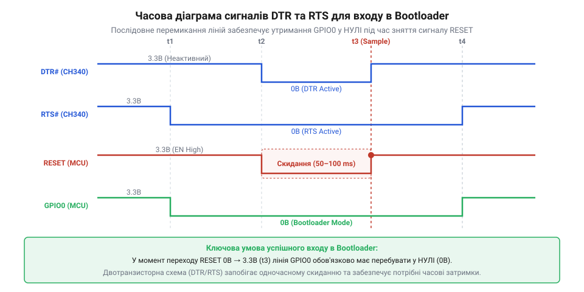
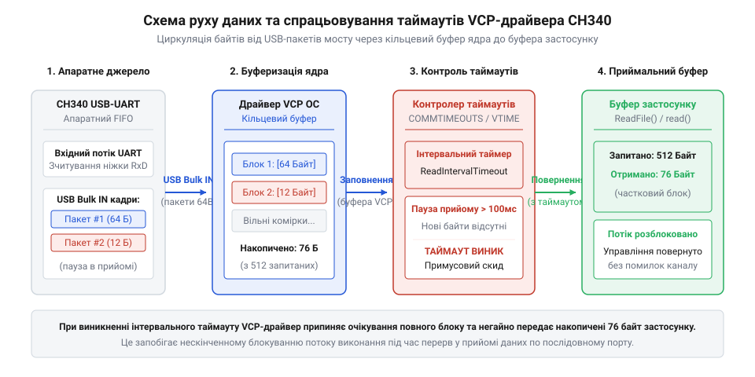

# Програмний інтерфейс VCP-драйвера та управління послідовним портом CH340

<preknowlist>
- [Плата-адаптер для ESP32-CAM (CH340, Type-C)](root:cat-hw-boards/esp32-cam-programmer) — схемотехнічне призначення ліній DTR та RTS для автоматичного скидання мікроконтролера
</preknowlist>

## Проблема нестабільної обробки потоку даних

Підключення мосту CH340 до системного порту @@en|USB@@ створює у системі віртуальний послідовний порт (від @@en|virtual COM port@@, англ. *virtual* — уявний, замінник фізичного) — @@en|VCP@@. Застосунок відкриває створений дескриптор пристрою як звичайний файл, однак спроба передати або прочитати довільний потік байтів без попередньої ініціалізації драйвера призводить до спотворення символів та систематичної втрати даних. Стандартні налаштування операційної системи за замовчуванням часто застосовують застарілу швидкість передачі (від @@en|baud rate@@, англ. *baud* — одиниця символьної швидкості) 9600 @@en|бод@@ та 8-бітовий кадр без перевірки парності. Якщо підключена периферія чи мікроконтролер розраховані на швидкість 115200 бод, приймальний регістр мосту CH340 зчитує відрізки сигнальних рівнів із помилковими інтервалами, що викликає помилку кадрування (від @@en|framing error@@, англ. *frame* — кадр даних).

Операційній системі невідомо, яка саме апаратна конфігурація встановлена на протилежному кінці лінії @@en|UART@@. Модуль CH340 виступає лише прозорим транслятором пакетів між шиною @@en|USB@@ та послідовними лініями @@en|TXD@@/@@en|RXD@@. Всі обчислення коефіцієнтів ділення внутрішнього тактового генератора CH340 виконуються драйвером на основі конфігураційних команд, надісланих утилітою або застосунком користувача. При використанні непідтримуваної або нестандартної швидкості апаратний дільник CH340 округлює значення, викликаючи відхилення частоти тактування понад допустиму межу в 2.5%, через що виникає розсинхронізація приймача.

Для забезпечення надійного зв'язку програміст мусить явно сконфігурувати параметри порту одразу після отримання системного дескриптора. Точна синхронізація швидкості передачі, кількості бітів у кадрі, типу парності та кількості стопових бітів між драйвером @@en|VCP@@ та апаратурою CH340 є обов'язковою умовою стабільної роботи каналу. Розуміння цих вимог дозволяє перейти до безпосереднього програмування системних структур керування послідовним портом.

## Налаштування швидкості та кадру передачі

Програмне конфігурування кадру передачі та швидкості обміну відрізняється залежно від операційної системи, проте в основі лежить надсилання низькорівневих керуючих пакетів до мосту CH340. У середовищі Windows для цього використовується системна структура @@en|DCB@@ (від @@en|Device Control Block@@, англ. *device control* — керування пристроєм) з @@en|Win32 API@@. Зміна параметрів відбувається шляхом зчитування поточної конфігурації через виклик GetCommState, модифікації полів BaudRate, ByteSize, Parity, StopBits та подальшого застосування через SetCommState. Драйвер CH340 перехоплює ці виклики та транслює їх у специфічні службові @@en|USB Control Transfers@@ запити до USB-контролера мосту.

У POSIX-сумісних операційних системах (Linux та macOS) керування здійснюється через структуру @@en|termios@@ та системний виклик 	csetattr. Швидкість передачі задається за допомогою функцій cfsetispeed та cfsetospeed, а конфігурація кадру маніпулює прапорами поля c_cflag. Наприклад, для встановлення популярного режиму 8N1 (8 бітів даних, без парності, 1 стоповий біт) скидаються маска CSIZE та прапор PARENB, після чого вмикається маска CS8. Драйвер ch341 у ядрі Linux конвертує конфігурацію termios у нативні команди мікросхеми CH340.

:::tabs
`c|win32
#include <windows.h>

BOOL configure_ch340_win32(HANDLE hCom, DWORD baudrate) {
    DCB dcbSerialParams = {0};
    dcbSerialParams.DCBlength = sizeof(dcbSerialParams);

    if (!GetCommState(hCom, &dcbSerialParams)) {
        return FALSE;
    }

    dcbSerialParams.BaudRate = baudrate;
    dcbSerialParams.ByteSize = 8;
    dcbSerialParams.StopBits = ONESTOPBIT;
    dcbSerialParams.Parity   = NOPARITY;

    return SetCommState(hCom, &dcbSerialParams);
}
```
`c|posix
#include <termios.h>
#include <unistd.h>

int configure_ch340_posix(int fd, speed_t baudrate) {
    struct termios options;
    tcgetattr(fd, &options);

    cfsetispeed(&options, baudrate);
    cfsetospeed(&options, baudrate);

    options.c_cflag &= ~PARENB;
    options.c_cflag &= ~CSTOPB;
    options.c_cflag &= ~CSIZE;
    options.c_cflag |= CS8;
    options.c_cflag |= (CLOCAL | CREAD);

    tcflush(fd, TCIFLUSH);
    return tcsetattr(fd, TCSANOW, &options);
}
```
:::

Апаратний дільник частоти CH340 підтримує стандартний ряд швидкостей від 50 бод до 2 Мбод для всіх версій серії (включаючи CH340G, CH340T, CH340K та CH340C). При спробі встановити непідтримуване значення, таке як 921600 бод на старих ревізіях мікросхеми, драйвер поверне помилку або автоматично підбере найближчий дільник, що призведе до збою зчитування. Налагоджена первинна ініціалізація кадру створює надійний базис для управління апаратними лініями квитування.

## Управління лініями DTR та RTS

Окрім основних ліній прийому та передачі даних, мікросхема CH340 містить виводи керування потоком @@en|DTR@@ (від @@en|Data Terminal Ready@@, англ. *terminal ready* — готовність термінала) та @@en|RTS@@ (від @@en|Request to Send@@, англ. *request to send* — запит на передачу). У схемотехніці [програмувального адаптера ESP32-CAM](root:cat-hw-boards/esp32-cam-programmer) та інших мікроконтролерних плат ці виходи підключаються до кіл керування виводами RESET (EN) та BOOT (GPIO0) через транзисторну пару автоматичного скидання. Шляхом програмної маніпуляції станами DTR та RTS драйвер VCP дозволяє дистанційно переводити мікроконтролер у режим завантажувача або виконувати його апаратне перезавантаження.

Звернення до ліній DTR та RTS виконується через спеціальні функції системного API без відправки байтів у потік даних. У Windows застосовується функція EscapeCommFunction із прапорами SETDTR/CLRDTR та SETRTS/CLRRTS. В операційних системах Linux та macOS керування здійснюється через системний виклик ioctl із використанням команд TIOCMBIS (встановити біти) та TIOCMBIC (скинути біти) над масками TIOCM_DTR та TIOCM_RTS. Важливо враховувати, що на апаратному рівні виводи CH340 інвертовані: встановлення високого логічного рівня у програмному коді викликає появу низького фізичного рівня на ніжці мікросхеми.


*Часова діаграма переходу сигналів DTR та RTS при створенні імпульсу скидання й переведення мікроконтролера в завантажувач.*

Створення чітких імпульсів перезапуску вимагає строгого дотримання затримок у часі. Для надійного переведення мікроконтролера в завантажувач лінія RTS встановлюється в активний стан, після чого активується DTR для підтягування лінії скидання до нуля. Після паузи тривалістю 50–100 мілісекунд DTR відпускається, а RTS залишається активним ще на 50 мілісекунд, що гарантує фіксацію режиму Bootloader. Володіння цими інструментами дозволяє керувати не лише логікою обміну, а й апаратним станом підключеного пристрою, що підводить до потреби конфігурування внутрішньосистемних буферів.

## Конфігурування буферів та встановлення таймаутів

Під час інтенсивного обміну даними між хостом і CH340 критичну роль відіграє налаштування системних буферів введення-виведення та інтервальних таймаутів операцій (від @@en|timeout@@, англ. *time out* — вичерпання часу). За замовчуванням драйвер VCP виділяє внутрішні кільцеві буфери (від @@en|ring buffer@@, англ. *ring buffer* — кільцевий накопичувач) обсягом 512 або 4096 байтів. Якщо застосунок обробляє вхідний потік із затримкою, вихідний буфер мікросхеми CH340 переповнюється, і нові байти відкидаються драйвером без сповіщення.

Для запобігання втратам у Windows застосовується функція SetupComm, яка явно виділяє необхідні обсяги вхідного та вихідного буферів операційної системи. Також налаштовуються таймаути через структуру COMMTIMEOUTS. Змінна ReadIntervalTimeout визначає максимальний допустимий час між прибуттям двох послідовних байтів. У Linux режим очікування даних налаштовується у структурі 	ermios за допомогою полів c_cc[VMIN] (мінімальна кількість байтів для завершення читання) та c_cc[VTIME] (таймаут очікування в десятках часток секунди).


*Схема проходження даних через внутрішні кільцеві буфери VCP-драйвера з позначенням спрацьовавання інтервальних таймаутів.*

:::tabs
`c|win32
#include <windows.h>

BOOL set_ch340_timeouts(HANDLE hCom) {
    COMMTIMEOUTS timeouts = {0};
    timeouts.ReadIntervalTimeout         = 20;
    timeouts.ReadTotalTimeoutMultiplier  = 0;
    timeouts.ReadTotalTimeoutConstant    = 100;
    timeouts.WriteTotalTimeoutMultiplier = 0;
    timeouts.WriteTotalTimeoutConstant   = 100;

    SetupComm(hCom, 4096, 4096);
    return SetCommTimeouts(hCom, &timeouts);
}
```
`c|posix
#include <termios.h>

void set_ch340_posix_timeouts(struct termios *options) {
    // Неблокуюче читання з таймаутом 100 мс (10 * 0.1 с)
    options->c_cc[VMIN]  = 0;
    options->c_cc[VTIME] = 10;
}
```
:::

Правильно підібрані значення VMIN=0 та VTIME>0 дозволяють реалізувати неблокуюче читання: функція 
ead повертає управління застосунку одразу після отримання доступної порції даних або після закінчення таймауту. Це позбавляє програму від зависання під час очікування відповіді від периферії. Грамотна організація буферизації створює умови для швидкого виявлення та обробки критичних збоїв зв'язку.

## Обробка помилок та відновлення зв'язку

Навіть при коректній конфігурації кадру та таймаутів у процесі роботи з CH340 можуть виникати апаратні збої та виключення. Найбільш поширеними є помилка переповнення буфера (від @@en|buffer overrun@@), фреймінгова помилка та раптове фізичне від'єднання USB-кабелю під час активного сеансу обміну. У Windows для перевірки стану ліній і зчитування накопичених кодувань помилок використовується функція ClearCommError. Вона повертає маску прапорів CE_RXOVER, CE_FRAME, CE_BREAK та очищує внутрішній статус помилки VCP-драйвера, відновлюючи можливість читання.

В операційних системах Linux та macOS раптове витягування адаптера CH340 з USB-роз'єму викликає повернення значення -1 системним викликом 
ead або write із встановленням системної змінної errno у значення EIO (помилка введення-виведення) або ENODEV (пристрій відсутній). На відміну від стандартних фізичних мостів, таких як [USB-UART адаптер CP2102](root:cat-hw-boards/cp2102-usb-uart), драйвер CH340 у деяких версіях ОС може не одразу звільняти дескриптор порту, через що повторне відкриття пристрою open викликає блокування.

Для створення стійкого кросплатформового застосунку необхідно реалізувати цикл перевірки стану з безпечним закриттям та гарячим відновленням дескриптора. При виявленні помилки EIO або CE_BREAK застосунок повинен негайно припинити операції читання/запису, закрити файловий дескриптор функцією CloseHandle або close, звільнити системні ресурси та перейти у стан періодичного опитування системи для повторного відкриття порту. Такий підхід гарантує високу надійність програмних інтерфейсів при роботі з CH340 у будь-яких експлуатаційних умовах.
