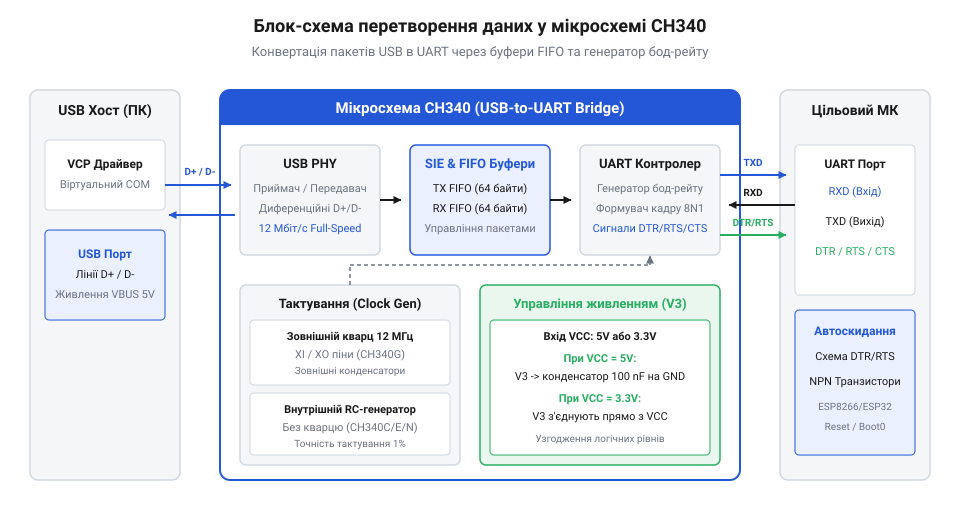
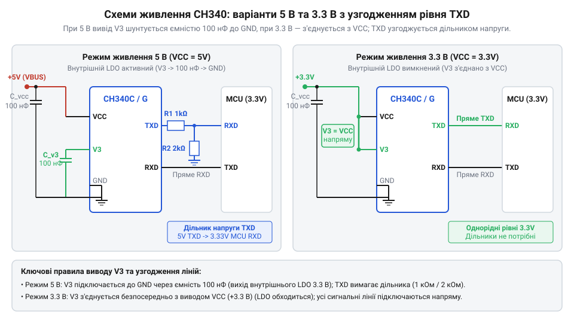
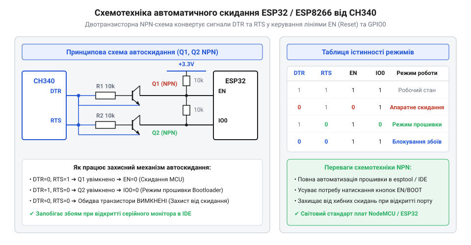

# USB-UART перетворювач CH340

<preknowlist>
- [USB-UART адаптер CP2102 (Micro-USB)](root:cat-hw-boards/cp2102-usb-uart) — розуміння базового призначення USB-UART мостів для зв'язку ПК з МК
- [Плата-адаптер для ESP32-CAM (CH340, Type-C)](root:cat-hw-boards/esp32-cam-programmer) — уявлення про практичне застосування CH340 в платах прошивки ESP32
</preknowlist>

## Потреба у зв'язку USB-UART та роль CH340

Сучасні персональні комп'ютери та ноутбуки вже давно позбулися класичних послідовних портів @@en|COM@@ (від англ. *communication* — зв'язок) стандарту @@en|RS-232@@. Проте практично кожен мікроконтролер для первинного програмування, налагодження та обміну діагностичними даними використовує асинхронний послідовний інтерфейс @@en|UART@@ (від англ. *Universal Asynchronous Receiver-Transmitter* — універсальний асинхронний приймач-передавач). Виникає фізична розбіжність між швидким пакетним протоколом @@en|USB@@ (від англ. *Universal Serial Bus* — універсальна послідовна шина) та простим побітовим послідовним потоком на виводах мікроконтролера. Без спеціального проміжного апаратного вузла комп'ютер фізично не здатний надіслати прошивку або прочитати логи з периферичного пристрою.

Розв'язанням цієї проблеми є спеціалізовані мікросхеми — USB-UART перетворювачі, або мости @@en|bridge@@ (від англ. *bridge* — міст, з'єднувальний перехід). Своє місце серед них посіла мікросхема @@en|CH340@@ від китайської компанії @@en|WCH@@ (від англ. *WinChipHead*). Вона бере на себе складну апаратну обробку дифпари сигналів @@en|USB D+@@ та @@en|D-@@, реалізує специфікацію @@en|USB 2.0 Full-Speed@@ (зі швидкістю до 12 Мбіт/с) та надає операційній системі стандартний віртуальний послідовний порт @@en|VCP@@ (від англ. *Virtual COM Port*). Детальніше розвиток цієї лінійки розкрито в матеріалі про [історію мостів CH340](root:cat-hw-boards/ch340-usb-uart-bridge/hist-ch340-evolution.md). З боку операційної системи взаємодія відбувається через стандартні системні виклики чи [програмний VCP-драйвер CH340](root:cat-hw-boards/ch340-usb-uart-bridge/api-ch340-vcp-driver-interface.md).

Для запобігання втраті даних при розбіжності швидкостей між високосмуговою шиною @@en|USB@@ та повільним послідовним зв'язком всередині @@en|CH340@@ інтегровано двонаправлені апаратні буфери @@en|FIFO@@ (від англ. *First-In, First-Out* — перший зайшов, перший вийшов). Апаратний механізм тактування цих буферів побудований на двопортовій осередковій пам'яті, що працює на стику двох асинхронних доменів: системної частоти 12 МГц контролера шини @@en|USB@@ та дільника внутрішнього генератора @@en|baud rate@@. Прийом і відправка даних виконуються через спеціалізовані кінцеві точки пакета @@en|Bulk Endpoint@@: пристроєва кінцева точка `@@en|Bulk OUT@@` приймає дані від хоста для вигрузки у лінію `TXD`, а кінцева точка `@@en|Bulk IN@@` збирає прийняті з лінії `RXD` байти для відправки на ПК. Під час інтенсивного трафіку з боку хоста апаратний алгоритм контролю вхідного буфера `TXD` безперервно відстежує кількість вільних комірок. Якщо прийом пакетів через `Bulk OUT` перевищує швидкість вичитування в лінію `TXD`, контролер пристрою перестає видавати підтвердження `@@en|ACK@@` та автотранслюється на надсилання сигналів `@@en|NAK@@` (від англ. *negative acknowledgment* — негативне підтвердження), примушуючи USB-хост призупинити передачу до звільнення буферного простору. Буфер прийому накопичує вхідні пакети даних від @@en|USB@@-хоста та вивантажує їх у лінію `TXD` відповідно до обраної швидкості обміну, а буфер передачі об'єднує прийняті з лінії `RXD` байти у зведені кадри для відправки на ПК. Таке буферизаційне вікно обсягом 64 байти нівелює затримки квантування часу в операційній системі, проте у разі тривалої паузи опитування @@en|polling@@ (від англ. *poll* — опитувати) з боку хоста внутрішній масив `RXD` повністю заповнюється. При досягненні межі мікросхема втрачає можливість зберігати нові символи, через що виникає апаратне переповнення @@en|buffer overflow@@ (від англ. *buffer* — буфер, та *overflow* — переповнення) із втратою вхідних байтів (помилка @@en|overrun@@), яке припиняється лише після відновлення зчитування даних операційною системою.


*Конвертація даних між шиною USB та послідовним портом UART всередині CH340.*

Для порівняння з іншими популярними рішеннями, як-от [адаптер CP2102](root:cat-hw-boards/cp2102-usb-uart), CH340 вирізняється надзвичайно низькою вартістю та мінімальною кількістю зовнішніх компонентів обв'язки. Повний огляд усього сімейства мікросхем наведено у матеріалі про [огляд сімейства WCH CH34x](root:hw-components/wch-ch34x-usb-bridges-family). Чіп приймає пакети даних @@en|Bulk IN@@ та @@en|Bulk OUT@@ від USB-хоста, зберігає їх у внутрішньому буфері @@en|FIFO@@ (від англ. *First-In, First-Out* — перший зайшов, перший вийшов) та послідовно висуває біти через лінії @@en|TXD@@ (від англ. *Transmit Data* — передані дані) і @@en|RXD@@ (від англ. *Receive Data* — прийняті дані) з точно заданою швидкістю @@en|baud rate@@ (від фр. *Baudot* — прізвище винахідника телеграфного коду, та англ. *rate* — швидкість).

## Модифікації мікросхеми CH340 та принципи тактування

Мікросхема CH340 випускається у кількох апаратних модифікаціях, які відрізняються типом корпусу, кількістю доступних сигнальних виводів та апаратним джерелом тактування. Класична ревізія @@en|CH340G@@ у 16-вивідному корпусі @@en|SOP-16@@ вимагає обов'язкового підключення зовнішнього кварцового резонатора з частотою 12 МГц до ніжок `XI` та `XO` з двома керамічними конденсаторами ємністю 22–30 пФ, а також надає повну цокольовку з усіма лініями модемного квитування. Використання зовнішнього кварцу забезпечує найвищу точність та стабільність тактової частоти, що критично для високих швидкостей зв'язку. Натомість у компактних модифікаціях @@en|CH340E@@ (корпус @@en|MSOP-10@@) та @@en|CH340N@@ (корпус @@en|SOP-8@@) розводка суттєво оптимізована: через обмежену кількість ніжок розробники пожертвували допоміжними модемними сигналами DSR, RI, DCD та CTS, залишивши лише лінії `TXD`, `RXD`, а у версії MSOP-10 — також керувальні лінії `RTS` і `TNOW`. Зменшення кількості виводів із 16 до 8 чи 10 ніжок дозволяє зменшити площу посадкового місця на друкованій платі більш ніж утричі, хоча й обмежує застосування мікросхеми у складних апаратних протоколах квитування.

Сучасніші версії мікросхеми — @@en|CH340C@@ (корпус SOP-16), @@en|CH340E@@ (компактний корпус @@en|MSOP-10@@) та @@en|CH340N@@ (мініатюрний корпус @@en|SOP-8@@) — містять усередині кремнієвого кристала вже відкалібрований внутрішній резисторно-ємнісний генератор @@en|RC oscillator@@ (від англ. *resistor-capacitor* — резисторно-ємнісний, та *oscillator* — генератор) на 12 МГц. Вони не потребують зовнішнього кварцового резонатора, що економить місце на друкованій платі та знижує загальну вартість виробу. Апаратну цокольовку та призначення ніжок кожної модифікації зведено в [апаратному інтерфейсі CH340](root:cat-hw-boards/ch340-usb-uart-bridge/api-ch340-hardware-interface.md).

Синтез потрібної швидкості передачі даних у мікросхемі здійснюється внутрішнім 16-бітовим дільником частоти. Для формування часового інтервалу кожного біта апаратний лічильник ділить базову частоту 12 МГц через попередній дільник частоти @@en|prescaler@@ (від лат. *prae* — попереду, та англ. *scaler* — дільник) та основний коефіцієнт ділення. Фізика асинхронного зв'язку @@en|UART@@ вимагає від приймача 16-кратного передискретизування @@en|oversampling@@ (від англ. *over* — понад, та *sampling* — вибірка) кожного бітового інтервалу для визначення логічного рівня у центрі біта. Розрахунок підсумкового коефіцієнта ділення `N` для обраної швидкості `Baud` з урахуванням 16-кратного стробування описує вираз:

```
N = 12.000.000 / (16 × Baud)      [ділення базової частоти на 16-кратну швидкість]
  = 750.000 / Baud                [спрощення коефіцієнта дільника]
```

Знайдене значення `N` округлюється до цілого та записується в регістри `prescaler`. Фізично 16-кратне передискретизування @@en|oversampling@@ працює так: після фіксації спадного фронту старт-біта внутрішній таймер відраховує 16 тактів на один біт. Стробування проводиться у самому центрі бітового інтервалу — на 7, 8 та 9 тактах із застосуванням мажоритарного вибору для захисту від випадкових сплесків. Оскільки дільник може приймати лише цілочисельні значення, для багатьох нестандартних або некратних частот базової тактової частоти 12 МГц сформована швидкість відхиляється від обраного значення @@en|baud rate@@. Щоб запобігти зсуву моментів вибірки та накопиченню часової похибки вздовж довгих кадрів даних, підсумкове відхилення швидкості дільника не повинно перевищувати межевий допуск у 2.5%, інакше стробування останніх бітів у кадрі потрапляє на межу фронтів і викликає викривлення значень або кадрову помилку @@en|framing error@@.

Оскільки дільники лічильника є цілочисельними, реальна сформована швидкість обміну може дещо відрізнятися від номінального значення, викликаючи фазовий зсув та ризик кадрових помилок @@en|framing error@@. Детальний математичний розрахунок дільників та підсумкової похибки наведено в матеріалі про [розрахунок дільника baud rate CH340](root:cat-hw-boards/ch340-usb-uart-bridge/math-ch340-baud-rate-divider-calc.md). При виборі версії без зовнішнього кварцу (наприклад, CH340C) слід враховувати температурний дрейф внутрішнього RC-генератора, який на межевих швидкостях може збільшувати сумарний бюджет похибки синхронізації.

## Схемотехніка живлення, вивід V3 та логічні рівні

Мікросхема CH340 спроможна працювати від двох стандартних напруг живлення — 5 В або 3.3 В. Ключову роль у виборі режиму живлення відіграє спеціальний вивід `V3`, який з'єднаний із внутрішнім апаратним лінійним регулятором з низьким падінням напруги @@en|LDO@@ (від англ. *Low Drop-Out* — низьке падіння напруги), що живить внутрішній трансивер @@en|USB PHY@@ (від англ. *Physical Layer* — фізичний рівень).

При живленні всієї схеми від напруги `VCC = 5 В` (наприклад, безпосередньо від шини `VBUS` порту @@en|USB@@) внутрішній LDO-регулятор знижує напругу до 3.3 В для живлення внутрішніх цифрових кіл та прийомопередавача фізичного рівня @@en|USB PHY@@. Вивід `V3` є безпосереднім виходом цього внутрішнього стабілізатора. Для забезпечення стійкості контуру зворотного зв'язку LDO-регулятора та компенсації фазового зсуву вивід `V3` обов'язково підключають до землі `GND` через керамічний шунтувальний конденсатор ємністю 100 нФ з низьким еквівалентним послідовним опором @@en|ESR@@ (англ. @@en|Equivalent Series Resistance@@). Цей конденсатор ефективно пригнічує високочастотні пульсації напруги, що виникають під час швидких перемикань ключів трансивера на частоті 12 МГц. Відсутність шунтувальної ємності на виводі V3 призводить до самозбудження регулятора, зсуву опорного потенціалу та масових помилок кадрування шини USB. Водночас категорично заборонено подавати 5 В безпосередньо на вивід `V3`, оскільки це перевищує граничний допуск напруги внутрішніх транзисторів і миттєво виводить з ладу регулятор та USB-трансивер.


*Конфігурація виводу V3 та джерел живлення CH340 для робочих напруг 5 В та 3.3 В.*

При роботі мікросхеми від джерела `VCC = 3.3 В` внутрішній LDO-регулятор не потрібен. У цій конфігурації вивід `V3` з'єднують безпосередньо з шиною живлення `VCC` (3.3 В) та шунтують керамічним конденсатором 100 нФ на землю. Нюанси електричних параметрів виводів та схеми включення детально наведено в [апаратному інтерфейсі CH340](root:cat-hw-boards/ch340-usb-uart-bridge/api-ch340-hardware-interface.md).

При з'єднанні 5-вольтової мікросхеми CH340 із 3.3-вольтовими мікроконтролерами слід враховувати узгодження логічних рівнів. Вихід `TXD` CH340 видає амплітуду 5 В, що перевищує допустиму напругу живлення 3.3-вольтових входів мікроконтролера і може викликати пробій або паразитичний струм через вбудовані захисні діоди. Для зниження амплітуди застосовують резистивний дільник напруги з резисторів `R1` (послідовно в лінії) та `R2` (з виходу дільника на землю `GND`).

Співвідношення опорів дільника виражається класичною формулою:

```
V_out = V_in × R2 ÷ (R1 + R2)  [формула вихідної напруги дільника]
```

Для пониження 5 В до безпечного рівня 3.3 В підбирають номінали `R1 = 1` кОм та `R2 = 2` кОм. Обчислимо вихідну напругу `V_out`:

```
V_out = 5 × 2000 ÷ (1000 + 2000)
      = 10000 ÷ 3000
      = 3.33                   [безпечна амплітуда сигналу в вольтах]
```

При виборі опорів важливим чинником є вхідна паразитна ємність ніжки мікроконтролера `C_in` (типово 10–15 пФ разом з ємністю друкованого провідника). Дільник утворює низькочастотний @@en|RC@@-фільтр з еквівалентним опором джерела `R_eq = (R1 × R2) ÷ (R1 + R2)`. Для `R1 = 1` кОм та `R2 = 2` кОм еквівалентний опір становить `R_eq ≈ 667` Ом, що дає сталу часу `τ = R_eq × C_in ≈ 10` нс. Це забезпечує круті фронти сигналу навіть на високих швидкостях @@en|UART@@ (до 921600 біт/с). Вибір занадто великих опорів (наприклад, `R1 = 47` кОм, `R2 = 100` кОм) збільшує сталу часу до сотень наносекунд, спотворюючи фронти імпульсів та викликаючи апаратні помилки кадрування. З іншого боку, занадто малі номінали підвищують енергоспоживання. Розрахуємо розсіювану потужність на резисторах дільника при тривалій передачі даних або перебуванні лінії в пасивному стані високого рівня `V_in = 5 В`:

        P_total
        = V_in² ÷ (R1 + R2)                      [загальна розсіювана потужність дільника]
        = 5² ÷ (1000 + 2000)                     [підстановка напруги 5 В та опорів 1 кОм і 2 кОм]
        = 25 ÷ 3000
        ≈ 0.00833 Вт (8.33 мВт)                  [сумарне тепловиділення обох резисторів]

        P_R1
        = P_total × R1 ÷ (R1 + R2)               [потужність на послідовному резисторі R1]
        = 8.33 × 1000 ÷ 3000
        ≈ 2.78 мВт                               [тепловиділення на верхньому плечі дільника]

        P_R2
        = P_total × R2 ÷ (R1 + R2)               [потужність на нижньому резисторі R2]
        = 8.33 × 2000 ÷ 3000
        ≈ 5.56 мВт                               [тепловиділення на плечі заземлення]

Отримані значення розсіюваної потужності (`P_R1 ≈ 2.78` мВт та `P_R2 ≈ 5.56` мВт) перебувають далеко в безпечних межах навіть для найдрібніших чип-резисторів поверхневого монтажу @@en|SMD@@ типорозміру 0402 (з номінальною потужністю 62.5 мВт), що повністю виключає їхнє теплове перевантаження чи деградацію параметрів під час тривалого обміну даними.

Другою поширеною проблемою є явище [паразитного живлення в електронних схемах](root:hw-digital/phantom-powering-in-digital-circuits). Коли цільовий мікроконтролер вимкнено від основного джерела 3.3 В, але мікросхема @@en|CH340@@ залишається підключеною до @@en|USB@@, на її виході @@en|TXD@@ утримується високий логічний рівень 5 В або 3.3 В. Струм виходу протікає через верхній захисний @@en|ESD-діод@@ (від англ. *Electrostatic Discharge* — електростатичний розряд) знеструмленого мікроконтролера на його шину живлення `VCC`, частково заживлюючи схему та викликаючи хаотичний перезапуск прошивки.

## Лінії модемного квитування та автоскидання МК

Окрім основних ліній прийому та передачі даних `TXD` і `RXD`, повнофункціональні модифікації мікросхеми CH340 (наприклад, CH340G та CH340C) надають повний набір виводів модемного квитування @@en|hardware flow control@@ (від англ. *hardware flow control* — апаратне керування потоком). До них належать вихідні лінії керування @@en|DTR@@ (від англ. *Data Terminal Ready* — готовність термінала даних) і @@en|RTS@@ (від англ. *Request to Send* — запит на передачу), а також вхідні лінії стану @@en|CTS@@ (від англ. *Clear to Send* — готовий до прийому), @@en|DSR@@, @@en|RI@@ та @@en|DCD@@.

У сучасних мікроконтролерних системах сигнальні лінії DTR та RTS найчастіше використовуються не за прямою призначеністю, а як керовані GPIO-виходи для формування сигналів скидання @@en|RESET@@ та вибору режиму завантаження @@en|BOOT0@@ / `GPIO0`. Це дозволяє середовищу розробки на ПК автоматично переводити мікроконтролер у режим завантажника @@en|bootloader@@ (від англ. *bootstrap loader* — первинне завантаження) перед початком прошивки без натискання фізичних кнопок на платі.


*Двотранзисторний вузол автоматичного скидання та вибору режиму завантаження для мікроконтролерів ESP32/ESP8266.*

У схемах для мікроконтролерів ESP32 та ESP8266 застосовується класичний двотранзисторний вузол на NPN-транзисторах. Принцип його роботи полягає у виключенні небезпечного стану, коли обидва виводи `EN` (Reset) та `IO0` (Boot) одночасно опускаються в нуль при випадкових імпульсах від USB-драйвера. При появі логічного нуля на лініях DTR або RTS схемотехніка за чергою формує короткий імпульс скидання та утримує низький рівень на `IO0`, дозволяючи завантажнику прийняти новий бінарний файл.

Часова діаграма сигналів утиліти прошивки (наприклад, `esptool`) складається з трьох послідовних фаз: спочатку виставляється стан `DTR = 1, RTS = 0`, що вмикає перший транзистор і притискає лінію `IO0` до землі (0 В) для вибору режиму завантаження. На наступному кроці подається комбінація `DTR = 0, RTS = 1`, яка відкриває другий транзистор і опускає вивід `EN` у логічний нуль, викликаючи скидання мікроконтролера. Нарешті, повернення у стан `DTR = 1, RTS = 1` або `DTR = 1, RTS = 0` знімає сигнал скидання `EN = 1`, і чип зчитує низький рівень на `IO0` саме на зростаючому фронті `EN`, фіксуючи режим завантажника @@en|UART@@. У разі заміни класичних біполярних NPN-транзисторів на польові @@en|MOSFET@@ (від англ. *Metal-Oxide-Semiconductor Field-Effect Transistor* — польовий транзистор зі структурою метал-оксид-напівпровідник) виникає специфіка затримок спрацьовування. На відміну від струмового керування біполярним переходом, затвор MOSFET володіє паразитною вхідною ємністю `C_iss` (типово 20–50 пФ), яка разом із затворними резисторами підтяжки 10 кОм утворює @@en|RC@@-ланцюг перезаряду зі сталою часу `τ = R × C_iss ≈ 0.2–0.5` мкс. Окрім того, польовий транзистор перемикається лише при досягненні порогової напруги затвора `V_GS(th)` (1.0–2.0 В для логічних транзисторів), що затягує фронти відкривання та закривання ключа. Хоча мікросекундні затримки затвора не порушують мілісекундну послідовність сигналів утиліти прошивки й додатково згладжують голчасті імпульси USB-драйвера, використання MOSFET із завищеною пороговою напругою (`V_GS(th) > 2.5 В`) або надмірними опорами затвора (>100 кОм) призводить до затримки розмикання ключа та збою фіксації режиму завантаження.

Критичну роль у цій часовій послідовності відіграє підтягувальний керамічний конденсатор ємністю 100 нФ (або 1 мкФ), підключений між виводом `EN` та землею `GND` паралельно резистору підтяжки 10 кОм. Ця RC-ланцюг виконує дві функції: вона фільтрує високочастотні голчасті перехідні завади від USB-драйвера при відкритті COM-порту та затримує наростання напруги на `EN` (з часовою сталою `τ = R × C ≈ 1` мс), гарантуючи, що мікроконтролер надійно зафіксує стан `IO0 = 0` під час перезапуску.

Важливою особливістю роботи драйвера @@en|VCP@@ операційної системи є виникнення короткочасних часових затримок (порядку 10–50 мілісекунд) при відкритті послідовного порту @@en|COM@@. Під час ініціалізації драйвера лінії @@en|DTR@@ та @@en|RTS@@ можуть довільно змінювати свій стан, що викликало б постійні хаотичні перезавантаження мікроконтролера при кожному підключенні термінала. Саме двотранзисторне перехресне блокування гарантує, що одиночні асинхронні затримки або одночасне опускання обох ліній у логічний нуль не призведуть до скидання `EN = 0`: мікроконтролер перезапуститься лише при строгій послідовності команд від утиліти прошивки, що детально описує [схемотехніка автоматичного скидання](root:hw-arch/mcu-bootloader-autoreset-circuits) мікроконтролерів.

Загальні принципи побудови таких вузлів висвітлює стаття про [автоматичне скидання мікроконтролерів](root:hw-arch/mcu-bootloader-autoreset-circuits). Цей транзисторний вузол є стандартним для багатьох схем, включаючи рішення на [адаптері ESP32-CAM](root:cat-hw-boards/esp32-cam-programmer) та [модулях ESP-01](root:cat-hw-boards/esp-01-adapter). Покроковий розрахунок елементів транзисторного ключа детально розібрано у матеріалі про [проєкт автоскидання ESP32](root:cat-hw-boards/ch340-usb-uart-bridge/proj-ch340-esp-autoreset-programmer.md).
