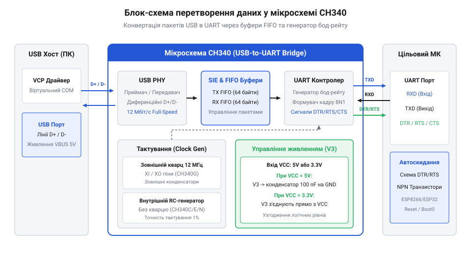
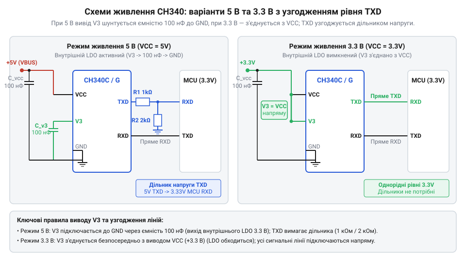
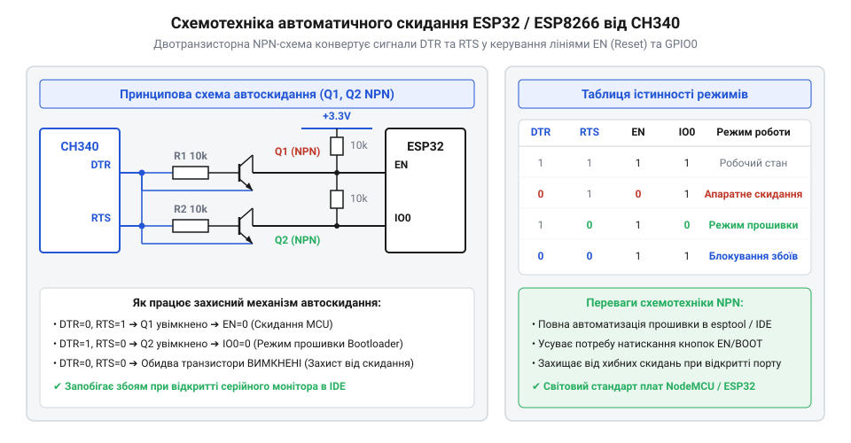

# USB-UART перетворювач CH340

<preknowlist>
- [USB-UART адаптер CP2102 (Micro-USB)](root:cat-hw-boards/cp2102-usb-uart) — базове призначення USB-UART мостів для зв'язку ПК з мікроконтролером
</preknowlist>

## Потреба у з'єднанні USB-UART

Сучасні комп'ютери позбулися системних портів @@en|COM@@ (від англ. *communication* — зв'язок) стандарту @@en|RS-232@@, але мікроконтролери продовжують використовувати асинхронний послідовний інтерфейс @@en|UART@@ (від англ. *Universal Asynchronous Receiver-Transmitter* — універсальний асинхронний приймач-передавач). Фізичний розрив між швидкісними пакетами шини @@en|USB@@ (від англ. *Universal Serial Bus* — універсальна послідовна шина) та побітовим потоком @@en|UART@@ вирішує апаратний міст @@en|CH340@@ від компанії @@en|WCH@@ (від англ. *WinChipHead*). Він перетворює сигнальну дифпару @@en|USB@@ у віртуальний послідовний порт @@en|VCP@@ (від англ. *Virtual COM Port*). Для запобігання втратам байтів під час квантування часу в операційній системі всередині чипа інтегровано двонаправлені буфери @@en|FIFO@@ (від англ. *First-In, First-Out* — перший зайшов, перший вийшов). Для порівняння з іншими рішеннями можна розглянути [адаптер CP2102](root:cat-hw-boards/cp2102-usb-uart), що виконує аналогічну роль.

*Блок-схема конвертації даних між хостом USB та інтерфейсом UART всередині мікросхеми CH340.*

## Модифікації чипа та тактування

Мікросхема @@en|CH340@@ випускається в кількох корпусах із різними джерелами тактування. Ревізія @@en|CH340G@@ (корпус @@en|SOP-16@@) вимагає зовнішнього кварцового резонатора 12 МГц із двома конденсаторами 22–30 пФ. Версії @@en|CH340C@@ (корпус @@en|SOP-16@@), @@en|CH340E@@ (корпус @@en|MSOP-10@@) та @@en|CH340N@@ (корпус @@en|SOP-8@@) містять вбудований відкалібрований внутрішній @@en|RC oscillator@@ (від англ. *resistor-capacitor* — резисторно-ємнісний, та *oscillator* — генератор) на 12 МГц, що усуває потребу в кварці й економить площу друкованої плати. Синтез потрібної швидкості обміну @@en|baud rate@@ (від фр. *Baudot* — прізвище винахідника телеграфного коду, та англ. *rate* — швидкість) виконує внутрішній 16-бітовий дільник частоти; відхилення генератора не повинно перевищувати 2.5%, щоб запобігти кадровим помилкам при зчитуванні бітів.

## Конфігурація живлення та узгодження рівнів

Мікросхема @@en|CH340@@ підтримує живлення від напруги 5 В або 3.3 В. При живленні `VCC = 5 В` внутрішній стабілізатор @@en|LDO@@ (від англ. *Low Drop-Out* — низьке падіння напруги) формує напругу 3.3 В для трансивера шини @@en|USB@@ на виводі `V3`. Цей вивід обов'язково підключають до землі через керамічний конденсатор 100 нФ для пригнічення високочастотних пульсацій. При живленні `VCC = 3.3 В` вивід `V3` з'єднують безпосередньо з лінією живлення. Для безпечного стикування 5-вольтового виходу `TXD` @@en|CH340@@ з 3.3-вольтовими мікроконтролерами застосовують резистивний дільник напруги (R1 = 1 кОм, R2 = 2 кОм), який знижує амплітуду сигналу до безпечних 3.33 В без спотворення фронтів імпульсів.

*Принципові схеми включення CH340 при живленні 5 В та 3.3 В із блокирувальним конденсатором на виводі V3.*

## Керування лініями автоскидання DTR і RTS

Окрім ліній прийому та передачі даних, повнофункціональні версії @@en|CH340@@ надають лінії модемного квитування @@en|DTR@@ (від англ. *Data Terminal Ready* — готовність термінала даних) та @@en|RTS@@ (від англ. *Request to Send* — запит на передачу). У схемах для мікроконтролерів вони керують двотранзисторним ключем на NPN-транзисторах, який формує сигнали скидання `EN` та входу в @@en|bootloader@@ (від англ. *bootstrap loader* — первинне завантаження) на піні `IO0`. Двотранзисторне перехресне блокування запобігає випадковому скиданню мікроконтролера при відкритті термінала на ПК. Таке рішення масово застосовується в платах розробки, зокрема в [адаптері ESP32-CAM](root:cat-hw-boards/esp32-cam-programmer) та у зв'язці з [модулем ESP-01](root:cat-hw-boards/esp-01-adapter) для автоматизації процесів прошивки.

*Двотранзисторний вузол автоматичного скидання та вибору режиму завантаження від сигналів DTR/RTS.*
