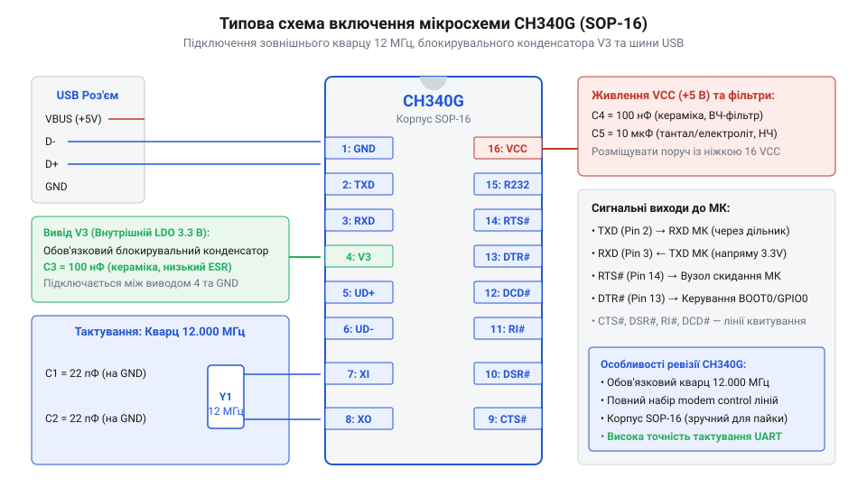
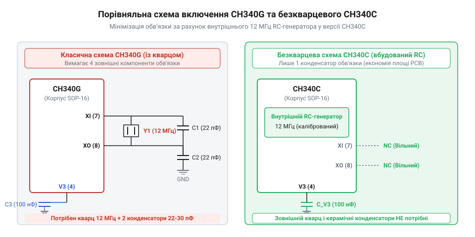

# Історія створення та еволюції серії USB-UART мостів CH340

<preknowlist>
- [USB-UART адаптер CP2102 (Micro-USB)](root:cat-hw-boards/cp2102-usb-uart) — розуміння класичних USB-UART мостів та призначення ліній Rx/Tx, DTR/RTS для прошивки мікроконтролерів
- [Плата-адаптер для ESP32-CAM (CH340, Type-C)](root:cat-hw-boards/esp32-cam-programmer) — уявлення про практичне застосування чипів CH340 у сучасних адаптерах програмування
</preknowlist>

## Проблема вартості USB мостів початку 2000х

На початку 2000-х років персональні комп'ютери стрімко відмовлялися від застарілих послідовних портів @@en|RS-232@@ на користь універсальної послідовної шини @@en|USB@@ (англ. *Universal Serial Bus*). Однак для розробників мікроконтролерних систем це створило серйозну проблему: більшість бюджетних мікроконтролерів того часу не мали апаратного контролера USB і спілкувалися із зовнішнім світом виключно через асинхронний послідовний інтерфейс @@en|UART@@ (англ. *Universal Asynchronous Receiver-Transmitter*). Для підключення плати до комп'ютера був потрібен спеціальний апаратний міст, який перетворював фізичні рівні сигналів та пакетний протокол USB у звичний послідовний потік даних.

У той період ринок спеціалізованих мікросхем-мостів повністю контролювали кілька західних компаній, серед яких беззаперечним лідером була шотландська компанія @@en|FTDI@@ (англ. *Future Technology Devices International*) зі своїм чіпом `FT232BM` (а пізніше `FT232RL`), а також американська Silicon Labs з мікросхемою [USB-UART адаптер CP2102](root:cat-hw-boards/cp2102-usb-uart). Відмінності між ними полягали не лише в апаратній структурі, а й у пропрієтарних протоколах та ліцензуванні драйверів: шлях @@en|VCP@@ (англ. @@en|Virtual COM Port@@ — віртуальний послідовний порт) створював стандартний послідовний порт на рівні операційної системи для звичайних термінальних програм, тоді як закритий низькорівневий драйвер @@en|D2XX@@ компанії FTDI повністю оминав системну абстракцію послідовного порту й надавав прямий доступ до внутрішніх регістрів кристала через власну динамічну бібліотеку для реалізації режимів прямого керування виводами (англ. @@en|bit-banging@@). Ці мікросхеми вирізнялися високою надійністю та якісними драйверами, але мали один вирішальний недолік — високу ціну. Окрема мікросхема моста коштувала в роздріб від \$3 до \$5, що нерідко перевищувало вартість самого мікроконтролера на платі розробки.

Такий економічний бар'єр ускладнював масове виробництво дешевих навчальних і радіоаматорських плат. Конструкторам доводилося або змушувати користувача купувати дорогий зовнішній кабель-адаптер, або шукати шляхи зниження собівартості. Використання окремих виносних адаптерів створювало додаткові виробничі витрати: збирання кабель-модулів вимагало ручного або поверхневого монтування багатоконтактних роз'ємів, індивідуального тестування з'єднань та комплектації кожного виробу, що відчутно збільшувало трудомісткість конвеєра та піднімало кінцеву ціну продукту. Водночас стрімко зростав попит на доступні апаратні платформи, такі як відкрита екосистема Arduino, де наявність зручного USB-порту безпосередньо на платі була критичною умовою для початківців. Ринок вимагав дешевого монолітного рішення, яке дозволило б інтегрувати USB-інтерфейс у кожен пристрій без його істотного здорожчання.

## Поява CH340G та вихід WCH на ринок

Відповіддю на гострий дефіцит бюджетних мостів стала розробка китайської компанії @@en|WinChipHead@@ (або @@en|WCH@@, офіційна назва — *Jiangsu Qinheng Co., Ltd.*), розташованої в місті Нанкін. У середині 2000-х років компанія представила серію мікросхем `CH341` та її спрощену модифікацію `CH340`, орієнтовану виключно на перетворення USB у UART. Головною перевагою нового чіпа стала його ціна: у масовому виробництві мікросхема коштувала менше $0.50, що було у 5–10 разів дешевше за продукти західних конкурентів.

Найпопулярнішою першою масовою версією серії стала мікросхема `CH340G` у стандартному корпусі @@en|SOP-16@@. Вона підтримувала всі базові лінії послідовного порту (`TXD`, `RXD`), а також службові лінії керування потоком (`RTS`, `CTS`, `DTR`, `DSR`, `DCD`, `RI`), що дозволило використовувати її не лише для передачі даних, а й для автоматичного скидання мікроконтролерів у режим завантажника. У схемі автоскидання популярних Wi-Fi модулів ESP8266 сигнали `DTR` та `RTS` через транзисторну розв'язку керують виводами `GPIO0` та `RST`: сигнал `DTR` притискає `GPIO0` до землі для вибору режиму прошивки UART Download Mode, а короткий імпульс `RTS` примусово перезавантажує мікроконтролер. Для забезпечення стабільної тактової частоти USB (12 МГц) мікросхема `CH340G` вимагала підключення зовнішнього кварцового резонатора з двома керамічними конденсаторами обв'язки.

*Типова схема включення CH340G із зовнішнім кварцовим резонатором 12 МГц та обв'язкою.*

Поява `CH340G` викликала справжній прорив на ринку електроніки. Виробники бюджетних клонів плат Arduino Uno та Nano відразу замінили дорогі мікросхеми ATmega16U2 та FT232RL на рішення від WCH. Вибір класичного корпусу @@en|SOP-16@@ із кроком ніжок 1.27 мм замість складних @@en|BGA@@-пакувань (від англійського *ball grid array* — масив кулькових виводів) або дрібнокрокових чипів додатково знизив витрати: виводи @@en|SOP@@ дозволили використовувати найпростіші двошарові друковані плати, проводити візуальний оптичний контроль пайкування без рентгенівських установок та задіювати дешеві тестові планки з пружинними контактами на фабриках у Шеньчжені. Доступність CH340G кардинально змінила технологію виробництва та постачання на китайських фабриках: постачальники компонентів почали формувати уніфіковані пакунки деталей (BOM-комплекти), що включали головний мікроконтролер, міст WCH та базову пасивну обв'язку в стрічках для автоматизованого поверхневого монтажу. Це дозволило фабрикам перейти від штучного складання до високошвидкісного панельного монтажу з мінімальними логістичними витратами. Згодом `CH340G` стала основним стандартом для програмування популярних Wi-Fi модулів ESP8266 та плат NodeMCU, а також для платформ зневадження на кшталт [плат для ESP32-CAM](root:cat-hw-boards/esp32-cam-programmer). Низька ціна та доступність драйверів для більшості операційних систем зробили `CH340` найпоширенішим USB-UART мостом у світі побутової електроніки та розробницьких плат.

## Безкварцева революція та мікрокорпуси

Хоча мікросхема `CH340G` здобула величезну популярність, її використання вимагало встановлення зовнішнього кварцового резонатора на 12 МГц та двох керамічних конденсаторів. У малогабаритних пристроях це створювало додаткові труднощі: кварц займав цінну площу друкованої плати, збільшував вартість монтажу компонентів та ускладняв розводку сигнальних трас. Головною технічною перепоною для відмови від кварцю була жорстка вимогливість протоколу @@en|USB@@ до точності тактової частоти — відхилення шини не повинно перевищувати ±0.25%. Стандартні внутрішні @@en|RC@@-генератори (англ. *Resistor-Capacitor*) мікроконтролерів зазнавали значного температурного дрейфу й зміни частоти при коливаннях живлення, що призводило до збоїв синхронізації пакетів.

Інженери компанії @@en|WCH@@ розв'язали цю проблему, розробивши інтегрований високоточний RC-осцилятор із внутрішнім фабричним калібруванням та автопідлаштуванням частоти за сигналами точних інтервалів USB-кадрів. Механізм автокалібрування покладається на маркери початку кадру @@en|SOF@@ (англ. *Start of Frame*), які хост-контролер USB надсилає шиною з точним інтервалом рівно в 1.0 мс: внутрішній цифровий компаратор чипа підраховує кількість тактів RC-генератора між сусідніми SOF-пакетами й динамічно підлаштовує коефіцієнт ділення осцилятора, нівелюючи температурний дрейф та компенсуючи коливання напруги. Результатом цієї технологічної революції стала випущена модифікація `CH340C`, яка зберегла корпус @@en|SOP-16@@ та повну сумісність за виводами з `CH340G`, але взагалі не потребувала зовнішнього резонатора.

*Порівняльна схема включення безкварцевої мікросхеми CH340C з мінімальною кількістю зовнішніх компонентів.*

Відмова від обов'язкового кварцю відкрила можливість випуску чипів у значно менших корпусах. Компанія представила модель `CH340E` у компактному корпусі @@en|MSOP-10@@ та `CH340N` у мініатюрному @@en|SOP-8@@. Зменшення кількості виводів досягли за рахунок відмови від рідко використовуваних службових ліній керування потоком, залишивши лише найважливіші лінії `TXD`, `RXD`, `RTS` та `DTR`. Перехід від класичного корпусу @@en|SOP-16@@ із зовнішнім кварцом HC-49S та паразитними конденсаторами, які сумарно займали на друкованій платі понад `150 мм²`, до корпусу MSOP-10 площею лише `15 мм²` зменшив необхідну схемотехнічну площу вузла узгодження майже вдесятеро, а корпус SOP-8 обійшовся лише `19 мм²`. Це дозволило створювати ультракомпактні USB-UART перетворювачі, які інтегрували безпосередньо в USB-роз'єми, розміщували на мініатюрних [адаптерах ESP32-CAM](root:cat-hw-boards/esp32-cam-programmer) або застосовували у компактних [адаптерах для модулів ESP-01](root:cat-hw-boards/esp-01-adapter).

## Розвінчання міфів про підробки та надійність

Швидке поширення чипів `CH340` на тлі низької ціни породило у спільноті розробників низку стереотипів. Найпоширенішим із них стало упередження, ніби `CH340` є «нелегальним китайським клоном» або «підробкою під чипи @@en|FTDI@@». Це уявлення з'явилося через плутанину в термінології: на ринку справді траплялися контрафактні репліки FT232RL, однак серія `CH340` є повністю самостійною оригінальною архітектурою. Вона має власні ідентифікатори обладнання @@en|VID@@ (`0x1A86`) та @@en|PID@@ (`0x7523`), власну систему команд і не намагається видавати себе за пристрої інших виробників.

Іншою причиною сумнівної репутації стали проблеми з драйверами в ранніх операційних системах. Операційні системи @@en|Windows@@ XP та Windows 7 не мали вбудованого драйвера для чипів WCH, тому при першому підключенні пристрій відображався як невідомий. Користувачам доводилося вручну шукати та встановлювати драйвери з китайських сайтів, що створювало враження «нестабільності». Ситуацію ускладнювала відсутність цифрового підпису лабораторій якості апаратного забезпечення (від англ. @@en|Windows Hardware Quality Labs@@, @@en|WHQL@@) у перших версіях драйверів WCH: під час інсталяції операційна система виводила критичні попередження безпеки про «неперевіреного видавця» та блокувала автоматичне встановлення, лякаючи недосвідчених користувачів. Градус напруги зріс у 2014 році під час скандалу, відомого як @@en|FTDIgate@@, коли оновлені драйвери FTDI навмисно виводили з ладу контрафактні мікросхеми FT232, скидаючи їхній PID у нуль. Багато початківців помилково вважали, що ці збої стосувалися й оригінальних чипів `CH340`.

З технічного погляду безкварцеві версії `CH340` мають певні апаратні межі. Внутрішній RC-генератор при екстремальних температурах або значних падіннях напруги живлення може давати відхилення частоти, що спричиняє помилки кадрів на високих швидкостях передачі. При діапазоні температур від -20 °C до +70 °C на стандартній швидкості 115200 @@en|бод@@ відсоток помилок байта залишається близьким до 0%, проте при піднятті швидкості до 921600 бод температурне відхилення частоти понад 2.5% спричиняє збільшення частоти помилок до 3–8%, викликаючи збої контрольних сум при високошвидкісному прошиванні. Проте для стандартних швидкостей прошивки мікроконтролерів чипи забезпечують повну надійність за ціною, недосяжною для дорожчих [моделей типу CP2102](root:cat-hw-boards/cp2102-usb-uart). Сьогодні `CH340` є визнаним промисловим стандартом у масовій бюджетній електроніці та [компактних платах програмування](root:cat-hw-boards/esp32-cam-programmer).
