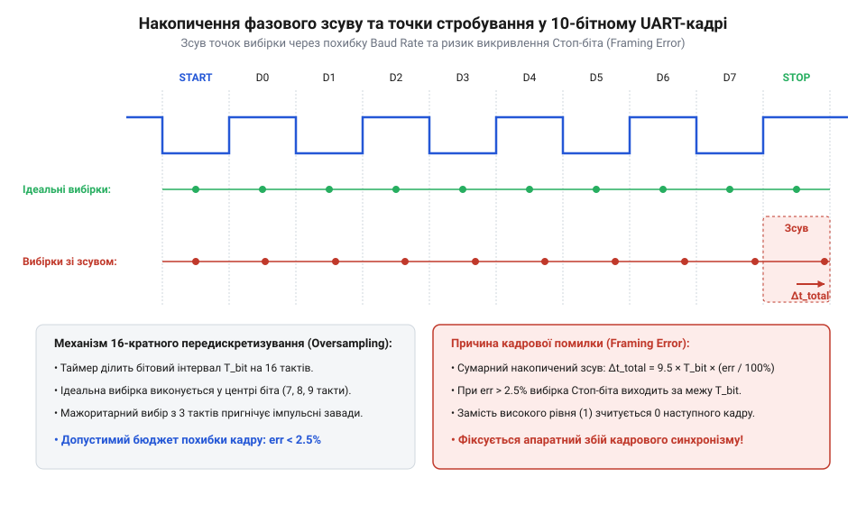
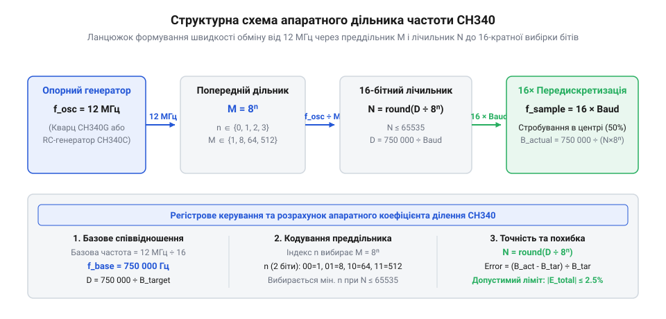

# Розрахунок дільника тактування та похибки baud rate CH340

<preknowlist>
- [Плата-адаптер для ESP32-CAM (CH340, Type-C)](root:cat-hw-boards/esp32-cam-programmer) — особливості інтеграції мікросхеми CH340 в схеми послідовного програмування та обміну даними
- [USB-UART адаптер CP2102 (Micro-USB)](root:cat-hw-boards/cp2102-uart-bridge) — принципи формування швидкості послідовної передачі даних UART та стандарти швидкостей обміну
</preknowlist>

## Проблема розсинхронізації та кадрових помилок

Під час передачі даних через асинхронний послідовний інтерфейс (англ. @@en|UART@@, від @@en|Universal Asynchronous Receiver-Transmitter@@ — універсальний асинхронний приймач-передавач) між комп'ютером та мікроконтролером відсутня спільна лінія тактування. Приймач орієнтується виключно на спадний фронт стартового біта і запускає свій внутрішній лічильник для стробування (англ. @@en|strobe@@ — вибірка імпульсу) кожного наступного біта кадру. На практиці при використанні нетипових швидкостей обміну або модулів на кшталт [модуля ESP32-CAM](root:cat-hw-boards/esp32-cam-programmer) чи інших пристроїв на базі [адаптера CP2102](root:cat-hw-boards/cp2102-usb-uart) виникає різниця частот між генераторами передавача та приймача. Ідеальна точка вибірки знаходиться точно в геометричному центрі бітового інтервалу (на позначці 50% від його тривалості `T_bit`), утворюючи симетричне часове вікно безпечної вибірки в межах ±50% (від 0% до 100% ширини біта). При накопиченні фазової похибки швидкісна розбіжність призводить до лінійного зсуву точок стробування уздовж часової осі: з кожним наступним бітом точка зчитування зміщується від центру до його фронтальних меж. Якщо до кінця кадру сумарний фазовий зсув виходить за межі допускного вікна `±0.5 T_bit`, стробувальний імпульс припадає на сусідній біт, спричиняючи зчитування некоректного логічного рівня та виникнення кадрової помилки.

Оскільки кожен біт зчитується у моменти часу, які визначає внутрішній дільник приймача, навіть найменше відхилення швидкості передачі (англ. @@en|baud rate@@ — швидкість передачі символів) накопичується з кожним наступним бітом. До кінця 10-бітного кадру (1 стартовий біт, 8 бітів даних, 1 стоп-біт) накопичена похибка створює часовий фазовий зсув (англ. @@en|phase shift@@, від @@en|phase@@ — фаза).

*Накопичення фазового зсуву точки стробування відносно центру бітового інтервалу під час прийому кадру.*

Оскільки внутрішній лічильник спроможний ділити опорну частоту лише на цілі числа, точний розрахунковий коефіцієнт `D` розкладається у регістровій структурі `@@en|CH340@@` на два елементи: попередній дільник частоти (англ. `@@en|prescaler@@`, від англ. *scale* — шкала) з коефіцієнтом `M` та 16-бітний лічильник `N`. Математична механіка формування коефіцієнта спирається на дискретну залежність `M = 8ⁿ`, де двобітний індекс `n` (значення від 0 до 3) вибирає базове співвідношення предділення з множини `{1, 8, 64, 512}`. Для довільної цільової швидкості `B_target` математична модель розраховує загальне дробове значення дільника `D = 750000 ÷ B_target`, після чого драйвер знаходить мінімальне ціле `n ∈ {0, 1, 2, 3}`, яке задовольняє умову поміщення значення лічильника у 16-бітну сітку `N = round(D ÷ 8ⁿ) ≤ 65535`. Математично згенерований апаратний дільник виражається як `D_actual = N × 8ⁿ`, а під час упаковки в регістри чипа двобітне значення `n` записується у службові прапорці предділення, тоді як округлене ціле значення `N` завантажується у 16-бітний регістр періоду лічильника, формуючи підсумкову фактичну швидкість обміну `B_actual = 750000 ÷ D_actual`.

## Математична модель апаратного дільника CH340

Формування заданої швидкості обміну у мікросхемі @@en|CH340@@ виконується шляхом ділення опорної тактової частоти 12 МГц (`12 000 000` Гц), яка задається зовнішнім кварцовим резонатором або внутрішнім RC-генератором. Апаратний лічильник мікросхеми генерує імпульси для 16-кратної вибірки бітів, тому частота внутрішнього лічильника має дорівнювати 16-кратній швидкості обміну `Baud`.

*Схема генерації тактових імпульсів бадрейту з базової частоти 12 МГц через преддільник та лічильник.*

Загальний математичний коефіцієнт ділення `D` для заданого бадрейту `Baud` обчислюється як відношення базової тактової частоти 12 МГц (`12 000 000` Гц) до 16-кратної потрібної швидкості обміну, оскільки апаратний лічильник виконує 16-кратне передискретизування кожної бітової комірки. Щоб спростити регулярні розрахунки у прошивці драйвера, початковий вираз скорочують на постійний множник `16`:

        D
        = 12000000 ÷ (16 × Baud)      [базова формула ділення частоти 12 МГц]
        = (12000000 ÷ 16) ÷ Baud      [алгебраїчне винесення постійного дільника 16]
        = 750000 ÷ Baud               [чисельне спрощення константи 12000000 на 16]

При обчисленні коефіцієнта `D` результат переважно виходить дробовим. Якщо внутрішня регістрова структура мікросхеми @@en|CH340@@ підтримує напівцілі дільники (дробові ступені з кроком `0.5`, як-от `6.5`), точний результат округлюють до найближчого допустимого дискретного кроку `6.5` замість грубого цілого `7`, що суттєво зменшує залишкове відхилення швидкості. Математичну перевагу напівцілого ділення видно з порівняння похибок для 115200 бод при точному значення коефіцієнта `D = 6.510416...`:

        Error_int
        = ((750000 ÷ 7) - 115200) ÷ 115200 × 100   [обчислення похибки для цілого N=7]
        = (107142.86 - 115200) ÷ 115200 × 100     [фактична швидкість 107142.86 бод]
        ≈ -6.99%                                  [недопустима похибка, що викликає кадрову помилку]

        Error_half
        = ((750000 ÷ 6.5) - 115200) ÷ 115200 × 100 [обчислення похибки для напівцілого N=6.5]
        = (115384.62 - 115200) ÷ 115200 × 100     [фактична швидкість 115384.62 бод]
        ≈ +0.16%                                  [висока точність у межах допуску 2.5%]

Використання напівцілого кроку зменшує відносну похибку відхилення понад ніж у 40 разів (із `-6.99%` до `+0.16%`), забезпечуючи стабільний зв'язок у пристроях на зразок [плати-адаптера для ESP32-CAM](root:cat-hw-boards/esp32-cam-programmer). Якщо ж використовується лише цілочисельний режим лічильника, дробове значення округлюють до найближчого цілого апаратного числа `N = round(D)`, обираючи мінімальну похибку між нижньою та верхньою цілими межами.

        D
        = 12000000 ÷ (16 × Baud)      [ділення базової частоти на 16-кратну швидкість]
        = 750000 ÷ Baud               [спрощення дробу на 16]

Оскільки внутрішній лічильник спроможний ділити частоту лише на цілі числа, точний розрахунковий коефіцієнт `D` округлюється до найближчого цілого апаратного значення `N = round(D)`. У регістровій структурі @@en|CH340@@ коефіцієнт ділення розкладається на два елементи: попередній дільник частоти (англ. @@en|prescaler@@, від @@en|scale@@ — шкала) з коефіцієнтом `M` та 16-бітний лічильник `N`. Математичний алгоритм кодування розраховує коефіцієнт `M` як дискретний ступінь вісімки `M = 8ⁿ`, де двобітний індекс `n` (значення від 0 до 3) задає рівні предділення 1, 8, 64 або 512. Під час ініціалізації драйвер визначає мінімальний індекс `n`, при якому значення 16-бітного лічильника `N = round(D ÷ 8ⁿ)` не перевищує розмірності регістру `65535`, і завантажує комбінацію індексу `n` та значення `N` у керуючі бадрейт-регістри чипа.

**Обчислення дільника для стандартної швидкості 115200 бод:**

        D
        = 750000 ÷ 115200             [застосування формули дільника]
        = 6.510416...                 [значення точного дробового коефіцієнта]
        ≈ 7                           [округлення до найближчого цілого]

Отримане значення `N = 7` завантажується у регістри дільника @@en|CH340@@, що визначає фактичну згенеровану швидкість обміну.

## Розрахунок накопиченого фазового зсуву бітів

Округлення дробового коефіцієнта ділення `D` до найближчого цілого числа `N` призводить до появи відносної похибки генерації швидкості. Відносна похибка обміну `Error` у відсотках визначається як відхилення фактично сформованої швидкості `B_actual` від цільової номінальної швидкості `B_target`:

        Error
        = ((B_actual - B_target) ÷ B_target) × 100    [формула відносного відхилення]

Розглянемо обчислення для стандартної швидкості 115200 @@en|бод@@. Розрахунковий дробовий дільник складає `D = 750000 ÷ 115200 = 6.5104`, що округлюється до цілого числа `N = 7` (або `6.5` при дробових ступенях):

        B_actual
        = 750000 ÷ 6.5                [фактична швидкість для апаратного дільника 6.5]
        = 115384.6                    [значення фактичної швидкості в бодах]

        Error
        = ((115384.6 - 115200) ÷ 115200) × 100 [підстановка значень швидкості]
        = 0.16                        [значення відносної похибки у %]

Для нестандартної швидкості 128000 @@en|бод@@ з дільником `D = 750000 ÷ 128000 = 5.8594`, що округлюється до `N = 6`:

        B_actual
        = 750000 ÷ 6.0                [обчислення для цілого дільника 6]
        = 125000                      [фактична швидкість у бодах]

        Error
        = ((125000 - 128000) ÷ 128000) × 100   [підстановка у формулу відхилення]
        = -2.34                       [відносна похибка у %]

Абсолютна тривалість бітового інтервалу `T_bit` для швидкості 128000 @@en|бод@@ становить `1 ÷ 128000 = 7.8125` мкс. Обчислимо абсолютний часовий зсув `Δt_shift` у мікросекундах на стоп-біті 10-бітного кадру:

        T_bit
        = 1 ÷ 128000                  [тривалість одного біта у секундах]
        = 0.0000078125                [значення у секундах]
        = 7.8125                      [значення тривалості біта у мкс]

        Δt_shift
        = 10 × Error × T_bit          [акумульований часовий зсув кадру]
        = 10 × (-0.0234375) × 7.8125  [підстановка похибки та тривалості біта]
        = -1.831                      [абсолютний зсув точки стробування у мкс]

Здобуте значення `-1.831` мкс складає `-23.4%` від ширини бітового інтервалу `7.8125` мкс, наближаючи точку вибірки до межі допустимого часового вікна.

        B_actual
        = 750000 ÷ 6.0                [обчислення для цілого дільника 6]
        = 125000                      [фактична швидкість у бодах]

        Error
        = ((125000 - 128000) ÷ 128000) × 100   [підстановка у формулу відхилення]
        = -2.34                       [відносна похибка у %]

Накопичений фазовий зсув на стоп-біті обчислюється шляхом множення похибки `Error` на кількість бітів у кадрі. Для стандартного кадру без перевірки парності (1 стартовий біт, 8 бітів даних, 1 стоповий біт, усього 10 бітів) при похибці `-2.34%` зсув стробування досягає `-23.4%` від ширини бітового інтервалу. Додавання @@en|біта парності@@ (англ. @@en|parity bit@@, від @@en|parity@@ — парність) збільшує загальну довжину кадру до 11 бітів, через що накопичене фазове відхилення на стоп-біті зростає до `11 × (-2.34%) = -25.74%`. Математичний зв'язок між тривалістю 10-бітного кадру `10 × T_bit` та 11-бітного `11 × T_bit` визначає загальний часовий інтервал акумуляції похибки: довший кадр пропорційно збільшує фізичний часовий зсув точки вибірки. При апаратному передискретизуванні (англ. @@en|oversampling@@) вибірка здійснюється в центрі бітового інтервалу (на позначці `50%`), тому геометричний перетин межі сусіднього біта відбувається при зсуві на `±50%`. Однак з урахуванням квантування 16-кратного оверсемплінгу (невизначеність `±6.25%`) та двостороннього розподілу похибки між передавачем і приймачем, накопичений зсув понад `25%` зміщує точку стробування на самий край безпечного часового вікна. Для 11-бітного кадру значення `-25.74%` перевищує цю межу, призводячи до геометричного переходу стробу в інтервал сусіднього біта та виникнення помилок кадсування (@@en|framing error@@). Подібні розрахунки дозволяють оцінити сумісність мікросхеми @@en|CH340@@ під час прошивки пристроїв на кшталт [плати-адаптера ESP32-CAM](root:cat-hw-boards/esp32-cam-programmer) або при підключенні [адаптера CP2102](root:cat-hw-boards/cp2102-usb-uart).

## Бюджет похибки та температурний дрейф

Загальна надійність послідовного зв'язку визначається сумарним бюджетом похибки `E_total`, який враховує не лише дискретність апаратного дільника `E_baud`, але й температурне відхилення частоти генераторів `E_drift` та розкид тактування мікроконтролера `E_mcu`:

        E_total
        = |E_baud| + |E_drift| + |E_mcu|              [формула сумарного бюджету похибки]

У мікросхемах модифікації @@en|CH340G@@ застосовується зовнішній кварцовий резонатор 12 МГц, який має високу стабільність із часовим дрейфом `|E_drift| ≤ 0.005%`. У той же час версія @@en|CH340C@@ використовує внутрішній @@en|RC-генератор@@ (англ. @@en|RC-oscillator@@, від @@en|resistor-capacitor oscillator@@ — генератор на резисторі й конденсаторі), чий температурний дрейф може досягати `|E_drift| ≈ 1.5%` при зміні температури навколишнього середовища. Фізична причина цього дрейфу полягає у змінності опору кремнієвих резисторів та ємності внутрішніх конденсаторів при коливаннях температури: у морозних умовах (від `-40` °C до `0` °C) зниження опору прискорює перезаряд ємності й зміщує опорну частоту вгору на `+1.5%`–`+2.0%`, а при високих температурах (від `+60` °C до `+85` °C) зростання опору сповільнює генератор, знижуючи частоту на `-1.5%`. У застосуваннях на кшталт [плати-адаптера для ESP32-CAM](root:cat-hw-boards/esp32-cam-programmer) такі екстремальні температурні відхилення вичерпують допустимий бюджет похибки й призводять до спотворення кадрової синхронізації при обміні даними в польових умовах.

Для забезпечення безпомилкового прийому даних у режимі 16-кратної передискретизування сумарний бюджет похибки повинен задовольняти нерівність стійкості:

        E_total
        = |E_baud| + |E_drift| + |E_mcu|
        ≤ 2.5                         [гранична умова запобігання кадровим помилкам]

Розрахуємо залишковий запас похибки `E_mcu_margin`, який залишається для тактування приймача (мікроконтролера) при використанні мікросхеми @@en|CH340C@@ на стандартній швидкості 115200 @@en|бод@@ (`|E_baud| = 0.16%`) з урахуванням номінального температурного дрейфу її RC-генератора (`|E_drift| = 1.5%`):

        E_mcu_margin
        = 2.5 - (|E_baud| + |E_drift|) [формула залишкового запасу]
        = 2.5 - (0.16 + 1.5)           [підстановка похибки дільника та дрейфу CH340C]
        = 2.5 - 1.66                   [сумарне відхилення CH340C у %]
        = 0.84                         [залишковий запас для приймача у %]

Отримане значення `0.84%` показує, що для модифікації @@en|CH340C@@ залишкова допустима похибка тактування приймача стискається майже втричі порівняно з кварцовим варіантом @@en|CH340G@@ (`2.33%`). При підвищенні температури навколишнього середовища, коли дрейф RC-генератора зростає до `|E_drift| = 2.0%`, залишковий запас знижується до критичних `0.34%`, через що будь-яке незначне відхилення частоти приймача спричиняє кадрову помилку (англ. @@en|framing error@@ — помилка кадрування) та втрату синхронізації пристроїв на кшталт [плати-адаптера для ESP32-CAM](root:cat-hw-boards/esp32-cam-programmer).

        E_total
        ≤ 2.5                         [гранична умова запобігання кадровим помилкам]

При виборі стандартної швидкості 115200 @@en|бод@@ на мікросхемі @@en|CH340G@@ значення `|E_baud| = 0.16%` залишає великий резерв у `2.33%` на похибку приймача. Однак для версії @@en|CH340C@@ з RC-генератором сумарна похибка на нестандартних швидкостях може перевищити ліміт 2.5%, що спровокує кадрову помилку (англ. @@en|framing error@@ — помилка кадровання) та втрату синхронізації. Щоб обґрунтувати вибір оптимальної швидкості зв'язку в широкому температурному діапазоні (від `-40` °C до `+85` °C), необхідно звести до мінімуму апаратну похибку дільника `|E_baud| ≤ 0.16%`, обираючи швидкості 115200 або 57600 бод із дробовим коефіцієнтом `D`, близьким до напівцілих або цілих дискретних рівнів. На швидкості 57600 бод розрахункове значення `D = 750000 ÷ 57600 ≈ 13.0208` округлюється до цілого `N = 13`, що дає фактичну швидкість `B_actual = 750000 ÷ 13 ≈ 57692.3` бод і мінімальну похибку `|E_baud| ≈ 0.16%`. Водночас тривалість бітового інтервалу збільшується вдвічі (з `T_bit ≈ 8.68` мкс при 115200 бод до `17.36` мкс при 57600 бод), що розширює абсолютне часове вікно стробування біта та знижує чутливість до високочастотного джиттера. Якщо приймальний мікроконтролер також працює від внутрішнього RC-генератора із власним відхиленням `|E_mcu| ≈ 1.0%`, єдиним способом утримати `E_total ≤ 2.5%` в умовах сильного розігріву є зниження швидкості обміну до 9600 або 19200 бод та застосування мікроконтролера з кварцовим тактуванням, як на [платі-адаптері для ESP32-CAM](root:cat-hw-boards/esp32-cam-programmer).
