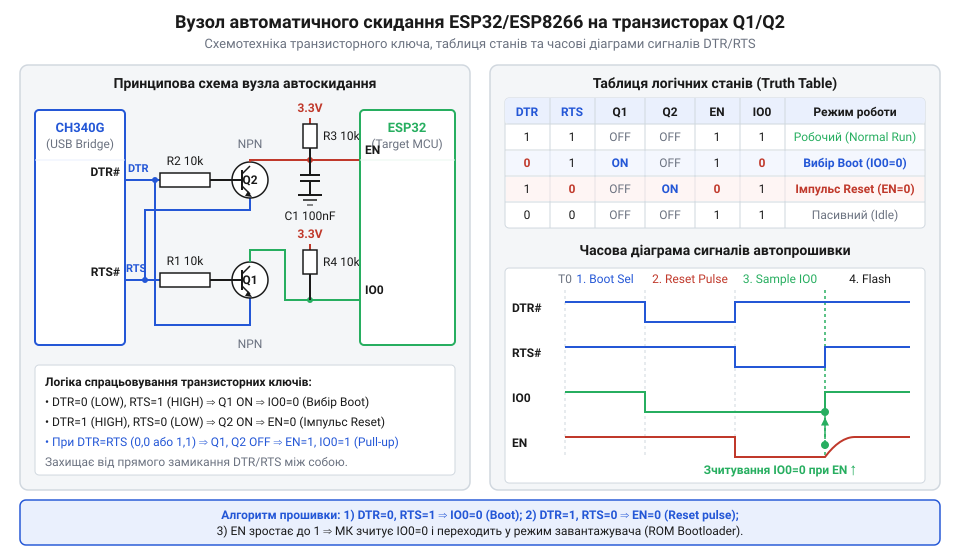

# Проєкт USB-програматора ESP32 та ESP8266 на базі CH340G з автоматичним скиданням

<preknowlist>
- [USB-UART адаптер CP2102 (Micro-USB)](root:cat-hw-boards/cp2102-usb-uart) — призначення сигнальних ліній DTR та RTS у послідовних інтерфейсах UART
- [Плата-адаптер для ESP32-CAM (CH340, Type-C)](root:cat-hw-boards/esp32-cam-programmer) — базові принципи підключення чипа CH340 та завантаження прошивки в мікроконтролери ESP
</preknowlist>

## Специфіка прошивки та проблеми ручного скидання

Розробка та налагодження програмного забезпечення для систем на кристалі серії @@en|ESP32@@ та @@en|ESP8266@@ вимагає систематичного перезапису вмісту флеш-пам'яті через послідовний інтерфейс @@en|UART@@ (від англ. @@en|Universal Asynchronous Receiver-Transmitter@@ — універсальний асинхронний приймач-передавач). Для ініціалізації процесу прошивання внутрішній масочно-запрограмований завантажувач @@en|ROM Bootloader@@ (від англ. @@en|bootloader@@ — завантажувач) мусить зчитати логічний нуль на виводі вибору режиму @@en|IO0@@ (або @@en|GPIO0@@) строго в момент підйому фронту напруги на лінії скидання @@en|EN@@ (англ. @@en|Enable@@ — увімкнення, чипа @@en|RESET@@). У базових макетних платах перехід у режим програмування здійснюється вручну двома механічними кнопками: розробник затискає кнопку `BOOT` (притискаючи @@en|IO0@@ до заземлення @@en|GND@@), подає імпульс скидання кнопкою `EN` і лише після цього відпускає `BOOT`. Критичною вимогою цього процесу є суворе дотримання часових таймаутів рукостискання службової утиліти @@en|esptool@@. Під час ініціалізації з'єднання утиліта циклічно надсилає стартові пакети синхронізації `0x00 0x08 0x24 0x00 ...` на швидкості 115200 бод і очікує підтвердження від завантажувача протягом обмеженого вікна часом від 50 мс до 200 мс після відпускання лінії @@en|EN@@. Якщо розробник затискає або відпускає кнопки з затримкою чи некоректним інтервалом між подачею скидання та стартом відправки кадру, завантажувач зчитує помилкову логічну одиницю на @@en|IO0@@ або виходить за межі вікна очікування першого пакета, через що @@en|esptool@@ аварійно завершує роботу з помилкою таймауту `Timed out waiting for packet header`.

Під час інтенсивної розробки або масового виготовлення пристроїв ручний метод викликає суттєві труднощі. Апаратне вікно фіксації рівнів триває частки мілісекунд, і найменше розходження у часі натискання кнопок призводить до звичайного старту виконання старого коду замість переходу в завантажувач. Консольна утиліта @@en|esptool@@ надсилає синхронізаційні пакети протягом обмеженого інтервалу та перериває сесію з помилкою таймауту. Порівняно з готовими модулями, де застосовується [адаптер CP2102](root:cat-hw-boards/cp2102-usb-uart) або подібні мости, створення власного програматора вимагає автоматизації цієї послідовності. Для цього використовують модемні лінії керування послідовного порту @@en|USB@@ (від англ. @@en|Universal Serial Bus@@ — універсальна послідовна шина) — @@en|DTR@@ (від англ. @@en|Data Terminal Ready@@ — готовність термінала) та @@en|RTS@@ (від англ. @@en|Request to Send@@ — запит на передачу), які програма прошивання перемикає автоматично.

## Логіка та схемотехніка двотранзисторного автоскиду

Пряме підключення сигналів @@en|DTR@@ та @@en|RTS@@ до ліній @@en|EN@@ та @@en|IO0@@ неможливе, оскільки програмне відкриття послідовного порту операційною системою одночасно скидає обидва сигнали в активний низький рівень. Якби лінії були з'єднані напряму, мікроконтролер одночасно утримувався б у стані скидання та режимі програмування. Для розв'язання цієї проблеми застосовують схему автоскидання на двох @@en|NPN-транзисторах@@ (наприклад, S8050 або SS8050). Робота цього вузла підпорядковується суворій таблиці істинності електричних станів: при початковій комбінації `DTR=0` та `RTS=0` (обидва сигнали в неактивному високому рівні 3.3 В) різниця потенціалів база-емітер `V_be` для обох транзисторів дорівнює 0 В, що утримує їх закритими й забезпечує нормальну роботу мікроконтролера (`EN=1`, `IO0=1`). Під час активації режиму завантаження утиліта виставляє `DTR=0` та `RTS=1` (активний низький рівень 0 В): база першого транзистора отримує 3.3 В від DTR, а емітер — 0 В від RTS, завдяки чому він відкривається й притискає лінію `IO0` до землі (`EN=1`, `IO0=0`). Наступним кроком подається комбінація `DTR=1` та `RTS=0`, яка відкриває другий транзистор і притискає вивід `EN` до нуля, перезапускаючи ядро (`EN=0`, `IO0=1`). Нарешті, при одночасній подачі `DTR=1` та `RTS=1` (типова поведінка драйверів під час відкриття COM-порту) потенціали баз та емітерів обидвох транзисторів стають однаковими (0 В), внаслідок чого обидва транзистори примусово закриваються і блокують хибне скидання системи (`EN=1`, `IO0=1`).

Схемотехніка вузла побудована так, що кожен транзистор керує однією цільовою лінією, а його база підключена через обмежувальний резистор 10 кОм до одного з керуючих сигналів, тоді як емітер з'єднаний з іншим. У початковому стані (`DTR=0`, `RTS=0`) обидва транзистори закриті, а лінії @@en|EN@@ та @@en|IO0@@ підтягнуті резисторами до шини живлення 3.3 В. Коли утиліта прошивання встановлює `DTR=0` та `RTS=1`, транзистор керування лінії @@en|IO0@@ відкривається і притискає її до заземлення @@en|GND@@. На наступному кроці встановлюється комбінація `DTR=1` та `RTS=0`, що відкриває другий транзистор і формує імпульс низького рівня на лінії @@en|EN@@. У разі аварійного стану, коли `DTR=1` та `RTS=1`, потенціали на базах та емітерах зрівнюються, обидва транзистори блокуються і запобігають заклинюванню процесора.

*Принципова схемотехніка автоскидання ESP32/ESP8266 з підключенням ліній DTR та RTS до транзисторної пари S8050.*

## Живлення CH340G та захист сигнальних ліній

Основою програматора є мікросхема послідовного мосту @@en|CH340G@@, яка вимагає правильного налаштування кіл живлення та виводу внутрішнього регулятора `V3`. При живленні всієї схеми від напруги 3.3 В вивід `V3` необхідно з'єднати безпосередньо з шиною `VCC`. Якщо ж мікросхема @@en|CH340G@@ живиться від напруги 5 В шини @@en|USB@@, вивід `V3` слугує виходом внутрішнього регулятора на 3.3 В і вимагає обов'язкового шунтування на заземлення керамічним конденсатором ємністю 100 нФ для стабілізації внутрішніх тактових генераторів. CH340G@@ | Докладний аналіз внутрішньої архітектури, призначення виводів та режимів живлення чипа висвітлено у матеріалі про [мікросхему USB-UART мосту CH340G](root:cat-hw-boards/ch340-usb-uart-bridge/api-ch340-hardware-interface.md).

Під час розробки схемотехніки важливо відсікти шляхи паразитного живлення цільового мікроконтролера. Коли плата ESP знеструмлена, а програматор підключений до комп'ютера, напруга з виводу `TXD` моста через внутрішні захисні діоди виводів мікроконтролера потрапляє на його внутрішню шину живлення, викликаючи частковий запуск ядра у нестабільному стані. Для усунення цього ефекту в розрив ліній `TXD` та `RXD` встановлюють послідовні захисні резистори номіналом 470 Ом або 1 кОм, які обмежують струм витікання до безпечних мікроамперів. Живлення 5 В від USB-роз'єму фільтрується феритовою намистиною (англ. @@en|ferrite bead@@) та паралельною групою з танталового конденсатора 10 мкФ і керамічного 0.1 мкФ.

## Трасування дифпари USB та розводка плати

Трасування двошарової друкованої плати програматора вимагає дотримання правил цілісності сигналів для послідовної шини @@en|USB 2.0 Full-Speed@@. Сигнальні лінії `D+` та `D-` утворюють диференціальну пару (англ. @@en|differential pair@@, @@en|diff-pair@@) з нормованим хвильовим опором (англ. @@en|differential impedance@@) 90 Ом. Недотримання геометрії провідників призводить до відбиття сигналів та збоїв розпізнавання пристрою операційною системою.

Для стандартного двошарового текстоліту @@en|FR-4@@ завтовшки 1.6 мм ширину провідників `D+` та `D-` обирають рівною 0.38 мм із зазором між ними 0.25 мм. Довжини обох провідників диференціальної пари мусять бути суворо симетричними з розходженням не більше 0.5 мм для відсутності часового зсуву фаз (англ. @@en|phase skew@@). На нижньому шарі друкованої плати безпосередньо під трасою дифпари розташовують суцільний полігон заземлення @@en|GND@@ без розривів, вирізів або прокладання інших сигнальних дорожок, що гарантує стабільний зворотний шлях струму.

## Збірка програматора та діагностика помилок

Після виготовлення та монтажу елементів плати проводиться перевірка функціонування вузла автоскиду та перетворення інтерфейсів. На практиці такі модулі використовуються в проєктах на кшталт [плати-адаптера для ESP32-CAM](root:cat-hw-boards/esp32-cam-programmer), де компактність та надійність автоскиду є вирішальними. Перевірити роботу транзисторного автомата можна за допомогою програмних скриптів та утиліт:

:::tabs
@tab C
:::code proj-ch340-esp-autoreset-programmer/c/main.c

@tab C++
:::code proj-ch340-esp-autoreset-programmer/cpp/main.cpp

@tab Python
:::code proj-ch340-esp-autoreset-programmer/py/ch340_dtr_rts_control.py
:::

Типовою несправністю під час первинного запуску є відсутність переведення в режим завантажувача через низький коефіцієнт підсилення за струмом `h_FE` використаних транзисторів або надто малий номінал резисторів підтяжки на платі мікроконтролера. У такому разі транзистор не здатний повністю притиснути лінію @@en|IO0@@ до рівня нижче 0.8 В. Іншою поширеною проблемою є апаратні перезавантаження ESP32 під час увімкнення Wi-Fi передавача, спричинені високим опором ліній живлення 3.3 В. Для усунення просідань на вихідний роз'єм живлення програматора встановлюють додатковий тантал з низьким послідовним опором @@en|Low ESR@@ ємністю 100 мкФ.
