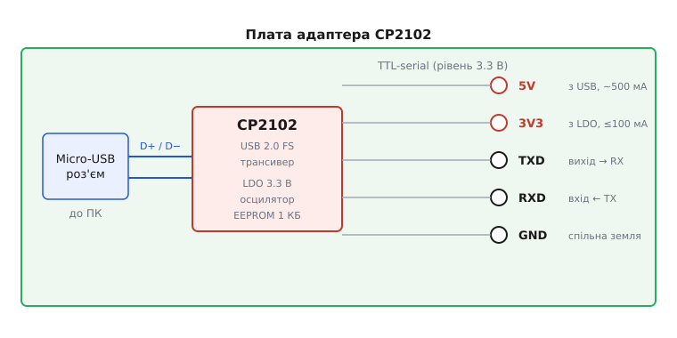
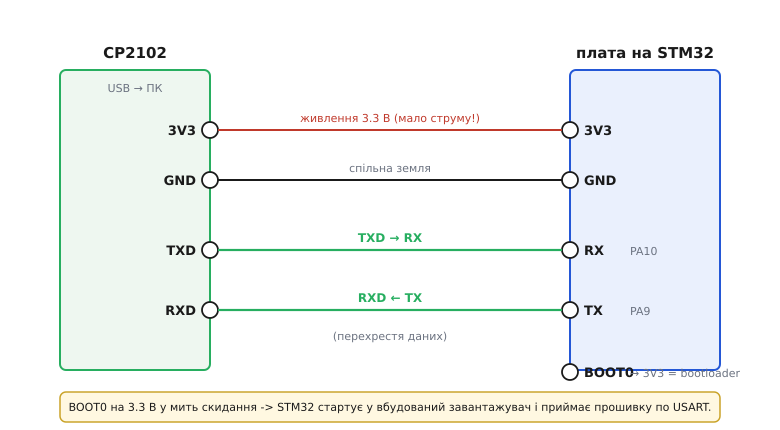

# USB-UART адаптер CP2102 (Micro-USB)

## Модуль-місток між USB та UART

Сучасні персональні комп'ютери та ноутбуки спілкуються із зовнішніми пристроями через високошвидкісний шинний інтерфейс @@en|USB@@ (від англ. *@@en|Universal Serial Bus@@* — універсальна послідовна шина). Водночас більшість простих мікроконтролерів без вбудованого USB-контролера використовують для зв'язку асинхронний послідовний порт @@en|UART@@ (від англ. *@@en|Universal Asynchronous Receiver-Transmitter@@* — універсальний асинхронний приймач-передавач) на транзисторно-транзисторних логічних рівнях @@en|TTL@@ (від англ. *@@en|Transistor-Transistor Logic@@* — транзисторно-транзисторна логіка). Без спеціального адаптера підключити такий мікроконтролер напряму до комп'ютера неможливо.

Адаптер на базі мікросхеми @@en|CP2102@@ компанії @@en|Silicon Labs@@ виконує роль апаратного мосту між цими двома протоколами. З одного боку плата має роз'єм @@en|Micro-USB@@ для підключення до ПК, а з іншого — виведені сигнали послідовного порту. В операційній системі комп'ютера драйвер адаптера створює віртуальний послідовний порт (англ. @@en|Virtual COM Port@@), дозволяючи програмам надсилати й приймати дані через стандартні виклики роботи з послідовним портом. На відміну від альтернативних рішень, таких як [USB-UART перетворювач CH340](root:cat-hw-boards/ch340-usb-uart-bridge), чип CP2102 містить вбудований тактовий генератор і не потребує зовнішнього кварцового резонатора.

## Схема з'єднання та призначення виводів

На вихідну гребінку адаптера CP2102 виведено п'ять основних контактів, які забезпечують живлення та обмін даними з мікроконтролерною платою.

*Схема показує перетворення пакетів USB у послідовні рівні TTL на виводах TXD та RXD з роздільним живленням 5V і 3V3.*

Головним правилом підключення сигнальних ліній є їхнє перехресне з'єднання (англ. @@en|crossover connection@@): вихід передавача адаптера `TXD` підключають до входу приймача мікроконтролера `RX`, а вхід приймача адаптера `RXD` — до виходу передавача `TX`. Обов'язковою умовою стабільної роботи є з'єднання контакту `GND` адаптера із землею мікроконтролера для формування спільного потенціалу відліку напруги.

## Електричні рівні та обмеження живлення

Сигнальні лінії `TXD` та `RXD` більшості модулів CP2102 працюють на логічному рівні 3.3 В, що робить їх безпечними для безпосереднього підключення до сучасних 3.3-вольтових мікроконтролерів. При підключенні до 5-вольтових пристроїв лінія `RXD` адаптера вимагає встановлення зовнішнього резистивного дільника напруги або перетворювача рівнів для запобігання пошкодженню вхідних каскадів мікросхеми.

Контакти живлення гребінки виводять напругу 5 В напряму з шини USB та 3.3 В з виходу вбудованого лінійного стабілізатора @@en|LDO@@ (від англ. *@@en|Low Dropout Regulator@@* — стабілізатор із малим падінням напруги). Вбудований стабілізатор 3.3 В має суворе паспортне обмеження за струмом до 100 мА. Цього достатньо для живлення самого чипа та малопотужної логіки, але забігаючи наперед, спроба заживити від нього потужні бездротові модулі викликає просідання напруги та постійне скидання пристрою.

## Прошивання та моніторинг сервісної консолі

Основними сценаріями використання адаптера CP2102 є завантаження прошивки та виведення налагоджувальних повідомлень у сервісну консоль.

*Підключення ліній живлення, спільної землі та перехресних сигнальних ліній TXD/RXD під час прошивання.*

Для оновлення ПЗ мікроконтролери переводять у режим системного завантажувача (англ. @@en|bootloader@@). Наприклад, при підключенні до плат без вбудованого USB-порту вивід вибору режиму завантаження садять на відповідний логічний рівень у момент скидання живлення, після чого комп'ютер передає бінарний файл через віртуальний COM-порт. У робочому режимі адаптер приймає символьні текстові логи від мікроконтролера й виводить їх у термінал зі швидкістю до 921 600 бод.
