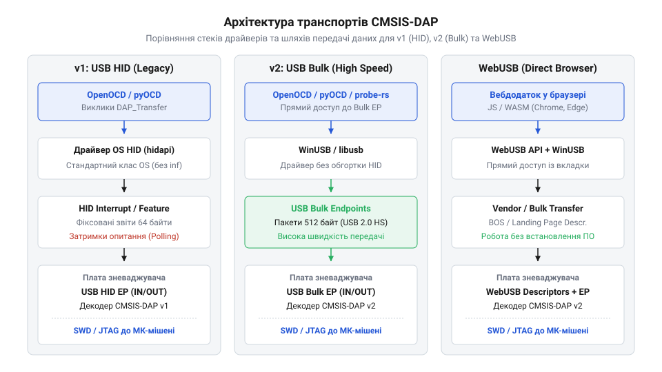
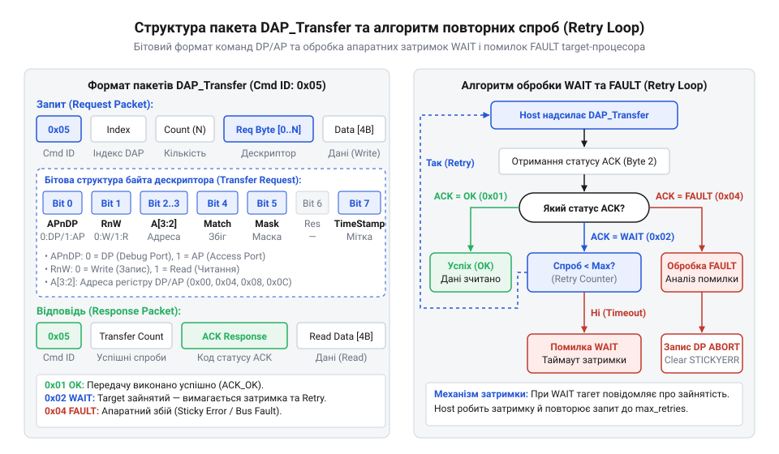

# Програмний протокол CMSIS-DAP, USB Mass Storage та WebUSB

## Проблема прямих апаратних інтерфейсів зневадження

Під час розробки вбудованих систем виникає постійна потреба керувати виконанням програми на мікроконтролері, зчитувати стан регістрів та записувати бінарний код у flash-пам'ять. Традиційно кожен виробник напівпровідникових кристалів створював власні пропрієтарні @@en|зневаджувачі@@ (від англ. @@en|debug@@ — усувати помилки) та специфічні драйвери для зв'язку з комп'ютером. Відсутність єдиного стандарту призводить до жорсткої прив'язки розробника до інструментарію конкретного вендора. Якщо проєкт вимагає заміни мікроконтролера, інженер змушений змінювати апаратні програматори, встановлювати нове програмне забезпечення та переналаштовувати все середовище розробки.

Головна проблема прямих апаратних інтерфейсів полягає у фрагментації транспортних протоколів та низькорівневих драйверів операційної системи. Для зв'язку з програматором хост-додаток повинен викликати спеціалізовані бібліотеки у режимі ядра, що створює значні перешкоди для кросплатформенності: драйвер, написаний під одну операційну систему, вимагає переробок або взагалі не підтримується на інших платформах. Це робить неможливою надійну автоматизацію тестування у системах безперервної інтеграції (@@en|CI/CD@@), де тестові стенди виконуються у ізольованих контейнерах без доступу до пропрієтарних ядрових драйверів.

Окремим бар'єром постає робота у вебсередовищі. Сучасні хмарні середовища розробки та браузерні конфігуратори не мають можливості звертатися до довільних апаратних пристроїв через класичні ядрові драйвери з міркувань безпеки. Для розв'язання цих проблем виникла потреба у відкритому, стандартизованому протоколі верхнього рівня, який абстрагує фізичний транспорт від низькорівневих команд зневадження. Таким стандартом став протокол @@en|CMSIS-DAP@@ (від англ. @@en|Cortex Microcontroller Software Interface Standard Debug Access Port@@ — стандартний порт доступу до зневадження), який транслює уніфіковані виклики через стандартні класи @@en|USB@@ у команди апаратних портів [архітектури ARM CoreSight](root:sys-ide/coresight-apb-ahb-ap-architecture) та [протоколу фізичного рівня SWD](root:sys-ide/swd-jtag-internals). Суть цієї абстракції полягає у перенесенні формування часових діаграм із комп'ютера на прошивку програматора. Замість прямих викликів ядрових драйверів для керування фізичними лініями, хост надсилає через штатні системні драйвери стандартні бінарні пакети вищого рівня з командами читання чи запису регістрів. Мікроконтролер програматора приймає ці пакети через @@en|USB@@, самостійно декодує їх і генерує точні електричні сигнали тактування й даних для фізичних ліній @@en|SWD@@ або @@en|JTAG@@ (від англ. @@en|Joint Test Action Group@@ — об'єднана група з питань розробки засобів тестування). Завдяки цьому прикладне програмне забезпечення повністю ізольоване від апаратних часових затримок та низькорівневого маніпулювання виводами, а зв'язок із пристроєм відбувається без встановлення сторонніх ядрових драйверів.

## Канали зв'язку CMSIS-DAP та WebUSB

Для передачі команд між комп'ютером та програматором протокол @@en|CMSIS-DAP@@ використовує стандартні транспортні механізми шини @@en|USB@@. Залежно від версії специфікації та вимог до швидкодії обмін даними здійснюється через різні класи пристроїв та кінцеві точки (від англ. @@en|endpoint@@ — кінцева точка): @@en|USB HID@@ у версії 1, @@en|WinUSB Bulk@@ у версії 2 та прямий браузерний інтерфейс @@en|WebUSB@@.


*Архітектура транспортних каналів CMSIS-DAP v1, v2 та WebUSB.*

У версії @@en|CMSIS-DAP v1@@ як транспорт застосовується клас @@en|USB HID@@ (від англ. @@en|Human Interface Device@@ — пристрій людського інтерфейсу). Головною перевагою цього підходу є бездрайверне підключення: операційні системи містять вбудований драйвер @@en|HID@@, тому програматор розпізнається одразу після підключення. Однак обмін здійснюється через переривальні кінцеві точки (від англ. @@en|Interrupt endpoint@@), які передають дані фіксованими репортами розміром 64 байти з періодом опитування 1 мілісекунда. Це обмежує максимальну пропускну здатність величиною близько 64 кілобайт на секунду та створює часові затримки при передачі великих масивів прошивки.

Версія @@en|CMSIS-DAP v2@@ усуває це обмеження шляхом переходу на прямі об'ємні кінцеві точки (від англ. @@en|Bulk endpoint@@) з використанням специфікації @@en|WinUSB@@. Об'ємні передачі дозволяють використовувати максимальний розмір пакета до 512 байт у режимі @@en|USB 2.0 High-Speed@@ і передавати дані суцільним потоком без затримок між фреймами. Завдяки цьому швидкість зчитування та запису пам'яті зростає у десятки разів.

Технологія @@en|WebUSB@@ відкриває можливість прямої взаємодії вебдодатків з програматором без проміжних серверів чи локальних утиліт. Щоб унеможливити несанкціоноване перехоплення низькорівневих команд шини @@en|USB@@, браузер на базі движка @@en|Blink@@ (наприклад, @@en|Google Chrome@@) вимагає виконання коду виключно у захищеному контексті (від англ. @@en|Secure Context@@ — захищений контекст) через протокол @@en|HTTPS@@ (від англ. @@en|Hypertext Transfer Protocol Secure@@ — захищений протокол передачі гіпертексту). Крім того, виклик `navigator.usb.requestDevice()` дозволено виконувати лише під час обробки події від користувача (від англ. @@en|User Gesture@@ — дія користувача), що захищає пристрій від фонового сканування сторонніми вебсторінками. Для підтвердження сумісності програматор надсилає дескриптор платформи @@en|WebUSB Capability Descriptor@@, на основі якого браузер надає сторінці дозвіл на відкриття сесії. Усередині контейнерів @@en|WebUSB@@ бінарні пакети команд @@en|CMSIS-DAP@@ упаковуються у структури @@en|ArrayBuffer@@ (від англ. @@en|ArrayBuffer@@ — буфер масиву) та передаються асинхронними викликами `transferOut()` і `transferIn()`. Оскільки операційна система блокує прямий доступ браузера до пристроїв із вбудованими системними драйверами (як-от @@en|USB HID@@ чи @@en|USB Mass Storage@@), передачу команд @@en|CMSIS-DAP@@ реалізують через окремий інтерфейс виробника (від англ. @@en|Vendor-Specific Interface@@ — специфічний для виробника інтерфейс). Якщо пристрій не надає дескриптор @@en|Microsoft OS 2.0 Descriptor@@ (від англ. @@en|Microsoft OS 2.0 Descriptor@@ — дескриптор операційної системи Microsoft версії 2.0) або системний драйвер уже захопив цей інтерфейс, виклик `claimInterface()` завершується помилкою доступу, і обмін даними зупиняється.

## Ініціалізація з'єднання та налаштування тактування

Перед початком виконання транзакцій зневадження хост повинен встановити зв'язок з апаратним портом цільового мікроконтролера та узгодити часові параметри передачі. Для цього використовується послідовність команд `DAP_Connect` та `DAP_SWJ_Clock`.

Команда `DAP_Connect` (код запросу `0x02`) призначена для вибору фізичного інтерфейсу зв'язку між програматором та цільовим кристалом. Формат байтового пакета запиту від хоста має такий вигляд:

```text
Байт 0: 0x02 (ідентифікатор команди DAP_Connect)
Байт 1: Port (0x00 — за замовчуванням, 0x01 — SWD, 0x02 — JTAG)
```

У відповідь програматор надсилає двобайтовий пакет статусу:

```text
Байт 0: 0x02 (ідентифікатор команди DAP_Connect)
Байт 1: Port Status (0x01 — підключено SWD, 0x02 — підключено JTAG, 0x00 — помилка)
```

Після успішного підключення порту хост налаштовує частоту тактування лінії зневадження за допомогою команди `DAP_SWJ_Clock` (код `0x11`). Швидкість тактування передається у вигляді 32-бітного цілого числа без знака у форматі з прямим порядком байтів (від англ. @@en|little-endian@@):

```text
Байт 0:   0x11 (ідентифікатор команди DAP_SWJ_Clock)
Байти 1-4: Clock Frequency (частота в Гц, 32 біти, little-endian)
```

Програматор повертає відповідь із результатом застосування частоти:

```text
Байт 0: 0x11 (ідентифікатор команди DAP_SWJ_Clock)
Байт 1: Status (0x00 — DAP_OK, 0xFF — DAP_ERROR)
```

Під час первинної ініціалізації рекомендується встановлювати знижену частоту тактування (наприклад, 100-500 кГц), оскільки цільовий мікроконтролер може перебувати у стані зниженого енергоспоживання або працювати від внутрішнього @@en|RC-генератора@@. Після успішного зчитування ідентифікатора кристала частоту можна підвищити до максимальної робочої величини (10-20 МГц).

## Операції DAP_Transfer, DAP_ResetTarget та збої

Основний обмін даними з цільовим мікроконтролером здійснюється через команду `DAP_Transfer` (код `0x05`), яка виконує пакетні операції читання та запису регістрів портів доступу @@en|Debug Port (DP)@@ та @@en|Access Port (AP)@@.


*Бітова структура запиту та відповіді команди DAP_Transfer та блок-схема алгоритму обробки відповідей WAIT і FAULT.*

Запит команди `DAP_Transfer` складається із загального заголовка та масиву описувачів транзакцій:

```text
Байт 0: 0x05 (ідентифікатор команди DAP_Transfer)
Байт 1: DAP Index (індекс пристрою, зазвичай 0x00)
Байт 2: Transfer Count (кількість транзакцій у пакеті, 1..255)
Далі для кожної транзакції:
  - Байт описувача (Transfer Request):
      Біт 0 (APnDP): 0 — порт DP, 1 — порт AP
      Біт 1 (RnW):   0 — запис, 1 — читання
      Біти 3:2 (A[3:2]): адреса регістру (0x00, 0x04, 0x08, 0x0C)
      Біт 4 (Value Match): перевірка збігу значення при читанні
      Біт 5 (Match Mask): маска перевірки
  - Байти даних (лише якщо RnW = 0): 4 байти (32-бітне значення, little-endian)
```

Відповідь програматора містить статус виконання пакетного запиту:

```text
Байт 0: 0x05 (ідентифікатор команди DAP_Transfer)
Байт 1: Transfer Count (кількість успішно виконаних транзакцій)
Байт 2: Response Status:
          Біт 0: ACK_OK (0x01 — успішно)
          Біт 1: ACK_WAIT (0x02 — цільовий процесор зайнятий)
          Біт 2: ACK_FAULT (0x04 — апаратний збій транзакції)
Далі для кожної успішної транзакції читання: 4 байти прочитаних даних.
```

Для апаратного або програмного перезапуску цільового мікроконтролера використовується команда `DAP_ResetTarget` (код `0x0A`). Її запит складається з одного байта `[0x0A]`, а відповідь повертає статус виконання `[0x0A, Status, Execute_Action]`.

Під час обробки транзакцій можуть виникати апаратні збої. Якщо цільова шина зайнята, програматор повертає статус `ACK_WAIT`. У цьому разі хост не повинен переривати сеанс: він робить паузу та повторює спробу транзакції відповідно до налаштованого лічильника повторів (від англ. @@en|retry count@@). Якщо ж повернуто статус `ACK_FAULT` (від англ. @@en|fault@@ — збій), це свідчить про помилку шини або спробу доступу до незахищеного регістру. Хост зобов'язаний зчитати ліпкий прапор помилки (від англ. @@en|sticky error@@) у регістрі `CTRL/STAT` порту `DP`, скинути його шляхом запису у регістр `ABORT` та відновити стан шини.

## Віртуальна файлова система та прошивка Drag-and-Drop

Альтернативним способом оновлення програмного забезпечення мікроконтролера без використання спеціалізованих командних утиліт є прошивка методом @@en|Drag-and-Drop@@ (від англ. @@en|drag and drop@@ — перетягни та кинь). Для цього адаптери на базі @@en|DAPLink@@ реалізують клас пристроїв @@en|USB Mass Storage (MSC)@@.

Програматор не містить реального накопичувача flash-пам'яті або картки пам'яті. Замість цього мікроконтролер програматора на льоту формує у оперативній пам'яті структуру віртуального диска з файловою системою @@en|FAT16@@. При підключенні до комп'ютера у системі з'являється новий знімний диск.

Алгоритм виконання прошивки працює за такою послідовністю дій:

```text
[Користувач копіює файл .bin або .hex на віртуальний диск]
       │
       ▼
[Драйвер USB Mass Storage приймає SCSI-команди WRITE(10)]
       │
       ▼
[Парсер віртуальної FAT аналізує сектори та збирає потік даних]
       │
       ▼
[Декодер декодує Intel HEX адреси або бере базовий адрес для BIN]
       │
       ▼
[DAP-ядро записує дані сторінками у Flash-пам'ять цільового MCU]
```

Якщо під час запису прошивки виникає помилка (наприклад, пропало живлення цільової плати, кристал заблоковано від зчитування або передано пошкоджений файл), програматор створює у кореневому каталозі віртуального диска текстовий файл `FAIL.TXT`. У цьому файлі міститься чітке розшифрування причини відмови, наприклад `error: Flash write failed` або `reason: Target reset failed`.

Поруч із цим у файлі `DETAILS.TXT` наводиться повна системна інформація про програматор: версія прошивки адаптера (`Interface Version`), ідентифікатор цільової плати (`Target Board ID`), комміт системи контролю версій та унікальний серійний номер. Це дозволяє швидко діагностувати проблеми сумісності інструментарію.
