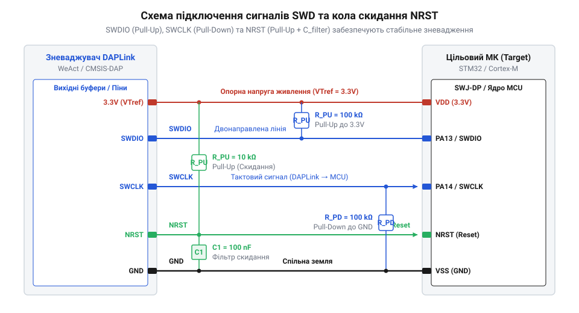
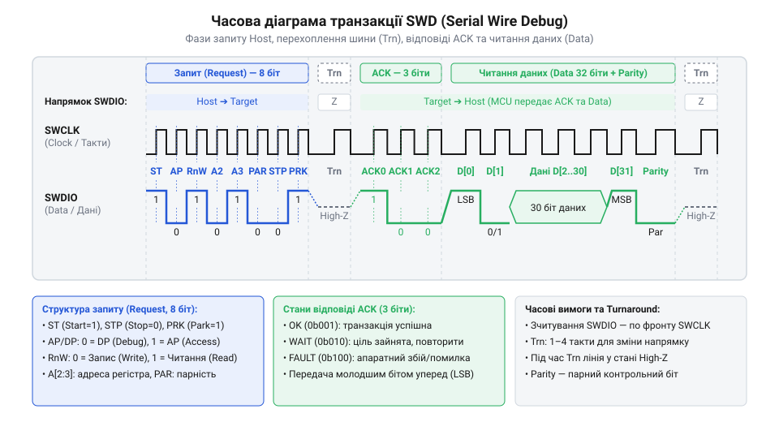

# Сигнальний інтерфейс та протокол Serial Wire Debug (SWD)

## Обмеження JTAG у компактних мікроконтролерах

Розробка сучасних пристроїв на базі мікроконтролерів @@en|Cortex-M@@ вимагає ефективного використання кожного виводу корпусу. У компактних корпусах, таких як @@en|QFN@@ чи @@en|TSSOP@@, загальна кількість фізичних контактів часто не перевищує 20 або 32 виводів. Застосування класичного інтерфейсу зневадження @@en|JTAG@@ (англ. *Joint Test Action Group* — об'єднана група з розробки засобів тестування) створює серйозний апаратний дефіцит. Класичний @@en|JTAG@@ потребує щонайменше чотирьох обов'язкових сигнальних ліній: тактування `@@en|TCK@@`, вибору режиму `@@en|TMS@@`, входу даних `@@en|TDI@@` та виходу даних `@@en|TDO@@`, а також додаткової лінії системного скидання `@@en|TRST@@`. Виділення п'яти фізичних виводів лише під потреби апаратного зневадження вилучає значну частку периферійних ресурсів кристала, таких як периферія @@en|UART@@, @@en|SPI@@ чи канали генератора @@en|PWM@@.

Спроба задіяти виводи @@en|JTAG@@ під звичайні входи-виходи загального призначення під час виконання програми робить неможливим одночасне підключення зневаджувача та зупинку ядра для аналізу внутрішнього стану. Крім того, розведення п'яти високочастотних сигнальних ліній на компактній друкованій платі збільшує ризик виникнення взаємних наводок та вимагає додаткової площі трасування.

Для усунення цього обмеження компанія @@en|ARM@@ створила двопровідний сигнальний інтерфейс @@en|Serial Wire Debug@@ (англ. *serial* — послідовний, *wire* — дріт, *debug* — зневадження), який інтегровано в архітектуру зневадження @@en|CoreSight@@. Інтерфейс @@en|SWD@@ скорочує кількість необхідних ліній зв'язку всього до двох: лінії тактування @@en|SWCLK@@ та двонапрямленої лінії даних @@en|SWDIO@@. Завдяки пакетному кодуванню кадру та почерговому використанню лінії даних @@en|SWD@@ забезпечує повний контроль над ядром, читанням і записом регістрів та оперативної пам'яті без втрати функціональності. Це звільняє від двох до трьох фізичних виводів мікроконтролера для потреб користувацької периферії.

Фізичне розмежування процесів передачі та приймання в @@en|SWD@@ реалізовано через напівдуплексний режим роботи (англ. @@en|half-duplex@@, від англ. *half* — половина та латинського *duplex* — подвійний). Зневаджувач та мікроконтролер почергово керують лінією даних @@en|SWDIO@@, узгоджуючи зміну напрямку сигналу з тактовими імпульсами @@en|SWCLK@@. Така синхронна схема усуває часовий зсув між сигналами входу та виходу, який притаманний @@en|JTAG@@, і забезпечує стабільний обмін даними на частотах у десятки мегагерц. Спрощення трасування друкованої плати та мінімізація електромагнітних наводок роблять інтерфейс @@en|SWD@@ безальтернативним вибором для компактних пристроїв на базі @@en|Cortex-M@@.

## Фізичний рівень ліній SWDIO SWCLK NRST

Фізична шина зв'язку між зневаджувачем @@en|DAPLink@@ та цільовим мікроконтролером будується на трьох основних лініях: @@en|SWCLK@@, @@en|SWDIO@@ та системній лінії скидання @@en|NRST@@. Кожна з цих ліній вимагає дотримання чітких схемотехнічних правил підключення для забезпечення завадостійкості під час передачі даних.


*Схема фізичного з'єднання сигнальних ліній SWD з підтягуючими резисторами та фільтруючим конденсатором для захисту від завад.*

Лінія тактування @@en|SWCLK@@ є однонапрямленою і керується виключно хостом зневаджувача. На цільовій платі лінію @@en|SWCLK@@ необхідно оснащувати резистором @@en|pull-down@@ (англ. *pull* — тягти, *down* — вниз) номіналом `100 kΩ` до спільного проводу. Це фіксує низький логічний рівень при відключеному зневаджувачі й запобігає хибному тактуванню від наводок.

Лінія даних @@en|SWDIO@@ працює в напівдуплексному режимі: через неї хост надсилає команди, а цільовий мікроконтролер повертає відповіді та дані. Для утримання шини у високому логічному стані під час пауз або перехоплення напрямку передачі застосовують резистор @@en|pull-up@@ (англ. *pull* — тягти, *up* — вгору) номіналом `100 kΩ` до лінії живлення `3.3 V`.

Сигнальна лінія @@en|NRST@@ керує апаратним скиданням мікроконтролера. Зневаджувач @@en|DAPLink@@ використовує її для переведення ядра в стан скидання та перехоплення виконання з першої інструкції. Схема підключення @@en|NRST@@ містить зовнішній підтягуючий резистор `10 kΩ` до живлення та фільтруючий конденсатор номіналом `100 nF` на землю для захисту від дребезгу та імпульсних завад. Внутрішня [архітектура регістрів системного доступу](root:sys-ide/coresight-apb-ahb-ap-architecture) дозволяє керувати пам'яттю мікроконтролера після зняття сигналу скидання.

## Послідовність ініціалізації та перемикання SWJ-DP

Більшість мікроконтролерів @@en|Cortex-M@@ оснащено комбінованим портом зневадження @@en|SWJ-DP@@, який після подачі живлення за замовчуванням може перебувати в режимі @@en|JTAG@@ або у невизначеному стані. Щоб гарантовано перевести порт у режим @@en|SWD@@, зневаджувач @@en|DAPLink@@ має виконати стандартизовану часову послідовність переключання на лінії @@en|SWDIO@@.

Спочатку хост подає не менше 50 тактових імпульсів на лінію @@en|SWCLK@@ при постійному високому рівні `1` на лінії @@en|SWDIO@@. Ця процедура скидає внутрішній автомат станів інтерфейсу в початкове положення, незалежно від того, в якому стані він перебував до цього.

Після скидання хост надсилає унікальний 16-бітний ключ перемикання `0xE79E` (у двійковому вигляді `0b1110_0111_1001_1110`, молодшим бітом уперед). Прийом цього ключа змушує відлагоджувальний порт @@en|SWJ-DP@@ вимкнути логіку @@en|JTAG@@ і підключити контролер @@en|SWD@@.

Одразу після ключа хост повторно надсилає послідовність із не менше ніж 50 тактових імпульсів високого рівня `1`, після чого видає від 2 до 8 тактових імпульсів передачі нульового стану (пауза шини).

Для верифікації успішного встановлення зв'язку хост виконує перше читання 32-бітного регістра ідентифікації @@en|IDCODE@@ (адреса `0x00` в порту @@en|Debug Port@@). Значення регістра @@en|IDCODE@@ обчислюється за структурою ідентифікатора @@en|ARM CoreSight@@:

```
IDCODE = (DesignerID × 2¹) + (PartNo × 2¹²) + (Revision × 2²⁸) + 1
       = (0x23B × 2) + (0xBA01 × 4096) + (0x0 × 268435456) + 1    [підстановка параметрів Cortex-M4]
       = 0x2BA01477                                               [підсумковий ідентифікатор]
```

Успішне зчитування значення `0x2BA01477` підтверджує готовність фізичної шини до виконання транзакцій читання й запису.

## Формат транзакцій та кодування пакетів

Обмін даними в інтерфейсі @@en|SWD@@ відбувається у вигляді окремих двонапрямлених транзакцій. Кожна транзакція складається з трьох послідовних фаз: передачі заголовка запиту хостом, фази перехоплення напрямку шини та фази відповіді цільового пристрою разом із передачею даних.


*Послідовність передачі бітів кадру SWD із показом зміни напрямку шини та підтвердження ACK.*

Транзакція починається з 8-бітного заголовка запиту, який надсилає хост на лінії @@en|SWDIO@@:
- Старт-біт (біт 0): завжди дорівнює `1`.
- Біт вибору порту `APnDP` (біт 1): `0` обирає порт зневадження @@en|Debug Port@@, а `1` обирає порт доступу @@en|Access Port@@.
- Біт напрямку `RnW` (біт 2): `1` відповідає читанню, `0` — запису.
- Біти адреси `A[2:3]` (біти 3–4): задають адресу регістра всередині обраного порту.
- Біт парності `Parity` (біт 5): біт перевірки на парність @@en|parity@@ (англ. *parity* — рівність, парність), що покриває біти `APnDP`, `RnW`, `A[2]` та `A[3]`.
- Стоп-біт (біт 6): завжди дорівнює `0`.
- Біт паркування `Park` (біт 7): завжди дорівнює `1`.

Після надсилання заголовка настає фаза перехоплення шини @@en|Turnaround phase@@ (англ. *turnaround* — розворот, передача керування), яка триває 1 тактовий імпульс @@en|SWCLK@@. У цей момент хост переводить свій вивід @@en|SWDIO@@ у високоімпедансний стан, а цільовий мікроконтролер підключає свій передавач.

Слідом за фазою перехоплення цільовий мікроконтролер відповідає 3-бітним кодом підтвердження @@en|ACK@@:
- `0b001` (OK): транзакцію прийнято успішно.
- `0b010` (WAIT): цільовий пристрій зайнятий і не може виконати запит негайно.
- `0b100` (FAULT): виникла низькорівнева помилка доступу.

При успішній відповіді `OK` у транзакції читання цільовий мікроконтролер передає 32 біти даних (молодшим бітом уперед) та 1 біт парності, після чого відбуваються повторна фаза перехоплення шини та повернення у стан спокою. Для захоплення апаратних подій використовують [протокол однопровідного трасування SWO](root:sys-ide/trace-itm-swo).

## Обробка станів WAIT FAULT та відновлення

Під час реального зневадження мікроконтролера транзакції шини @@en|SWD@@ можуть завершуватися відповідями @@en|WAIT@@ або @@en|FAULT@@. Зневаджувач повинен коректно обробляти ці стани для запобігання втраті зв'язку або зависанню сесії.

Відповідь @@en|WAIT@@ виникає тоді, коли порт доступу @@en|Access Port@@ не встигає завершити попередню операцію на внутрішній системній шині (наприклад, під час стирання сторінки флеш-пам'яті або затримки шини @@en|AHB@@). У разі отримання @@en|WAIT@@ зневаджувач припиняє поточну транзакцію і повторює запит через фіксовану кількість тактових імпульсів. Якщо кількість повторних спроб перевищує заданий ліміт таймауту, зневаджувач ініціює процедуру примусового перезапуску шини.

Відповідь @@en|FAULT@@ вказує на критичний збій доступу, такий як звернення до незадіяної області адресної пам'яті, порушення прав доступу або виникнення помилки переповнення. При отриманні @@en|FAULT@@ відлагоджувальний порт встановлює липкі біти помилок @@en|sticky bit@@ (англ. *sticky* — липкий, *bit* — біт) у регістрі контролю та статусу `CTRL/STAT`. Доки ці біти активні, порт відхиляє всі наступні транзакції, повертаючи відповідь @@en|FAULT@@.

Для відновлення працездатності шини зневаджувач виконує процедуру скидання прапорців через регістр очищення @@en|ABORT@@ (адреса `0x00` при записі в @@en|Debug Port@@):

```
ABORT_WRITE = (STKCMPCLR × 2¹) + (STKERRCLR × 2²) + (WDERRCLR × 2³) + (ORUNERRCLR × 2⁴)
            = (1 × 2) + (1 × 4) + (1 × 8) + (1 × 16)      [установка бітів очищення помилок]
            = 0x0000001E                                  [маска очищення прапорців]
```

Запис значення `0x0000001E` у регістр @@en|ABORT@@ скидає всі липкі прапорці помилок, після чого зневаджувач повторно зчитує регістр статусу для перевірки готовності системи. Команди комп'ютера обробляє [прошивка зневаджувача CMSIS-DAP](root:sys-ide/cmsis-dap-debugger-firmware) на рівні мікроконтролера.
