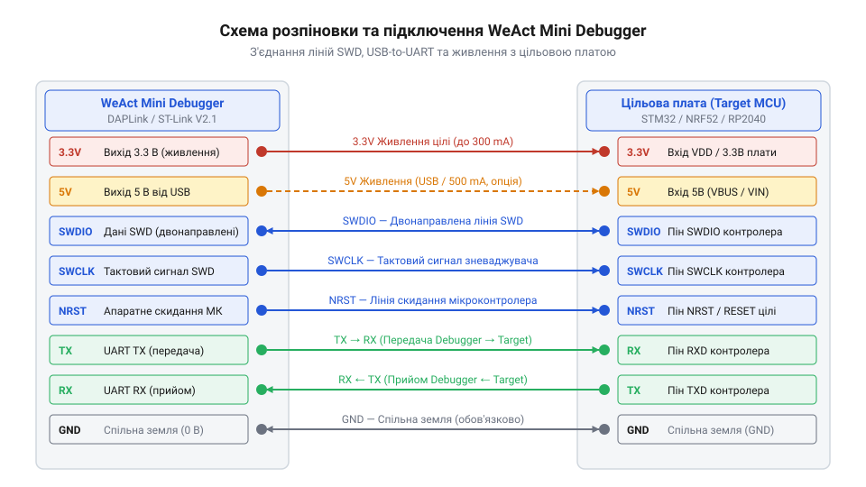
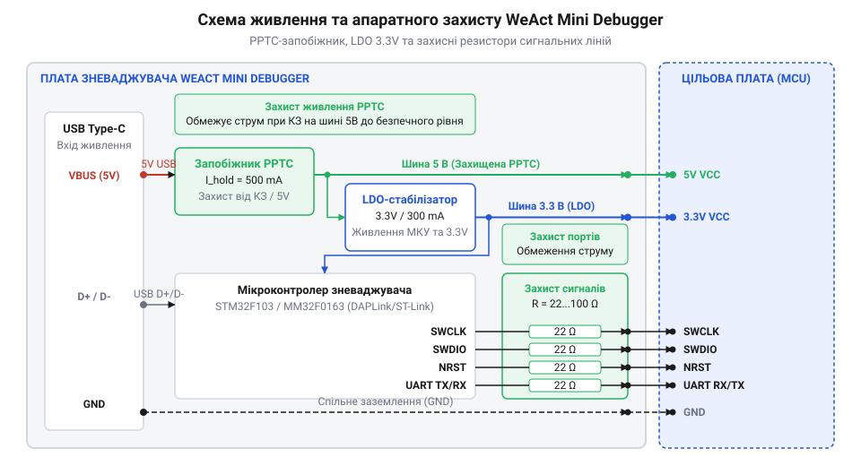

# Апаратний інтерфейс, цокольовка та схема живлення WeAct Mini Debugger

## Апаратні конфлікти та збої зневадження

Пряме підключення прошивальних пристроїв до мікроконтролера часто закінчується раптовим зависанням плати, втратою зв'язку або фізичним виходом з ладу захисних діодів. Під час розробки виникає спокуса з'єднати лінії безпосередньо, проте відсутність розмежування шин живлення та стрибки потенціалів створюють апаратні конфлікти.

При використанні незахищених прошивачів без струмообмежувальних ланцюгів будь-яке вирівнювання потенціалів відбувається через внутрішні `@@en|ESD-діод@@` (від англ. @@en|Electrostatic Discharge@@, грец. *ēlektron* — бурштин, *statikos* — той, що стоїть, нім. *Entladung* — розряд) цільового чіпа. Верхній захисний діод кожного виводу `@@en|GPIO@@` (від англ. @@en|General-Purpose Input/Output@@) увімкнений прямо між сигнальною лінією та внутрішньою шиною живлення мікроконтролера і має фізичний поріг відкривання близько 0.6 В. Якщо цільова плата знеструмлена і потенціал її внутрішньої шини дорівнює 0 В, а зневаджувач продовжує подавати високий логічний рівень 3.3 В на сигнальні лінії, різниця напруг значно перевищує цей поріг. Діод переходить у стан провідності та пропускає струм у знеструмлене коло, піднімаючи потенціал шини живлення приблизно до 2.7 В, через що виникає паразитне живлення. Це призводить до неповного скидання регістра `@@en|NRST@@` (від англ. @@en|Negative Reset@@, лат. *negativus* — заперечний, *restituere* — відновлювати), до хаотичного виконання інструкцій `@@en|CPU@@` (від англ. @@en|Central Processing Unit@@, лат. *centralis* — серединний, *processus* — поступ, *unitas* — єдність) та до деградації напівпровідникового кристала.

Не менш небезпечним є [конфлікт логічних рівнів](root:hw-digital/level-shifter), коли пристрої працюють від джерел з різною напругою (наприклад, 5 В та 3.3 В). Без вирівнювання потенціалів та обмеження струму виникають земляні петлі та зворотні струми, через які переривається синхронізація інтерфейсу `@@en|SWD@@` (від англ. @@en|Serial Wire Debug@@, лат. *serialis* — послідовний, *filum* — дріт, англ. *debug* — зневадження) та спотворюються пакети даних `@@en|UART@@` (від англ. @@en|Universal Asynchronous Receiver-Transmitter@@).

Зневаджувач `@@en|WeAct Mini Debugger@@` розв'язує ці проблеми на апаратному рівні. Він містить вбудовані `@@en|захисні резистори@@` на кожній сигнальній лінії, незалежні лінії живлення 3.3 В та 5 В, а також самовідновлюваний `@@en|PPTC fuse@@` (від англ. @@en|Polymer Positive Temperature Coefficient@@, грец. *polys* — численний, *meros* — частка, лат. *positivus* — позитивний, *temperatura* — температура) на вході від шини `@@en|USB@@` (від англ. @@en|Universal Serial Bus@@). Така схемотехніка гасить паразитні сплески напруги, відсікає надмірний струм короткого замикання та забезпечує стабільний обмін даними.

У разі виникнення короткого замикання на шині живлення струм понад норму розігріває полімерну структуру `@@en|PPTC fuse@@`. При нагріванні опір елемента стрибкоподібно зростає і практично повністю розриває коло живлення. Після усунення перевантаження та охолодження полімер відновлює початковий опір без потреби заміни компонента. Одночасно `@@en|захисні резистори@@` обмежують струм сигнальних ліній нижче порогу відкривання `@@en|ESD-діод@@` цільового мікроконтролера. Це запобігає паразитному протіканню струму через виводи при нестійкому контакті чи гарячому підключенні цільової плати.

## Розпіновка та функціонал сигнальних виводів

Стабільність апаратного з'єднання залежить від точного розуміння фізичного призначення та напрямку сигналів на дворядній вихідній гребінці зневаджувача `@@en|WeAct Mini Debugger@@`. Кожен вивід має суворо визначену функцію в процедурах зневадження та послідовного обміну.


*Розташування та функціональне призначення контактів дворядного роз'єму для підключення до цільового мікроконтролера.*

Інтерфейс зневадження `@@en|SWD@@` складається з трьох ключових сигнальних ліній:
- `@@en|SWDIO@@` (від англ. @@en|Serial Wire Debug Input/Output@@) — двонаправлена лінія передачі даних та команд зневадження. Напрямок обміну змінюється динамічно під час тактових імпульсів.
- `@@en|SWCLK@@` (від англ. @@en|Serial Wire Debug Clock@@) — вихідний сигнал тактування, який генерує `@@en|WeAct Mini Debugger@@` для синхронізації зчитування та запису бітів у цільовий мікроконтролер.
- `@@en|NRST@@` — активна низьким рівнем лінія апаратного скидання. Зневаджувач керує цим виводом через каскад із відкритим стоком для примусового переведення цільового чіпа в стан скидання перед записом прошивки.

Для реалізації послідовного мосту `@@en|USB@@`-to-`@@en|UART@@` використовуються виводи:
- `@@en|TX@@` (від англ. @@en|Transmit@@, лат. *transmittere* — пересилати) — вихід послідовних даних зневаджувача. Цей вивід підключають до приймального контакту `@@en|RX@@` цільового мікроконтролера.
- `@@en|RX@@` (від англ. @@en|Receive@@, лат. *recipere* — отримувати) — вхід послідовних даних зневаджувача. На нього подається сигнал з передавача `@@en|TX@@` цільової плати.

Спільна точка відліку потенціалів забезпечується контактом `@@en|GND@@` (від англ. @@en|Ground@@). Без надійного з'єднання виводів `@@en|GND@@` між `@@en|WeAct Mini Debugger@@` та цільовою платою виникає зсув синфазної напруги, що унеможливлює розпізнавання логічних рівнів 3.3 В `@@en|CMOS@@` (від англ. @@en|Complementary Metal-Oxide-Semiconductor@@).

У компактному виконанні `@@en|WeAct Mini Debugger@@` вивід `@@en|SWO@@` (від англ. @@en|Serial Wire Output@@, від англ. *output* — вихід) відсутній, що унеможливлює апаратне трасування подій у реальному часі через модуль `@@en|ITM@@` (від англ. @@en|Instrumentation Trace Macrocell@@, від англ. *trace* — слід). Для виведення діагностичних повідомлень без лінії `@@en|SWO@@` застосовують послідовний міст `@@en|UART@@` або технологію `@@en|RTT@@` (від англ. @@en|Real-Time Transfer@@, від англ. *transfer* — передача) безпосередньо через оперативну пам'ять по лініях `@@en|SWDIO@@` та `@@en|SWCLK@@`. Сигнал тактування `@@en|SWCLK@@` працює в діапазоні частот від 100 кГц до граничних 10 МГц. Максимальна частота `@@en|SWCLK@@` прискорює прошивку та зчитування регістрів, проте на довгих з'єднувальних дротах паразитні ємність та індуктивність спотворюють прямокутні фронти сигналів, змушуючи знижувати частоту тактування для збереження стабільності обміну.

## Схема живлення та захисні кола

Безпечна комутація та захист від короткого замикання досягаються розділенням силових шин та встановленням пасивних захисних елементів у кола живлення й сигналів.


*Структура розподілу напруги USB із запобіжником PPTC, регулятором LDO та обмежувальними резисторами сигнальних ліній.*

Живлення від порту `@@en|USB@@` напругою 5 В потрапляє на зневаджувач через самовідновлюваний `@@en|PPTC fuse@@`. При перевищенні струму понад граничне значення (близько 500 мА) або при аварійному короткому замиканні опір полімеру стрибкоподібно зростає, розмикаючи коло. Після усунення перевантаження та охолодження елемента структура полімеру відновлюється, і подача напруги поновлюється.

З шини 5 В напруга подається на `@@en|LDO-стабілізатор@@` (від англ. @@en|Low Dropout@@, англ. *low* — низький, *drop* — падіння), який формує точну напругу 3.3 В для внутрішніх кіл зневаджувача та зовнішнього виводу 3.3V. Для захисту виводів `@@en|SWDIO@@`, `@@en|SWCLK@@`, `@@en|NRST@@`, `@@en|TX@@` та `@@en|RX@@` у кожну лінію послідовно впаяно `@@en|захисні резистори@@` номіналом `R_prot = 33` Ом.

Граничний струм `I_max` при перепаді напруги `ΔU = 3.3` В через обмежувальний опір `R_prot = 33` Ом обчислюємо за законом Ома:

```
I_max = ΔU ÷ R_prot
= (3.3 - 0) ÷ 33      [Закон Ома для ділянки кола]
= 0.1 A               [Обчислення граничного струму 100 мА]
```

Отримане значення `I_max = 0.1` А (100 мА) є короткочасним піковим струмом, який безпечно розсіюється резистором і не здатний випалити вихідні транзистори.

Правила вибору джерела живлення:
1. Якщо цільова плата не має власного джерела, її підключають до виводу 3.3V або 5V зневаджувача `@@en|WeAct Mini Debugger@@` (із сумарним споживанням не більше 300 мА).
2. Якщо цільова плата живиться від власного мережевого чи акумуляторного адаптера, виводи 3.3V та 5V зневаджувача залишають непідключеними. З'єднують лише лінії `@@en|SWDIO@@`, `@@en|SWCLK@@`, `@@en|NRST@@`, `@@en|TX@@`, `@@en|RX@@` та обов'язкову спільну землю `@@en|GND@@`. Підключення зовнішнього джерела паралельно до виводу 3.3V зневаджувача спричиняє конфлікт двох стабілізаторів і вихід їх з ладу.

## Індикація стану та світлодіодні сигнали

Візуальний контроль працездатності та діагностика режимів роботи `@@en|WeAct Mini Debugger@@` здійснюються за допомогою трьох світлодіодних індикаторів на платі.

Індикатор живлення `@@en|Power LED@@` підключений безпосередньо до виходу `@@en|LDO-стабілізатор@@` 3.3 В:
- Безперервне світіння свідчить про наявність штатної напруги живлення від `@@en|USB@@`.
- Відсутність світіння або бліде миготіння вказує на спрацювання запобіжника `@@en|PPTC fuse@@` через коротке замикання на виводах 3.3V або 5V.

Індикатор стану цільового пристрою `@@en|Status LED@@` відображає роботу інтерфейсу `@@en|SWD@@`:
- Постійне світіння або повільне рівномірне миготіння — зневаджувач успішно ініціалізовано, шина `@@en|SWD@@` перебуває в режимі очікування.
- Часте мерехтіння — відбувається активне зчитування або запис пам'яті цільового мікроконтролера через лінію `@@en|SWDIO@@` та тактування `@@en|SWCLK@@`.
- Згасання після спроби підключення — помилка сесії зневадження або відсутність відповіді від цільового чіпа.

Індикатор послідовного порту `@@en|UART LED@@` контролює роботу `@@en|CDC@@` (від англ. @@en|Communication Device Class@@) мосту:
- Короткі спалахи відповідають передачі або прийому окремих байтів через лінії `@@en|TX@@` та `@@en|RX@@`.
- Відсутність індикації під час відправки даних свідчить про обрив фізичної лінії або некоректні налаштування швидкості порту на ПК.

## Діагностика збоїв та усунення помилок

Апаратні несправності при з'єднанні `@@en|WeAct Mini Debugger@@` з цільовою платою усуваються за систематичним алгоритмом перевірки.

1. **Відсутність зв'язку по `@@en|SWD@@` (помилка Target Not Found):**
   - Перевірте з'єднання `@@en|GND@@`. При відсутності спільної землі виводи `@@en|SWDIO@@` та `@@en|SWCLK@@` фіксують плаваючий потенціал.
   - Виміряйте напругу живлення цільового мікроконтролера. Просідання напруги нижче 2.7 В призводить до виходу чіпа в режим `@@en|Brown-out@@` (від англ. @@en|Brown-out@@).
   - Застосуйте процедуру `@@en|Connect under Reset@@` (від англ. @@en|Connect under Reset@@). Якщо виводи `@@en|SWDIO@@` або `@@en|SWCLK@@` у цільовій прошивці було перевизначено як звичайні виводи `@@en|GPIO@@` або чіп переведено в глибокий сон, підключіть лінію `@@en|NRST@@` зневаджувача до виводу скидання плати. Під час ініціалізації середовище розробки підтягне `@@en|NRST@@` до логічного нуля, блокуючи ядро до подачі команд зневадження.

2. **Помилка передачі по `@@en|UART@@` (сміттєві символи або відсутність прийому):**
   - Перевірте перехресну комутацію: вивід `@@en|TX@@` зневаджувача має йти на `@@en|RX@@` плати, а `@@en|RX@@` зневаджувача — на `@@en|TX@@` плати.
   - Переконайтеся в однаковому значенні напруги логічної одиниці. Зневаджувач `@@en|WeAct Mini Debugger@@` працює з рівнями 3.3 В `@@en|CMOS@@`; підключення до 5-вольтових ліній `@@en|UART@@` без узгоджувального каскаду призводить до перегріву та викривлення бітів.

3. **Спрацювання захисту живлення (вимкнення `@@en|Power LED@@`):**
   - Від'єднайте цільову плату від виводів 3.3V та 5V `@@en|WeAct Mini Debugger@@`.
   - Перевірте наявність замикання між шинами живлення та `@@en|GND@@` мультиметром у режимі продзвонювання. Після усунення замикання зачекайте 10-15 секунд для охолодження та відновлення провідності запобіжника `@@en|PPTC fuse@@`.
