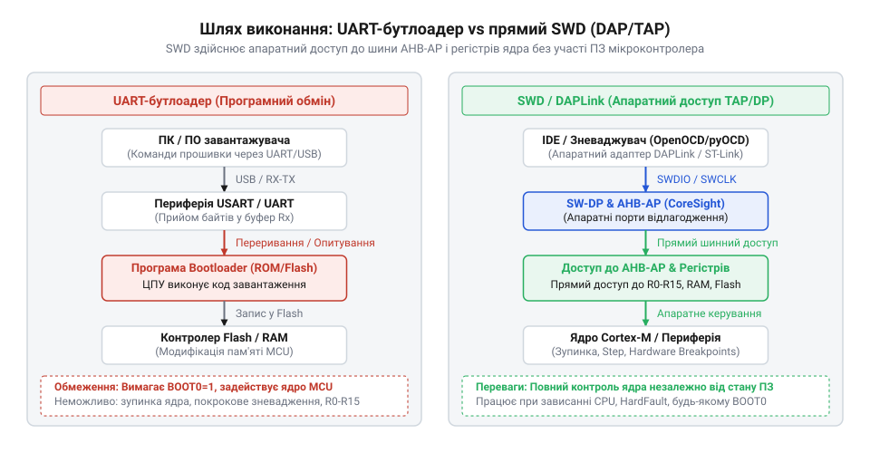
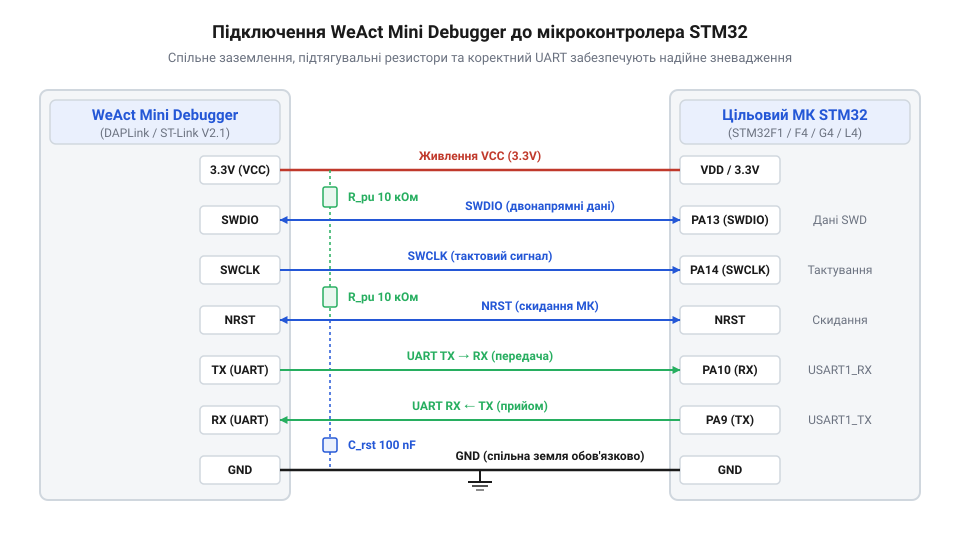
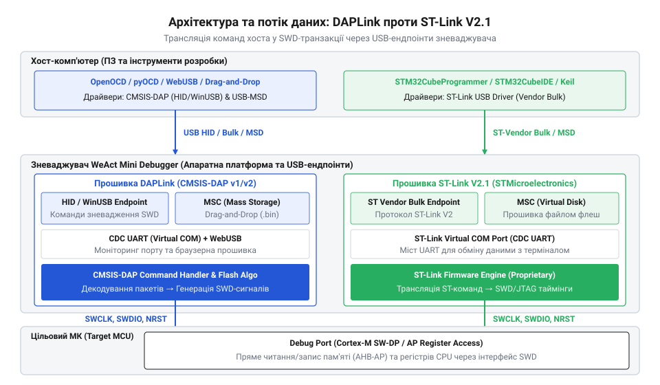
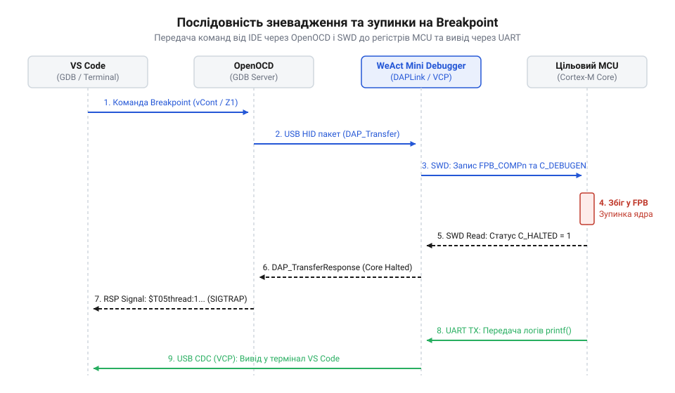
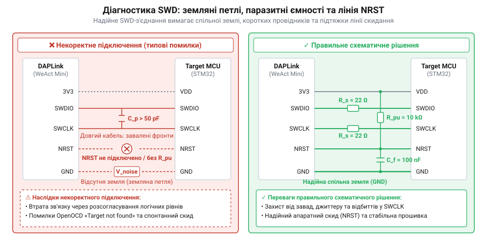

# WeAct Mini Debugger (DAPLink / ST-Link V2.1)

## Проблема зневадження мікроконтролерів без відкритого інтерфейсу

Розробка мікропрограми для сучасного @@en|microcontroller@@ (англ. *microcontroller*, від *micro-* — малий, *controller* — управитель) майже завжди починається з простих інструментів: прошивки через системний @@en|bootloader@@ (англ. *bootloader*, від *boot* — початковий імпульс завантаження, *loader* — завантажувач) та виведення діагностичних повідомлень у послідовний порт. Проте як тільки @@en|firmware@@ (англ. *firmware*, від *firm* — постійний, *ware* — виріб) стикається із критичною помилкою на кшталт @@en|HardFault@@ (англ. *HardFault*, від *hard* — апаратний, *fault* — збій), зависає в нескінченному циклі із вимкненими перериваннями або випадково переконфігуровує виводи, зайняті зв'язком, мікроконтролер перетворюється на «чорний ящик». Пристрій перестає відповідати на зовнішні запити, а розробник втрачає будь-яку можливість з'ясувати, на якій саме інструкції стався збій і які значення містили внутрішні регістри процесорного ядра в момент аварії.

Головна обмеженість прошивки через @@en|UART@@ (англ. *Universal Asynchronous Receiver-Transmitter*) полягає у тому, що системний @@en|bootloader@@ є програмним кодом, який виконується самим процесорним ядром з вбудованої @@en|ROM@@ або @@en|Flash@@-пам'яті. Якщо створена програма зіпсувала вказівник стека, пошкодила вектори переривань або вимкнула внутрішній тактовий генератор, ядро фізично не здатне передати управління коду завантажувача. Спроба повторної прошивки завершується помилкою таймауту, а відновлення пристрою вимагає складних апаратних маніпуляцій із сигналами вибору режиму завантаження @@en|BOOT0@@ або повного зняття живлення.

Використання так званого «зневадження через виведення» (англ. *print debugging*), коли програма надсилає текстові статуси через послідовний порт, створює додаткові пастки. Такий обмін є асинхронним і спирається на справність периферійного контролера @@en|UART@@, наявність тактування та цілісність оперативної пам'яті. У критичних секціях коду, обробниках переривань чи під час налаштування прямих каналів доступу до пам'яті виклик процедур виведення викривляє реальну часову динаміку виконання коду, що ховає апаратні конфлікти або призводить до втрати останніх даних перед зависанням. Традиційні підходи не дають змоги поставити виконання коду на паузу, встановити @@en|breakpoint@@ (англ. *breakpoint*, від *break* — зупинка, *point* — точка) чи прочитати вміст оперативної пам'яті без модифікації самої мікропрограми.

Для виходу з цього замкненого кола потрібен інструмент, який взаємодіє з процесорним ядром на апаратному рівні, незалежно від стану виконання користувацького коду. У процесорах @@en|Cortex-M@@ цю роль виконують [внутрішні блоки зневадження](root:hw-arch/arm-cortex-m-swd-architecture) архітектури @@en|CoreSight@@, які надають прямий доступ до регістрів процесора та шини пам'яті через послідовний шинний інтерфейс @@en|SWD@@ (англ. *Serial Wire Debug*, від *serial* — послідовний, *wire* — дріт, *debug* — усунення помилок). Апаратний @@en|debugger@@ (англ. *debugger*, від *de-* — усунення, *bug* — дефект, помилка) спроможний зупинити ядро за запитом від зовнішнього @@en|OpenOCD@@ чи @@en|pyOCD@@ хоста, навіть якщо програма перебуває в глухому куті або захоплена сторожовим таймером @@en|watchdog@@ (англ. *watchdog*, від *watch* — стежити, *dog* — собака).


*Порівняння шляху виконання коду через UART-завантажувач та прямого апаратного доступу SWD до регістрів ядра Cortex-M.*

У корпусах компактних мікроконтролерів із малою кількістю виводів кожен фізичний контакт є цінним ресурсом. Класичний апаратний інтерфейс @@en|JTAG@@ (англ. *Joint Test Action Group*, від *joint* — спільний, *test* — випробування, *action* — дія, *group* — група) вимагає для роботи щонайменше чотири сигнальні лінії: тактову, вибору стану, вхідних та вихідних даних. Виділення чотирьох виводів виключно під зневадження суттєво обмежує кількість периферійних пристроїв, які можна підключити до малогабаритної мікросхеми. Для усунення цього надлишку розробили [дводротовий протокол зневадження](root:hw-arch/arm-cortex-m-swd-architecture) @@en|SWD@@, який обходиться двома лініями: тактовим сигналом @@en|SWCLK@@ (англ. *Serial Wire Clock*, від *serial* — послідовний, *wire* — дріт, *clock* — тактовий сигнал) та двонаправленою лінією даних @@en|SWDIO@@ (англ. *Serial Wire Data Input/Output*, від *data* — дані, *input* — вхід, *output* — вихід). Скорочення кількості сигналів удвічі вивільняє фізичні виводи мікроконтролера для прикладних задач без втрати контролю над покроковим виконанням коду та станом регістрів.

Поряд із повним контролем над зупинкою та кроковим виконанням коду розробникові залишається необхідним зручний канал для отримання текстових логів реального часу. Саме тому сучасні зневаджувальні плати поєднують апаратний @@en|SWD@@-контролер і мост USB-to-UART в одному корпусі. Альтернативою класичному послідовному порту є апаратний механізм трасування в архітектурі @@en|CoreSight@@ — модуль @@en|ITM@@ (англ. *Instrumentation Trace Macrocell*, від *trace* — слід, відстеження), який передає текстовий потік через виділений вивід @@en|SWO@@ (англ. *Serial Wire Output*, від *serial* — послідовний, *wire* — дріт, *output* — вивід). На відміну від @@en|UART@@, який спирається на програмне обслуговування периферійного контролера, переривання чи канали пам'яті й зупиняється разом із крахом мікропрограми, @@en|ITM@@ вбудований безпосередньо в процесорне ядро: запис даних у його стимулюючі регістри перетворюється на пакети трасування апаратними засобами ядра без затримки виконання та без ризику втрати повідомлень при системних збоях. Утім, передача через @@en|SWO@@ вимагає додаткового сигнального виводу, суворого узгодження тактової частоти зневаджувача з частотою ядра та наявності самого блоку трасування, якого немає в найпростіших процесорах на кшталт @@en|Cortex-M0@@. Через це поєднання двохпровідної шини @@en|SWD@@ із віртуальним послідовним портом залишається базовим стандартом: коли розробник налаштовує [спеціалізовані сервери зневадження](root:sys-ide/openocd-debugger-ecosystem) у своєму конвеєрі розробки, пристрій одночасно забезпечує покрокову відладку, керує лінією апаратного скидання @@en|NRST@@ та транслює текстовий потік через [віртуальні послідовні мости](root:com-devices/usb-cdc-acm-serial-bridges) стандарту @@en|CDC ACM@@.

## Апаратна архітектура плати WeAct Mini Debugger

Компактна плата @@en|WeAct Mini Debugger@@ є апаратною реалізацією відкритого зневаджувача, виконаного у форматі USB-флешки на базі мікроконтролера @@en|STM32F103C8T6@@. Щоб забезпечити надійну взаємодію з цільовими платами без ризику виходу з ладу апаратних компонентів, схемотехніка пристрою розділена на три взаємопов'язані функціональні домени: вузол підключення до @@en|USB@@-хоста, схему розподілу живлення й захисту та фізичний інтерфейс з'єднання з цільовим мікроконтролером.

Для детального аналізу [цокольовки та схеми живлення](root:cat-hw-boards/daplink-debugger/api-weact-mini-debugger-hardware.md) цієї плати варто розглянути призначення її вихідного гребінця. Інтерфейс підключення містить сигнальні лінії шини @@en|SWD@@, послідовного порту @@en|UART@@ та лінії живлення.

Лінія @@en|SWCLK@@ (англ. *Serial Wire Clock*) призначена для передачі тактового сигналу, який генерується зневаджувачем для синхронізації бітів даних. Односпрямований сигнал стробує зчитування та запис команд. Лінія @@en|SWDIO@@ (англ. *Serial Wire Data Input/Output*) є двоспрямованою шиною даних, яка працює в напівдуплексному режимі: через неї @@en|debugger@@ надсилає команди й адреси регістрів, а цільовий мікроконтролер повертає статуси та вміст пам'яті. Окрема лінія @@en|NRST@@ (англ. *Negative Reset*) підключається до виводу системного скидання цільового МК. Вона дає змогу апаратно утримувати процесор у стані скидання при підключенні (режим *Reset Catch*). Це критично важливо у випадках, коли користувацька прошивка відключила виводи @@en|SWD@@ для використання їх як @@en|GPIO@@ або перевела ядро в глибокий енергозберігаючий режим.


*Підключення сигнальних ліній SWD, інтерфейсу UART та кіл живлення зневаджувача WeAct Mini Debugger до цільового мікроконтролера з обов'язковим спільним заземленням.*

Лінії послідовного моста @@en|TX@@ (англ. *Transmit*) та @@en|RX@@ (англ. *Receive*) підключаються за перехресною схемою: вивід @@en|TX@@ зневаджувача з'єднується з виводом @@en|RX@@ цільового МК, а вивід @@en|RX@@ зневаджувача — з виводом @@en|TX@@ цільової плати. Особливу увагу слід приділити контактному виводу спільного заземлення @@en|GND@@. З'єднання ліній @@en|GND@@ між зневаджувачем та цільовою платою є суворо обов'язковим. Відсутність спільного потенціалу призводить до того, що різниця плаваючих напруг між живленням комп'ютера та плати розробки створює синфазні перешкоди. Це викликає спотворення сигналів на виводах @@en|SWDIO@@ і @@en|SWCLK@@, розрив зв'язку або навіть пробій входів мікросхем статичною електрикою.

Схема живлення @@en|WeAct Mini Debugger@@ формує два рівні напруги на вихідному роз'ємі: 3.3 В та 5 В. Вивід `3V3` живиться від вбудованого лінійного стабілізатора @@en|LDO@@ (англ. *Low Dropout Regulator*, від *low* — низький, *dropout* — падіння, *regulator* — регулятор) типу @@en|ME6211@@ або @@en|AMS1117-3.3@@ і здатен віддавати струм до 150–200 мА для живлення невеликих планок із МК. Оскільки лінійний стабілізатор скидає надлишок напруги у вигляді тепла, його граничний струм безпосередньо обмежений тепловим розсіюванням. При живленні від шини @@en|USB@@ з вхідною напругою `V_in` 5 В, вихідній напрузі `V_out` 3.3 В та максимальному струмі споживання цільової плати `I_out` 200 мА (0.2 А), теплову потужність розсіювання `P_diss` обчислюють як добуток спаду напруги та струму навантаження:

```
P_diss = (V_in - V_out) × I_out      [формула потужності розсіювання LDO]
       = (5.0 - 3.3) × 0.2          [підстановка значень напруги й струму]
       = 1.7 × 0.2                  [обчислення спаду напруги на стабілізаторі]
       = 0.34                       [розсіювана теплова потужність у ватах]
```

Отримане значення 0.34 Вт (340 мВт) виділяється у вигляді тепла на компактному корпусі мікросхеми, що обумовлює її нагрівання й пояснює встановлення межі струму 150–200 мА для запобігання перегріву. Вивід `5V` підключений безпосередньо до шини живлення @@en|USB@@ комп'ютера через захисну схему.

Захисна схемотехніка плати розрахована на запобігання пошкодженню хост-комп'ютера під час аварійних ситуацій:
- **Захист від перевантаження за струмом:** у ланцюг живлення `5V` вбудовано самовідновлюваний запобіжник @@en|PPTC@@ (англ. *Polymeric Positive Temperature Coefficient*), який розмикає коло при перевищенні струму понад 500 мА, захищаючи @@en|USB@@-порт комп'ютера від коротких замикань на платі розробки.
- **Захист від зворотного струму:** діод Шотткі (@@en|Schottky diode@@, на честь фізика Вальтера Шотткі) блокує проходження струму від зовнішнього джерела живлення цільової плати назад у шину @@en|USB@@ комп'ютера, якщо цільова плата живиться від власного блоку живлення.
- **Узгодження сигналів та демпфування:** у ланцюгах @@en|SWDIO@@ та @@en|SWCLK@@ встановлені послідовні демпфуючі резистори номіналом 22–100 Ом, які гасять високочастотні дзвінки й відбиття сигналів у довгому шлейфі.

Правила вибору режиму живлення є однозначними: якщо цільова плата має власний блок живлення або підключена до свого @@en|USB@@-кабелю, з'єднувати виводи `3V3` чи `5V` між платою та зневаджувачем **заборонено** — підключаються лише лінії @@en|GND@@, @@en|SWDIO@@, @@en|SWCLK@@ та @@en|NRST@@. Помилкове об'єднання двох активних джерел живлення створює зрівнювальні струми, що гріє стабілізатори та порушує роботу ліній. Якщо ж цільова плата малопотужна й не має власного живлення, її можна заживити від виводу `3V3` або `5V` зневаджувача. Там, де розраховуються [часові параметри сигнальних ліній](root:cat-hw-boards/daplink-debugger/math-swd-timing-calculations.md) та граничні частоти, важливо враховувати, що сигнальні рівні @@en|WeAct Mini Debugger@@ відповідають логіці 3.3 В КМОН (англ. *CMOS*), що забезпечує пряму сумісність із більшістю сучасних мікроконтролерів @@en|STM32@@, @@en|ESP32@@, @@en|nRF52@@ та @@en|RP2040@@.

Небезпека зрівнювальних струмів стає особливо критичною при підключенні цільової плати до зовнішнього лабораторного блоку живлення, коли комп'ютер і блок живлення увімкнені в різні розетки без спільного контуру заземлення @@en|ground loop@@ (англ. *ground loop*, від *ground* — земля, *loop* — контур). Через витік струму або різну якість мережевих фільтрів між клемами заземлення @@en|GND@@ двох пристроїв виникає різниця потенціалів `U_diff`. При підключенні зневаджувача ця напруга прикладається до тонкого провідника заземлення шлейфу з омічним опором `R_gnd`, створюючи вирівнювальний струм @@en|equalization current@@ (англ. *equalization current*, від *equalization* — вирівнювання, *current* — струм) `I_eq`. Значення цього струму обчислюють за законом Ома:

```
I_eq = U_diff ÷ R_gnd                 [формула вирівнювального струму за законом Ома]
     = 0.8 ÷ 0.2                      [підстановка різниці потенціалів 0.8 В та опору 0.2 Ом]
     = 4.0                            [величина вирівнювального струму в амперах]
```

Отримане значення `I_eq` 4.0 А є катастрофічним для тонкого провідника 28 @@en|AWG@@ (англ. *American Wire Gauge*, від *American* — американський, *wire* — дріт, *gauge* — калібр) та внутрішніх доріжок плати @@en|WeAct Mini Debugger@@, розрахованих на струми до 0.5 А. Такий високий струм спричиняє падіння напруги на лінії @@en|GND@@, що спотворює опорний нуль сигналів @@en|SWDIO@@ та @@en|SWCLK@@ в [архітектурі зневадження ARM Cortex-M](root:hw-arch/arm-cortex-m-swd-architecture), викликає систематичні розриви зв'язку та може призвести до відгоряння контактів або пошкодження @@en|USB@@-контролера хоста.

## Порівняння прошивок DAPLink та ST-Link

Під час вибору мікропрограми для `@@en|WeAct Mini Debugger@@` розробник постає перед вибором між універсальністю відкритої екосистеми та глибокою інтеграцією з фірмовими інструментами. Апаратно плата побудована на мікроконтролері `@@en|STM32F103@@`, однак її функціональні можливості для зовнішніх програм повністю визначаються архітектурою завантаженої прошивки — `@@en|DAPLink@@` (від англ. *@@en|Debug Access Port@@* — порт доступу для зневадження та *@@en|link@@* — з'єднання) або `@@en|ST-Link@@` V2.1.

Історія відкритих програматорів розпочалася зі створення консорціумом ARM відкритого стандарту `@@en|CMSIS-DAP@@`, покликаного усунути залежність від закритих фірмових апаратних ключів. На його основі проєкт Mbed розробив мікропрограму `@@en|DAPLink@@`, яка вперше об'єднала канальний рівень `@@en|SWD@@` із віртуальним диском `@@en|USB Mass Storage Class@@` (від латинського *@@en|mass@@* — маса та англійського *@@en|storage@@* — сховище) для прошивки через `@@en|Drag-and-Drop@@` (від англ. *@@en|drag@@* — тягти та *@@en|drop@@* — кидати) та прямою взаємодією з браузером через `@@en|WebUSB@@` без встановлення сторонніх драйверів. Згодом ентузіасти адаптували прошивку `@@en|ST-Link V2.1@@` для роботи на універсальних платах `@@en|STM32@@`, що й зумовило появу `@@en|WeAct Mini Debugger@@` як мультипротокольної платформи.

З точки зору організації `@@en|USB@@`-ендпоінтів, `@@en|DAPLink@@` реалізує протокол `@@en|CMSIS-DAP@@` v1 через `@@en|USB HID@@` або v2 через `@@en|USB Bulk@@`, доповнюючи його послідовним мостом `@@en|CDC ACM@@` та віртуальним накопичувачем. У версії `@@en|CMSIS-DAP@@` v1 обмін обмежений специфікацією `@@en|USB HID@@`, де дані передаються пакетами фіксованого розміру по 64 байти з обов'язковою прив'язкою до інтервалів опитування шини. Кожна команда зневадження чекає на свій кадр `@@en|USB@@`, що створює затримки та обмежує швидкість прошивки десятками кілобайт на секунду. Натомість `@@en|CMSIS-DAP@@` v2 використовує прямоточні `@@en|USB Bulk@@`-ендпоінти, які не мають обмежень на інтервали опитування й утилізують усю вільну пропускну здатність шини. Передача даних відбувається суцільним потоком великих блоків без накладних витрат на кадрування, що прискорює запис пам'яті в кілька разів і зменшує затримку під час покрокового виконання. Прошивка `@@en|ST-Link V2.1@@`, навпаки, застосовує власні закриті `@@en|USB Bulk@@`-команди `@@en|ST Microelectronics@@`, що забезпечує найвищу швидкість обміну у фірмовій утиліті `@@en|STM32CubeProgrammer@@`, але обмежує сумісність із мікроконтролерами інших виробників, таких як `@@en|RP2040@@` або `@@en|ESP32@@`.


*Структура програмних рівнів та розподіл ендпоінтів USB у прошивках DAPLink та ST-Link V2.1.*

Режим `@@en|USB MSC@@` створює в операційній системі віртуальний диск. Під час копіювання `.bin` або `.hex` файлу прошивки `@@en|DAPLink@@` перехоплює файлові сектори, вилучає виконуваний код і через `@@en|SWD@@` заповнює `@@en|Flash@@`-пам'ять цільового мікроконтролера, повертаючи текстовий файл із результатом запису. Для роботи безпосередньо з веб-оглядачів [технологія WebUSB](root:sys-ide/webusb-browser-flashing) надає прямий доступ JavaScript до `@@en|USB Bulk@@`-ендпоінтів `@@en|CMSIS-DAP@@`, що детально описує [довідник з протоколу CMSIS-DAP](root:cat-hw-boards/daplink-debugger/api-cmsis-dap-usb-protocol.md).

Обирати `@@en|DAPLink@@` варто для універсальної розробки у `@@en|VS Code@@`, `@@en|PlatformIO@@` чи `@@en|pyOCD@@`, а також при використанні не-STM32 чипів. Натомість `@@en|ST-Link V2.1@@` необхідний при роботі в `@@en|STM32CubeIDE@@` або специфічному використанні [протоколу ST-Link V2.1](root:cat-hw-boards/stlink-v21-firmware-architecture). Зміна мікропрограми самого зневаджувача виконується замиканням джампера `@@en|BOOT0@@` та завантаженням відповідного образу, як демонструє [проєкт зміни прошивки](root:cat-hw-boards/daplink-debugger/proj-debugger-firmware-switching.md).

## Налаштування програмного інструментарію та середовищ розробки

Для трансляції відповідей середовища розробки у фізичні сигнали `@@en|SWD@@` використовують сервери зневадження. У разі застосування `@@en|WeAct Mini Debugger@@` у режимі `@@en|DAPLink@@` основними інструментами виступають `@@en|OpenOCD@@` та `@@en|pyOCD@@`. У конфігурації `OpenOCD` необхідно призначити інтерфейс `cmsis-dap` та обрати транспорт `swd`. Гранична частота тактування `f_SWCLK` обмежується обчислювальною спроможністю ядра за формулою зв'язку з частотою ядра `f_CPU`. Фізична суть цієї межі обумовлена тим, що сигнальні лінії підключені до вбудованого в мікроконтролер модуля `@@en|Serial Wire Debug Port@@` (SW-DP), де зовнішні тактові імпульси зневаджувача синхронізуються з системною шиною, яку визначає [архітектура зневадження ARM Cortex-M](root:hw-arch/arm-cortex-m-swd-architecture). Оскільки `SWCLK` генерується зовнішнім пристроєм, а ядро працює від власного джерела тактування, логіка узгодження тактових доменів (від англ. *@@en|clock domain crossing@@*, де *clock* — тактування, *domain* — область, *crossing* — перетин) вимагає щонайменше 2–3 повних циклів `f_CPU` на кожну фазу сигналу для запобігання метастабільності тригерів та арбітражу на шині `@@en|AHB-AP@@`. Якщо частота `f_SWCLK` перевищує `f_CPU / 6`, логіка синхронізації не встигає зафіксувати стан лінії `SWDIO`, що викликає втрату пакетів та збої обміну. Для гарантування стабільного з'єднання параметри взаємодії покроково налаштовують у конфігураційних файлах. У скрипті `openocd.cfg` директива `source [find interface/cmsis-dap.cfg]` завантажує драйвер апаратного містка `@@en|CMSIS-DAP@@`, команда `transport select swd` перемикає транспортний шар із `@@en|JTAG@@` на двопровідний `SWD`, `source [find target/stm32f4x.cfg]` підключає карту пам'яті `@@en|Flash@@` та `@@en|SRAM@@` цільового МК, а `adapter speed 4000` задає частоту `f_SWCLK` 4000 кГц (4 МГц), що є безпечною межею для ядер із `f_CPU` від 24 МГц. Своєю чергою, у файлі `.vscode/launch.json` середовища `@@en|VS Code@@` параметр `"type": "cortex-debug"` підключає розширення зневадження, `"request": "launch"` запускає сесію з апаратним скиданням і прошивкою, `"servertype": "openocd"` призначає [сервер зневадження OpenOCD](root:sys-ide/openocd-debugger-ecosystem), `"executable"` вказує шлях до бінарного файла `.elf` із відлагоджувальними символами `@@en|DWARF@@`, `"configFiles"` передає сценарій `openocd.cfg`, а `"runToEntryPoint": "main"` виставляє тимчасову точку переривання (від англ. *@@en|breakpoint@@*, де *break* — переривати, *point* — точка) на вхід у функцію `main()`.

```
f_SWCLK = f_CPU / 6      [граничне співвідношення тактування SWD]
```

Тут `f_SWCLK` позначає частоту тактування сигнальної лінії `SWCLK`, а `f_CPU` — робочу частоту ядра цільового мікроконтролера. Повне математичне обґрунтування часових затримок наведено у [розрахунку частот SWD](root:cat-hw-boards/daplink-debugger/math-swd-timing-calculations.md).

Базова конфігурація `openocd.cfg` для мікроконтролерів родини `@@en|STM32F4@@` має наступний вигляд:

```tcl
source [find interface/cmsis-dap.cfg]
transport select swd
source [find target/stm32f4x.cfg]
adapter speed 4000
```

Альтернативний консольний інструмент `@@en|pyOCD@@` забезпечує автоматизовану прошивку та зчитування регістрів. Для запуску GDB-сервера утиліті передається параметр цільового мікроконтролера `pyocd gdbserver --target stm32f401re`, що детально описує [проєкт pyOCD та UART-моніторингу](root:cat-hw-boards/daplink-debugger/proj-pyocd-flashing-and-uart-monitor.md). У разі використання прошивки `@@en|ST-Link V2.1@@` з'єднання з платою здійснюється через середовище `@@en|STM32CubeProgrammer@@`, де обирається інтерфейс `ST-LINK` та частота тактування до 4000 кГц.

Для організації покрокового зневадження у `@@en|VS Code@@` додають розширення Cortex-Debug та створюють конфігураційний файл `.vscode/launch.json`. У ньому вказують шлях до `@@en|GDB@@` та керуючі параметри зупинки (від англ. *@@en|breakpoint@@* — точка переривання):

```json
{
  "version": "0.2.0",
  "configurations": [
    {
      "name": "Cortex-Debug (OpenOCD)",
      "type": "cortex-debug",
      "request": "launch",
      "servertype": "openocd",
      "executable": "${workspaceFolder}/build/firmware.elf",
      "configFiles": ["openocd.cfg"],
      "runToEntryPoint": "main"
    }
  ]
}
```

Під час сесії [екосистема OpenOCD](root:sys-ide/openocd-debugger-ecosystem) транслює команди перехоплення виконання у внутрішні регістри [архітектури CoreSight](root:hw-arch/arm-cortex-m-swd-architecture), зупиняючи ядро МК на заданих рядках коду. Практичні кроки з налаштування висвітлює [проєкт STM32 OpenOCD](root:cat-hw-boards/daplink-debugger/proj-stm32-openocd-debugging.md).


*Послідовність обміну командами між середовищем розробки, сервером зневадження та платою через SWD.*

Паралельно з процедурою зневадження сигнальні лінії `TX` та `RX` плати `@@en|WeAct Mini Debugger@@` передають текстові дані від цільового МК. Вбудований [віртуальний послідовний міст](root:com-devices/usb-cdc-acm-serial-bridges) реєструє в системі порт `COM` або `/dev/ttyACM0`. У середовищі `@@en|VS Code@@` або через сторонні термінали налаштовують швидкість обміну (наприклад, 115200 бод), що дозволяє зчитувати діагностичні логи без зупинки процесу зневадження.


*Апаратні чинники збоїв SWD-з'єднання та вплив електричних виводів на стабільність обміну.*

У разі виникнення помилок з'єднання в першу чергу перевіряють наявність спільного контакту `GND` та логічні рівні напруг, які містить [довідник з апаратури](root:cat-hw-boards/daplink-debugger/api-weact-mini-debugger-hardware.md). Якщо лінію `@@en|NRST@@` не підключено, зневаджувач не зможе примусово скинути МК під час виходу з режимів глибокого сну. Параметри часових затримок та підтяжки ліній описує [довідник з протоколу SWD](root:cat-hw-boards/daplink-debugger/api-swd-protocol-and-signals.md).

## Процедура оновлення та зміни прошивки зневаджувача

Потреба в зміні внутрішньої мікропрограми `@@en|WeAct Mini Debugger@@` виникає під час зміни завдань розробки або відновлення пристрою після програмних збоїв. Наприклад, універсальний стандарт `@@en|DAPLink@@` забезпечує роботу з не-STM32 мікроконтролерами у середовищі `@@en|VS Code@@`, тоді як [фірмова прошивка ST-Link V2.1](root:cat-hw-boards/stlink-v21-firmware-architecture) оптимізована для спеціалізованих утиліт відладки. Оскільки апаратно зневаджувач побудований на базі мікроконтролера `@@en|STM32F103@@`, зміна його режимів виконується шляхом перезапису внутрішньої `@@en|Flash@@`-пам'яті через системний `@@en|Bootloader@@` (від англ. *@@en|boot@@* — завантаження та *@@en|loader@@* — завантажувач).

Для переведення зневаджувача у режим оновлення мікропрограми застосовують апаратний вибір джерела завантаження. На корпусі плати розташована кнопка або контактна площадка `@@en|BOOT0@@`. Алгоритм переведення пристрою в режим завантажувача складається з трьох послідовних кроків:
1. Відключити `@@en|WeAct Mini Debugger@@` від `@@en|USB@@`-порту комп'ютера.
2. Затиснути й утримувати кнопку `@@en|BOOT0@@` (або встановити тимчасову перемичку між контактами `BOOT0` та `3V3`).
3. Підключити плату до `@@en|USB@@`-порту хоста та через 1–2 секунди відпустити кнопку.

У момент подачі живлення високий логічний рівень на виводі `BOOT0` змушує процесорне ядро зневаджувача проігнорувати основну програму й передати управління фабричному завантажувачу, який міститься в масочно-запрограмованій системній пам'яті `@@en|ROM@@`.

Цей апаратний завантажувач принципово відрізняється від програмного завантажувача `@@en|DAPLink Maintenance@@` (від англ. *@@en|maintenance@@* — обслуговування), який також застосовують у пристрої. Заводський `@@en|ROM@@`-завантажувач мікроконтролера `@@en|STM32@@` випалений безпосередньо у системній пам'яті кристала під час виготовлення, тому його неможливо витерти чи пошкодити програмними командами, а зв'язок із комп'ютером він здійснює через спеціалізований протокол `@@en|DFU@@`. Натомість `@@en|DAPLink Maintenance@@` є програмним завантажувачем другого рівня, який розміщується в перших секторах перезаписуваної `@@en|Flash@@`-пам'яті та ініціалізує високорівневий інтерфейс `@@en|USB MSC@@` (від англ. *@@en|Mass Storage Class@@* — клас пристроїв збереження даних) для оновлення мікропрограми шляхом звичайного перетягування файла. Якщо `@@en|Flash@@`-пам'ять пошкоджено й програмний завантажувач не здатний змонтувати віртуальний диск, саме апаратний `@@en|ROM@@`-завантажувач залишається остаточним страхувальним механізмом для відновлення працездатності плати.

Залежно від поточного стану плати процедура запису бінарного образу `.bin` або `.hex` виконується одним із двох способів. Якщо у зневаджувачі вже працює базовий завантажувач `@@en|DAPLink Bootloader@@`, пристрій ініціалізується в операційній системі як віртуальний накопичувач із міткою `MAINTENANCE` або `BOOTLOADER`. У цьому разі для зміни мікропрограми достатньо скопіювати новий файл прошивки на цей диск. Якщо ж мікропрограма пошкоджена або виконується перехід із закритого режиму, оновлення здійснюють через утиліту `@@en|STM32CubeProgrammer@@` або консольний інструмент `@@en|dfu-util@@` за допомогою протоколу DFU (англ. *@@en|Device Firmware Upgrade@@*, від *device* — пристрій, *firmware* — мікропрограма, *upgrade* — оновлення). Зокрема, команда `dfu-util -d 0483:df11 -a 0 -s 0x08000000:leave -D firmware.bin` звертається до пристрою за `@@en|USB@@`-ідентифікатором DFU-режиму `0483:df11`, записує бінарний образ `firmware.bin` у внутрішню `@@en|Flash@@`-пам'ять за базовою адресою `0x08000000`, після чого атрибут `:leave` автоматично перезапускає мікроконтролер для виконання оновленого коду. Практичну послідовність кроків та конфігураційні файли описує [проєкт зміни прошивки зневаджувача](root:cat-hw-boards/daplink-debugger/proj-debugger-firmware-switching.md).

Головною перевагою схемотехніки `@@en|WeAct Mini Debugger@@` є неможливість остаточного виведення плати з ладу (так званого «оцеглування», від англ. *@@en|bricking@@* — перетворення на цеглину). Оскільки системний завантажувач записується виробником мікросхеми в енергонезалежну пам'ять `ROM` ще на етапі виготовлення кристала, його неможливо витерти чи перезаписати програмними командами. Навіть при повному знеструмленні під час запису або пошкодженні образу `@@en|Flash@@` повторне затискання кнопки `BOOT0` при включенні завжди повертає плату в режим завантажувача для відновлення працездатності.

## Діагностика та усунення типових апаратних збоїв

Навіть правильно налаштований конвеєр зневадження може працювати нестабільно: сесія переривається помилками `@@en|SWD Read Error@@`, сервери `@@en|OpenOCD@@` чи `@@en|pyOCD@@` втрачають контакт із пристроєм, або цільовий мікроконтролер перестає відповідати після запуску периферії. Більшість таких збоїв викликана електричними та сигнальними факторами на фізичному рівні підключення.

Найпоширенішою апаратною помилкою є відсутність або ненадійність спільного заземлення `@@en|GND@@` між `@@en|WeAct Mini Debugger@@` та цільовою платою. Якщо сигнальні лінії `@@en|SWDIO@@` та `@@en|SWCLK@@` підключені, а лінія `GND` відсутня, струми повернення сигналів починають протікати через мережеві джерела живлення, комп'ютер та заземлення приміщення. Різниця потенціалів між плаваючими «землями» створює синфазну перешкоду, амплітуда якої перевищує порогові рівні логічного нуля та одиниці КМОН-входів. Це призводить до спотворення бітових послідовностей, хаотичних збоїв синхронізації та можливого електричного пробою входів мікросхем. Суворе правило свідчить: з'єднання провідника `GND` має виконуватися першим, до підключення будь-яких сигнальних виводів.


*Спотворення логічних рівнів SWD при плаваючих потенціалах та процедура захоплення ядра Cortex-M через лінію NRST.*

Другий чинник нестабільності — деградація сигналів у довгих шлейфах з'єднання. На високих частотах тактування `f_SWCLK` (понад 4–8 МГц) паразитні ємності й індуктивності гнучких провідників довжиною понад 15–20 см викликають відбиття сигналів та фронтальні дзвінки. Для відновлення надійного обміну слід зменшити частоту тактування шини `@@en|SWD@@` у конфігураційних файлах `@@en|OpenOCD@@` (параметр `adapter speed 1000`) або `@@en|pyOCD@@`. Якщо ж фізично скорочити довжину з'єднань неможливо, рекомендується використовувати виту пару (англ. *@@en|Twisted Pair@@*, з англ. *twist* — скручувати), де кожна сигнальна лінія — `@@en|SWDIO@@` та `@@en|SWCLK@@` — переплетена з окремим провідником `@@en|GND@@`. Проходження зворотного струму безпосередньо поруч із сигнальною жилою мінімізує площу індуктивного контуру, стабілізує хвильовий опір лінії та нейтралізує взаємні перехресні наводки. Електричні характеристики й часові діаграми сигналів містить [довідник з протоколу SWD](root:cat-hw-boards/daplink-debugger/api-swd-protocol-and-signals.md), а специфіку розведення роз'ємів — [довідник з апаратури](root:cat-hw-boards/daplink-debugger/api-weact-mini-debugger-hardware.md). Фізику високочастотних завад та розрахунок фільтрів деталізує [цілісність сигналів та демпфування в шлейфах зневадження](root:hw-pcb/signal-integrity-in-debug-cables).

Втрата зв'язку з цільовим мікроконтролером часто стається через конфлікти у користувацькій мікропрограмі. Якщо нова прошивка випадково переконфігуровує виводи `@@en|PA13@@` (`SWDIO`) або `@@en|PA14@@` (`SWCLK`) як звичайні виводи загального призначення `@@en|GPIO@@`, вимикає тактування порту `@@en|GPIOA@@` або переводить ядро в режими глибокого енергозбереження `STOP` чи `STANDBY`, апаратний блок зневадження припиняє відповідати на запити хоста. У такій ситуації підключення лінії апаратного скидання `@@en|NRST@@` є обов'язковим. Сервер зневадження переводиться в режим підключення під скиданням (англ. *@@en|Reset Catch@@* або *@@en|Connect Under Reset@@*): відладчик примусово притягує лінію `NRST` до нуля, зупиняє ядро МК до виконання першої інструкції коду та відновлює контроль над пристроєм для стирання пошкодженої прошивки. При роботі з цільовими мікроконтролерами з живленням 1.8 В виникає неузгодженість логічних рівнів: вихідний сигнал 3.3 В від зневаджувача викличе струми перевантаження через вхідні захисні діоди МК, а відповідь 1.8 В від плати не досягне порогової напруги логічної одиниці на вхідних виводах відладчика. Для безпечного узгодження сигналів у коло вмикають двоспрямований перетворювач рівнів (англ. *@@en|Level Shifter@@*, з англ. *shift* — зміщувати). Цей модуль потребує двох опорних напруг: вивід низьковольтного живлення з'єднують із шиною 1.8 В цільової плати, а вивід високовольтного живлення — із джерелом 3.3 В зневаджувача. Внутрішні транзисторні ключі конвертера знижують амплітуду вихідних тактових імпульсів `SWCLK` та сигналу скидання `NRST` до 1.8 В, а на двоспрямованій лінії `SWDIO` підсилюють відповіді мікроконтролера до 3.3 В, запобігаючи спотворенню даних та пошкодженню напівпровідникових структур. Докладніше про принципи зупинки процесора описує [механізм захоплення мікроконтролера по скиданню Reset Catch у SWD](root:sys-ide/swd-reset-catch-mechanisms).

Додаткову увагу слід приділити узгодженню логічних рівнів живлення. Вихідні сигнали `@@en|WeAct Mini Debugger@@` працюють із фіксованим рівнем 3.3 В. Підключення зневаджувача до цільових плат із логікою 1.8 В без двоспрямованих конвертерів рівнів викликає протікання захисних струмів через вхідні діоди МК і може пошкодити низьковольтну мікросхему. При роботі з платами 5 В необхідно переконуватися, що виводи цільового МК є толерантними до напруги 5 В (англ. *@@en|5V tolerant@@*).
