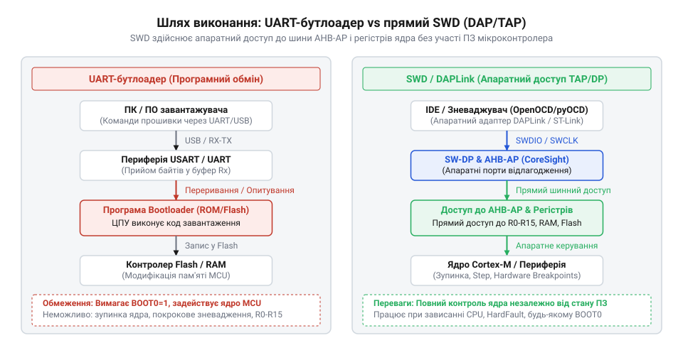
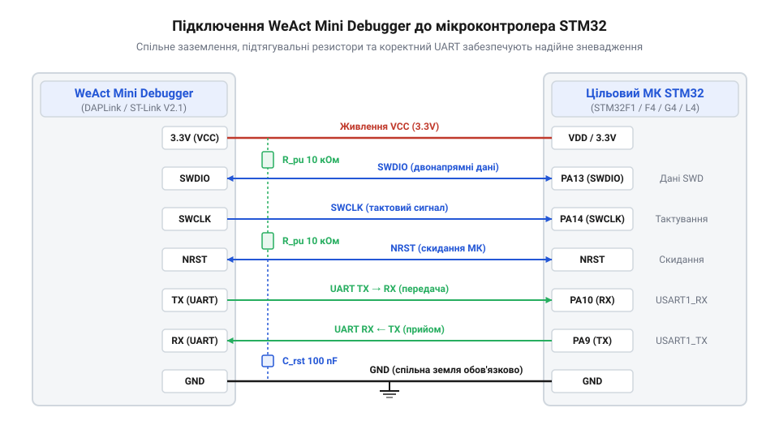
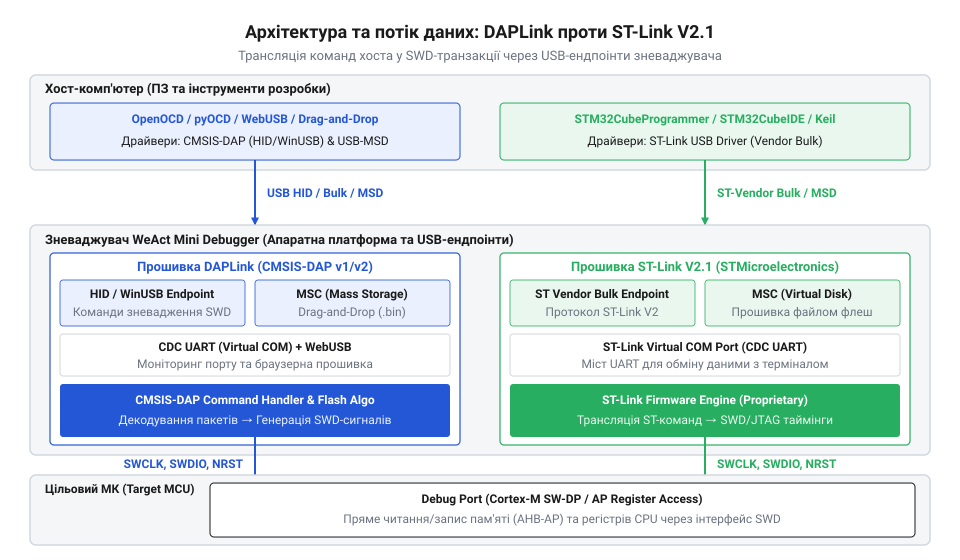
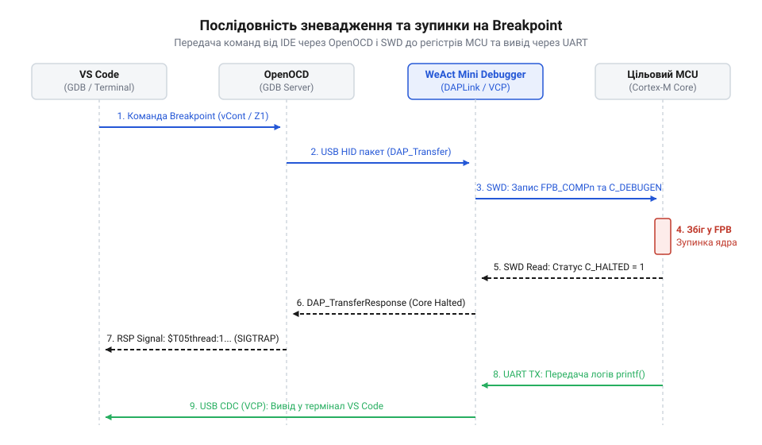
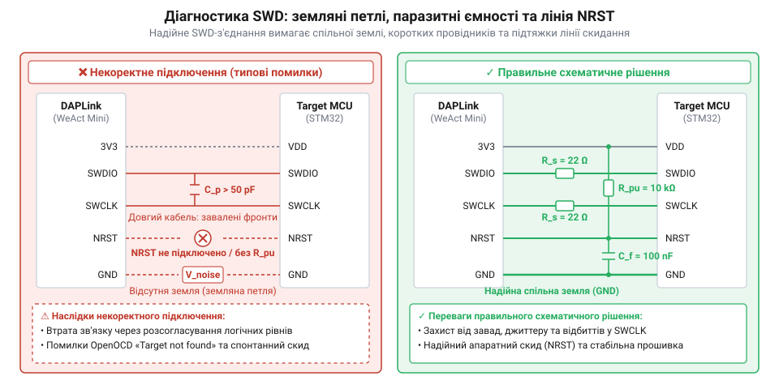

# WeAct Mini Debugger (DAPLink / ST-Link V2.1)

<preknowlist>
- [Архітектура зневадження ARM Cortex-M](root:hw-arch/arm-cortex-m-swd-architecture) — Принципи функціонування блоків CoreSight та дводротового інтерфейсу SWD для зчитування регістрів і зупинки ядра МК.
- [Сервери зневадження OpenOCD](root:sys-ide/openocd-debugger-ecosystem) — Призначення відлагоджувального сервера як містка між середовищем розробки та апаратним зневаджувачем.
- [Віртуальні послідовні мости USB CDC ACM](root:com-devices/usb-cdc-acm-serial-bridges) — Принцип трансляції даних UART через USB-інтерфейс у віртуальний послідовний порт.
</preknowlist>

## Проблема зневадження мікроконтролерів без SWD

При виведенні логів через послідовний порт @@en|UART@@ (англ. *Universal Asynchronous Receiver-Transmitter* — універсальний асинхронний приймач-передавач) виклики друку затримують виконання коду та змінюють його часову динаміку. Якщо виникає критична помилка @@en|HardFault@@ (англ. *Hard Fault* — важка відмова), ядро зупиняється, виведення припиняється, а вміст регістрів зберігається.


*Втрата зв'язку при збої UART на відміну від збереження контролю над ядром через SWD.*

Для відладки потрібен доступ до ядра через [архітектуру зневадження ARM](root:hw-arch/arm-cortex-m-swd-architecture) та інтерфейс @@en|SWD@@ (англ. *Serial Wire Debug* — зневадження через послідовний дріт). Двопровідний шинний інтерфейс @@en|SWD@@ дозволяє зупиняти ядро, зчитувати регістри @@en|CoreSight@@ та ставити точки зупину без модифікації коду.

## Апаратна будова WeAct Mini Debugger

Зневаджувач @@en|WeAct Mini Debugger@@ на чипі @@en|STM32F103C8T6@@ містить сигнальні лінії `SWCLK` (тактування) і `SWDIO` (дані), а також лінії `TX` та `RX` [віртуального послідовного мосту](root:com-devices/usb-cdc-acm-serial-bridges) @@en|USB CDC ACM@@. Живлення плати здійснюється напругою 3.3 В або 5 В із дотриманням обмежень струму стабілізатора.


*Призначення контактів зневаджувача та підключення сигналів і спільної шини заземлення.*

З'єднання ліній @@en|GND@@ (англ. *Ground* — земля) вирівнює опорні потенціали. Відсутність спільного @@en|GND@@ створює контури заземлення та вирівнювальні струми, що спотворюють високочастотні фронти `SWCLK` і можуть пошкодити виводи мікроконтролера.

## Порівняння прошивок DAPLink та ST-Link

Для @@en|WeAct Mini Debugger@@ доступні прошивки @@en|DAPLink@@ та @@en|ST-Link V2.1@@. Прошивка @@en|DAPLink@@ реалізує стандарт @@en|CMSIS-DAP@@ (англ. *Cortex Microcontroller Software Interface Standard Debug Access Port*). Стандарт @@en|CMSIS-DAP@@ v2 використовує прямоточні кінцеві точки @@en|USB Bulk@@ замість повільного інтерфейсу @@en|USB HID@@ v1, усуваючи затримки опитування.


*Порівняння стеків протоколів CMSIS-DAP v2 та ST-Link для взаємодії з процесорним ядром.*

Прошивка @@en|DAPLink@@ емулює віртуальний диск @@en|MSC@@ (англ. *Mass Storage Class* — клас масового збереження) для запису прошивки через @@en|Drag-and-Drop@@. Прошивка @@en|ST-Link V2.1@@ оптимізована для @@en|STM32CubeIDE@@, але підтримує лише сімейство @@en|STM32@@, тоді як @@en|DAPLink@@ є універсальним для чипів @@en|ARM Cortex-M@@.

## Налаштування програмних серверів зневадження

Програмний сервер перекладає команди середовища @@en|VS Code@@ у фізичні транзакції шини @@en|SWD@@. За допомогою [серверів зневадження OpenOCD](root:sys-ide/openocd-debugger-ecosystem) або @@en|pyOCD@@ інструмент керує ядром через протокол @@en|CMSIS-DAP@@.


*Потік команд зневадження від середовища розробки до регістрів процесора через OpenOCD.*

Максимально допустиму частоту сигнальної лінії `SWCLK` визначають через робочу частоту ядра цільового мікроконтролера `f_CPU`:

```
f_SWCLK_max = f_CPU ÷ 6      [гранична частота зневадження]
```

Значення `f_SWCLK` не повинно перевищувати одну шосту від `f_CPU`, інакше блоку зневадження бракуватиме часу для фіксації станів `SWDIO`. Логи одночасно зчитуються через віртуальний @@en|COM-порт@@.

## Оновлення прошивки та усунення збоїв

Для оновлення мікропрограми @@en|WeAct Mini Debugger@@ вивід @@en|BOOT0@@ підтягують до напруги 3.3 В і перезапускають пристрій. Перезапис пам'яті @@en|Flash@@ виконують утилітами @@en|dfu-util@@ або @@en|STM32CubeProgrammer@@.


*Застосування витої пари для зниження завад та режим Reset Catch для зняття блокування.*

На довгих провідниках виникають електромагнітні завади. Скручування сигнальних ліній `SWCLK` і `SWDIO` з провідниками @@en|GND@@ у виту пару стабілізує передачу. Для відновлення чипів із вимкненим інтерфейсом @@en|SWD@@ застосовують лінію скидання @@en|NRST@@ та режим @@en|Reset Catch@@, який зупиняє ядро до виконання збійного коду.
