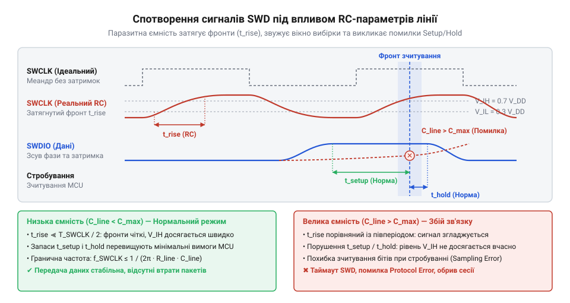

# Розрахунок частоти тактування SWD та часових параметрів сигнальних ліній

## Збої зневадження через спотворення сигналів SWD

Під час розробки та налагодження пристроїв на базі мікроконтролерів інженери часто намагаються прискорити прошивання та зчитування пам'яті шляхом збільшення частоти тактування інтерфейсу. Проте після встановлення частоти тактування `f_SWCLK` у значення 10 МГц або 20 МГц зневаджувальні утиліти раптово втрачають зв'язок із цільовою платою, повертаючи помилки невизначеного стану порту або збоїв читання регістрів. Спроба розв'язати проблему розгоном без урахування фізичних характеристик ліній призводить до того, що двопровідний інтерфейс SWD (англ. @@en|Serial Wire Debug@@, від англ. *serial* — послідовний, *wire* — дріт та *debug* — зневадження) починає працювати вкрай нестабільно.

Інтерфейс SWD використовує дві фізичні лінії: однонапрямкову лінію тактування SWCLK (англ. @@en|Serial Wire Clock@@), яку завжди формує апаратний зневаджувач, та двонапрямкову лінію даних SWDIO (англ. @@en|Serial Wire Data Input/Output@@). На відміну від паралельних систем, передача команд та даних відбувається послідовно біт за бітом, де кожна зміна стану на лінії SWDIO має відбутися до приходу активного фронту тактового сигналу. Якщо пристрій підключено довгим гнучким шлейфом або на платі присутні додаткові паразитні ємності, прямокутний імпульс тактування втрачає крутизну.

Основні фізичні симптоми порушення часових параметрів виникають на етапі зчитування та запису:
- **Втрата синхронізації пакетів**: приймач цільового мікроконтролера не встигає зафіксувати логічну одиницю до спаду тактового імпульсу, через що контрольна сума кадру стає хибною.
- **Хибні відповіді розпізнавання**: під час зміни напрямку передачі даних лінія SWDIO залишається у невизначеному стані, спричиняючи помилки декодування станів підтвердження ACK (англ. @@en|Acknowledge@@, від англ. *acknowledge* — підтвердження).
- **Раптові обриви сесії зневадження**: висока частота викликає наведення між паралельними провідниками кабелю, що призводить до збирання хибних тактових імпульсів.

Для забезпечення стабільної роботи зневаджувача необхідно відмовитися від довільного вибору частоти та вирахувати фізично обґрунтовані часові межі. Розглянувши [архітектуру програматора DAPLink](root:cat-hw-boards/daplink-programmer-architecture), стає зрозуміло, що частота тактування зв'язує апаратні таймери програматора та внутрішню логіку мікроконтролера.

## Співвідношення частоти тактування SWCLK та CPU

Вибір граничної частоти тактування `f_SWCLK` обмежується не лише якістю кабелю, а й внутрішньою архітектурою модуля зневадження CoreSight (англ. @@en|CoreSight@@). Усередині мікроконтролера порт доступу зневадження DP (англ. @@en|Debug Port@@, від англ. *debug* — зневадження та *port* — порт) приймає зовнішні тактові імпульси від лінії SWCLK, але обробка запитів до внутрішніх регістрів ядра та системної шини відбувається на частоті тактування центрального процесора `f_CPU`.

Оскільки шина SWD та ядро мікроконтролера працюють у двох незалежних часових доменах, передача сигналів між ними вимагає використання багатоетапних тригерних синхронізаторів (англ. @@en|Clock Domain Crossing Synchronizer@@). Для надійного захоплення стану зовнішньої лінії без виникнення метастабільності внутрішній логіці CoreSight потрібно від 2 до 4 тактових імпульсів частоти `f_CPU` на кожен біт зовнішнього сигналу. Згідно з документацією розробників архітектури ARM, гранична частота тактування SWCLK не повинна перевищувати 1/6 від частоти роботи ядра мікроконтролера `f_CPU`.

Гранична допустима частота `f_SWCLK_max` розраховується за формулою:

```
f_SWCLK_max
= f_CPU ÷ k_sync          [формула зв'язку частот через коефіцієнт синхронізації]
```

де `f_CPU` — поточна частота ядра мікроконтролера в герцах, а `k_sync` — апаратний коефіцієнт безпечної синхронізації (стандартне значення `k_sync = 6`).

**Приклад обчислення граничної частоти SWCLK для мікроконтролера в режимі економії енергії:**

Припустимо, що мікроконтролер переведено на тактування від внутрішнього генератора HSI з частотою `f_CPU = 8` МГц.

```
f_SWCLK_max
= 8.0 × 10⁶ ÷ 6           [підстановка значення частоти ядра 8 МГц та k_sync = 6]
= 1.333 × 10⁶ Гц          [обчислення максимальної частоти в герцах]
≈ 1.33 МГц                [переведення значення у мегагерци]
```

Якщо програматор спробує працювати на частоті 4 МГц при частоті ядра 8 МГц, синхронізатор CoreSight пропустить частини тактових імпульсів, і внутрішній порт доступу AP (англ. @@en|Access Port@@, від англ. *access* — доступ) поверне помилку зв'язку. Детальний аналіз того, як порт DP взаємодіє із шиною мікроконтролера, наведено у описі [архітектури блоку CoreSight](root:hw-arch/arm-cortex-m-swd-architecture). Особливо небезпечними є моменти входу мікроконтролера в режими глибокого сну (англ. @@en|Deep Sleep@@), коли частота ядра знижується до сотень кілогерц, що вимагає динамічного зниження частоти `f_SWCLK`.

## Затримка фронту в RC-моделі лінії

Окрім внутрішніх затримок синхронізації, максимальна швидкість обміну обмежується фізичними параметрами провідників. Лінії SWCLK та SWDIO можна представити як еквівалентний RC-ланцюг (від англ. @@en|RC circuit@@, де R — @@en|Resistor@@, від лат. *resisto* — опиратися, C — @@en|Capacitor@@, від лат. *capacitas* — місткість). Опір провідника та вихідного каскаду `R_line`, разом із сумарною паразитною ємністю кабелю та вхідних виводів `C_line`, формують затримку наростання фронту сигналу.

Час наростання фронту `t_rise` визначається як проміжок часу, за який напруга сигналу зростає від 10% до 90% від рівня живлення `V_DD`. Для еквівалентного RC-ланцюга першого порядку ця величина описується математичною залежністю:

```
t_rise
= R_line × C_line × ln(0.9 ÷ 0.1)     [формула розрахунку часу фронту від 10% до 90%]
= R_line × C_line × ln(9)             [спрощення логарифмічного виразу]
≈ 2.2 × R_line × C_line               [підстановка значення натурального логарифма ln(9)]
```

де `R_line` — сумарний опір лінії у омах, а `C_line` — сумарна паразитна ємність у фарадах.

Сумарна ємність лінії залежить від довжини кабелю `L`, погонної ємності провідника `C_spec` та вхідної ємності виводів мікроконтролера і програматора `C_pin`:

```
C_line
= C_spec × L + C_pin                  [розрахунок сумарної ємності лінійного кабелю]
```

Для стабільного зчитування біта приймач вимагає дотримання часу встановлення Setup Time (англ. @@en|Setup Time@@, від англ. *setup* — встановлення) та часу утримання Hold Time (англ. @@en|Hold Time@@, від англ. *hold* — утримання). Фронт сигналу `t_rise` не повинен перевищувати 30% від тривалості півперіоду тактового сигналу `T_SWCLK / 2`:

```
t_rise_max
= 0.30 × (T_SWCLK ÷ 2)                [критерій допустимого часу наростання фронту]
= 0.15 ÷ f_SWCLK                      [підстановка тривалості періоду T_SWCLK = 1 / f_SWCLK]
```


*Часова діаграма прямокутних сигналів SWCLK та SWDIO демонструє утворення затримки t_rise та звуження допустимого вікна вибірки через вплив RC-параметрів.*

**Приклад розрахунку граничної довжини кабелю зневадження:**

Нехай частота тактування складає `f_SWCLK = 5` МГц (період `T_SWCLK = 200` нс). Вихідний опір драйвера з урахуванням підтягувального резистора (англ. @@en|Pull-up Resistor@@) становить `R_line = 100` Ом. Погонна ємність якісного стрічкового шлейфу `C_spec = 50` пФ/м, а вхідна ємність виводів `C_pin = 10` пФ.

Обчислимо граничний час фронту та максимальну довжину кабелю:

```
t_rise_max
= 0.15 ÷ (5.0 × 10⁶)                  [обчислення максимально дозволеного часу фронту]
= 3.0 × 10⁻⁸ с                        [результат у секундах]
= 30 нс                               [переведення в наносекунди]

C_line_max
= t_rise_max ÷ (2.2 × R_line)         [визначення гранично допустимої ємності лінії]
= (30 × 10⁻⁹) ÷ (2.2 × 100)           [підстановка часу фронту 30 нс та опору 100 Ом]
= 1.363 × 10⁻¹₀ Ф                     [обчислення ємності у фарадах]
≈ 136.3 пФ                            [переведення у пікофаради]

L_max
= (C_line_max - C_pin) ÷ C_spec       [обчислення максимальної довжини кабелю]
= (136.3 - 10) ÷ 50                   [підстановка ємностей у пікофарадах]
= 2.526 м                             [максимальна довжина кабелю в метрах]
≈ 2.53 м                              [округлення результату]
```

Перевищення довжини кабелю понад 2.53 м спричинить затягування фронтів понад 30 нс, через що сигнал SWDIO не встигне стабілізуватися до моменту вибірки тактовим імпульсом.

## Обчислення корисної пропускної здатності SWD

Навіть при виборі високої частоти тактування реальна швидкість передачі корисних даних виявляється нижчою за номінальну частоту `f_SWCLK`. Це зумовлено накладними витратами на передачу службових бітів кадру, паузами зміни напрямку лінії та очікуванням готовності системної шини.

Згідно зі [стандартною структурою кадру](root:com-devices/swd-protocol-frame-structure), кожна транзакція читання або запису 32-бітного слова складається з таких послідовних фаз:
1. **Запит хоста (Header)**: 8 бітів (стартовий біт, вибір AP/DP, читання/запис, 2 біти адреси, парність, стоповий біт, паркувальний біт).
2. **Перемикання напрямку (TURN)**: 1 такт тактування (англ. @@en|Turnaround Time@@, від англ. *turnaround* — зміна напрямку), під час якого хост відключає свій вихідний драйвер.
3. **Відповідь пристрою (ACK)**: 3 біти підтвердження від мікроконтролера (значення `001` означає OK).
4. **Перемикання напрямку (TURN)**: 1 такт тактування (при транзакції запису).
5. **Інформаційне поле (Data)**: 32 біти корисних даних.
6. **Біт парності (Parity)**: 1 біт перевірки парності даних.

Загальна кількість тактових імпульсів `N_packet` на одну успішну транзакцію читання або запису становить:

```
N_packet
= 8 + 1 + 3 + 1 + 32 + 1              [сумування бітів заголовка, TURN, ACK, даних та парності]
= 46 тактів                           [загальна кількість тактів на 32 біти даних]
```

Корисна пропускна здатність `S_eff` обчислюється як відношення обсягу корисних даних (32 біти) до загального часу передачі кадру:

```
S_eff
= (32 ÷ N_packet) × f_SWCLK           [формула обчислення корисного потоку даних у біт/с]
= (32 ÷ 46) × f_SWCLK                 [підстановка кількості тактів кадру N_packet = 46]
≈ 0.6957 × f_SWCLK                    [обчислення коефіцієнта корисної дії каналу]
```

**Приклад обчислення реальної швидкості передачі даних:**

Розрахуємо корисну пропускну здатність для частоти тактування `f_SWCLK = 10` МГц.

```
S_eff_bits
= 0.6957 × (10.0 × 10⁶)               [обчислення корисної швидкості у бітах за секунду]
= 6.957 × 10⁶ біт/с                   [значення у біт/с]
≈ 6.96 Мбіт/с                         [переведення у мегабіти за секунду]

S_eff_bytes
= S_eff_bits ÷ 8                      [переведення швидкості у байти за секунду]
= (6.957 × 10⁶) ÷ 8                   [ділення на 8 біт у байті]
= 8.696 × 10⁵ байт/с                  [значення у байт/с]
≈ 869.6 Кбайт/с                       [переведення у кілобайти за секунду]
```

Коефіцієнт корисної використання каналу становить лише 69.57%. Проте якщо внутрішній модуль пам'яті мікроконтролера зайнятий обробкою переривання, порт доступу повертає стан WAIT (значення ACK = `010`). У цьому випадку хост змушений повторювати кадри запиту, що призводить до появі додаткових пауз очікування та падіння реальної пропускної здатності в кілька разів. Для запобігання паузам WAIT програматори використовують буферизоване зчитування та групові транзакції до послідовних адрес пам'яті.
