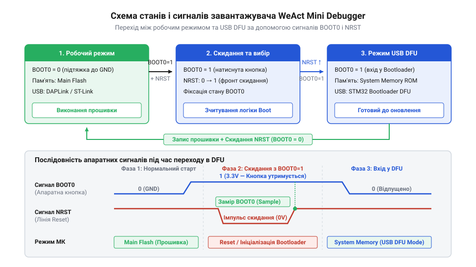

# Зміна прошивки WeAct Mini Debugger між DAPLink та ST-Link V2.1

## Несумісність зневаджувача з інструментами розробки

Під час розробки пристроїв на мікроконтролерах спроба підключити зневаджувач `@@en|WeAct Mini Debugger@@` до середовища `@@en|STM32CubeIDE@@` з прошивкою `@@en|DAPLink@@ (від англ. @@en|Debug Access Port Link@@, зв'язок порту доступу зневадження)` завершується помилкою ідентифікації пристрою. Фірмові інструменти `@@en|STMicroelectronics@@` очікують на специфічний протокол обміну та відгук викликів `@@en|ST-Link V2.1@@`. З іншого боку, спроба використати утиліти `@@en|OpenOCD@@ (від англ. @@en|Open On-Chip Debugger@@, відкритий накристальний зневаджувач)` або `@@en|PyOCD@@` з прошивкою `@@en|ST-Link V2.1@@` часто викликає збої через відсутність підтримки нестандартних вендорних команд.

Причина полягає у принципових відмінностях стеків протоколів та низькорівневої структури `@@en|USB@@`-інтерфейсу. Прошивка `@@en|DAPLink@@` реалізує відкритий стандарт `@@en|CMSIS-DAP@@ (від англ. @@en|Cortex Microcontroller Software Interface Standard Debug Access Port@@)` від компанії `@@en|ARM@@`. Вона передає команди зневадження через стандартний клас `@@en|USB@@` `@@en|HID@@ (від англ. @@en|Human Interface Device@@, пристрій взаємодії з людиною)`, використовуючи кінцеві точки переривань `@@en|Interrupt Endpoint@@ (від англ. @@en|Interrupt Endpoint@@, кінцева точка переривання)`. Канали `@@en|Interrupt Endpoint@@` забезпечують фіксовану затримку опитування та дозволяють працювати без встановлення спеціальних драйверів у середовищах `@@en|OpenOCD@@`, `@@en|Keil MDK@@` та `@@en|VS Code@@` з розширенням `@@en|Cortex-Debug@@`. У цьому режимі програматор ідентифікує себе через `@@en|Vendor ID@@` зі значенням `0x0D28` (або `0x0483`) та `@@en|Product ID@@ (від англ. @@en|Product Identifier@@, ідентифікатор продукту)` зі значенням `0x0204`. Натомість `@@en|STM32CubeIDE@@` працює виключно через профілі `@@en|ST-Link V2.1@@`, які відмовляються від `@@en|HID@@` на користь кінцевих точок масової передачі `@@en|Bulk Endpoint@@ (від англ. @@en|Bulk Endpoint@@, кінцева точка масової передачі)` у складі `@@en|Vendor Specific Class@@ (від англ. @@en|Vendor Specific Class@@, клас специфічний для виробника)`. Канали `@@en|Bulk Endpoint@@` утилізують усю вільну пропускну здатність шини `@@en|USB@@` для швидкісного пересилання пам'яті без обмежень розміру буфера `@@en|HID@@`. Для активації цього стека інструменти `@@en|STMicroelectronics@@` вимагають суворого збігу ідентифікаторів, очікуючи `@@en|Vendor ID@@` зі значенням `0x0483` та `@@en|Product ID@@` зі значенням `0x374B`.

Оскільки `@@en|WeAct Mini Debugger@@` побудовано на базі мікроконтролера `@@en|STM32F103@@` або `@@en|STM32F411@@`, його апаратні ресурси дозволяють розміщувати будь-яку з цих прошивок у внутрішній пам'яті `@@en|Flash@@`. Для зміни робочої поведінки програматора під вимоги обраного інструментарію розробник повинен вміти змінювати вміст цієї пам'яті через вбудований апаратний завантажувач.

## Переведення зневаджувача в режим оновлення

Запуск апаратного завантажувача у мікроконтролерах `@@en|STM32F103@@` та `@@en|STM32F411@@` на платі `@@en|WeAct Mini Debugger@@` контролюється станом виводу `@@en|BOOT0@@ (від англ. @@en|bootstrap@@, початкове завантаження)` під час скидання процесора сигналом `@@en|NRST@@ (від англ. @@en|Negative Reset@@, скидання низьким рівнем)`. Внутрішня шина мікроконтролера опитує рівень на `@@en|BOOT0@@` під час підняття напруги або при виході зі стану скидання, визначаючи початковий адресний простір для виконання коду.

Якщо під час перезавантаження вивід `@@en|BOOT0@@` підтягнуто до логічного нуля, мікроконтролер переходить до виконання основної прошивки з адреси `0x08000000` у пам'яті `@@en|Flash@@`. Якщо ж на виводі `@@en|BOOT0@@` утримується логічна одиниця (напруга `3.3V`), системний мультиплексор перенаправляє вектор завантаження на системну пам'ять `@@en|ROM@@` (`0x1FFFF000` для `@@en|STM32F103@@` або `0x1FFF0000` для `@@en|STM32F411@@`). Там розміщено заводський бутлодер `@@en|DFU@@ (від англ. @@en|Device Firmware Upgrade@@, оновлення мікропрограми пристрою)`, який ініціалізує периферійний модуль `@@en|USB@@` та очікує на команди перезапису пам'яті.


*Послідовність сигналів скидання та вибору режиму завантаження для активації вбудованого USB DFU бутлодера.*

Щоб перевести плату `@@en|WeAct Mini Debugger@@` у режим `@@en|DFU@@`, виконують таку послідовність дій з кнопками на платі:
1. Затискають і утримують кнопку `@@en|BOOT0@@`.
2. Короткочасно (протягом `50`–`100` мс) натискають і відпускають кнопку `@@en|NRST@@`, подаючи імпульс низького рівня для скидання мікроконтролера.
3. Відпускають кнопку `@@en|BOOT0@@`.

Для надійного переходу в завантажувач критично важливо дотримуватися тривалості утримання кнопок: `@@en|BOOT0@@` слід затиснути до натискання `@@en|NRST@@` і утримувати щонайменше `100`–`500` мс після того, як сигнал `@@en|NRST@@` повернеться до високого рівня. Внутрішня схема мікроконтролера опитує логічний рівень на виводі `@@en|BOOT0@@` саме в момент підйому сигналу `@@en|NRST@@`. Якщо відпустити кнопку `@@en|BOOT0@@` занадто рано, лінія встигне розрядитися до логічного нуля, і мікроконтролер перейде до виконання звичайної робочої прошивки `@@en|DAPLink@@` або `@@en|ST-Link V2.1@@`.

Успішне переведення пристрою у режим `@@en|DFU@@` підтверджується поведінкою світлодіодного індикатора станів `@@en|LED@@` (від англ. `@@en|Light-Emitting Diode@@`, світловипромінювальний діод) на платі. Під час виконання робочих мікропрограм індикатор постійно світиться або ритмічно блимає, інформуючи про активність зневаджувача. Натомість заводський завантажувач у системній пам'яті `@@en|ROM@@` не ініціалізує периферійний вивід світлодіода, тому при переході у режим `@@en|DFU@@` індикатор повністю гасне. Якщо після виходу зі скидання світлодіод продовжує блимати або світитися, це свідчить про те, що перехід не відбувся, і процедуру натискання кнопок необхідно повторити з більшою тривалістю утримання `@@en|BOOT0@@`.

Після цього мікроконтролер припиняє виконання поточної прошивки (`@@en|DAPLink@@` або `@@en|ST-Link V2.1@@`) і визначається комп'ютером як пристрій оновлення `@@en|STM32 BOOTLOADER@@`.

## Запис прошивки утилітами CubeProgrammer та dfu-util

Після переведення плати `@@en|WeAct Mini Debugger@@` у режим `@@en|DFU@@` здійснюється процедура запису обраного бінарного файла прошивки (`daplink.bin` або `stlink_v21.bin`) у пам'ять `@@en|Flash@@`.

У графічному середовищі `@@en|STM32CubeProgrammer@@` (`@@en|Windows@@`, `@@en|Linux@@`, `@@en|macOS@@`) порядок дій наступний:
1. У правому верхньому куті вікна утиліти обирають тип підключення `@@en|USB@@`.
2. Натискають кнопку оновлення списку пристроїв та переконуються, що у полі портів з'явився пристрій `@@en|USB1@@` з позначкою `@@en|DFU@@`.
3. Натискають кнопку "Connect" для встановлення зв'язку з завантажувачем.
4. Переходять у вкладку "Erasing & Programming", обирають потрібний файл прошивки та вказують початкову адресу `0x08000000`.
5. Встановлюють прапорець "Verify programming" та натискають "Start Programming".

У консольних операційних системах `@@en|Linux@@` або `@@en|macOS@@` процес запису виконується через утиліту `@@en|dfu-util@@ (від англ. @@en|Device Firmware Upgrade Utility@@, утиліта оновлення мікропрограми)`. Звичайний бінарний файл прошивки `.bin` містить лише чистий масив інструкцій без метаданих про цільовий пристрій. Для захисту від запису несумісного коду утиліта `@@en|dfu-tool@@ (від англ. tool — інструмент)` упаковує цей масив у спеціальний контейнер формату `.dfu`. Під час конвертації у заголовок та суфікс файла додаються ідентифікатори обладнання, адреси секцій пам'яті й контрольна сума `@@en|CRC32@@ (від англ. @@en|Cyclic Redundancy Check@@, циклічний надлишковий код; від cyclic — циклічний, redundancy — надлишковість, check — перевірка)`. Іншою перешкодою для запису може стати активований захист від зчитування `@@en|RDP@@ (від англ. @@en|Readout Protection@@, захист від зчитування; від read — зчитувати, out — назовні, protection — захист)` у байтах налаштувань `@@en|Option Bytes@@ (від англ. option — параметр, byte — байт)`. У такому стані апаратний завантажувач мікроконтролера блокує будь-які операції модифікації пам'яті `@@en|Flash@@`. Для відновлення доступу виконують зняття RDP, яке скидає рівень захисту до нульового. Ця процедура автоматично викликає апаратне повне стирання пам'яті `@@en|Full Chip Erase@@ (від англ. full — повний, chip — мікросхема, erase — стирання, повне стирання мікросхеми)` та розблоковує всі сектори для запису. Після підготовки файла прошивки та зняття захисту наявність пристрою у системі перевіряють командою:

```bash
dfu-util -l
```

Запис прошивки та автоматичний вихід із режиму завантажувача після завершення прошивки здійснюються командою:

```bash
dfu-util -d 0483:df11 -a 0 -s 0x08000000:leave -D firmware.bin
```

Параметр `-d 0483:df11` вказує ідентифікатори `@@en|Vendor ID@@` та `@@en|Product ID@@` завантажувача `@@en|STM32@@`, параметр `-a 0` обирає внутрішню пам'ять `@@en|Flash@@`, а ключ `:leave` змушує мікроконтролер виконати скидання та розпочати виконання записаного коду.

## Перевірка системних USB-пристроїв та діагностика

Після запису прошивки та перезавантаження мікроконтролера операційна система виконує повторне перелічення шини `@@en|USB@@`. Результат розпізнавання залежить від того, яку саме мікропрограму було завантажено у `@@en|WeAct Mini Debugger@@`.

У режимі `@@en|DAPLink@@` плата реєструється як складений пристрій `@@en|USB Composite Device@@`, що включає три незалежні інтерфейси:
* Інтерфейс зневадження `@@en|CMSIS-DAP@@`, який працює через драйвер `@@en|HID@@` і не потребує встановлення сторонніх драйверів у `@@en|Windows@@`, `@@en|Linux@@` чи `@@en|macOS@@`.
* Віртуальний послідовний порт `@@en|CDC@@ (від англ. @@en|Communication Device Class@@, клас комунікаційних пристроїв)`, що створює системний порт `COM` у `@@en|Windows@@` або `/dev/ttyACM0` у `@@en|Linux@@`.
* Віртуальний накопичувач `@@en|MSC@@ (від англ. @@en|Mass Storage Class@@, клас пристроїв збереження даних)` для прямого програмування перетягуванням файлів.

У системі `@@en|Linux@@` перевірка розпізнавання виконується утилітою `lsusb`, яка відображає пристрій з назвою `ARM DAPLink CMSIS-DAP`. У `@@en|Windows@@` утиліта `@@en|Device Manager@@ (від англ. @@en|Device Manager@@, диспетчер пристроїв)` відображає пристрій у розділах "Пристрої взаємодії з людьми" та "Порти (COM і LPT)".

У режимі `@@en|ST-Link V2.1@@` плата передає `@@en|Vendor ID@@` `0x0483` та `@@en|Product ID@@` `0x374B`. У `@@en|Windows@@` для коректної роботи необхідна наявність драйвера `@@en|WinUSB@@` від `@@en|STMicroelectronics@@`. Якщо драйвер відсутній, `@@en|Device Manager@@` покаже пристрій із жовтим знаком оклику в розділі "Інші пристрої", а `@@en|STM32CubeIDE@@` видаватиме помилку підключення. У `@@en|Linux@@` для роботи без прав `root` необхідно додати правило `@@en|udev@@` у файл `/etc/udev/rules.d/99-stlink.rules`.

Файл `/etc/udev/rules.d/99-stlink.rules` містить текстове правило для сортування пристроїв шини `@@en|USB@@` за атрибутами та призначення належних прав доступу:

```udev
SUBSYSTEMS=="usb", ATTRS{idVendor}=="0483", ATTRS{idProduct}=="374b", MODE="0666"
```

Параметри `ATTRS{idVendor}=="0483"` та `ATTRS{idProduct}=="374b"` точково обирають `@@en|ST-Link V2.1@@` за ідентифікаторами `@@en|Vendor ID@@` і `@@en|Product ID@@`. Прапорець `MODE="0666"` дозволяє читання та запис у файл пристрою всім користувачам без залучення прав `root`. Для негайного набрання чинності новим правилом без перезавантаження операційної системи викликають утиліту `@@en|udevadm@@ (від англ. @@en|udev administration@@, адміністрування udev; від administration — адміністрування)`:

```bash
sudo udevadm control --reload-rules && sudo udevadm trigger
```

Ключ `control --reload-rules` оновлює конфігурацію демона `@@en|udev@@` у пам'яті, а команда `trigger` повторно застосовує правила до вже підключених пристроїв `@@en|USB@@`.

## Відновлення зневаджувача при збоях прошивки

Знеструмлення плати під час запису, пошкодження бінарного файла або запис за некоректною адресою призводять до пошкодження таблиці векторів переривань `@@en|Vector Table@@` за адресою `0x08000000`. Якщо покажчик стека `@@en|MSP@@` або вектор скидання містять сміттєві дані, процесор під час звичайного старту негайно потрапляє у критичну помилку `@@en|HardFault@@ (від англ. @@en|Hard Fault@@, апаратна відмова)` або нескінченне перезавантаження. У такому стані пристрій не здатний ініціалізувати `@@en|USB@@` та не розпізнається операційною системою.

Для відновлення роботоздатності плати використовують властивість апаратного виводу `@@en|BOOT0@@`. Оскільки опитування стану `@@en|BOOT0@@` здійснюється апаратними колами мікроконтролера ще до старту обробки першої інструкції з пам'яті `@@en|Flash@@`, пошкоджений вміст `0x08000000` повністю ігнорується.

Процедура аварійного відновлення `@@en|WeAct Mini Debugger@@` виконується за таким алгоритмом:
1. Активують режим `@@en|DFU@@` утриманням кнопки `@@en|BOOT0@@` під час скидання кнопкою `@@en|NRST@@`.
2. Підключають плату до комп'ютера та запускають `@@en|STM32CubeProgrammer@@` або `@@en|dfu-util@@`.
3. Виконують операцію повного стирання чипа (`@@en|Full Chip Erase@@`), щоб очистити пам'ять `@@en|Flash@@` від пошкодженого коду.
4. Повторно записують завідомо справну прошивку `@@en|DAPLink@@` або `@@en|ST-Link V2.1@@` за адресою `0x08000000`.
5. Натискають кнопку `@@en|NRST@@` для перезапуску у робочому режимі.
