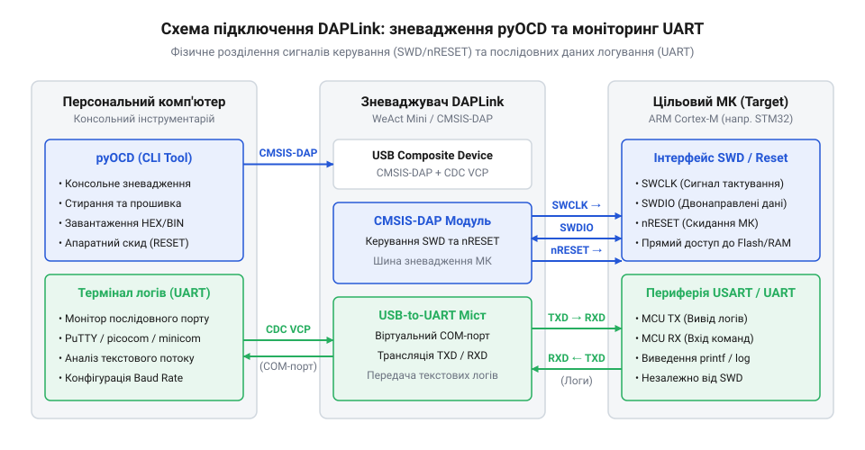

# Автоматизація прошивки через pyOCD та консольний моніторинг через UART

## Ручне завантаження гальмує цикл розробки

Цикл створення прошивки для мікроконтролерів неминуче полягає у безперервному чергуванні редагування коду, компіляції та перевірки реакції заліза. Традиційне використання важких графічних @@en|IDE@@ (Integrated Development Environment, англ. *integrate* — об'єднувати, *develop* — розробляти) перетворює це чергування на рутинну процедуру з високими часовими витратами. Для відправки будь-яких змін у пристрій розробник змушений вручну натискати кнопки інтерфейсу, чекати ініціалізації внутрішніх модальних вікон зневадження та підтверджувати параметри підключення.

Головна проблема графічного середовища полягає в неможливості гнучкої автоматизації. Графічне вікно блокує інтеграцію процедур програмування у зовнішні автоматизовані скрипти чи конвеєри безперервної інтеграції. Консольний підхід @@en|CLI@@ (Command Line Interface, англ. *command* — команда, *line* — рядок) усуває проміжні діалогові вікна й дозволяє викликати завантаження коду однією командою з термінала. Після завершення виконання кожна @@en|CLI@@-утиліта повертає операційній системі числовий статус виходу — @@en|exit status@@ (англ. *exit* — вихід, *status* — стан). Нульове значення коду підтверджує успішне завершення операції. Ненульове значення свідчить про апаратний збій, втрату зв'язку з мішенню або помилку стирання пам'яті. Командна оболонка аналізує отриманий @@en|exit status@@ і миттєво зупиняє виконання послідовності команд при виявленні помилки. Таке автоматичне переривання запобігає запуску моніторингу або тестування на непрацездатному пристрої. Сформована потреба у швидкому консольному конвеєрі вимагає використання автономного інструментарію, здатного працювати без візуальної оболонки.

## Апаратний зв'язок DAPLink із ПК та МК

Для реалізації консольного конвеєра необхідно забезпечити фізичне сполучення персонального комп'ютера з цільовим мікроконтролером родини @@en|ARM Cortex-M@@. Роль проміжного апаратного моста виконує зневаджувач на базі прошивки @@en|DAPLink@@, що підтримує відкритий стандарт @@en|CMSIS-DAP@@.


*Фізичне підключення DAPLink забезпечує одночасне зневадження за протоколом SWD та збір телеметрії через VCP UART.*

Зв'язок між зневаджувачем та цільовим чипом поділяється на два незалежних інтерфейси:
1. Двохдротовий [протокол SWD](root:cat-hw-boards/daplink-debugger/api-swd-protocol-and-signals.md) (Serial Wire Debug, англ. *serial* — послідовний, *wire* — дріт), який використовує лінію даних `SWDIO`, тактовий сигнал `SWCLK`, спільний провідник `GND` та опціональну лінію апаратного скидання `NRST`.
2. Послідовний інтерфейс @@en|UART@@ (Universal Asynchronous Receiver-Transmitter, англ. *asynchronous* — несинхронний), де лінія передачі мікроконтролера `TX` з'єднується з приймачем зневаджувача `RX`, а `RX` мікроконтролера — з `TX` зневаджувача.

При підключенні до USB-порту ПК зневаджувач ініціалізується як складовий пристрій, оголошуючи системі дескриптори кількох функціональних інтерфейсів. Інтерфейс @@en|CMSIS-DAP@@ слугує для передачі низькорівневих команд зневадження та прошивки. Для передачі логів зневаджувач реалізує апаратний мост на основі специфікації @@en|CDC-ACM@@ (Communications Device Class — Abstract Control Model, від англ. *communication* — зв'язок, *device* — пристрій, *class* — клас, *abstract* — абстрактний, *control* — керування, *model* — модель). Вбудований мост @@en|VCP@@ (Virtual COM Port, англ. *virtual* — віртуальний) надає операційній системі стандартні ідентифікатори послідовного інтерфейсу. Під час переліку пристроїв на шині штатні драйвери ОС — `cdc_acm` у Linux або `usbser.sys` у Windows — розпізнають дескриптори й прив'язуються до кінцевих точок обміну даними. Після ініціалізації драйвер створює в системі файл послідовного пристрою (наприклад, `/dev/ttyACM0` або `COMx`) для зчитування діагностичних логів. Байти з лінії `TX` мікроконтролера надходять на приймач зневаджувача, пакуються в USB-пакети та завантажуються в кільцевий буфер ядра ОС. Програми моніторингу відкривають цей файл як звичайний послідовний порт. Драйвер надає монопольний доступ до порту лише одному процесу, тому спроба паралельного зчитування повертає помилку блокування. Якщо програма зчитує дані повільніше за швидкість передачі, кільцевий буфер ядра переповнюється й втрачає символи. Детальніший розбір внутрішньої структури цієї прошивки та трансляції USB-команд у транзакції SWD наведено в описі [архітектури CMSIS-DAP](root:sys-ide/cmsis-dap-debugger-firmware).

## Автоматизація прошивки та скидання через pyOCD

Програмування внутрішньої пам'яті мікроконтролера з командного рядка здійснюється за допомогою утиліти @@en|pyOCD@@, яка взаємодіє із зондом @@en|CMSIS-DAP@@ напряму через USB. Перед початком запису утиліта завантажує в оперативну пам'ять мікроконтролера спеціалізований алгоритм програмування flash-пам'яті, який виконує поблочне стирання та побайтовий запис бінарного (`.bin`) або hex-файла (`.hex`). Якщо модель цільового чипа відсутня у вбудованій базі інструменту, @@en|pyOCD@@ завантажує відповідний пакунок @@en|CMSIS-Pack@@ (від англ. *package* — пакунок) за допомогою команди `pyocd pack install`. З цього пакунка утиліта витягує карти адрес та алгоритми запису у форматі `.FLM`, що дозволяє працювати з рідкісними мікроконтролерами без модифікації вихідного коду інструменту. У разі активації апаратного захисту зчитування @@en|Readout Protection@@ (від англ. *readout* — зчитування, *protection* — захист) контролер пам'яті мікроконтролера блокує будь-які операції зчитування через порт зневадження. Для обходу цього обмеження @@en|pyOCD@@ виконує примусове суцільне стирання чипа за допомогою ключа `pyocd erase --chip` або прапорця `--unlock`. Ця операція скидає конфігураційні байти до заводського стану й відновлює доступ до програмування за ціною повного вилучення збережених даних.

Виклик процедури запису прошивки виконується командою `pyocd flash`. Ключ `--target` вказує точну модель цільового чипа (наприклад, `stm32f411ce`), що необхідно для завантаження коректного алгоритму стирання та карти адрес пам'яті. Параметр `--frequency` задає тактову частоту шини @@en|SWD@@ в Герцах, де значення `4000000` (4 МГц) забезпечує високу швидкість запису без ризику втрати пакетів на з'єднувальних провідниках:

```bash
pyocd flash --target stm32f411ce --frequency 4000000 build/firmware.bin
```

Після завершення запису мікроконтролер необхідно перезапустити командою `pyocd reset`. Запуск із прапорцем `--method hw` примусово підтягує фізичну лінію `NRST` до нуля через зневаджувач @@en|DAPLink@@, що виконує повноцінне апаратне скидання всіх периферійних блоків чипа. Якщо лінія `NRST` не розведена, використовується програмне скидання шляхом запису в регістр `SYSRESETREQ` системного контролера переривань ядра @@en|ARM Cortex-M@@.

## Паралельний моніторинг логів через UART

Після завантаження нової прошивки та перезапуску мікроконтролера необхідно перевірити коректність його роботи в режимі реального часу. Для цього в код прошивки вбудовується модуль передачі текстової телеметрії через апаратний периферійний блок @@en|UART@@ зі встановленою швидкістю (наприклад, `115200` бод).

:::tabs
@tab C
:::code proj-pyocd-flashing-and-uart-monitor/c/main.c
:::code proj-pyocd-flashing-and-uart-monitor/c/uart.h
:::code proj-pyocd-flashing-and-uart-monitor/c/uart.c

@tab C++
:::code proj-pyocd-flashing-and-uart-monitor/c/cpp/main.cpp
:::code proj-pyocd-flashing-and-uart-monitor/c/cpp/uart.hpp
:::code proj-pyocd-flashing-and-uart-monitor/c/cpp/uart.cpp
:::

Для перегляду текстового потоку на стороні ПК застосовуються консольні термінали @@en|picocom@@, @@en|minicom@@ або @@en|screen@@. Консольний термінал відкриває файл пристрою віртуального порту @@en|VCP@@ із вказуванням однакової швидкості @@en|baud rate@@.

Під час роботи з послідовним портом важливо враховувати механізм монопольного блокування пристрою в операційній системі. Якщо консольний термінал утримує відкритим порт `/dev/ttyACM0`, спроба повторного запуску утиліти прошивки або другого термінала завершиться помилкою доступу. Тому автоматизований конвеєр має чітко розмежовувати фазу запису пам'яті та фазу підключення монітора логів.

## Об'єднання прошивки й моніторингу в конвеєр

Окремі етапи прошивки через @@en|pyOCD@@ та моніторингу через @@en|UART@@ об'єднуються в єдиний командний сценарій bash. Це дозволяє розробникові запускати повний цикл тестування однією командою в терміналі. Конфігурація середовища виноситься в окремий файл `config.env`, що спрощує адаптацію під різні плати та порти.

:::code proj-pyocd-flashing-and-uart-monitor/sh/config.env

Головний скрипт `flash_and_monitor.sh` послідовно перевіряє наявність бінарного файла та потрібних утиліт у системі, виконує прошивку й скидання мікроконтролера через @@en|pyOCD@@, після чого передає керування терміналу за допомогою команди `exec`:

:::code proj-pyocd-flashing-and-uart-monitor/sh/flash_and_monitor.sh

Використання `exec` заміщує процес @@en|bash@@-скрипта безпосередньо процесом термінала @@en|picocom@@. У результаті розробник отримує безперервний консольний конвеєр: після запису коду та скидання чипа термінал миттєво відображає стартові логи мікроконтролера без необхідності вручну відкривати нові вікна. У цьому режимі утиліта @@en|picocom@@ захоплює клавіатурне введення й пересилає комбінації на кшталт `Ctrl+C` прямо в послідовний порт, тому вони більше не переривають сам процес моніторингу. Для виклику внутрішніх команд термінала застосовують спецсимвол втечі (@@en|escape character@@) — комбінацію `Ctrl+A`. Коректний вихід із монітора відбувається через послідовне натискання `Ctrl+A`, а потім `Ctrl+X`. Таке закриття штатно вивантажує термінал і звільняє файл пристрою послідовного порту. Примусове ж обривання сесії залишає порт заблокованим, через що наступний запуск @@en|pyOCD@@ завершиться помилкою доступу.
