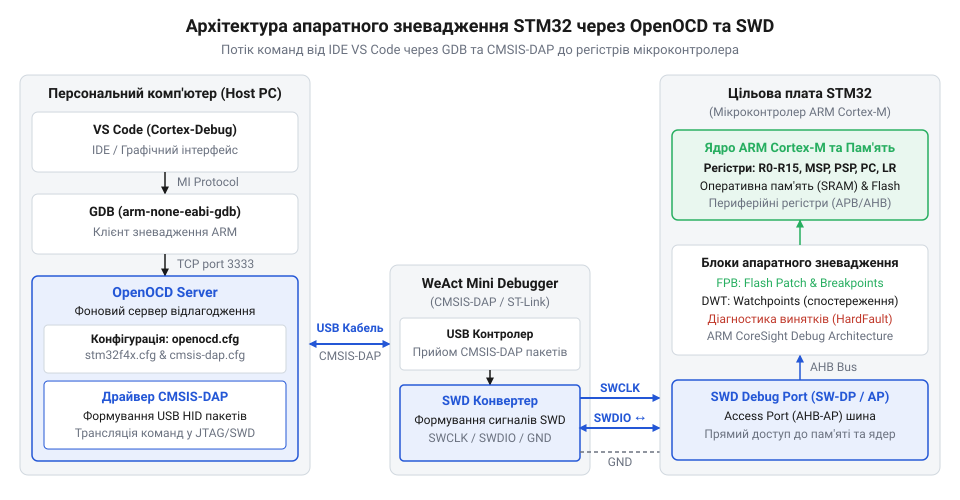
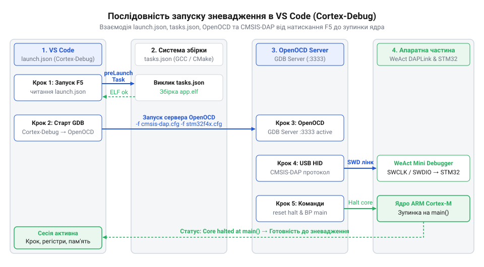

# Покрокове зневадження STM32 через OpenOCD, VS Code та WeAct Mini Debugger

## Сліпе зневадження та втрата контролю

Під час розробки прошивок для мікроконтролерів STM32 виявлення помилок найчастіше починають з виведення текстових повідомлень через периферійний модуль @@en|UART@@ (від англ. @@en|Universal Asynchronous Receiver-Transmitter@@ — універсальний асинхронний приймач-передавач) або перемикання стану світлодіода. Такий підхід працює для простих перевірок, але виявляється безсилим перед недетермінованими збоями. Якщо мікроконтролер входить у нескінченний цикл всередині обробника переривання або виклику сторонньої бібліотеки, передача рядка через @@en|UART@@ вимагає часу та активної роботи ядра. Внесення додаткових викликів друку змінює часові інтервали виконання коду, що ховає апаратні конфлікти або змінює послідовність дій. Крім того, при виникненні системного збою ядро зупиняє виконання раніше, ніж встигає відправити вміст буфера через послідовний порт.

Для діагностики складних збоїв необхідний інструмент, який дає змогу бачити стан процесора без спотворення його часової поведінки програмними затримками. Родина мікроконтролерів @@en|ARM Cortex-M@@ містить на кристалі спеціалізований [апаратний модуль зневадження](root:sys-ide/arm-cortex-m-core-debug), що працює незалежно від виконання основної програми. Цей модуль дає змогу зупиняти ядро на конкретній інструкції, покроково виконувати машинні команди та зчитувати вміст внутрішніх регістрів. Зв'язок між цим внутрішнім апаратним модулем та зовнішнім комп'ютером розробника забезпечує послідовний двопровідний інтерфейс @@en|SWD@@ (від англ. @@en|Serial Wire Debug@@ — послідовне дротове зневадження). Інтерфейс @@en|SWD@@ створює повноцінний двосторонній канал діагностики, який надає повний контроль над мікроконтролером без потреби виділяти ресурси пам'яті чи периферії під текстовий вивід. Фізично цей зв'язок реалізують через два сигнальні виводи мікроконтролера STM32: лінію тактування @@en|SWCLK@@ (від англ. @@en|Serial Wire Clock@@ — тактування послідовного дроту), розташовану на виводі @@en|PA14@@, та двонаправлену лінію даних @@en|SWDIO@@ (від англ. @@en|Serial Wire Data Input/Output@@ — ввід-вивід даних послідовного дроту) на виводі @@en|PA13@@. Окрім сигнальних ліній, для коректної роботи інтерфейсу потрібне спільне заземлення @@en|GND@@ (від англ. @@en|Ground@@ — земля) для узгодження логічних рівнів напруги, а також лінія живлення @@en|3V3@@ для відстеження опорного потенціалу зневаджувачем або живлення плати. Додатково використовують апаратну лінію скидання @@en|NRST@@ (від англ. @@en|Negative Reset@@ — активне скидання низьким рівнем), яка дає змогу зневаджувачу захоплювати контроль над ядром у момент подачі живлення або перезавантаження за режимом @@en|connect under reset@@, що є критичним, якщо виводи @@en|SWD@@ були перепризначені як звичайні виводи @@en|GPIO@@ (від англ. @@en|General Purpose Input/Output@@ — ввід-вивід загального призначення).

## Архітектура зв'язку та конфігурація OpenOCD

Щоб встановити зв'язок між середовищем розробки на ПК та інтерфейсом @@en|SWD@@ мікроконтролера, потрібен апаратний адаптер і спеціалізоване програмне забезпечення. У ролі фізичного містка виступає зневаджувач @@en|WeAct Mini Debugger@@, який працює за стандартизованим протоколом @@en|CMSIS-DAP@@ (від англ. @@en|Cortex Microcontroller Software Interface Standard Debug Access Port@@ — порт доступу до зневадження стандарту ARM). Адаптер приймає USB-пакети від комп'ютера і перетворює їх на послідовні електричні сигнали тактування `SWCLK` та даних `SWDIO`.


*Архітектурний ланцюжок від відлагоджувача GDB до фізичних сигналів SWDIO та SWCLK на платі.*

На стороні персонального комп'ютера взаємодією з адаптером керує сервер @@en|OpenOCD@@ (від англ. @@en|Open On-Chip Debugger@@ — відкритий зневаджувач на кристалі). Сервер відкриває мережевий порт (за замовчуванням 3333) для протоколу @@en|GDB@@ (від англ. @@en|GNU Debugger@@ — зневаджувач проєкту GNU), транслюючи високорівневі команди діагностики в низькорівневі виклики драйвера адаптера. Щоб сервер міг безпосередньо надсилати @@en|USB@@-пакети адаптеру без втручання операційної системи, у системі має бути встановлений відповідний низькорівневий драйвер: в @@en|Windows@@ це @@en|WinUSB@@ (від англ. @@en|Windows USB driver@@), який прив'язують до пристрою за допомогою утиліти @@en|Zadig@@, а в @@en|Linux@@ — бібліотека @@en|libusb@@ (від англ. @@en|Library USB@@) із налаштованими правилами доступу @@en|udev@@. Без правильної прив'язки драйвера @@en|OpenOCD@@ не зможе захопити @@en|USB@@-інтерфейс зневаджувача та поверне помилку доступу. Для коректного запуску @@en|OpenOCD@@ потрібно вказати два конфігураційні файли: один описує апаратний інтерфейс зневаджувача, а який другий — архітектуру та карту пам'яті цільового мікроконтролера. У цих сценаріях критично важливо правильно налаштувати два ключові параметри з'єднання: частоту тактування шини @@en|SWD@@ за допомогою директиви @@en|adapter speed@@ (від англ. @@en|adapter speed@@ — швидкість адаптера) та режим апаратного й програмного скидання мікроконтролера через @@en|reset_config@@ (від англ. @@en|reset configuration@@ — конфігурація скидання). Параметр @@en|adapter speed@@ задає частоту сигналів `SWCLK` у кілогерцах (наприклад, 4000 кГц); надто висока частота призводить до втрати пакетів на довгих провідниках, а надто низька уповільнює зчитування пам'яті. Директива @@en|reset_config@@ (наприклад, `srst_only` або `none`) визначає, чи використовує @@en|OpenOCD@@ фізичну лінію `NRST` для примусового скидання перед підключенням, чи застосовує вектори програмного скидання ядра через інтерфейс @@en|SWD@@, що критично для відлагодження плат із заблокованими або зайнятими виводами скидання.

```tcl
# Конфігураційний файл openocd.cfg для STM32F4
source [find interface/cmsis-dap.cfg]
transport select swd
source [find target/stm32f4x.cfg]
```

Під час запуску @@en|OpenOCD@@ зчитує ці сценарії, ініціалізує USB-з'єднання з @@en|WeAct Mini Debugger@@, подає сигнал скидання на плату та переводить ядро STM32 у стан зупинки. З цього моменту локальний сервер @@en|OpenOCD@@ готовий приймати команди від будь-якого @@en|GDB@@-клієнта.

## Інтеграція OpenOCD у VS Code

Управління відлагодженням безпосередньо з консолі @@en|GDB@@ вимагає пам'ятати десятки команд і не дає наочного уявлення про стан коду. Інтеграція сервера @@en|OpenOCD@@ у редактор @@en|VS Code@@ дає змогу об'єднати графічний інтерфейс розробки з низькорівневим контролем ядра. Останньою ланкою цього зв'язку виступає розширення @@en|Cortex-Debug@@, яке автоматично керує фоновим запуском сервера, підключенням @@en|GDB@@ та відображенням вихідних файлів проєкту.


*Послідовність дій від запуску збірки проєкту до автозавантаження ELF-файлу та зупинки на функції main.*

Налаштування сесії діагностики виконується у файлі `.vscode/launch.json`. У ньому вказують шлях до скомпільованого виконуваного файлу у форматі @@en|ELF@@ (від англ. @@en|Executable and Linkable Format@@ — виконуваний та зв'язуваний формат), тип сервера `openocd` та списки конфігураційних файлів для @@en|CMSIS-DAP@@ і STM32. Для того щоб перед кожним сеансом зневадження прошивка автоматично оновлювалася, у параметрі `preLaunchTask` описують зв'язок із завданням збірки у файлі `.vscode/tasks.json`.

```json
{
  "version": "0.2.0",
  "configurations": [
    {
      "name": "Cortex Debug",
      "cwd": "${workspaceFolder}",
      "executable": "${workspaceFolder}/build/app.elf",
      "request": "launch",
      "type": "cortex-debug",
      "runToEntryPoint": "main",
      "servertype": "openocd",
      "device": "STM32F401CC",
      "configFiles": [
        "interface/cmsis-dap.cfg",
        "target/stm32f4x.cfg"
      ],
      "preLaunchTask": "Build Project"
    }
  ]
}
```

Під час натискання клавіші `F5` середовище @@en|VS Code@@ виконує завдання збірки, стартує фоновий процес @@en|OpenOCD@@, завантажує новий бинарний файл у флеш-пам'ять мікроконтролера та зупиняє виконання коду на першій інструкції функції `main()`. Розробник отримує повністю готовий інструментарій для апаратного відлагодження в один клік.

## Керування виконанням, зупинками та спостереженням

Коли програма на мікроконтролері виконується на повній частоті ядра, виявити момент спотворення змінної чи хибне розгалуження алгоритму за допомогою тимчасового виводу даних стає неможливо. Спроба зупинити ядро програмними затримками змінює часові інтервали периферії й маскує реальні помилки. Повноцінний контроль потребує здатності апаратного модуля ядра покроково виконувати інструкції та призупиняти обробку при досягненні заданих умов.

Під час зневадження у середовищі @@en|VS Code@@ через розширення @@en|Cortex-Debug@@ керування потоком виконується командними кнопками панелі відлагодження. Команда @@en|Step Into@@ змушує ядро зробити крок на одну інструкцію @@en|GDB@@ з заходом усередину функції, команда @@en|Step Over@@ виконує поточний рядок без переходу в викликану функцію, а @@en|Step Out@@ продовжує виконання до моменту повернення з поточної функції. Позаду цих команд сервер @@en|OpenOCD@@ надсилає через інтерфейс @@en|SWD@@ низькорівневі сигнатури апаратному модулю зневадження ядра @@en|ARM Cortex-M@@, який переводить процесор у стан зупинки (@@en|Halt@@).

Для призупинення програми на конкретному рядку коду без його модифікації використовують апаратну точку зупинки (@@en|Breakpoint@@, англ. *break* — ламати, *point* — точка). Оскільки прошивка мікроконтролерів @@en|STM32@@ розміщена в енергонезалежній флешпам'яті, звичайний запис інструкції збою в код неможливий без довготривалої сесії перезапису флешсекторів. Замість цього ядро містить спеціалізований модуль @@en|FPB@@ (@@en|Flash Patch and Breakpoint@@, англ. *flash* — пам'ять, *patch* — виправлення). Модуль містить апаратні компаратори, які постійно порівнюють поточну адресу лічильника команд @@en|PC@@ (@@en|Program Counter@@) на шині інструкцій із заданими адресами. При збігу адрес @@en|FPB@@ миттєво генерує апаратний сигнал зупинки ядра. Оскільки кількість компараторів @@en|FPB@@ обмежена апаратно (зазвичай 4 або 6 залежно від моделі мікроконтролера), спроба встановити більше апаратних точок зупинки викликає помилку сервера @@en|OpenOCD@@.


*Принцип перехоплення адрес шин інструкцій модулем FPB та шин даних модулем DWT для зупинки ядра Cortex-M.*

Окремий клас помилок виникає тоді, коли змінна в оперативній пам'яті незаплановано змінює значення через вихід за межі масиву чи пошкодження вказівника. Ручний пошук місця перезапису за допомогою точок зупинки вимагає перегляду сотень рядків коду. Для відстеження таких подій використовують точку спостереження (@@en|Watchpoint@@, англ. *watch* — стежити, *point* — точка). Ця функціональність реалізована в модулі ядра @@en|DWT@@ (@@en|Data Watchpoint and Trace@@, англ. *data* — дані, *watchpoint* — точка спостереження, *trace* — трасування). Компаратори модуля @@en|DWT@@ аналізують шину даних процесора. Як тільки за вказаною адресою пам'яті відбувається операція читання, запису чи модифікації, @@en|DWT@@ генерує виняток зневадження та зупиняє процесор безпосередньо після виконання інструкції, яка змінила дані. Це дозволяє вказівником миші у @@en|VS Code@@ одразу побачити рядок коду та стан регістрів у момент пошкодження пам'яті.

Практичне встановлення точки спостереження у середовищі @@en|VS Code@@ виконують через консоль @@en|GDB@@ або меню точок зупинки, вказуючи конкретну адресу або ім'я змінної. Оскільки компаратори модуля @@en|DWT@@ відстежують абсолютну фізичну адресу в пам'яті, точка спостереження найефективніше працює з глобальними та статичними змінними. Спроба встановити @@en|Watchpoint@@ на локальну змінну викликає хибні зупинки ядра, оскільки після виходу з функції відповідна ділянка пам'яті використовується іншими кадрами виконання. Крім того, кількість апаратних компараторів @@en|DWT@@ у мікроконтролерах @@en|STM32@@ обмежена двома або чотирма блоками, що вимагає вимикати неактивні точки спостереження після локалізації помилки.

## Інспектування регістрів та аналіз винятків

Зупинка ядра на точці виконання показує поточний стан змінних у програмі, але не дає прямого розуміння стану апаратної периферії. Базовий відлагоджувач @@en|GDB@@ відображає лише сирі шістнадцяткові адреси пам'яті, змушуючи розробника вручну вираховувати зміщення бітових прапорців у документації.

Для автоматичного декодування периферійних модулів у зручний вигляд використовують файли @@en|SVD@@ (@@en|System View Description@@, англ. *system* — система, *view* — огляд, *description* — опис). Файл @@en|SVD@@ містить XML-опис усіх регістрів, їхніх адрес та бітових полів для конкретної моделі @@en|STM32@@. Під час підключення файлу в конфігурації @@en|Cortex-Debug@@ у середовищі @@en|VS Code@@ з'являється панель периферії (@@en|Peripherals@@). Розгортаючи дерево модулів (наприклад, @@en|GPIOA@@ чи @@en|RCC@@), розробник бачить поточний стан конфігураційних бітів, системних прапорців та регістрів даних безперервно під час зупинок ядра.

У момент призупинення виконання критично важливо аналізувати стан внутрішніх регістрів ядра @@en|ARM Cortex-M@@. Панель регістрів відображає поточну адресу виконання у лічильнику інструкцій @@en|PC@@, адресу повернення з функції в регістрі зв'язку @@en|LR@@ (@@en|Link Register@@) та поточний вказівник верхівки стека @@en|SP@@ (@@en|Stack Pointer@@). На основі значень @@en|SP@@ та @@en|LR@@ середовище відновлює стековий кадр і будує стек викликів (@@en|Call Stack@@, англ. *call* — виклик, *stack* — стос). Стек викликів показує повний ланцюжок функцій, які призвели до поточної точки виконання, разом із значеннями їхніх локальних аргументів.

Найскладнішим сценарієм під час розробки є потрапляння процесора в нескінченний цикл обробника апаратного винятку `HardFault_Handler`. Це відбувається при спробі звернення за неіснуючою адресою пам'яті, роззименуванні нульового вказівника чи розкодуванні невизначеної інструкції. За замовчуванням програма зациклюється, а стандартні точки зупинки не демонструють місце збою.


*Формування апаратного кадру стека та зчитування регістрів SCB для діагностики причини HardFault.*

Для локалізації причини збою аналізують регістри блоку керування системою @@en|SCB@@ (@@en|System Control Block@@, англ. *system* — система, *control* — керування, *block* — блок). При виникненні апаратного винятку ядро автоматично зберігає у стеку контекст (включаючи значення @@en|PC@@ на момент виклику збою) і фіксує причину в регістрі статусу конфігурованих збоїв @@en|CFSR@@ (@@en|Configurable Fault Status Register@@) та регістрі статусу hard-fault @@en|HFSR@@ (@@en|HardFault Status Register@@). Прочитавши значення регістрів @@en|CFSR@@ та адреси збою пам'яті в @@en|BFAR@@ (@@en|BusFault Address Register@@) через панель регістрів або консоль @@en|GDB@@, розробник точно визначає тип помилки (наприклад, некоректне вирівнювання даних чи відсутність доступу до шини). Після цього переходять по адресі стекового кадру до збереженого значення @@en|PC@@, що вказує на точний рядок вихідного коду, який спровокував @@en|HardFault@@.
