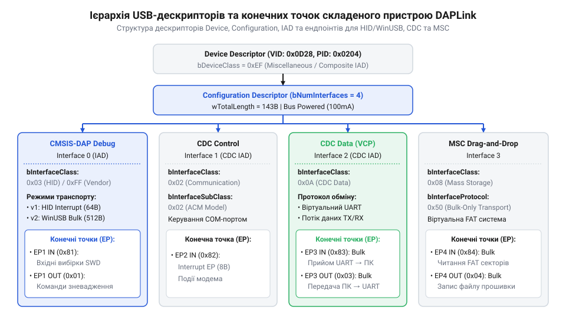
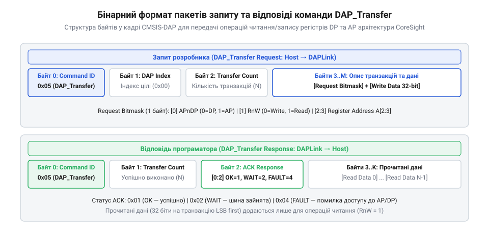
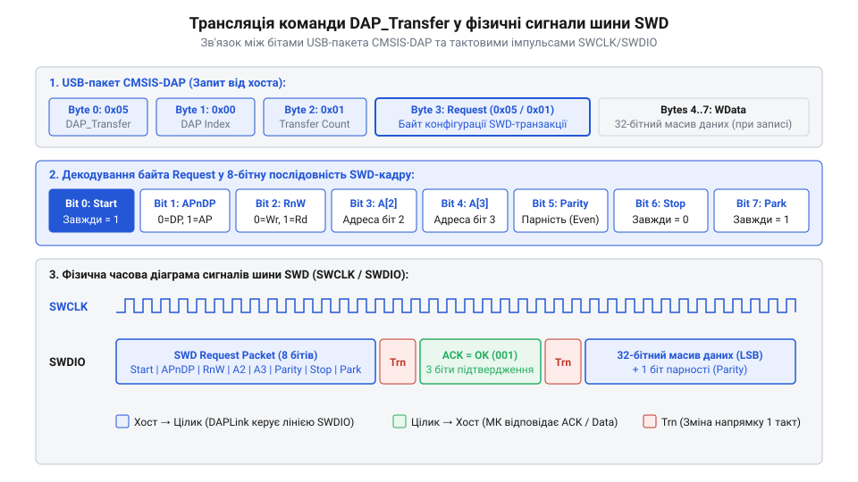

# Протокол CMSIS-DAP та USB-дескриптори DAPLink

<preknowlist>
- [WeAct Mini Debugger (DAPLink / ST-Link V2.1)](root:cat-hw-boards/daplink-debugger) — апаратна архітектура зневаджувача на базі DAPLink та використання сервісних USB-інтерфейсів
- [Фірмова прошивка та протокол ST-Link V2.1](root:cat-hw-boards/stlink-v21-firmware-architecture) — порівняльні особливості реалізації зневаджувальних USB-протоколів та альтернативних прошивок
</preknowlist>

## Проблема уніфікації зневадження та USB-структура

Тривалий час розробка систем на базі мікроконтролерів із ядром @@en|ARM Cortex@@ була прив'язана до закритих вендорських зневаджувачів та пропреітарних драйверів. Кожен виробник апаратного забезпечення використовував власні бінарні протоколи та специфічні драйвери операційної системи. Якщо середовище розробки або утиліта зневадження не мала вбудованого драйвера під конкретний прошивач, робота з мікроконтролером ставала неможливою. Для розв'язання цієї проблеми консорціум ARM розробив відкритий стандарт @@en|CMSIS-DAP@@ (англ. *Cortex Microcontroller Software Interface Standard Debug Access Port*), який визначає уніфікований формат команд керування апаратними виводами зневадження.

Апаратна реалізація стандарту в прошивці @@en|DAPLink@@ (англ. *Debug Access Port Link*) створює на базі USB-інтерфейсу складений пристрій — @@en|Composite Device@@ (англ. *composite*, від латинського *componere* — складати). Це дозволяє операційній системі бачити один фізичний адаптер як групу незалежних логічних пристроїв із власними функціями. Класичний приклад такої апаратної реалізації представляє [зневаджувач DAPLink](root:cat-hw-boards/daplink-debugger), де в одному контролері поєднано функції зневадження та зв'язку.

Архітектура пристрою DAPLink виділяє окремі незалежні канали передачі даних через конечні точки — @@en|endpoints@@ (англ. *endpoints* — кінцеві пункти). Основний канал зневадження працює через інтерфейс @@en|HID@@ або @@en|WinUSB Bulk@@, віртуальний послідовний порт для виводу консольних логів функціонує через клас @@en|CDC@@, а режим прошивання перетягуванням файлів використовує клас @@en|MSC@@. Крім того, наявність додаткових спеціальних дескрипторів відкриває можливість застосування @@en|WebUSB@@ (англ. @@en|Web Universal Serial Bus@@, від @@en|web@@ — мережа), завдяки чому сучасні веб-браузери можуть напряму захоплювати конечну точку зневадження безпосередньо через JavaScript-код без встановлення сторонніх утиліт (типу OpenOCD чи pyOCD) та локальних драйверів. Порівняно з пропреітарними рішеннями, які описує [протокол ST-Link V2.1](root:cat-hw-boards/stlink-v21-firmware-architecture), підхід DAPLink усуває потребу у встановленні спеціалізованих драйверів ядра в операційній системі та спрощує розгортання веб-інструментів прошивання на будь-якій платформі.

Для автоматичного розпізнавання та спливаючої реєстрації пристрою в браузері прошивка @@en|DAPLink@@ реалізує сервісний дескриптор @@en|BOS@@ (англ. @@en|Binary Device Object Store@@ — бінарне сховище об'єктів пристрою). Під час перерахування хост-система зчитує дескриптор BOS, усередині якого розміщено дескриптор можливостей платформи (англ. @@en|Platform Capability Descriptor@@) із фіксованим 128-бітним ідентифікатором @@en|UUID@@ (англ. @@en|Universally Unique Identifier@@ — універсально унікальний ідентифікатор) стандарту @@en|WebUSB@@. Цей дескриптор містить специфічний вендорний код команди `bVendorCode` та індекс цільової веб-сторінки `iLandingPage`. Отримавши ці параметри, браузер надсилає управляючий запит на нулеву конечну точку (Endpoint 0), зчитує закодовану URL-адресу інструменту зневадження та автоматично показує системне сповіщення користувачеві для миттєвого переходу до веб-прошивача без ручного введення адреси.

На рівні внутрішнього розкладника прошивки мікроконтролера програматора надходження кадру на будь-яку з конечних точок викликає переривання USB, після чого дані передаються у відповідну чергу обробки операційної системи реального часу. Окремі потоки виконання для задач зневадження CMSIS-DAP, емуляції файлової системи віртуального диска @@en|FAT@@ та трансляції послідовного буфера CDC ізольовані один від одного. Така буферизація гарантує, що тривала операція запису бінарного файла на накопичувач MSC чи інтенсивний потік логів через CDC-інтерфейс не блокують виконання високопріоритетних команд зневадження на виводах SWD.

## Дескриптори ендпоінтів та транспорти DAPLink

Організація обміну даними в пристроях DAPLink спирається на ієрархію стандартизованих USB-дескрипторів. Під час ініціалізації на шині хост зчитує головний дескриптор конфігурації (Configuration Descriptor), який описує набір доступних інтерфейсів (Interface Descriptors) та пов'язаних із ними конечних точок (Endpoint Descriptors).

*Структурна ієрархія USB-дескрипторів та ендпоінтів складеного пристрою DAPLink.*

Передача зневаджувальних команд CMSIS-DAP здійснюється двома основними транспортними механізмами, параметри яких безпосередньо залежать від швидкісного режиму шини USB та обмежень максимального розміру пакунка (поля @@en|wMaxPacketSize@@ дескриптора конечної точки). У режимі @@en|Full-Speed USB@@ (12 Мбіт/с) граничний розмір пакунка за один кадр обмежений рівно 64 байтами як для переривальних конечних точок (@@en|Interrupt Endpoints@@ в @@en|CMSIS-DAP v1@@ / @@en|HID@@), так і для магістральних (@@en|Bulk Endpoints@@ в @@en|CMSIS-DAP v2@@ / @@en|WinUSB@@). Перехід на режим @@en|High-Speed USB@@ (480 Мбіт/с) збільшує ліміт магістрального пакунка Bulk до 512 байтів за транзакцію, що в поєднанні з відсутністю фіксованої затримки між опитуваннями дає змогу передавати великі масиви даних прошивки без дроблення на дрібні 64-байтові кадри.

1. Перша версія протоколу @@en|CMSIS-DAP v1@@ використовує клас @@en|HID@@ (англ. *Human Interface Device* — пристрій людського інтерфейсу). Команди передаються через переривальні конечні точки @@en|EP IN@@ та @@en|EP OUT@@ у вигляді фіксованих пакетів (наприклад, по 64 байти). Головною перевагою HID є повна відсутність потреби у драйверах в усіх сучасних операційних системах. Однак обмежений розмір кадру та фіксований інтервал опитування шини USB обмеженої швидкості ставлять стелю на максимальну швидкість прошивання.

2. Друга версія протоколу @@en|CMSIS-DAP v2@@ переходить на режим @@en|WinUSB Bulk@@. Використання магістральних конечних точок (Bulk Endpoints) дозволяє передавати пакети довільного розміру (до 512 байт у режимі High-Speed USB) без очікування фіксованих інтервалів опитування. Якщо за класичного транспорту HID v1 реальна швидкість прошивання обмежена значеннями близько 15–30 КБ/с через затримки опитування переривань у 1 мс, то в режимі WinUSB Bulk реальна пропускна здатність передачі даних досягає 200–500 КБ/с під час масового запису у флеш-пам'ять. Це забезпечує максимальну продуктивність шини USB та скорочує час завантаження великих бінарних образів у десятки разів.

Паралельно з дебаг-каналом у дескрипторах DAPLink розводяться сервісні ендпоінти. Клас @@en|CDC-ACM@@ (англ. *Abstract Control Model*) виділяє пару ендпоінтів для емуляції послідовного порту UART, що дозволяє зчитувати текстові логи мікроконтролера без окремого USB-UART адаптера. Клас @@en|MSC@@ (англ. *Mass Storage Class*) реалізує віртуальний диск із файловою системою FAT12, де запис файлу образу у корінь диска ініціює апаратну процедуру прошивання цільового кристала.

## Бінарний формат команд протоколу CMSIS-DAP

Взаємодія між комп'ютером-хостом та мікроконтролером програматора в протоколі @@en|CMSIS-DAP@@ побудована на обміні бінарними пакетами за схемою запит-відповідь. Кожен запит починається з однобайтового ідентифікатора команди (Command ID), за яким ідуть параметри виклику. Відповідь пристрою дублює той самий ідентифікатор у першому байті, що дозволяє хосту однозначно ідентифікувати підтвердження транзакцій.

*Структура бінарних пакетів запиту та відповіді команди DAP_Transfer.*

Специфікація стандарту визначає базовий набір сервісних та зневаджувальних команд:

1. `@@en|DAP_Connect@@` (`0x02`): ініціалізує фізичний порт зв'язку. Вхідний параметр задає бажаний режим (`0x01` для @@en|SWD@@ або `0x02` для JTAG), а у відповідь пристрій повертає бітову маску фактично активованого порту.
2. `@@en|DAP_Disconnect@@` (`0x03`): завершує сесію зневадження та переводить виводи програматора у високоімпедансний стан.
3. `@@en|DAP_SWJ_Clock@@` (`0x11`): налаштовує тактову частоту шини у герцах. Передає 32-бітне ціле число (`uint32_t`), за яким адаптер обчислює дільники внутрішнього таймера тактування виводу SWCLK.
4. `@@en|DAP_Transfer@@` (`0x05`): ключова команда для читання й запису регістрів. Запит містить індекс цільового порту, кількість транзакцій та послідовність 8-бітних заголовків запитів. Заголовки визначають тип порту (DP чи AP), напрямок передачі (Read чи Write) та 2-бітний індекс регістру A[2:3]. У відповіді адаптер повертає кількість успішно виконаних операцій, код підтвердження та масив зчитаних 32-бітних значень.

Для оптимізації затримок на шині USB специфікація додає розширення `@@en|DAP_ExecuteCommands@@` (`0x7F`). Воно дозволяє упакувати кілька послідовних команд CMSIS-DAP в один кадр USB-передачі, що суттєво прискорює ініціалізацію зневаджувача та зчитування блоків пам'яті. Такий самий підхід пакетування реалізовано й в альтернативних прошивках, про що свідчить [протокол ST-Link V2.1](root:cat-hw-boards/stlink-v21-firmware-architecture).

Окремим механізмом апаратного прискорення в рамках команд передачі є очікування зміни стану регістрів @@en|ARM CoreSight@@ без постійного опитування з боку ПК. Зазвичай для перевірки готовності периферії або завершення стирання флешпам'яті хост змушений у циклі надсилати запити читання, втрачаючи час на кругову затримку кадру шини @@en|USB@@. Щоб усунути це накладне навантаження, протокол передає маску збігу @@en|Match Mask@@ (від англ. *match* — збіг, відповідність та *mask* — маска) та лічильник повторів @@en|Match Retry@@ (від англ. *retry* — повторна спроба). Прошивка програматора застосовує побітову маску до зчитаного значення регістру @@en|DP@@ або @@en|AP@@, порівнює результат із очікуваним шаблоном і, у разі розбіжності, самостійно повторює зчитування безпосередньо по шині @@en|SWD@@ до @@en|Match Retry@@ разів. Лише після успішного збігу або вичерпання ліміту спроб адаптер формує підсумкову відповідь хосту, що скорочує затримки очікування прапорців готовності з мілісекунд до кількох мікросекунд.

У разі виникнення таймінгових затримок або апаратних збоїв цільового мікроконтролера під час виконання групового кадру `@@en|DAP_Transfer@@`, прошивка адаптера негайно перериває обробку подальших команд у пакеті. У байті статусу відповіді повертається фактична кількість успішно завершених транзакцій та код підтвердження: `0x01` (ACK OK), `0x02` (ACK WAIT) або `0x04` (ACK FAULT). Якщо цільовий корпус повертає стан зайнятості `ACK WAIT`, програматор автоматично повторює транзакцію на фізичному рівні до досягнення ліміту спроб, заданого через `@@en|DAP_TransferConfigure@@`. Якщо ж виникає помилка `ACK FAULT`, хост-драйвер отримує точну кількість виконаних кроків і надсилає скидання помилкових прапорців через регістр `ABORT`, після чого відновлює виконання сесії. Для зчитування або запису суцільних масивів оперативної пам'яті виклики `@@en|DAP_Transfer@@` стають неефективними через накладні витрати на повторення дескрипторів кожної транзакції. У таких завданнях використовують спеціалізовану команду блокового обміну `@@en|DAP_TransferBlock@@` (`0x06`). Хост передає єдиний 8-бітний заголовок запиту до регістру даних `DRW` (англ. @@en|Data Read/Write@@, від @@en|data@@ — дані, @@en|read@@ — читати, @@en|write@@ — писати) порту доступу @@en|AP@@, 16-бітну кількість 32-бітних слів (Transfer Count) та початкову адресу. Завдяки режиму автоінкременту адреси в регістрі `TAR` (англ. @@en|Transfer Address Register@@, від @@en|transfer@@ — передача, @@en|address@@ — адреса, @@en|register@@ — регістр) протоколу @@en|ARM CoreSight@@, прошивка програматора зчитує весь масив пам'яті на максимальній швидкості шини @@en|SWD@@ без проміжних заголовків. У відповіді `@@en|DAP_TransferBlock@@` адаптер повертає кількість фактично прочитаних слів, байт статусу виконання та послідовний масив 32-бітних значень. Якщо під час читання блоку виникає збій шини (наприклад, звернення до незадійсненої області пам'яті викличе `ACK FAULT`), операція негайно припиняється, а повернутий лічильник показує точну кількість слів, прочитаних до моменту аварії.

## Трансляція команд у транзакції CoreSight

Отримавши пакет `DAP_Transfer`, прошивка програматора транслює високорівневі аргументи у фізичні послідовності сигналів шини zневадження. В архітектурі @@en|ARM CoreSight@@ керування кристалом розділено між двома типами портів: портом зневадження @@en|DP@@ (англ. *Debug Port*) та портом доступу @@en|AP@@ (англ. *Access Port*). Порт DP відповідає за стан зневаджувального зв'язку, лінії живлення ядра та вибір активного порту AP за допомогою регістру `DP_SELECT`. Порт AP (наприклад, @@en|MEM-AP@@) забезпечує безпосередній доступ до системної шини мікроконтролера, внутрішньої пам'яті та периферійних регістрів.

*Часова діаграма трансляції команди DAP_Transfer у виклики шини SWD.*

Під час виконання команди прошивка виконує такі послідовні апаратні дії:

Часова тривалість фази зміщення напрямку лінії @@en|SWDIO@@ під час переходу між запитом і відповіддю безпосередньо залежить від заданої частоти тактування `f_SWCLK` та кількості конфліктно-безпечних тактів @@en|Turnaround Cycles@@ (`N_Trn`, за замовчуванням 1 такт). Зміна напрямку відбуваються двічі за транзакцію читання — перед прийомом статусу @@en|ACK@@ та після зчитування даних, а абсолютна часова затримка `t_Trn` у наносекундах розраховується як добуток кількості тактів `N_Trn` на період тактового сигналу `T_SWCLK = 1 ÷ f_SWCLK`:

        T_SWCLK
        = 1 ÷ f_SWCLK                 [період тактового сигналу в секундах]
        = 1 ÷ 10000000                [підстановка частоти 10 МГц]
        = 0.0000001                   [тривалість такту у секундах]
        = 100                         [тривалість одного такту у наносекундах]

        t_Trn
        = N_Trn × T_SWCLK             [тривалість інтервалу зміни напрямку]
        = 1 × 100                     [підстановка для одного циклу Trn]
        = 100                         [часова затримка лінії SWDIO у наносекундах]

При високій частоті 10 МГц тривалість паузи перемикання `t_Trn` становить лише 100 нс, тоді як на стандартній частоті 1 МГц вона зростає до 1000 нс (1 мкс). Якщо через високу паразитну ємність довгого кабелю конфігурацію розширено до `N_Trn = 4` тактів, затримка безпечного переходу лінії у стан @@en|High-Z@@ збільшується до 400 нс на частоті 10 МГц, забезпечуючи надійне вирівнювання потенціалів перед активацією передавача протилежної сторони.

1. Якщо адреса запиту вказує на порт AP, а поточний стан регістру `DP_SELECT` відповідає іншому банку регістрів, мікроконтролер програматора спочатку примусово виконує запис у `DP_SELECT`.
2. На виводах SWCLK та SWDIO формується 8-бітний заголовок пакету SWD, який складається зі старт-біта (1), біта вибору порту (0 для DP, 1 для AP), біта напрямку (0 для Write, 1 for Read), двох бітів адреси A[2:3], біта парності та стоп-бітів.
3. Програматор очікує від цільового кристала 3-бітне підтвердження @@en|ACK@@ (англ. *Acknowledge* — підтвердження). При отриманні статусу `OK` (0b001) адаптер продовжує тактування та передає або зчитує 32 біти даних із бітом перевірки парності.
4. Якщо кристал повертає статус `WAIT` (0b010), це свідчить про зайнятість внутрішньої шини CoreSight. Програматор переходить через цикли зміни напрямку шини @@en|Turnaround Cycles@@ (1–4 такти SWCLK для безпечного перемикання лінії SWDIO) і запускає серію автоматичних повторних спроб відповідно до заданого лічильника ретраїв. Лише якщо після вичерпання дозволеної кількості повторів кристал не відновлює готовність або повертає статус `FAULT` (0b100), адаптер остаточно перериває серію, фіксує помилку у відповіді `DAP_Transfer` і повертає хосту кількість успішно виконаних транзакцій до моменту збою.

Пряма трансляція пакетів у сигнали шини дозволяє інструментам розробки зчитувати стан регістрів процесора й пам'яті «на льоту», що демонструє апаратна архітектура, яку має [зневаджувач DAPLink](root:cat-hw-boards/daplink-debugger).

## Діагностика трафіку та обробка помилок

Під час практичної роботи з мікроконтролерами розробники нерідко стикаються з раптовими обривами зв'язку, таймаутами зневадження або помилками запису флеш-пам'яті. Утиліти @@en|OpenOCD@@ та @@en|pyOCD@@ у таких випадках виводять у консоль повідомлення виду `CMSIS-DAP command DAP_TRANSFER failed` або `SWD DPACK FAULT`. Для швидкого усунення несправностей необхідно розрізняти апаратні збої лінії зв'язку та протокольні помилки на рівні USB.

Первинним джерелом помилок на фізичному рівні є надмірна частота тактування шини @@en|SWCLK@@ або велика довжина з'єднувальних дротів. Якщо мікроконтролер перебуває у стані глибокого енергозбереження (Deep Sleep) або його системні тактові генератори вимкнені, його порт зневадження повертає статус @@en|WAIT@@ (0b010) чи @@en|FAULT@@ (0b100) у відповідь на виклики `@@en|DAP_Transfer@@`. Для відновлення доступу хост-програма знижує частоту через команду `@@en|DAP_SWJ_Clock@@`, ініціює апаратний скид цільового кристала перед підключенням (режим Connect Under Reset) або виконує програмне скидання ядра. Якщо інтерфейс зневадження розсинхронізувався чи заблокувався в режимі @@en|JTAG@@, хост-відлагоджувач видає команду `@@en|DAP_SWJ_Sequence@@` із магічною 16-бітовою послідовністю перемикання `0xE79E` (англ. @@en|SWJ-DP Switch Sequence@@), яка передує лінійному скиду шини та змушує відлагоджувальний порт кристала примусово перемкнутися в режим @@en|SWD@@.

Для глибокого аналізу непрозорих помилок застосовують аналізатори USB-трафіку (наприклад, @@en|Wireshark@@ з модулем USBPcap). Захоплення пакетів на конечних точках дозволяє зіставити відправлені байтові кадри команд із відповідями програматора. Порівнюючи часові інтервали відповідей адаптера, описуваного матеріалом [зневаджувач DAPLink](root:cat-hw-boards/daplink-debugger), із пропреітарними алгоритмами, які має [протокол ST-Link V2.1](root:cat-hw-boards/stlink-v21-firmware-architecture), розробник може точно визначити, на якій саме транзакції відбувається обрив сесії.

Якщо аналіз дампа USB-трафіку виявляє статус тупикового стану `@@en|STALL@@` на ендпоінті (наприклад, WinUSB Bulk IN чи OUT), це свідчить про апаратне зависання обробника команд у прошивці програматора або про розсинхронізацію послідовності тумблера даних (Data Toggle). Для програмного виходу з такого стану хост-утиліта надсилає керуючий запит `@@en|CLEAR_FEATURE@@` із прапорцем `@@en|ENDPOINT_HALT@@`, що скидає апаратне блокування конечної точки без потреби фізичного перепідключення USB-кабелю. Після очищення стану ендпоінта хост повторно викликає `@@en|DAP_Connect@@`, відновлюючи логічний канал зв'язку та продовжуючи перервану сесію зневадження.

Окремим випадком хибної поведінки протоколу є виникнення фатального винятку `@@en|HardFault@@` у цільовому мікроконтролері під час виконання апаратного запиту. Якщо ядро перериває виконання через спробу доступу до незадіяної адреси чи невирівняне зчитування, порт `@@en|MEM-AP@@` блокує подальші шинні транзакції й повертає код підтвердження `ACK FAULT` на кожну наступну команду `DAP_Transfer`. Для діагностики причин зависання хост-програма першочергово зчитує прапорець апаратної помилки `@@en|STICKYERR@@` у керуючому регістрі `@@en|CTRL/STAT@@` порту `DP`. Якщо прапор збереження помилки активовано, зневаджувач очищає його бітом `@@en|STICKYERRCLR@@` у регістрі `@@en|ABORT@@`, після чого зчитує регістри системного блоку керування `@@en|SCB@@` (від англ. *System Control Block* — системний блок керування) ядра Cortex-M: регістр стану збоїв `@@en|CFSR@@` (від англ. *Configurable Fault Status Register* — регістр стану налаштовуваних збоїв) та регістр адреси шинного збою `@@en|BFAR@@` (від англ. *BusFault Address Register* — регістр адреси шинного збою). Аналіз значення `CFSR` дозволяє розрізнити точний шинний збій від помилки вирівнювання або інструкції без процесорних прав, а адреса з `BFAR` вказує на конкретний периферійний регістр чи ділянку пам'яті, спроба звернення до якої викликала завісання системи.
