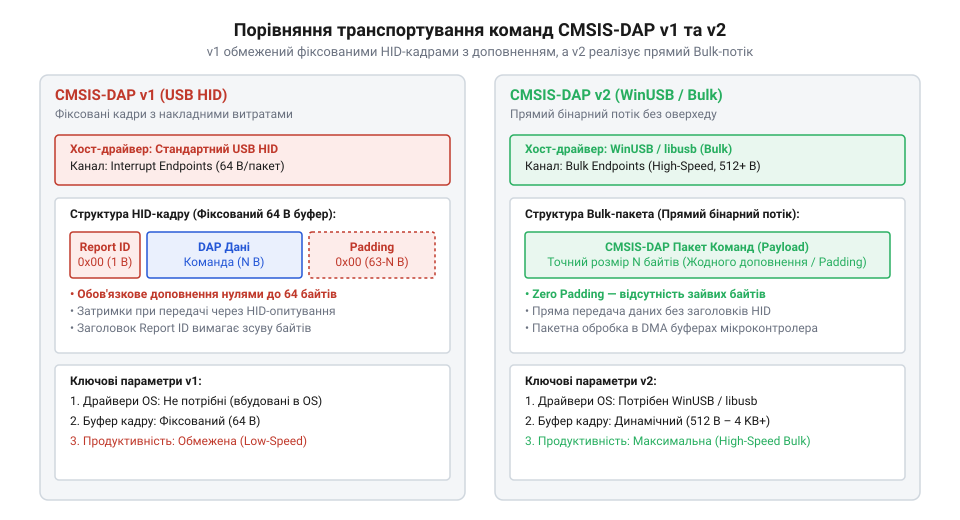

# Програмний протокол і командна специфікація CMSIS-DAP v1/v2

<preknowlist>
- [WeAct Mini Debugger (DAPLink / ST-Link V2.1)](root:cat-hw-boards/daplink-debugger) — апаратна структура програматора DAPLink та фізичне призначення виводів ліній зневадження SWD/JTAG.
</preknowlist>

## Проблема прямих драйверів зневадження

Розробка апаратного забезпечення та прошивок для мікроконтролерів вимагає постійного контролю стану внутрішніх регістрів ядра, читання оперативної пам'яті та запису бінарного коду у флеш-пам'ять. Без стандартизованого програмного інтерфейсу кожен виробник зневаджувального обладнання створює власний проприєтарний протокол обміну даними через @@en|USB@@ (від англ. @@en|Universal Serial Bus@@, від латинського *universalis* — загальний). У такій системі інтегрована середовище розробки (англ. @@en|IDE@@, від англ. @@en|Integrated Development Environment@@) або утиліта автоматизованого тестування змушена містити окремі низькорівневі драйвери під кожен конкретний програматор. Найменша зміна ревізії чіпа чи перехід на альтернативний адаптер вимагає переписати модулі сполучення, що створює монопольну прив'язку до фірмового інструментарію та призводить до збоїв при зміні апаратного забезпечення.

Кожен проприєтарний драйвер безпосередньо кодує низькорівневі часові діаграми сигналів шини зневадження у сирі пакети. Це змушує комп'ютер керувати кожним зміщенням рівня на фізичних лініях, генеруючи величезний надлишковий трафік. Відсутність уніфікованої абстракції унеможливлює створення універсальних відкритих флешерів. Для вирішення цієї проблеми розроблено протокол @@en|CMSIS-DAP@@ (від англ. @@en|Cortex Microcontroller Software Interface Standard Debug Access Port@@, від латинського *de-* — зняття та англійського *bug* — жук). Він виносить усю часову логіку та керування послідовностями сигналів у прошивку самого програматора, надаючи хосту високорівневий бінарний інтерфейс. На відміну від специфічних реалізацій, якими вирізняється [фірмова прошивка ST-Link V2.1](root:cat-hw-boards/stlink-v21-firmware-architecture), стандарт @@en|CMSIS-DAP@@ перетворює уніфіковані команди хоста на апаратні маніпуляції з лініями шини на [програматорі DAPLink](root:cat-hw-boards/daplink-debugger).

## Транспортний рівень v1 та v2

Після прийняття єдиної системи команд постає завдання їхнього транспортування між хостом та мікроконтролером програматора через шину @@en|USB@@. Протокол @@en|CMSIS-DAP@@ визначає дві версії транспортного рівня, які відрізняються використаними класами пристроїв та механізмами кадрування.

У першій версії протоколу (v1) обмін даними здійснюється через стандартний клас @@en|USB HID@@ (від англ. @@en|Human Interface Device@@, від латинського *humanus* — людський та *facies* — обличчя). Головна перевага цього підходу — відсутність потреби у встановленні сторонніх драйверів в операційній системі. Проте специфікація @@en|USB HID@@ вимагає передачі даних фіксованими репортами (найчастіше по 64 байти). Якщо хосту потрібно надіслати коротку команду довжиною у 4 байти, решту 60 байтів кадру доводиться заповнювати нульовими байтами розширення (англ. @@en|padding bytes@@). Крім того, пересилання HID-репортів прив'язане до періодичних інтервалів опитування переривань шини (англ. @@en|USB Interrupt endpoints@@), що створює додаткові часові затримки при масовому зчитуванні пам'яті.

Друга версія протоколу (v2) переходить на використання високошвидкісних ендпоінтів @@en|WinUSB Bulk@@ (від англ. @@en|Windows USB@@ та англійського *bulk* — масовий). Використання каналів @@en|Bulk@@ усуває обмеження фіксованого розміру кадру: байти кожної команди передаються послідовно один за одним без байтів-заповнювачів. Це дозволяє повністю утилізувати пропускну здатність @@en|USB 2.0 High-Speed@@ (до 480 Мбіт/с) та знизити затримку передачі до мінімуму.

*Порівняння форматів кадрування CMSIS-DAP v1 та v2 наочно демонструє усунення фіксованого заповнення 64-байтових HID-репортів у високошвидкісних Bulk-ендпоінтах WinUSB.*

Кожен пакет обидвох версій починається з однобайтового ідентифікатора команди (англ. @@en|Command ID@@). Якщо хост надсилає запит, першим байтом іде код потрібної операції, після якого розміщуються її параметри. Програматор у відповідь повертає кадр, що починається з того самого ідентифікатора команди, після якого ідуть байти стану виконання та запитані дані.

## Команди ініціалізації та налаштування шини

Перш ніж виконувати операції читання чи запису в пам'ять цільового чіпа, хост мусить встановити логічний зв'язок із програматором і відкалібрувати параметри фізичної шини. Для цього використовується група команд ініціалізації.

Процедура активації починається з команди `DAP_Connect` (ідентифікатор `0x02`). Хост передає в параметрі бажаний тип фізичного інтерфейсу: `0x01` для шини @@en|SWD@@ (від англ. @@en|Serial Wire Debug@@) або `0x02` для шини @@en|JTAG@@ (від англ. @@en|Joint Test Action Group@@). Програматор ініціалізує відповідні виводи та повертає код підтвердження з байтом активного режиму. Якщо фізичне підключення відсутнє або інтерфейс не підтримується, повертається значення `0x00`.

Після вибору інтерфейсу хост налаштовує тактову частоту лінії за допомогою команди `DAP_SWJ_Clock` (ідентифікатор `0x11`). Команда приймає 32-бітне ціле число без знаку у форматі @@en|Little-Endian@@, яке задає тактову частоту сигналів `SWCLK` або `TCK` у герцах. Хост розраховує це значення на основі максимально припустимої частоти цільового мікроконтролера та довжини фізичного шлейфу.

Далі здійснюється параметризація таймінгів за допомогою команди `DAP_TransferConfigure` (ідентифікатор `0x04`). Ця команда визначає поведінку програматора при виникненні затримок з боку цільового чіпа:

- **@@en|Idle Cycles@@** (1 байт): кількість порожніх тактових імпульсів, які програматор додає після кожного трансферу даних.
- **@@en|Retry Count@@** (2 байти): максимальна кількість автоматичних повторних спроб, які програматор здійснює при отриманні відповіді про зайнятість чіпа.
- **@@en|Match Retry@@** (2 байти): кількість повторів при очікуванні збігу значення з маскою при читанні.

Завдяки команді `DAP_TransferConfigure` повторні спроби читання реалізуються апаратно всередині мікроконтролера програматора, що позбавляє хост від необхідності надсилати повторні @@en|USB@@-пакети при короткочасній зайнятості ядра.

## Структура команд читання та запису

Після успішного налаштування шини хост переходить до комутації з регістрами внутрішньої архітектури зневадження @@en|ARM CoreSight@@ (від англ. *core* — ядро та *sight* — бачення). Специфікація розрізняє два типи регістрів: регістри порту зневадження @@en|Debug Port@@ (від латинського *portus* — гавань), що керують станом сесії, та регістри порту доступу @@en|Access Port@@ (від латинського *accessus* — підхід), через які здійснюється доступ до системної шини та пам'яті мікроконтролера.

Основною робочою командою протоколу є `DAP_Transfer` (ідентифікатор `0x05`). Вона дозволяє згрупувати кілька послідовних операцій читання та запису в один бінарний пакет.

*Діаграма бінарної структури DAP_Transfer ілюструє розміщення бітів напрямку, вибору порту DP/AP та адреси регістру в запиті хоста.*

Кожен байт запиту операції у структурі `DAP_Transfer` кодує параметри звернення за допомогою бітової маски:

- **Біт 0** (англ. @@en|Direction@@): `0` — операція запису, `1` — операція читання.
- **Біт 1** (англ. @@en|Port Select@@): `0` — звернення до регістру @@en|Debug Port@@ (DP), `1` — звернення до регістру @@en|Access Port@@ (AP).
- **Біти 2–3** (англ. @@en|Address A[2:3]@@): адреса регістру всередині обраного банку (`0x00`, `0x04`, `0x08` або `0x0C`).
- **Біт 4** (англ. @@en|Value Match@@): вимога порівняння зчитаного значення з заданим шаблоном.
- **Біт 5** (англ. @@en|Match Mask@@): використання маски при виконанні порівняння.

Для операцій запису одразу після байта маски в пакеті додається 32-бітне значення у форматі @@en|Little-Endian@@. Для операцій читання зчитані дані повертаються у масиві відповіді у тій самій послідовності.

Низькорівневе формування пакетів у хост-драйвері реалізується мовами C та C++:

:::tabs
@tab C
:::code api-cmsis-dap-protocol/c/build-dp-write-request.c
@tab C++
:::code api-cmsis-dap-protocol/cpp/daptransferbuilder.cpp
:::

Для мінімізації накладних витрат шини при передачі серії різнотипних команд специфікація надає команду `DAP_ExecuteCommands` (ідентифікатор `0x7F`). Вона дозволяє упакувати кілька незалежних команд протоколу в один фізичний кадр @@en|USB@@.

## Інтерпретація відповідей та обробка збоїв

У процесі виконання трансферів цільовий мікроконтролер може перебувати у стані зниженого енергоспоживання, виконувати тривалу операцію стирання флеш-пам'яті або зазнавати впливу електромагнітних завад. Хост-драйвер мусить правильно інтерпретувати байти підтвердження та забезпечувати відновлення зв'язку при апаратних збоях.

У відповіді на команду `DAP_Transfer` програматор повертає байт статусу підтвердження (англ. @@en|ACK Status@@, від англ. @@en|Acknowledge@@):

- **`0x01` (@@en|OK@@)**: операція виконана успішно, дані у відповіді є дійсними.
- **`0x02` (@@en|WAIT@@)**: цільове ядро зайняте і не змогло прийняти або надати дані.
- **`0x04` (@@en|FAULT@@)**: виникла апаратна помилка шини або спроба доступу за незахищеною адресою.
- **`0x08` (@@en|NO_ACK@@)**: цільовий мікроконтролер не дав жодної відповіді на лінії (відсутність живлення або обрив провідників).

При отриманні статусу `WAIT` прошивка програматора спочатку виконує цикл повторних спроб відповідно до лічильника `Retry Count`. Якщо лічильник вичерпано, хост-драйвер мусить виконати скидання прапорців зайнятості, надіславши запис значення `0x50000000` у регістр `CTRL/STAT` порту @@en|Debug Port@@.

При отриманні статусу `FAULT` хост зчитує регістр статусу для визначення причини відмови (наприклад, помилка вирівнювання адреси або збій шини @@en|AHB/APB@@), після чого очищає прапорці помилок (англ. @@en|STICKYERR@@) шляхом запису у регістр `ABORT`.

Якщо ж виникає статус `NO_ACK` або таймаут передачі по @@en|USB@@, хост проводить процедуру апаратного скидання лінії зневадження без вимикання живлення програматора. Для цього надсилається команда `DAP_SWJ_Sequence`, яка формує не менше 50 тактових імпульсів високого рівня на лінії `SWDIO`, повертаючи апаратний порт зневадження чіпа у вихідний стан готовності.
