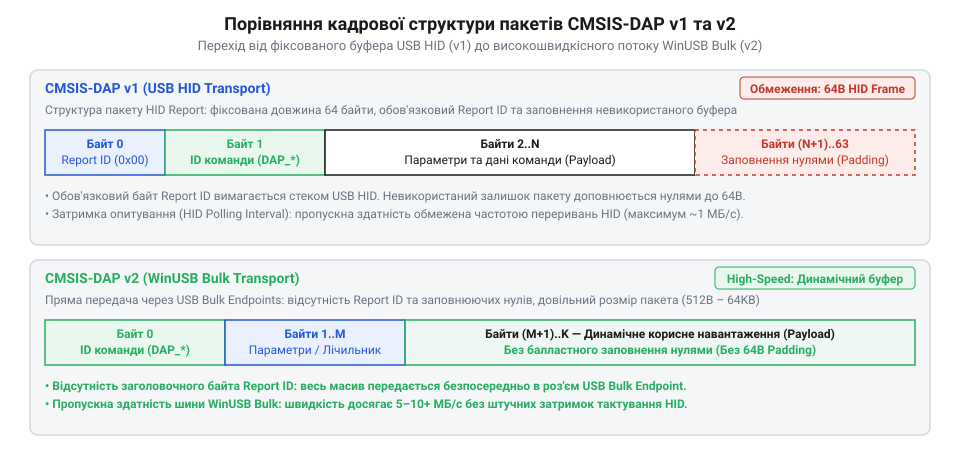
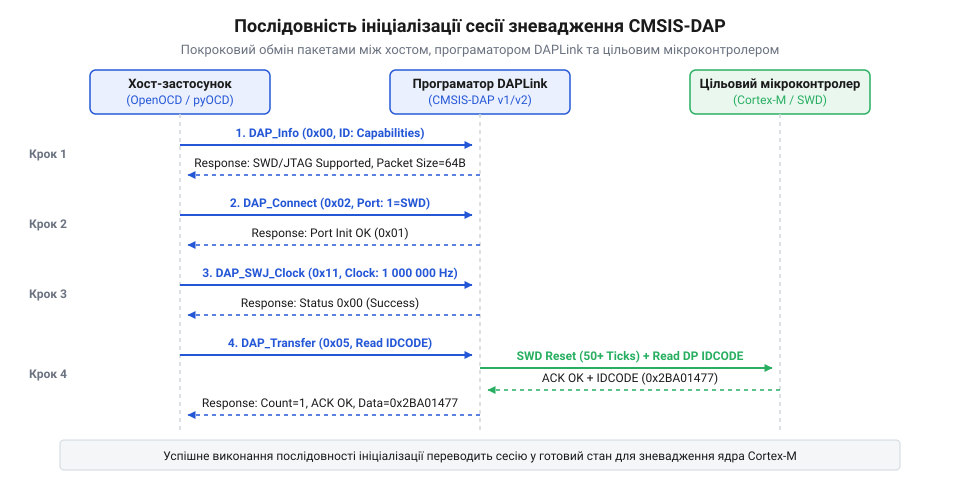
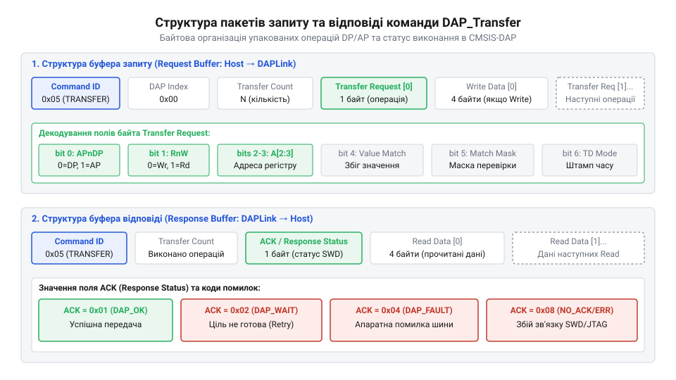
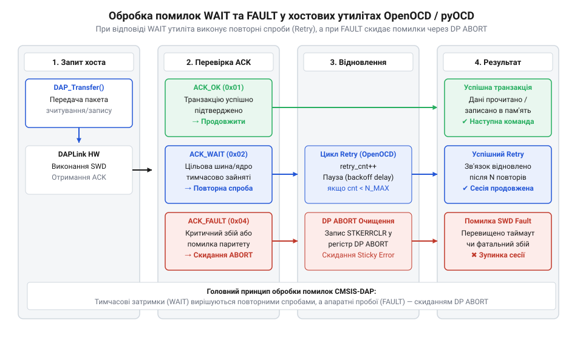

# Програмний протокол команд CMSIS-DAP та структура USB-пакетів

<preknowlist>
- [WeAct Mini Debugger (DAPLink / ST-Link V2.1)](root:cat-hw-boards/daplink-debugger) — Апаратне підключення програматора DAPLink та призначення виводів SWD/JTAG для розуміння середовища виконання команд.
- [Фірмова прошивка та протокол ST-Link V2.1](root:cat-hw-boards/stlink-v21-firmware-architecture) — Альтернативні протоколи зневадження та відмінності між прошивкою ST-Link і стандартом CMSIS-DAP.
</preknowlist>

## Проблема повільного зневадження та нестандартних протоколів

Пряме керування лініями фізичного інтерфейсу зневадження мікроконтролера через послідовний порт шини @@en|USB@@ створює суттєві затримки (від англ. @@en|latency@@, лат. *latentia* — прихований стан). Кожна зміна стану сигналів @@en|SWCLK@@ (від англ. *Serial Wire Clock* — тактовий сигнал послідовного інтерфейсу) чи @@en|SWDIO@@ (від англ. *Serial Wire Data Input/Output* — двонаправлена лінія даних) вимагає окремої транзакції на шині. При програмному обчисленні фронтів через @@en|bit-banging@@ (від англ. *bit-banging* — програмне побітове формування сигналів) передача одного біта вимагає щонайменше трьох послідовних @@en|USB@@-пакетів для встановлення рівня даних, підйому та спаду тактового імпульсу. Фізичний рівень @@en|USB Full-Speed@@ передає диференційні (від латинського @@la|differentia@@ — відмінність) сигнали через лінійні провідники D+ та D- з диференційним опором 90 Ом на базовій швидкості 12 Мбіт/с (тривалість біта близько 83.33 нс). Однак апаратна архітектура шини квантує передачу кадрів за допомогою міжкадрових інтервалів тривалістю 1 мілісекунда. При прямому @@en|bit-banging@@ формування одного 45-бітного кадру @@en|SWD@@ (ініціалізація, 8 бітів запиту, 3 біти квитування, 32 біти даних та інверсний паритет) вимагає `45 × 3 = 135` окремих @@en|USB@@-транзакцій. За мінімальної затримки в 1 мілісекунду на пакет повний переданий кадр вимагає `135` мілісекунд, через що підсумкова швидкість обміну падає нижче `300` байт на секунду, а реальна швидкість прошивки пам'яті сповільнюється до кількох кілобайт на секунду.

Історично кожен виробник апаратних засобів створював власний вендорний протокол зневадження. Наприклад, класичні рішення реалізовували бінарний обмін через закриті прошивки, що вимагало встановлення унікальних системних драйверів у хостовій операційній системі. Прикладом такого підходу є використання [фірмової прошивки ST-Link](root:cat-hw-boards/stlink-v21-firmware-architecture), яка зв'язує хостову утиліту з конкретним апаратним середовищем через проприєтарні команди. У результаті відлагоджувальні утиліти на кшталт @@en|OpenOCD@@ або @@en|pyOCD@@ змушені були підтримувати десятки окремих драйверів під кожен тип апаратного відлагоджувача.

Відсутність єдиного стандарту адресації регістрів і керування шиною робить неможливим універсальне об'єднання інтерфейсів. Для швидкого й надійного зневадження потрібен уніфікований програмний протокол, який агрегує низькорівневі послідовності команд @@en|SWD@@ (від англ. *Serial Wire Debug*) та @@en|JTAG@@ у компактні байтові пакети й передає їх через кадри шини @@en|USB@@ за одну мережеву транзакцію.

## Архітектура транспорту CMSIS-DAP v1 та v2

Стандарт @@en|CMSIS-DAP@@ (від англ. *Cortex Microcontroller Software Interface Standard Debug Access Port*) розв'язує проблему сумісності шляхом стандартизації структури байтових кадрів, які передаються між хостом і мікроконтролером програматора. Для транспортування цих кадрів через шину @@en|USB@@ застосовують дві різні версії архітектури, які відрізняються використаним класом пристрою та продуктивністю.

Перша версія стандарту, @@en|CMSIS-DAP v1@@, будується на базі класу пристроїв @@en|USB HID@@ (від англ. *Human Interface Device*). Головна перевага цього підходу — повна відсутність потреби у встановленні сторонніх драйверів в операційній системі хоста, оскільки підтримка @@en|HID@@ вбудована за замовчуванням. Передача команд виконується через кінцеві точки переривань або за допомогою керуючих звітів @@en|HID Feature Report@@: кожен пакет обов'язково починається з байта ідентифікатора звіту @@en|Report ID@@ (зазвичай `0x00`), після якого слідують байти команди. Специфікація кінцевих точок переривань @@en|USB HID Interrupt Endpoints@@ та структур звітів обмежує максимальний розмір одного кадру 64 байтами для пристроїв @@en|Full-Speed USB@@ зі швидкістю 12 Мегабіт на секунду. Крім того, виклики керуючих запитів `Set_Report` та `Get_Report` через керуючу кінцеву точку @@en|Control Endpoint@@ вимагають системного фазового узгодження та обробки дескрипторів операційною системою. Інтервал опитування цих точок жорстко задається у дескрипторі кінцевої точки (англ. *descriptor* — описувач, @@en|Endpoint Descriptor@@) за допомогою поля @@en|bInterval@@. Для забезпечення мінімальної затримки пристрої конфігурують значення `bInterval = 1`, що зобов'язує планувальник шини хоста звертатися до пристрою не частіше ніж один раз на 1 мілісекунду. У результаті періодичне опитування (англ. *poll* — опитування, @@en|polling@@) у поєднанні з накладними витратами обгортки звітів створює фіксоване апаратне обмеження темпу передачі: навіть за нульового завантаження мікроконтролера програматора реальна пропускна здатність не перевищує 64 кілобайти на секунду, створюючи суттєві затримки при зчитуванні великих буферів пам'яті — на відміну від прямого транспорту @@en|WinUSB Bulk@@, де сирий потік даних передається суцільними блоками по 512 байтів без інтервальних затримок та заголовків HID.

Для подолання цих обмежень було розроблено версію @@en|CMSIS-DAP v2@@, яка переходить на транспорт @@en|WinUSB@@ із використанням каналів @@en|Bulk transfer@@. Канали типу @@en|Bulk@@ дозволяють передавати буфери розміром 512 байт і більше для пристроїв @@en|High-Speed USB@@ (480 Мегабіт на секунду) без часових затримок періодичного опитування. Завдяки цьому пропускна здатність зневадження зростає в кілька разів, що критично для зчитування великих масивів пам'яті. Сучасний [апаратний програматор DAPLink](root:cat-hw-boards/daplink-debugger) підтримує саме цю версію транспорту для забезпечення максимальної швидкості роботи.


*Порівняння байтової структури кадру CMSIS-DAP v1 (USB HID) та v2 (WinUSB Bulk) з виділенням полів ID команди, довжини буфера та корисного навантаження.*

Кожен пакет @@en|CMSIS-DAP@@ має чітко визначену байтову структуру. Перший байт пакета містить ідентифікатор команди @@en|Command ID@@, за яким ідуть параметри виклику та розмір корисного навантаження. Приймальний пристрій формує відповідь у тому самому буфері, зберігаючи першим байтом код виконаної команди. Для максимальної ефективності хостове програмне забезпечення узгоджує розмір пакета під час ініціалізації сесії.

Структура байтового заголовка пакетів запиту реалізується на мовах @@en|C@@ та @@en|C++@@ наступним чином:

:::tabs
@tab C
```c
// Заголовок пакету CMSIS-DAP v1 / v2 у C
#include <stdint.h>

typedef struct __attribute__((packed)) {
    uint8_t command_id;    // Ідентифікатор команди DAP
    uint8_t transfer_num;  // Кількість передач у пакеті
    uint8_t dap_index;     // Індекс порту DAP
} dap_packet_header_t;
```
@tab C++
```cpp
// Заголовок пакету CMSIS-DAP v1 / v2 у C++
#include <cstdint>
#include <cstddef>

struct alignas(1) DapPacketHeader {
    std::uint8_t command_id;    // Ідентифікатор команди DAP
    std::uint8_t transfer_num;  // Кількість передач у пакеті
    std::uint8_t dap_index;     // Індекс порту DAP
};
```
:::

Вибір між версіями v1 та v2 визначається вимогами до простоти підключення та швидкості. Версія v1 оптимальна для простих утиліт без встановлення драйверів, тоді як v2 є стандартом для швидкісного зневадження в професійних середовищах розробки.

## Ініціалізація сесії та конфігурування шини

Перед тим як виконувати читання пам'яті чи керування процесорним ядром, хостова програма мусить узгодити апаратний режим зв'язку з програматором. На надсилання випадкових команд непідготовлений пристрій відповідає помилкою, оскільки виводи програматора перебувають у стані високого імпедансу, а внутрішній дільник тактової частоти не налаштований.


*Послідовність команд ініціалізації сесії та встановлення тактової частоти шини зневадження.*

Ініціалізація починається з надсилання команди `DAP_Info` (байт ідентифікатора `0x00`), яка приймає байт селектора @@en|Info ID@@ і повертає апаратні та програмні параметри програматора. Структура відповіді пристрою містить байт ідентифікатора підтвердження `0x00`, байт довжини корисних даних `L` та самі дані. Зокрема, селектор `0xFF` повертає двохбайтове ціле число розміру пакета USB, селектори `0x01`–`0x03` — текстові ASCII-рядки назви вендора, продукту й серійного номера, а селектор `0xF0` повертає ASCII-рядок версії протоколу (наприклад, `"1.1.0"` або `"2.1.0"`). Поле версії протоколу є вирішальним для хоста, оскільки рядок `"2.x"` сигналізує про підтримку транспорту WinUSB/Bulk замість класичного USB HID. До моменту виклику команди підключення виводи програматора перебувають у високоімпедансному стані (англ. @@en|high-impedance state@@, Hi-Z) з вимкненими внутрішніми драйверами. Це необхідно для того, щоб зневаджувач не чинив електричного впливу на цільову плату під час подачі живлення або перезавантаження. Якщо хост спробує виконати транзакції зчитування пам'яті чи налаштування тактування без попереднього виконання підключення, пристрій поверне помилку відсутності ініціалізованого порту. Для переведення ліній у робочий стан виконується команда `DAP_Connect` (`0x02`) з параметром режиму: `0x01` для вибору двохпровідного інтерфейсу @@en|SWD@@ (від англ. *Serial Wire Debug* — послідовне дротове зневадження) або `0x02` для чотирипровідного @@en|JTAG@@ (від англ. *Joint Test Action Group* — об'єднана робоча група з тестування). Лише після цього апаратний мультиплексор відлагоджувача активує потрібні фізичні виводи, а відповідь пристрою містить байт підтвердження обраного порту.

Після активації порту хост конфігурує частоту тактування шини за допомогою команди `DAP_SWJ_Clock` (`0x11`). Команда приймає 32-бітне ціле число в форматі @@en|little-endian@@ (від англ. @@en|little-endian@@ — порядок від молодшого до старшого байта), яке задає бажану частоту тактування шини в герцах (наприклад, `0x004C4B40` для 5 МГц). Після цього надсилають команду `DAP_TRANSFER_CONFIGURE` (`0x04`) для задання кількості повторних спроб при виникненні затримки зв'язку. Для відключення та переведення виводів у захищений стан використовується команда `DAP_Disconnect` (`0x03`). Специфіку апаратного підключення фізичних ліній описано в огляді [компактного зневаджувача DAPLink](root:cat-hw-boards/daplink-debugger).

## Формування транзакцій зневадження та команда DAP_Transfer

Після встановлення зв'язку та налаштування тактової частоти постає потреба масового обміну даними між хостом і регістрами цілі. Надсилання окремого USB-пакета на кожне зчитування байта створило б надмірні накладні витрати на рівні транспорту. Для розв'язання цієї проблеми в протоколі передбачено універсальну команду `DAP_Transfer` (`0x05`), яка пакує серію операцій читання й запису в один кадр.


*Структура кадру команди DAP_Transfer з полями адресації регістрів DP/AP та значеннями даних.*

Команда `DAP_Transfer` містить індекс цільового пристрою, лічильник транзакцій та послідовність управляючих байтів @@en|Transfer Request@@ (від англ. @@en|Transfer Request@@ — запит на передачу). Кожен управляючий байт визначає тип транзакції: читання чи запис, доступ до регістру порту доступу відладки @@en|DP@@ (від англ. @@en|Debug Port@@ — порт зневадження) або порту доступу до периферії @@en|AP@@ (від англ. @@en|Access Port@@ — порт доступу), а також конкретну адресу регістра (`A[2:3]`). Для адресації розширених регістрів @@en|AP@@ використовується попередній запис у регістр `SELECT` порту @@en|DP@@ (поле `APBANKSEL`), який перемикає активний банк регістрів перед виконанням транзакції. При послідовній роботі з блоками пам'яті через @@en|MEM-AP@@ задіяно механізм автоматичного інкременту адреси: налаштування поля `AddrInc` у регістрі `CSW` дозволяє програматору автоматично збільшувати покажчик адреси `TAR` після кожного зчитування чи запису даних через регістр `DRW` без додаткових транзакцій адресації. Особливе значення при зчитанні регістрів мають біти `Match Value` (Bit 4) та `Match Mask` (Bit 5). Якщо встановлено біт `Match Value`, хост передає в запиті 32-бітне очікуване значення, з яким програматор автоматично порівнює зчитаний з шини результат. При одночасній активації `Match Mask` перед порівнянням до зчитаного значення застосовується 32-бітна бітова маска: `(зчитане_значення & маска) == (очікуване_значення & маска)`. Цей механізм дозволяє реалізувати циклічне очікування прапорців готовності (наприклад, завершення запису у @@en|Flash-пам'ять@@ або зупинки ядра) безпосередньо апаратним мікроконтролером програматора: повторні опитування виконуються на високій частоті шини зневадження без проміжної передачі пакетів по шині @@en|USB@@, усуваючи накладні часові затримки. Якщо за відведений ліміт спроб збіг не досягається, програматор зупиняє пакет і повертає відповідну помилку.

```
Байт Transfer Request:
Bit 0:   APnDP  (0 = DP, 1 = AP)
Bit 1:   RnW    (0 = Write, 1 = Read)
Bit 2:3: A[2:3] (Адреса регістра: 0x00, 0x04, 0x08, 0x0C)
Bit 4:   Match Value (Перевірка збігу значень при зчитанні)
Bit 5:   Match Mask  (Застосування маски збігу)
```

При виконанні запису за байтом `Transfer Request` ідуть 4 байти даних. При читанні дані повертаються у відповіді програматора. У порівнянні з альтернативними рішеннями, наприклад [фірмовими прошивками ST-Link](root:cat-hw-boards/stlink-v21-firmware-architecture), группування транзакцій у `DAP_Transfer` дозволяє зчитувати дамп пам'яті @@en|RAM@@ (від англ. @@en|Random Access Memory@@ — оперативна пам'ять) або регістри @@en|CoreSight@@ з максимально можливою швидкістю шини USB.

Якщо під час виконання транзакції цільовий мікроконтролер повертає статус зачекання @@en|WAIT@@ або помилки @@en|FAULT@@, програматор негайно припиняє обробку подальших команд пакета. У відповіді повертається фактична кількість успішно виконаних транзакцій та підсумковий код статусу (`0x01` — OK, `0x02` — WAIT, `0x04` — FAULT). Це дає змогу хостовим утилітам повторити лише ті транзакції, що зазнали збою.

## Атомне виконання пакетів та розширені команди

Поповерхове відправлення кожної інструкції окремим USB-пакетом створює критичні часові затримки через накладні витрати на тактування шини та обробку переривань. Для усунення цієї проблеми в протоколі @@en|CMSIS-DAP@@ передбачено команду пакетного виконання `DAP_ExecuteCommands` (від англ. *execute commands* — виконати послідовність команд). Вона дозволяє об'єднати довільну групу незалежних інструкцій (наприклад, зміну частоти `DAP_SWJ_Clock`, скидання лінії `DAP_ResetTarget` та серію транзакцій `DAP_Transfer`) в єдиний байтовий буфер кадру. Програматор зчитує лічильник команд у першому байті й послідовно виконує їх у локальному циклі мікроконтролера, повертаючи об'єднану відповідь із результатами кожної операції. Якщо одна з команд у пакетові зазнає збою, обробка негайно переривається, а статус помилки вказує точну позицію зупинки.

Окремий пласт розширених команд присвячено роботі з асинхронним трасуванням через один вивід @@en|SWO@@ (від англ. *Serial Wire Output* — однопровідний вихід трасування). Команди `DAP_SWO_Transport` та `DAP_SWO_Baudrate` конфігурують режим зчитування даних (послідовний @@en|UART@@ або манчестерське кодування) та задають дільник тактування. Команда `DAP_SWO_Control` вмикає або вимикає захоплення траси, а `DAP_SWO_Data` зчитує накопичені буфери @@en|ITM@@ (від англ. *Instrumentation Trace Macrocell* — модуль інструментального трасування) без зупинки обчислювального ядра мікроконтролера. Отриманий із буфера сирий потік байтів декодується на основі заголовкових байтів пакета @@en|header byte@@: біт 2 заголовка визначає джерело траси (значення `0` відповідає програмному @@en|software trace@@ через стимульні порти @@en|stimulus port@@, а `1` — апаратному трасуванню блоку @@en|DWT@@ чи системним подіям). У пакетах програмного трасування молодші біти `[1:0]` байта заголовка вказують довжину корисного навантаження @@en|payload@@ (`01₂` — 1 байт, `10₂` — 2 байти, `11₂` — 4 байти), а старші п'ять бітів `[7:3]` розрізняють 32 незалежні канали стимулів від 0 до 31 (наприклад, порт 0 для виводу `printf`, порт 1 для подій ОС, порт 31 для профайлінгу). Декодер зчитує ідентифіковані `1`, `2` або `4` байти даних у форматі @@en|little-endian@@ (від англ. *little-endian* — молодшим байтом уперед) і спрямовує їх у відповідний буфер обробника, а в разі надходження апаратних кадрів `C=1` виділяє кадри часових позначок (англ. *timestamp*) або синхронізації. Таке бітове ущільнення та атомарне групування команд трасування разом із відлагоджувальними транзакціями уможливлює моніторинг змінних і вивід логів у реальному часі без зниження швидкості обміну по шині @@en|SWD@@.

## Обробка помилок та інтеграція з відлагоджувачами

При виконанні транзакцій зневадження фізичні завади на лініях зв'язку або зайнятість шини мікроконтролера викликають аномальні стани, які програматор повертає в байті відповіді `ACK` (від англ. *acknowledge* — підтвердження прийому). Стандартний код `0x01` свідчить про успішне виконання, тоді як статус `0x02` (`WAIT`) сигналізує, що відлагоджувальний порт @@en|DP@@ (від англ. *Debug Port* — порт зневадження) зайнятий внутрішніми операціями (наприклад, стиранням сторінки @@en|Flash@@-пам'яті). Статус `0x04` (`FAULT`) виникає при спробі зчитати незадіяну адресу пам'яті або при спрацюванні апаратного захисту шини, а повна відсутність відповіді (`NO_ACK`) вказує на обрив шлейфа чи знеструмлення цільової плати.


*Алгоритм обробки станів WAIT та FAULT хостовими утилітами зневадження.*

Утиліти зневадження верхнього рівня, такі як @@en|OpenOCD@@ та @@en|pyOCD@@, реалізують чіткий двостадійний алгоритм відновлення зв'язку при отриманні помилок. Отримавши статус `WAIT`, хостовий драйвер виконує коротку паузу й повторює запит до досягнення ліміту спроб. Якщо ж повертається статус `FAULT`, драйвер негайно надсилає запит у спеціальний регістр `ABORT` для скидання прапорців помилок `STICKYERR` та `STICKYORUN`, після чого повторно зчитує регістр статусу `CTRL/STAT`. Особливої уваги вимагає обробка прапорця переповнення `STICKYORUN`, який зафіксовується апаратурою @@en|DP@@ у разі перевищення швидкості надсилання пакетів над швидкістю шини цільового мікроконтролера. При виникненні цього збою порт блокує подальші транзакції, тому хост записує одиницю у біт `ORUNERRCLR` регістру `ABORT` (значення `0x10`), скидає чергу внутрішніх буферів та повторно ініціалізує покажчики блоку @@en|AP@@, гарантуючи, що втрачені через переповнення дані не спричинять розсинхронізації потоку. Лише після апаратного очищення стану збою дозволяється відновлення виконання команд. Порівняно з проприєтарними рішеннями, такими як адаптери під [прошивку ST-Link V2.1](root:cat-hw-boards/stlink-v21-firmware-architecture), відкрита архітектура CMSIS-DAP дозволяє реалізувати цей цикл повністю на стороні хоста. Завдяки цьому компактні апаратні модулі, як-от [зневаджувач WeAct Mini Debugger](root:cat-hw-boards/daplink-debugger), гарантують високу надійність зв'язку навіть на нестабільних довгих з'єднувальних дрітах.
