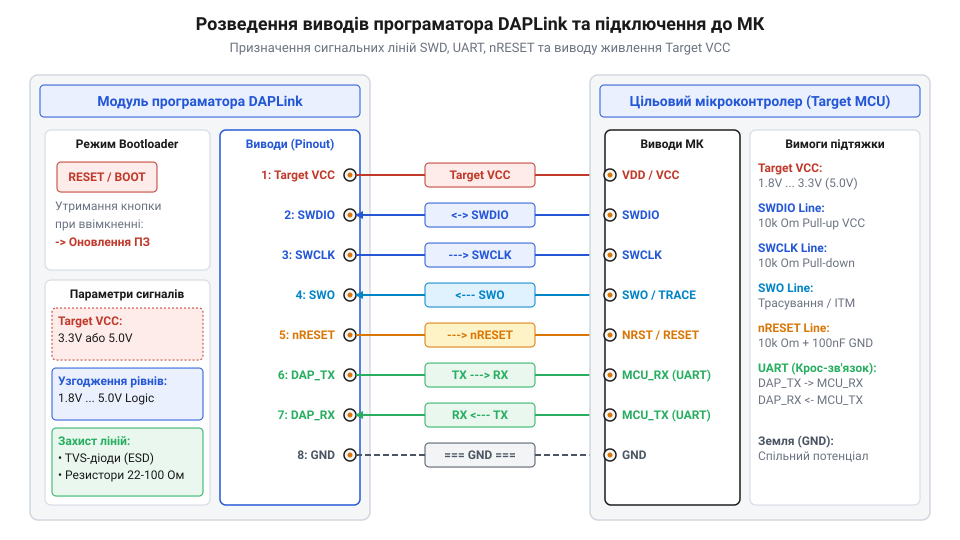
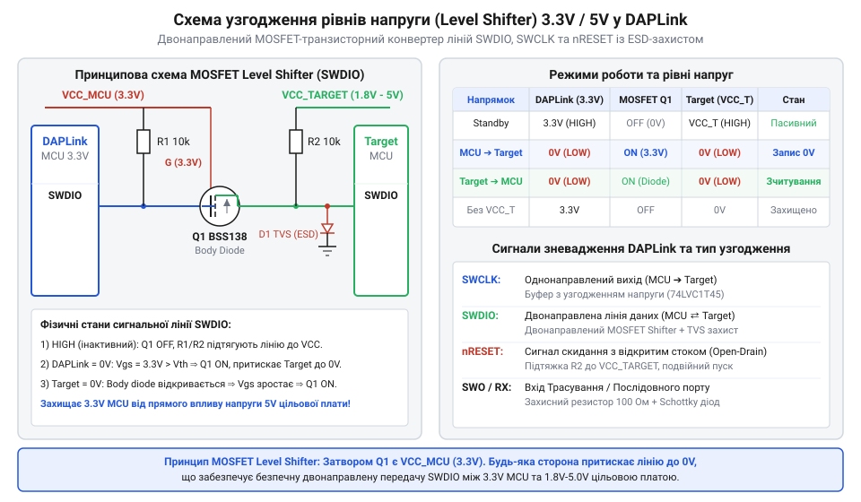

# Апаратний інтерфейс та розвідка виводів DAPLink

<preknowlist>
- [WeAct Mini Debugger (DAPLink / ST-Link V2.1)](root:cat-hw-boards/daplink-debugger) — Загальна конструкція плат на базі DAPLink, розташування індикаторів та базове призначення відлагоджувальної плати.
- [Фірмова прошивка та протокол ST-Link V2.1](root:cat-hw-boards/stlink-v21-firmware-architecture) — Принципи співіснування двох режимів (ST-Link та DAPLink) та особливості використання комбінованих пристроїв.
</preknowlist>

## Проблема підключення та апаратні ризики

При підключенні автономного програматора @@en|DAPLink@@ до мікроконтролера розробники часто стикаються з відсутністю зв'язку, помилками розпізнавання цільового ядра ARM Cortex-M або навіть термічним пошкодженням вхідних буферів. Головною причиною таких збоїв є помилкове підключення сигнальних ліній через відсутність стандартизованої розводки виводів @@en|pinout@@ (від англ. *pin* — ніжка, та *out* — вихід) на різних платах. Компактні плати-носії, такі як [WeAct Mini Debugger](root:cat-hw-boards/daplink-debugger), можуть мати власне розташування контактів гребінки, що відрізняється від класичного 10-пінового роз'єму @@en|ARM Cortex Debug Connector@@.

Спроба підключити лінію живлення до сигнального виводу мікроконтролера чи недотримання узгодження напруг між 5-вольтовим адаптером і 3.3-вольтовим цільовим пристроєм призводить до виникнення паразитного струму через вбудовані захисні діоди. Зокрема, якщо цільову плату знеструмлено, але шину зневадження залишено активною, високий логічний рівень на лініях @@en|SWDIO@@ та @@en|SWCLK@@ створює потенціал 3.3 В на вхідних виводах. Оскільки внутрішня шина живлення мікроконтролера перебуває під нульовою напругою, верхні захисні @@en|ESD@@-діоди (від англ. *Electrostatic Discharge* — електростатичний розряд) у каскаді @@en|GPIO@@ відкриваються в прямому напрямку, пропускаючи струм від сигнальних ліній програматора безпосередньо в шину `Target VCC`. Це явище паразитного живлення викликає хаотичний частковий запуск кристала, зависання внутрішніх регістрів та електричну деградацію напівпровідникових переходів через вихід струму за допустимі межі. Крім того, відсутність спільної землі @@en|GND@@ (від англ. *ground* — заземлення) викликає плаваючий потенціал, через який лінія тактування @@en|SWCLK@@ (від англ. *Serial Wire Clock* — тактовий сигнал) ловить імпульсні завади, а лінія даних @@en|SWDIO@@ втрачає синхронізацію пакетів. Для безпечної та надійної роботи розробник повинен чітко розуміти електричне призначення кожної ніжки роз'єму.

Для захисту вхідних буферів від згубного впливу плаваючого потенціалу та вирівнювання імпедансу сигнальних ліній у схемах підключення застосовують апаратне координування за допомогою вирівнювальних та підтягувальних резисторів. Підключення резистора підтяжки @@en|pull-up@@ (від англ. *pull* — тягнути, та *up* — вгору) номіналом 10–47 кОм між лінією даних `SWDIO` та шиною `Target VCC` гарантує фіксований високий логічний рівень під час пауз у передачі кадру, коли виводи обох пристроїв переходять у високоімпедансний стан @@en|Hi-Z@@ (від англ. *High-Impedance* — високий імпеданс). Водночас послідовне включення низькоомних обмежувальних резисторів опором 22–100 Ом безпосередньо у розрив ліній `SWCLK` і `SWDIO` гасить зворотні імпульсні відбиття сигналів у довгому шлейфі, запобігає наскрізним струмам короткого замикання при одночасному зустрічному перемиканні вхідних каскадів @@en|CMOS@@ (від англ. *Complementary Metal-Oxide-Semiconductor* — комплементарний метал-оксид-напівпровідник) та ліквідує перенапруги на високочутливих буферах зневаджувача.

## Розвідка виводів та сигнальні лінії

Апаратний інтерфейс програматора DAPLink об'єднує два основні логико-функціональні блоки: двохпровідний шинний інтерфейс зневадження @@en|SWD@@ (від англ. *Serial Wire Debug* — послідовне дротове зневадження) та послідовний порт апаратного мосту @@en|UART@@ (від англ. *Universal Asynchronous Receiver-Transmitter*).

*Розводка ніжок та призначення сигнальних ліній роз'єму DAPLink.*

Двонаправлена лінія @@en|SWDIO@@ (від англ. *Serial Wire Data Input/Output* — вхід/вихід даних) відповідає за передачу команд та даних між хостом і цільовим мікроконтролером. Тактова лінія @@en|SWCLK@@ задає синхроімпульси прийому-передачі. Допоміжна однонаправлена лінія @@en|SWO@@ (від англ. *Serial Wire Output* — вихід трасування) використовується для апаратного потокового виводу діагностичних логів через модуль @@en|ITM@@ (від англ. *Instrumentation Trace Macrocell*). Лінія @@en|nRESET@@ (від англ. *negative Reset* — інверсне скидання) є виходом з відкритим колектором для примусового апаратного скидання цільового ядра. Зв'язок із [фірмовою прошивкою ST-Link V2.1](root:cat-hw-boards/stlink-v21-firmware-architecture) показує схожість цієї розводки з класичними налагоджувальними інтерфейсами ST-LINK.

Окрему групу становлять лінії апаратного послідовного порту `TX` (вихід даних програматора) та `RX` (вхід даних), які підключаються відповідно до виводів `RX` та `TX` мікроконтролера. Вивід `Target VCC` слугує опорним входом для вимірювання робочої напруги цільової плати або джерелом живлення для неї.

Для зручності підключення та запобігання помилкам трасування нижче наведено зведену специфікацію виводів роз'єму @@en|DAPLink@@ із зазначенням їхнього напрямку, робочих напруг і апаратного стану за замовчуванням:

| Пін | Назва виводу | Напрямок | Електричний рівень | Стан за замовчуванням | Призначення та функція |
| :-: | :--- | :--- | :--- | :--- | :--- |
| 1 | `Target VCC` | Вхід / Вихід | 1.8V – 3.3V (до 5V) | Активне живлення / вимір | Опорна напруга узгоджувача рівнів або подача живлення на ціль |
| 2 | `SWDIO` | Двонапрямлений | 1.8V – 3.3V / 5V | @@en|Pull-up@@ (10 кОм) | Канал даних інтерфейсу зневадження @@en|SWD@@ |
| 3 | `SWCLK` | Вихід | 1.8V – 3.3V / 5V | @@en|Push-pull@@ (Низький) | Сигнал синхронізації шини зневадження |
| 4 | `nRESET` | Вихід | @@en|Open-drain@@ (до 5V) | @@en|Pull-up@@ (10 кОм) | Апаратний інверсний сигнал скидання цільового мікроконтролера |
| 5 | `SWO` | Вхід | 1.8V – 3.3V / 5V | Високоімпедансний (High-Z) | Вхід апаратного трасування логів @@en|ITM@@ |
| 6 | `TX` | Вихід | 1.8V – 3.3V / 5V | @@en|Push-pull@@ (Високий) | Вихід передавача мосту @@en|UART@@ (підключається до RX цілі) |
| 7 | `RX` | Вхід | 1.8V – 3.3V / 5V | @@en|Pull-up@@ (10 кОм) | Вхід приймача мосту @@en|UART@@ (підключається до TX цілі) |
| 8 | `GND` | Живлення | 0V | Спільний мінус | Спільна земля схеми для зрівнювання потенціалів |

Оскільки передавання та приймання даних шини @@en|SWD@@ відбувається через єдину фізичну лінію @@en|SWDIO@@, часові діаграми обміну розділяються на тактові фази запиту від [відлагоджувача DAPLink](root:cat-hw-boards/daplink-debugger) та фази відповіді цільового мікроконтролера. Під час фази передавання команд (запиту) вихідний буфер програматора працює в активному режимі @@en|push-pull@@, виставляючи нові біти даних по спадному фронту тактового сигналу @@en|SWCLK@@, щоб цільове ядро встигало зчитати їх по наростаючому фронту. Для переходу в режим приймання даних використовується часовий інтервал перемикання напрямку (англ. @@en|turnaround period@@, цикл передачі керування), під час якого обидва пристрої переводять свої виводи в високоімпедансний стан (англ. @@en|High-Z@@, від @@en|high impedance@@ — високий опір) на один тактовий імпульс `SWCLK`. У фазі відповіді вже цільовий мікроконтролер формує біти даних по спадному фронту `SWCLK`, а програматор зчитує стан лінії по наростаючому фронту, гарантуючи відсутність конфліктів на спільній провідниковій лінії.

## Електричні рівні та узгодження живлення

Більшість апаратних реалізацій DAPLink розраховані на роботу з логічними рівнями 3.3 В. Проте при підключенні до пристроїв із живленням 1.8 В або 5 В виникає проблема несумісності електричних параметрів. Для запобігання пошкодженню вхідних буферів застосовують двонаправлені перетворювачі рівнів @@en|level shifter@@ (від англ. *level* — рівень, та *shifter* — зсувач) на польових транзисторах @@en|MOSFET@@ (від англ. *Metal-Oxide-Semiconductor Field-Effect Transistor*).

*Схемотехніка двонаправленого перетворювача рівнів на MOSFET-транзисторах для сигнальних ліній.*

Лінія `SWCLK` є push-pull виходом і вимагає послідовного антидребезгового резистора опором 22–33 Ом для приглушення дзвеніння фронтів при довгих з'єднувальних проводах. Двонаправлена лінія `SWDIO` та відкритий вихід `nRESET` потребують зовнішніх підтягуючих резисторів @@en|pull-up@@ (від англ. *pull-up* — підтяжка догори) номіналом 10 кОм до шини `Target VCC`. Вивід `Target VCC` визначає опорну напругу порівняння для буферних каскадів [відлагоджувача DAPLink](root:cat-hw-boards/daplink-debugger) і не повинен перевантажуватися струмом понад 100 мА при подачі живлення на цільову плату. У схемі @@en|level shifter@@ опір підтяжки `R` у поєднанні з паразитною ємністю лінії `C` (утворюваною довгими шлейфами й вхідними буферами) формує RC-ланцюг, що критично впливає на затримку наростання фронту `t_rise ≈ 2.2 × R × C`. При значенні підтяжки 10 кОм і ємності лінії 50 пФ час наростання досягає понад 1 мкс, що затягує наростаючий фронт сигналу й накладає суворе частотне обмеження на шину `SWD` (не вище 1 МГц). Зменшення опору підтяжки до 1.5–2.2 кОм прискорює перезаряд паразитних ємностей і дозволяє підняти частоту зневадження, однак пропорційно збільшує струм споживання у стані логічного нуля.

## Режими завантажника та усунення збоїв

На платі програматора DAPLink передбачено апаратну кнопку або джампер переходу в режим оновлення прошивки @@en|bootloader@@ (від англ. *bootstrap loader* — завантажник). Для переведення пристрою в режим завантажника необхідно затиснути кнопку при підключенні USB-кабелю до ПК. При цьому мікросхема програматора монтується в операційній системі як звичайний накопичувач @@en|MSC@@ (від англ. *Mass Storage Class* — клас масового сховища) з назвою `MAINTENANCE`, куди достатньо скопіювати новий бінарний файл прошивки `.bin` для автоматичного оновлення.

У разі виникнення помилок зв'язку "Target Not Halting" або "SWD Communication Failure" першочергово перевіряють цілісність лінії `GND` та відсутність просідання напруги на `Target VCC`. При роботі з мікроконтролерами, у яких виводи @@en|SWD@@ переконфігуровано у звичайний @@en|GPIO@@ або переведено в режим глибокого сну у прошивці цілі, стандартне підключення блокується. Для відновлення доступу застосовують режим @@en|Connect Under Reset@@ за таким апаратним алгоритмом:

1. **Примусове скидання ядра:** Програматор @@en|DAPLink@@ притискає лінію `nRESET` до землі, утримуючи мікроконтролер у стані скидання і не даючи виконатися користувацькому коду.
2. **Апаратне захоплення шини:** Не відпускаючи лінію `nRESET`, програматор подає серію тактових імпульсів по лінії @@en|SWCLK@@ і передає ініціалізаційну послідовність на @@en|SWDIO@@ для встановлення зв'язку з портом зневадження.
3. **Активація регістра зупинки:** @@en|DAPLink@@ записує прапорці апаратної зупинки в регістр @@en|DHCSR@@ (від англ. @@en|Debug Halting Control and Status Register@@ — регістр керування та стану зупинки зневадження) ядра ARM.
4. **Відпускання лінії скидання:** Лінія `nRESET` піднімається до високого рівня, але ядро зупиняється на першому ж інструкційній точці вектора скидання до того, як периферійний контролер встигне виконати ремапінг виводів у користувацькому коді.
5. **Масове стирання пам'яті:** Зневаджувач виконує процедуру @@en|Mass Erase@@ флеш-пам'яті, вилучаючи конфліктну прошивку і відновлювати повноцінний доступ через [плату WeAct Mini Debugger](root:cat-hw-boards/daplink-debugger) чи аналогічні адаптери на базі [архітектури ST-Link V2.1](root:cat-hw-boards/stlink-v21-firmware-architecture).
