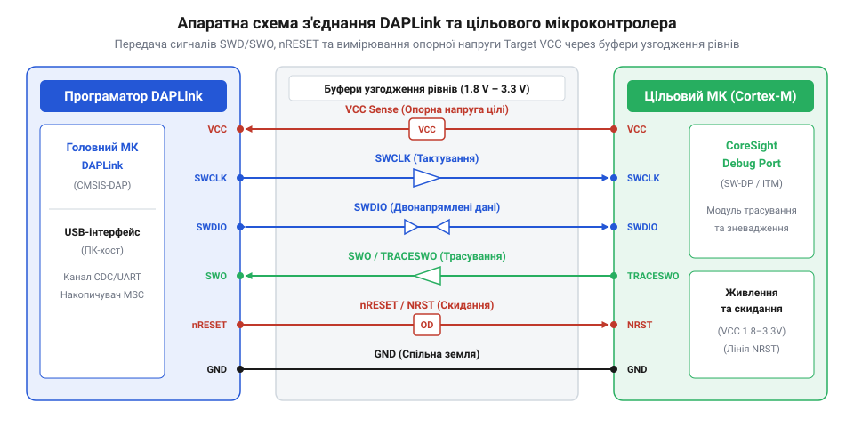
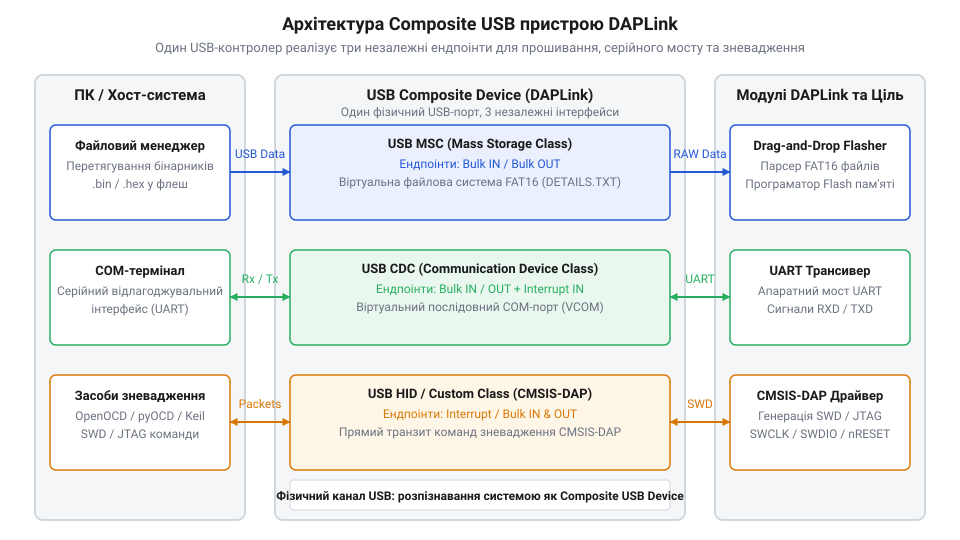
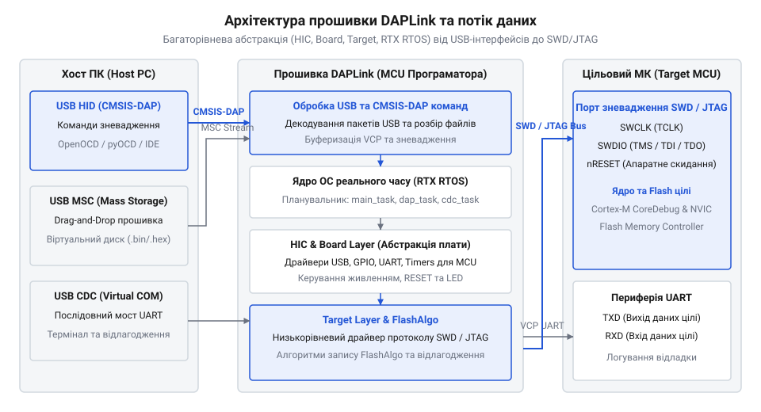

# Архітектура та принципи роботи програматора DAPLink

<preknowlist>
- [WeAct Mini Debugger (DAPLink / ST-Link V2.1)](root:cat-hw-boards/daplink-debugger) — поняття про практичне виконання плат програматорів та апаратну компоновку компактних зневаджувачів
- [Фірмова прошивка та протокол ST-Link V2.1](root:cat-hw-boards/stlink-v21-firmware-architecture) — базове розуміння протоколів програмування та зневадження мікроконтролерів через USB-міст
</preknowlist>

## Проблема закритості та складності зневадження

Тривалий час розробка електроніки на базі мікроконтролерів родини @@en|ARM@@ (англ. @@en|Advanced RISC Machines@@, вдосконалені RISC-машини) @@en|Cortex-M@@ була обмежена фрагментацією та закритістю апаратних інструментів. Кожен виробник напівпровідникових кристалів випускав власні програматори та зневаджувачі із закритими протоколами. Щоб завантажити прошивку або покроково виконати код, розробники мусили купувати коштовні фірмові адаптери на кшталт @@en|ST-LINK@@ чи @@en|J-Link@@, а також встановлювати закриті проприєтарні драйвери у середовищі розробки @@en|IDE@@ (англ. @@en|Integrated Development Environment@@, інтегроване середовище розробки). Ситуація ускладнювалася під час роботи з мультиплатформними стендами: при одночасному підключенні кількох проприєтарних зневаджувачів до спільних ліній зневадження виникали електричні конфлікти шини через різницю опорних потенціалів живлення та відсутність активної ізоляції. Двотактні вихідні каскади (англ. @@en|push-pull@@) фірмових адаптерів без переведення у високоімпедансний стан змушували сигнальні лінії протитискати одна одну, спричиняючи вирівнювальні струми, викривлення фронтів імпульсів та апаратні пошкодження вхідних буферів.

Такий підхід створював суттєві труднощі під час автоматизації збірки, тестування та розгортання проєктів. Проприєтарні програматори часто вимагали спеціалізованих двосторонніх зв'язувальних бібліотек для кожної операційної системи, що унеможливлювало швидку інтеграцію в хмарні конвеєри або роботу на операційних системах @@en|Linux@@ та @@en|macOS@@. Аналізуючи [фірмові протоколи зневадження](root:cat-hw-boards/stlink-v21-firmware-architecture), розробники стикалися з нездоланними обмеженнями щодо розширення функціонала або адаптації інструментів під власний апаратний стенд.

Складність підключення посилювалася фізичним інтерфейсом. Класичний зневаджувальний стандарт @@en|JTAG@@ (англ. @@en|Joint Test Action Group@@, об'єднана група випробувальних дій) вимагав від 4 до 20 фізичних провідників для передачі сигналів синхронізації, даних, контролю та скидання. Перехід на двопровідний інтерфейс @@en|SWD@@ (англ. @@en|Serial Wire Debug@@, послідовне дротове зневадження) спростив трасування плати, але не вирішив проблему сумісності програмного транспорту. Для повноцінної роботи адаптеру все одно були потрібні гнучке узгодження рівнів напруги, керування лініями живлення та системного скидання.

*Підпис: Апаратне з'єднання між програматором DAPLink та цільовим мікроконтролером через лінії SWD, системне скидання nRESET, вивід трасування SWO та буфери узгодження напруг.*

Щоб подолати закритість та спростити розробку, компанія @@en|Arm@@ розробила відкритий стандарт протоколу зневадження. Вивчаючи [еволюційні витоки стандарту](root:cat-hw-boards/daplink-programmer-architecture/hist-daplink-evolution.md), можна простежити шлях від перших апаратних платформ до універсального проєкту @@en|DAPLink@@. Сучасні розробники використовують [компактні плати зневаджувачів](root:cat-hw-boards/daplink-debugger) для безперешкодного доступу до пам'яті та регістрів мікроконтролера через єдиний стандартизований апаратний мостик. Точний розподіл сигналів описують [апаратні лінії зневадження](root:cat-hw-boards/daplink-programmer-architecture/api-daplink-hardware-interface.md) та живлення, які забезпечують надійний зв'язок із цільовою платою.

Головною ідеєю проєкту стало створення уніфікованого програмного містка, де стандартизований [протокол зневадження CMSIS-DAP](root:cat-hw-boards/daplink-programmer-architecture/api-cmsis-dap-protocol-and-usb-endpoints.md) (від англ. *Cortex Microcontroller Software Interface Standard Debug Access Port*) транслює низькорівневі командні транзакції безпосередньо в універсальні кадри @@en|USB@@. Завдяки цій архітектурній трансформації зникла потреба розробляти та підтримувати вендорні драйвери під кожне окреме середовище, оскільки хостовий комп'ютер взаємодіє з програматором через стандартні системні класи пристроїв. Це рішення сформувало основу для побудови багатофункціонального апаратного мосту, здатного одночасно забезпечувати прошивку пам'яті, зневадження та послідовну передачу даних через єдине фізичне USB-з'єднання.

## Мультиплексування USB та складові інтерфейси

Під час налагодження вбудованого пристрою розробнику одночасно потрібні три незалежні канали зв'язку: транспорт для завантаження бінарного файлу прошивки, зневаджувальний канал для покрокового виконання коду та послідовний порт для виводу налагоджувальних логів @@en|UART@@ (англ. @@en|Universal Asynchronous Receiver-Transmitter@@, універсальний асинхронний приймач-передавач). Використання трьох окремих кабелів чи адаптерів ускладнює апаратний стенд і створює плутанину. Програматор @@en|DAPLink@@ вирішує цю проблему завдяки технології складеного пристрою шини @@en|USB@@ (англ. @@en|Universal Serial Bus@@, універсальна послідовна шина) — @@en|Composite USB Device@@.

Фізично програматор підключається до хоста одним USB-кабелем, але на рівні операційної системи реалізує три самостійні логічні інтерфейси через окремі кінцеві точки (англ. @@en|endpoint@@, від @@en|point@@ — точка). Якщо розробник примусово вимикає один із сервісів (наприклад, накопичувач MSC чи послідовний порт CDC) у конфігураційному файлі налаштувань, прошивка @@en|DAPLink@@ під час перерахування пристрою (англ. @@en|USB enumeration@@) динамічно перебудовує таблицю USB-дескрипторів. Вона виключає дескриптори асоціації інтерфейсів (англ. @@en|IAD@@, @@en|Interface Association Descriptor@@) та кінцеві точки вимкненого модуля, вивільняючи апаратні буфери USB-контролера і примусово перезапускаючи підтяжку лінії `D+` для реініціалізації в ОС. Це дозволяє оптимізувати конфігурацію пристрою під конкретні завдання, усуваючи затримки з монтуванням віртуального диска чи ініціалізацією системних драйверів у випадках, коли потрібен лише чистий транспорт зневадження.

1. @@en|USB-MSC@@ (англ. @@en|Mass Storage Class@@, клас накопичувачів великої ємності): підключається як віртуальний флеш-диск. Це дозволяє здійснювати прошивку за принципом @@en|Drag-and-Drop@@ (перетягни і відпусти) — розробнику достатньо скопіювати файл `.bin` або `.hex` на диск, після чого прошивка програматора автоматично запише його у флеш-пам'ять цільового мікроконтролера.
2. @@en|USB-CDC@@ (англ. @@en|Communications Device Class@@, клас комунікаційних пристроїв): створює віртуальний послідовний порт (англ. @@en|Virtual COM Port@@). Він транслює дані між виводами @@en|TX@@/@@en|RX@@ цільового мікроконтролера та терміналом на ПК без використання зовнішніх USB-UART конвертерів.
3. @@en|USB-HID@@ / @@en|WinUSB@@ (англ. @@en|Human Interface Device@@ / @@en|Windows USB Driver@@): забезпечує високошвидкісну передачу команд протоколу зневадження. Використання стандарту @@en|HID@@ дозволяє програматору працювати в будь-якій операційній системі без встановлення сторонніх драйверів.

*Підпис: Організація складеного USB-пристрою DAPLink із розділенням кінцевих точок для накопичувача MSC, послідовного порту CDC та зневаджувального транспорту HID/Bulk.*

Операційна система хоста розділяє потік пакетів між цими інтерфейсами за їхньою адресою кінцевих точок. Коли утиліта зневадження надсилає запит, пакети спрямовуються через канальний шар безпосередньо до обробника зневаджувального протоколу. Детальніше вивчити [структуру USB-дескрипторів та ендпоінтів](root:cat-hw-boards/daplink-programmer-architecture/api-cmsis-dap-protocol-and-usb-endpoints.md) можна у відповідній апаратній специфікації. Завдяки такому розділенню розробник отримує змогу одночасно вести зневадження через взаємодію з [протоколом зневадження CMSIS-DAP](root:cat-hw-boards/daplink-programmer-architecture/api-cmsis-dap-protocol-and-usb-endpoints.md) та читати текстові логи з послідовного порту, не перериваючи роботу апаратного шинної лінії.

## Внутрішня архітектура прошивки та RTOS

Апаратна реалізація складеного USB-пристрою вимагає від прошивки програматора високого рівня паралелізму. Для одночасної обробки файлових операцій, приймання послідовних даних та виконання зневаджувальних команд у реальному часі прошивка @@en|DAPLink@@ побудована на базі операційної системи реального часу @@en|RTOS@@ (англ. @@en|Real-Time Operating System@@, операційна система реального часу), зокрема ядра @@en|RTX RTOS@@ (чи @@en|CMSIS-RTOS@@).

Операційна система розподіляє обчислювальні ресурси мікроконтролера-програматора між кількома паралельними задачами відповідно до строго визначеної ієрархії пріоритетів:
- Задача обслуговування шини @@en|USB@@ виконується з найвищим пріоритетом реального часу, миттєво реагуючи на системні переривання для вивантаження та заповнення вхідних і вихідних кільцевих буферів.
- Задача виконання команд @@en|CMSIS-DAP@@ має високий пріоритет, розбираючи вхідні пакети, формуючи часові діаграми сигналів @@en|SWCLK@@ й @@en|SWDIO@@ та здійснюючи прямий доступ до пам'яті цільового кристала.
- Задача послідовного мосту керує буферизацією даних між контролером @@en|UART@@ та кінцевою точкою @@en|CDC@@ із середнім пріоритетом. Для запобігання переповненню кільцевого буфера на високих швидкостях обміну реалізовано апаратні пороги заповнення та механізм зворотного тиску @@en|backpressure@@ (від англ. *back* — назад, та *pressure* — тиск): при досягненні верхнього вотермарку буфера пристроєм надсилається сигнал @@en|NAK@@ (від англ. *Negative Acknowledgment* — негативне підтвердження) на шину @@en|USB@@, що вимушено призупиняє відправку нових пакетів з боку ПК до звільнення пам'яті.
- Задача віртуальної файлової системи (англ. @@en|Virtual FAT@@) функціонує у фоновому пріоритеті, емулюючи структури таблиці розміщення файлів @@en|FAT12@@/@@en|FAT16@@ в оперативній пам'яті. Вона перехоплює сектори запису бінарного файлу, витягує з них сирі дані прошивки та передає їх на модуль програмування.

Для забезпечення переношуваності код прошивки DAPLink розділений на три чіткі шари абстракції:

1. Шар @@en|HIC@@ (англ. @@en|Hardware Interface Circuit@@, апаратна схема інтерфейсу): абстрагує периферію самого мікроконтролера-програматора (наприклад, @@en|STM32F103@@ або @@en|LPC11U35@@), відповідаючи за тактування, налаштування USB-драйвера та таймерів.
2. Шар @@en|Board@@ (англ. @@en|Board Layer@@, шар плати): визначає специфічну розводку виводів конкретного зневаджувача, керування світлодіодами стану, лініями живлення та системного скидання.
3. Шар @@en|Target@@ (англ. @@en|Target Layer@@, шар цілі): містить алгоритми стирання та запису флеш-пам'яті цільових мікроконтролерів різних родин, а також картографування їхніх адресних просторів.

*Підпис: Внутрішня трирівнева архітектура прошивки DAPLink на основі RTX RTOS із розподілом задач між мостом USB, віртуальною файловою системою та програмуванням цільової плати.*

Якщо під час прошивки методом @@en|Drag-and-Drop@@ виникає апаратна або програмна помилка (наприклад, збій верифікації, обрив живлення цілі або захист від читання), віртуальна файлова система не виходить з ладу. Замість цього прошивка динамічно створює в кореневому каталозі віртуального диска текстовий файл @@en|FAIL.TXT@@ (або @@en|fail.txt@@). У ньому міститься докладний код помилки та текстовий опис причини збою. Бажаючі самостійно зібрати пристрій можуть вивчити [збірку вихідного коду](root:cat-hw-boards/daplink-programmer-architecture/proj-stm32-daplink-programmer.md) прошивки для налаштування власних платформа-залежних шарів @@en|HIC@@ та @@en|Board@@. Принцип побудови розширених обробників файлової системи та [динамічне формування файлової структури](root:sf-data/virtual-fat-file-system-in-embedded) в RAM докладно розглядаються у відповідному огляді.

## Фізичне керування ціллю та режими скидання

Після формування зневаджувальних пакетів усередині прошивки програматор переходить до апаратної взаємодії з виводами цільового мікроконтролера. Надійний зв'язок вимагає точного узгодження електричних рівнів та логічних станів сигнальних ліній. Оскільки цільова плата може живитися напругою від 1.8 В до 3.3 В або 5 В, програматор @@en|DAPLink@@ використовує двонапрямлені буфери або перетворювачі рівнів (англ. @@en|level shifter@@). Вивід @@en|Target VCC@@ вимірює опорну напругу цілі, адаптуючи вихідні каскади ліній зневадження.

Основний обмін даними здійснюється через лінії @@en|SWCLK@@ (синхронізація) та @@en|SWDIO@@ (двонапрямлена лінія даних із підтягувальним резистором @@en|pull-up@@). Додаткова лінія @@en|SWO@@ (англ. @@en|Serial Wire Output@@ — послідовне виведення трасування) призначена для однопровідного апаратного трасування подій та виводу логів без зупинки ядра. Алгоритм тактування лінії @@en|SWO@@ спирається на асинхронне кодування @@en|NRZ@@ (від англ. *Non-Return-to-Zero* — без повернення до нуля, асинхронний режим на кшталт @@en|UART@@) або манчестерське кодування, де швидкість передачі прямо задається дільником базової частоти ядра процесора. Для коректного прийому даних @@en|DAPLink@@ узгоджує швидкість захвату з тактовою частотою цілі, після чого апаратний модуль трасування @@en|ITM@@ (англ. @@en|Instrumentation Trace Macrocell@@ — макрокомірка інструментального трасування) розбиває потік на стандартизовані кадри трасування @@en|TRC@@ (від англ. *trace frame* — кадр трасування). Кожен такий кадр містить заголовочний байт із номером каналу джерела (від 0 до 31), корисне навантаження обсягом 1, 2 або 4 байти та синхронізувальні мітки часу. Сигнальна лінія скидання @@en|nRESET@@ реалізована за схемою з відкритим стоком (англ. @@en|open-drain@@), що дозволяє програматору примусово перезавантажувати цільовий кристал або утримувати його у стані скидання під час програмування пам'яті.

Особливе місце в апаратній діагностиці займає режим затискання при скиданні — @@en|Reset Catch@@ (чи @@en|Under Reset Vector Catch@@). Якщо у користувацькій прошивці стається фатальна помилка, кристал переходить у режим глибокого сну (англ. @@en|Deep Sleep@@) або перевизначає виводи @@en|SWD@@ як звичайні @@en|GPIO@@, стандартне підключення стає неможливим. У цьому разі DAPLink знижує рівень на лінії @@en|nRESET@@, підключається до порту зневадження, встановлює прапорець @@en|VC_CORERESET@@ у регістрі @@en|DEMCR@@ (англ. @@en|Debug Exception and Monitor Control Register@@) ядра @@en|Cortex-M@@ і відпускає лінію скидання. В результаті процесор зупиняється на найпершій інструкції вектора скидання до виконання проблемного коду. Повний список фізичних виводів описують деталізовані [розведенні виводів та сигналах](root:cat-hw-boards/daplink-programmer-architecture/api-daplink-hardware-interface.md), які реалізовуються на [апаратних платах зневаджувачів](root:cat-hw-boards/daplink-debugger).

## Процес оновлення прошивки та режими роботи

Програматор @@en|DAPLink@@ розроблений із розрахунком на безпечне обслуговування та оновлення без використання зовнішніх апаратних засобів. Для цього внутрішня пам'ять мікроконтролера-програматора розділена на дві незалежні області: завантажник @@en|DAPLink Bootloader@@ та основну інтерфейсну прошивку @@en|Interface Firmware@@. Залежно від умов подачі живлення пристрій працює в одному з двох режимів.

Звичайний робочий режим — @@en|Interface Mode@@ — запускається при стандартному підключенні до @@en|USB@@. Завантажник перевіряє цілісність таблиці векторів (англ. @@en|vector table@@) та контрольної суми основного коду, після чого передає керування інтерфейсній прошивці. У цьому стані пристрій надає доступ до всіх трьох складових інтерфейсів (@@en|MSC@@, @@en|CDC@@, @@en|HID@@).

Режим оновлення — @@en|Bootloader Mode@@ — активується, якщо під час підключення USB-кабелю утримувати натиснутою кнопку @@en|Reset@@ на платі програматора. Завантажник ініціалізує мінімальну віртуальну файлову систему з назвою диска `MAINTENANCE` (або `BOOTLOADER`). Процес оновлення складається з кількох кроків:

1. Користувач копіює скомільований файл нової інтерфейсної прошивки з розширенням `.bin` або `.act` на диск `MAINTENANCE`.
2. Завантажник перехоплює записані сектори, перевіряє заголовки й контрольні суми @@en|CRC32@@.
3. Після успішного перезапису внутрішньої флеш-пам'яті програматор автоматично перезавантажується та входить у режим @@en|Interface Mode@@ з оновленою версією коду.

Якщо під час оновлення стався обрив живлення або файл виявився пошкодженим, завантажник залишається в режимі `MAINTENANCE`, запобігаючи незворотному виходу програматора з ладу (англ. @@en|bricking@@). Подробиці створення та [самостійної збірки завантажника](root:cat-hw-boards/daplink-programmer-architecture/proj-stm32-daplink-programmer.md) можна простежити в контексті [еволюції проєктів Arm](root:cat-hw-boards/daplink-programmer-architecture/hist-daplink-evolution.md).

Перед безпосереднім записом секторів у внутрішню флеш-пам'ять завантажник виконує сувору перевірку заголовка (англ. @@en|header validation@@) прийнятого образу прошивки. Він зчитує перші слова таблиці векторів переривань у базі бінарного файла: перевіряє, чи початковий вказівник стека (англ. @@en|stack pointer@@, @@en|SP@@) потрапляє в допустимий діапазон оперативної пам'яті @@en|RAM@@ мікроконтролера-програматора, а вектор скидання (англ. @@en|Reset Vector@@) вказує на адресу всередині робочої області флеш-пам'яті. Крім того, завантажник обчислює контрольну суму перших семи векторів та порівнює її із зарезервованим значенням за зсувом `0x1C`. Лише після підтвердження цілісності цих структур даних завантажник знімає захист із відповідних секторів флеш-пам'яті й розпочинає поблочний запис, гарантуючи захист пристрою від пошкодження невалідною прошивкою.

## Інтеграція в інструментарій та діагностика

Завдяки дотриманню відкритого стандарту програматор @@en|DAPLink@@ легко інтегрується в сучасні конвеєри розробки та автоматизованого тестування. На відміну від проприєтарних адаптерів, він підтримується більшістю відкритих зневаджувальних серверів без встановлення спеціалізованих системних драйверів.

Основними програмними інструментами для роботи з DAPLink є:
- @@en|OpenOCD@@ (англ. @@en|Open On-Chip Debugger@@): відкритий сервер зневадження, який підключається до DAPLink через драйвер `cmsis-dap`. У конфігурації достатньо вказати інтерфейсний файл `interface/cmsis-dap.cfg`.
- @@en|pyOCD@@: інструментарій мовою @@en|Python@@, який автоматично виконує розпізнавання (англ. @@en|enumeration@@) пристроїв за ідентифікаторами @@en|VID/PID@@ і дозволяє прошивати мікроконтролери та читати пам'ять безпосередньо з командного рядка.
- Сучасні середовища розробки: @@en|VS Code@@ із розширенням @@en|Cortex-Debug@@, @@en|Keil MDK@@ та @@en|IAR Embedded Workbench@@ забезпечують покрокове зневадження коду, перегляд регістрів периферії та розставити точки зупинки через стандартизований транспорт.

Під час експлуатації програматора можуть виникати типові апаратні та програмні збої, які вимагають систематичної діагностики. У разі відсутності відгуку від цільового кристала ("@@en|SWD Read Array Error@@") першочергово перевіряють наявність напруги на лінії @@en|Target VCC@@ та цілісність з'єднань @@en|SWCLK@@/@@en|SWDIO@@. Якщо цільовий мікроконтролер заблокований або знаходиться у стані глибокого сну, застосовують режим затискання скидання. 

Помилки під час прошивки перетягуванням файлів діагностують за вмістом текстового файлу @@en|FAIL.TXT@@: наприклад, повідомлення про захист флеш-пам'яті вимагає зняття прапорців у байтах конфігурації (англ. @@en|Option Bytes@@). Взаємодія сервісних утиліт узгоджується з загальною [специфікацією протоколу зневадження](root:cat-hw-boards/daplink-programmer-architecture/api-cmsis-dap-protocol-and-usb-endpoints.md), оперуючи стандартизованими [пакетами зневаджувальних команд](root:cat-hw-boards/daplink-programmer-architecture/api-cmsis-dap-protocol-and-usb-endpoints.md) для надійного відновлення зв'язку.
