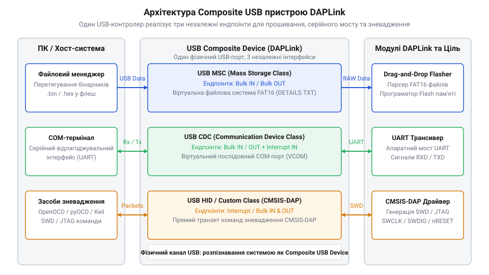
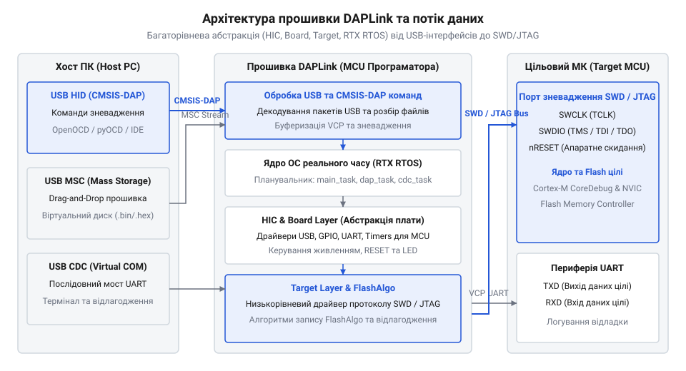
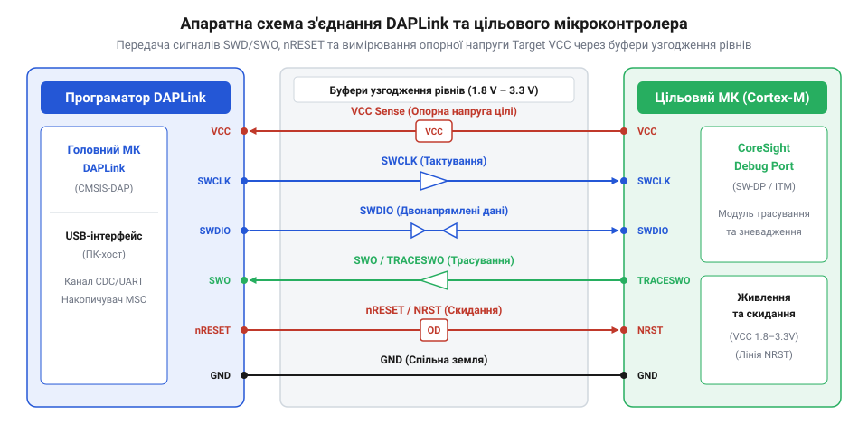

# Архітектура та принципи роботи програматора DAPLink

<preknowlist>
- [WeAct Mini Debugger (DAPLink / ST-Link V2.1)](root:cat-hw-boards/daplink-debugger) — поняття про практичне виконання плат програматорів та апаратну компоновку компактних зневаджувачів
- [Фірмова прошивка та протокол ST-Link V2.1](root:cat-hw-boards/stlink-v21-firmware-architecture) — базове розуміння протоколів програмування та зневадження мікроконтролерів через USB-міст
</preknowlist>

## Проблема закритості та складності зневадження

Традиційне програмування та зневадження мікроконтролерів @@en|ARM Cortex-M@@ роками пакували у закріплені за конкретними виробниками проприєтарні адаптери. Спроба об'єднати в одному проєкті рішення різних вендорів призводила до конфліктів системних драйверів, високої вартості обладнання та складнощів із підключенням декількох пристроїв одночасно. Кожен виробник застосовував власний закритий протокол, вимагаючи встановлення специфічних утиліт. Для уніфікації апаратного мосту компанія @@en|ARM@@ розробила відкритий стандарт @@en|CMSIS-DAP@@, а його еталонною програмною реалізацією став універсальний міст @@en|DAPLink@@ (англ. @@en|link@@ — ланка, зв'язок). Втім, [фірмова прошивка та протокол ST-Link V2.1](root:cat-hw-boards/stlink-v21-firmware-architecture) також демонструють еволюцію від закритих адаптерів до гнучких інтерфейсів зневадження.

## Мультиплексування інтерфейсів складеного USB пристрою

Щоб уникнути встановлення стороннього ПЗ для кожного сервісу, програматор реалізовано як складений пристрій @@en|Composite USB Device@@ (англ. @@en|composite@@ — складений). Поєднуючи декілька кінцевих точок в одному фізичному USB-кабелі, він одночасно надає операційній системі три незалежні інтерфейси:
- @@en|USB MSC@@ (англ. @@en|Mass Storage Class@@ — клас масових накопичувачів) — віртуальний накопичувач, на який файл прошивки (@@en|HEX@@ або @@en|BIN@@) завантажується звичайним перетягуванням (@@en|Drag-and-Drop@@);
- @@en|USB CDC-ACM@@ (англ. @@en|Communication Device Class@@ — клас комунікаційних пристроїв) — віртуальний послідовний порт @@en|VCP@@ (англ. @@en|Virtual COM Port@@ — віртуальний COM-порт) для зчитування логів роботи цільового мікроконтролера;
- @@en|USB HID@@ або @@en|WinUSB@@ — бездрайверний транспорт зневадження для передачі команд протоколу @@en|CMSIS-DAP@@ прямо в середовища @@en|OpenOCD@@ чи @@en|pyOCD@@.

*Структура складеного пристрою DAPLink: операційна система бачить накопичувач, послідовний порт і зневаджувач через один фізичний USB-кабель.*

## Трирівнева прошивка та база RTOS

Внутрішнє програмне забезпечення програматора побудоване на базі операційної системи реального часу @@en|RTX RTOS@@ (англ. @@en|Real-Time Operating System@@ — операційна система реального часу), що паралельно розподіляє обробку файлового накопичувача, буферизацію послідовного порту та обмін пакетами @@en|CMSIS-DAP@@. Прошивка ділиться на три апаратні шари абстракції:
- @@en|HIC@@ (англ. @@en|Hardware Interface Circuit@@ — схема апаратного інтерфейсу) — контролює роботу власного USB-контролера програматора;
- @@en|Board Layer@@ — обробляє периферію конкретної плати програматора (наприклад, [компактний WeAct Mini Debugger](root:cat-hw-boards/daplink-debugger));
- @@en|Target Layer@@ — містить алгоритми запису у флеш-пам'ять конкретної родини цільових МК та обгортку віртуальної файлової системи @@en|VFS FAT@@ (англ. @@en|Virtual File System@@ — віртуальна файлова система). Для оновлення внутрішнього ПЗ пристрою використовують [режим Maintenance для відновлення](root:sf-devices/daplink-maintenance-mode), який активується утриманням кнопки скидання.

*Архітектура прошивки DAPLink: взаємодія шарів HIC, Board та Target під керуванням ядра RTX RTOS.*

## Апаратне з'єднання та фізичне керування

Фізичний обмін між програматором і цільовим мікроконтролером здійснюється за допомогою шини @@en|SWD@@ (англ. @@en|Serial Wire Debug@@ — двопровідне зневадження). Двопровідний інтерфейс використовує лінію тактування @@en|SWCLK@@ та двонаправлену лінію даних @@en|SWDIO@@, доповнюючись лінією виводу трасування @@en|SWO@@ і апаратним скиданням @@en|nRESET@@. У разі занурення цілі у глибокі режими енергозбереження програматор застосовує режим затискання скидання (@@en|Reset Catch@@), утримуючи низький рівень на @@en|nRESET@@ до захоплення ядра. При помилках запису віртуальний накопичувач генерує файл `@@en|FAIL.TXT@@` із текстовим описом проблеми.

*Апаратне підключення DAPLink до цільового мікроконтролера через сигнальні лінії SWD, nRESET та послідовний міст UART.*
