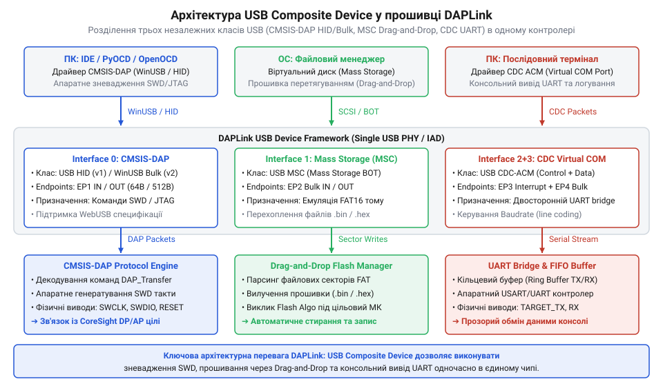
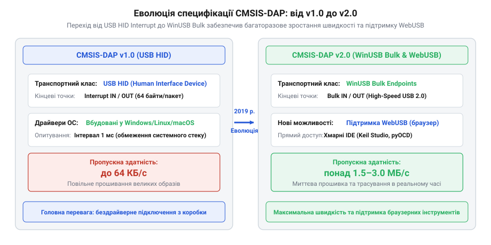

# Від mbed CMSIS-DAP до сучасної екосистеми DAPLink

<preknowlist>
- [WeAct Mini Debugger](root:cat-hw-boards/daplink-debugger) — апаратне виконання популярного програматора на базі STM32F103 для порівняння реалізацій DAPLink
- [Фірмова прошивка та протокол ST-Link V2.1](root:cat-hw-boards/stlink-v21-firmware-architecture) — особливості вендорної прошивки STMicroelectronics та її конвертації у DAPLink
</preknowlist>

## Проблема пропреітарних зневаджувачів початку 2010-х

На початку 2010-х років ринок мікроконтролерів переживав стрімку експансію архітектури @@en|Cortex-M@@ розробки компанії @@en|Arm@@ (від англійського @@en|Advanced RISC Machines@@ — вдосконалені @@en|RISC@@-машини). На відміну від 8-бітних чипів, нові 32-бітні процесори вимагали складних апаратних засобів для прошивки та налагодження через послідовні інтерфейси @@en|JTAG@@ (від англійського @@en|Joint Test Action Group@@ — об'єднана група дій з тестування) та @@en|SWD@@ (від англійського @@en|Serial Wire Debug@@ — послідовне зневадження дротами). Однак кожен виробник напівпровідникових кристалів — @@en|STMicroelectronics@@, @@en|NXP Semiconductors@@, @@en|Freescale@@, @@en|Texas Instruments@@ — випускав власні пропреітарні апаратні програматори з закритими протоколами обміну.

Головною перешкодою для розробників стала відсутність єдиного стандарту взаємодії між середовищами розробки (англ. @@en|IDE@@, від @@en|Integrated Development Environment@@ — інтегроване середовище розробки) та фізичним зневаджувачем. Ситуацію ускладнювала апаратна різниця між інтерфейсами: традиційний класичний @@en|JTAG@@ вимагав громіздкого 20-контактного роз'єму з чотирма основними сигнальними лініями (`TCK`, `TMS`, `TDI`, `TDO`), що суттєво здорожувало розводку планок зневадження та збільшувало габарити відлагоджувальних плат. Запропонований Arm двопровідний інтерфейс @@en|SWD@@ (англ. @@en|Serial Wire Debug@@ — послідовне зневадження дротами) скоротив кількість ліній до двох (`SWCLK` і бінаправленої `SWDIO`), дозволивши зменшити роз'єми до компактних 4-контактних гребінок. Проте підтримка двох відмінних фізичних шин та різного числового узгодження вимагала від вендорних програматорів складної апаратури перемикання сигналів. Для роботи кожного таких програматора в операційній системі вимагалося встановлення спеціалізованого системного драйвера (від англійського @@en|driver@@ — керувач) ядра, такого як пропреітарний драйвер @@en|Segger J-Link@@, @@en|Keil ULINK@@ чи фірмовий модуль для пристроїв @@en|ST-LINK@@. Ці драйвери розроблялися переважно виключно під операційну систему @@en|Windows@@. При спробі запустити процес налагодження в середовищах на базі @@en|Linux@@ або @@en|macOS@@ інженер стикався з відсутністю офіційного ПЗ, конфліктами прав доступу до шини @@en|USB@@ (від англійського @@en|Universal Serial Bus@@ — універсальна послідовна шина) та необхідністю збирати сторонні утиліти з вихідного коду.

Висока вартість комерційних апаратних адаптерів створювала фінансовий бар'єр для малих компаній та інженерів-аматорів. Комерційні зневаджувачі коду коштували сотні доларів США, а бюджетні плати розвитку часто мали прив'язку до одного конкретного сімейства мікроконтролерів. Навіть коли компанія @@en|STMicroelectronics@@ випустила доступну серію плат з вбудованим прошивачем, [фірмова прошивка ST-Link V2.1](root:cat-hw-boards/stlink-v21-firmware-architecture) залишалася закритою та відмовлялася працювати з мікросхемами сторонніх виробників. Фрагментація екосистеми стримувала масове поширення архітектури @@en|Cortex-M@@ у навчальних закладах та відкритих стартап-проєктах, що змусило компанію @@en|Arm@@ шукати універсальне відкрите рішення.

## Поява mbed CMSIS-DAP 1.0 на USB HID

У 2012 році підрозділ @@en|mbed@@ компанії @@en|Arm@@ запропонував радикальний вихід з технологічного тупика, випустивши першу версію відкритого стандарту @@en|CMSIS-DAP@@ (від англійського @@en|Cortex Microcontroller Software Interface Standard — Debug Access Port@@ — стандарт програмного інтерфейсу мікроконтролерів Cortex для порту доступу до зневадження). Замість створення чергового низькорівневого драйвера ядра розробники специфікації обрали як транспортний протокол стандартний клас пристроїв @@en|USB HID@@ (від англійського @@en|Human Interface Device@@ — пристрій людського інтерфейсу). Драйвери для пристроїв класу @@en|HID@@ підтримуються на рівні ядра в усіх сучасних операційних системах з коробки для забезпечення роботи мишей та клавіатур.

Завдяки використанню класу @@en|USB HID@@ програматор під керуванням прошивки @@en|CMSIS-DAP 1.0@@ миттєво розпізнавався операційними системами @@en|Windows@@, @@en|Linux@@ та @@en|macOS@@ без інсталяції сторонніх драйверів чи отримання адміністративних привілеїв. Вбудована бібліотека трансляції приймала пакети даних безпосередньо з середовища розробки, де кожен командний пакет містив однобайтовий ідентифікатор команди (наприклад, `DAP_Connect` чи `DAP_Transfer`), лічильник транзакцій та 32-бітні значення регістрів. При отриманні команди `DAP_Transfer` внутрішній автомат станів прошивки декодував запит до порту зневадження, побітово висував 8-бітний заголовок із одночасним тактуванням виводу `SWCLK`, зчитував 3-бітне підтвердження відповіді `ACK` від цільового мікроконтролера на лінії `SWDIO` та формував фізичні часові діаграми читання чи запису даних із перевіркою паритету. Специфікація стандарту була повністю відкритою: будь-який виробник мікросхем або апаратури міг безкоштовно інтегрувати код прошивки у свій мікроконтролер супроводу, усунувши прив'язку інструментарію до конкретного вендора.

Однак вибір транспортного рівня @@en|USB HID@@ приніс не лише бездрайверний доступ, а й суттєві обмеження швидкості. Стандартний специфікований endpoint (від англійського @@en|endpoint@@ — кінцева точка) класу @@en|HID@@ у режимі переривань (англ. @@en|Interrupt Endpoint@@) обмежував розмір одного кадру даних значенням 64 байти з максимальною частотою опитування 1 мілісекунда. У результаті реальна швидкість обміну даними між комп'ютером та програматором не перевищувала 64 Кілобайт на секунду. Під час читання чи запису великих масивів флеш-пам'яті обсягом у кілька мегабайтів процес прошивки займав тривалий час, що вимагало подальшої еволюції архітектури протоколу.

## Становлення DAPLink та режимів MSC і CDC

Для перетворення простого транслятора команд у повноцінну платформу підтримки розробки компанія @@en|Arm@@ реструктуризувала вихідний проєкт @@en|mbed@@ у відкритий фреймворк @@en|DAPLink@@. Головним архітектурним проривом стала реалізація складеного пристрою @@en|USB@@ (від англійського @@en|Composite Device@@ — складений пристрій), який через один фізичний кабель представляв комп'ютеру одразу три незалежні функціональні інтерфейси.

*Архітектура складеного пристрою DAPLink, яка об'єднує протокол зневадження CMSIS-DAP, віртуальний накопичувач MSC та послідовний міст CDC.*

Першим елементом складеного пристрою залишився канал зневадження @@en|CMSIS-DAP@@ для прямого зв'язку з середовищем розробки. Другим елементом став віртуальний диск класу @@en|USB MSC@@ (від англійського @@en|Mass Storage Class@@ — клас масового накопичувача) з файловою системою @@en|FAT12@@ або @@en|FAT16@@. При підключенні програматора операційна система монтувала звичайний знімний диск. Розробникові більше не потрібно було відкривати @@en|IDE@@ для швидкої перевірки коду: достатньо було перетягнути (англ. @@en|drag-and-drop@@) згенерований бінарний файл `.bin` або `.hex` на цей диск. Прошивка @@en|DAPLink@@ перехоплювала сектори запису файлової системи у пам'яті, на льоту витягувала прошивальні дані та стирала й програмувала внутрішню флеш-пам'ять цільового мікроконтролера.

Третім обов'язковим інтерфейсом став віртуальний послідовний порт класу @@en|USB CDC@@ (від англійського @@en|Communication Device Class@@ — клас комунікаційного пристрою). Завдяки вбудованому трансиверу (від англійського @@en|transceiver@@ — приймач-передавач) мікроконтролер програматора транслював дані з апаратних виводів @@en|UART@@ цільової плати безпосередньо в шину @@en|USB@@, утворюючи віртуальний @@en|COM@@-порт на комп'ютері. Наявність трьох служб в одному чипі зробила програматор універсальним середовищем для розробки. Подібну схему комбінованого пристрою застосовують у багатьох відкритих відлагоджувачах, зокрема в [модулі WeAct Mini Debugger](root:cat-hw-boards/daplink-debugger). Попри зручність використання, об'єднання трьох USB-класів істотно ускладнило структуру прошивки, оскільки обробники переривань файлової системи та послідовного порту не мали заважати реальному часу передавання команд зневадження.

## Перехід до CMSIS-DAP 2.0 та WebUSB

Зростання обсягів флеш-пам'яті в мікроконтролерах виявило головний недолік @@en|CMSIS-DAP@@ першого покоління — обмеження швидкості передачі даних через інтерфейс @@en|USB HID@@ (від англ. *Human Interface Device* — пристрій людського інтерфейсу). Режим переривань @@en|Interrupt Endpoint@@ обмежував пропускну здатність величиною 64 КБ/с, через що завантаження великих бінарних файлів тривало десятки секунд. У 2019 році компанія @@en|Arm@@ випустила специфікацію CMSIS-DAP v2.0, яка замінила HID-транспорт на високошвидкісні конечні точки @@en|WinUSB Bulk@@. Це дозволило усунути накладні витрати на опитування інтерфейсу та підвищити швидкість зневадження до межі физичної пропускної здатності шини USB.

*Хронологічний розвиток архітектури CMSIS-DAP від класичного USB HID до високошвидкісного WinUSB та браузерного WebUSB.*

Важливим етапом розвитку стандарту стала інтеграція технології @@en|WebUSB@@. Завдяки нативній підтримці викликів браузера прошивачі на базі @@en|DAPLink@@ отримали можливість взаємодіяти з хмарними середовищами розробки (такими як Keil Studio Cloud) без встановлення локальних драйверів чи системного програмного забезпечення. Хост-сторінка звертається до прошивача напряму через системний USB-стек операційної системи, що спростило процес навчання та швидкого прототипування. Завдяки відкритості та низькій собівартості DAPLink став стандартом де-факто для навчальних та промислових плат розробки, прикладом чого є популярний [зневаджувач DAPLink](root:cat-hw-boards/daplink-debugger). Принципи прямого зв'язку веббраузера з апаратурою без сторонніх утиліт розкрито у матеріалі про [бездрайверний доступ через WebUSB](root:sf-web/webusb-browser-hardware-access).

Поява протоколу @@en|CMSIS-DAP 2.0@@ та інтеграція технології @@en|WebUSB@@ створили підґрунтя для автоматизованого тестування в розробці вбудованих систем. Завдяки відсутності проприєтарних бібліотек розробники отримали змогу запускати тестові конвеєри безпосередньо у хмарі або у браузерних терміналах на базі бібліотек @@en|pyOCD@@ та @@en|WebOCD@@. Пряма передача пакетів @@en|WinUSB Bulk@@ забезпечила стабільну пропускну здатність для трасування пам'яті в реальному часі, закріпивши екосистему @@en|DAPLink@@ як фундаментальну відкриту платформу для сучасного зневадження мікроконтролерів родини @@en|Cortex-M@@.

## Міфи та реальні межі стандарту DAPLink

Популярність @@en|DAPLink@@ породила поширений міф про його абсолютну універсальність для будь-яких мікроконтролерів. Насправді функціонал автоматичного завантаження файлів drag-and-drop через віртуальний накопичувач @@en|USB MSC@@ жорстко прив'язаний до внутрішніх алгоритмів прошивки флеш-пам'яті @@en|Flash Algo@@ (від англ. *Flash Algorithm*). Якщо у прошивку прошивача не інтегровано бінарний модуль розблокування та запису секторів для конкретної серії чипа, спроба скопіювати файл на накопичувач призведе до помилки або пошкодження даних, хоча прямий зневаджувальний SWD-зв'язок через OpenOCD продовжуватиме працювати. DAPLink@@ породила | Детальніше внутрішню структуру та виконання цих виконувальних блоків висвітлюють [алгоритми прошивки флеш-пам'яті](root:sys-ide/flash-algo-mcu-programming) мікроконтролерів.

Другою важливою межею є орієнтованість специфікації @@en|CMSIS-DAP@@ на архітектуру @@en|Arm CoreSight@@. Хоча фізичні лінії SWD і JTAG здатні тактувати сигнали для мікроконтролерів інших архітектур (зокрема RISC-V), протокол не містить нативних високорівневих команд для роботи з не-ARM регістрами зневадження без додаткових апаратних адаптерів. Крім того, для специфічних заводських операцій — таких як відновлення заблокованих чипів або високовольтне скидання — розробникам доводиться використовувати [фірмові прошивки ST-Link V2.1](root:cat-hw-boards/stlink-v21-firmware-architecture) або спеціалізовані інструменти від вендорів.
