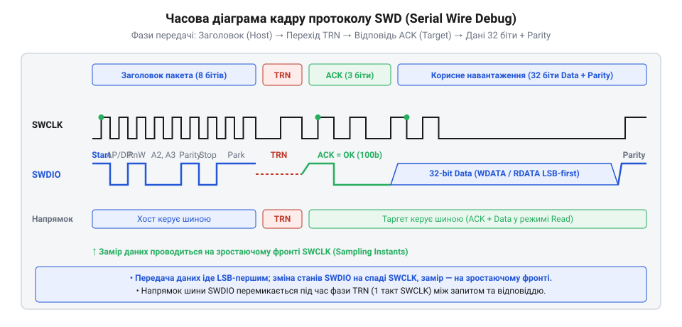

# Обчислення таймингів та пропускної здатності шини SWD/JTAG при програмному та апаратному формуванні сигналів

<preknowlist>
- [WeAct Mini Debugger (DAPLink / ST-Link V2.1)](root:cat-hw-boards/daplink-debugger) — апаратні характеристики та частота ядра програматора для розрахунку тактових затримок
</preknowlist>

## Проблема падіння пропускної здатності програматора

Під час зневадження та прошивання мікроконтролерів розробники нерідко стикаються із парадоксальною ситуацією: підвищення номінальної частоти тактування шини SWD у налаштуваннях утиліт OpenOCD чи pyOCD не приводить до пропорційного прискорення обміну даними. Більше того, при перевищенні певного порогу частоти з'являються помилки втрати синхронізації пакета та хаотичні збої зчитаних значень.

Головна причина цього явища криється в розбіжності між заданою номінальною частотою та реальним часовим бюджетом физичних сигналів. Формування імпульсів шини визначається трьома обмежувальними чинниками:
1. Накладними витратами виконання програмних циклів мікроконтролера програматора (@@en|bit-banging@@).
2. Протокольним оверхедом кадру SWD, що вимагає передачі сервісних бітів, фаз узгодження напрямку шини (@@en|Turnaround@@) та бітів перевірки парності.
3. Фізичною RC-фільтрацією сигналів у довгому зневаджувальному шлейфі через паразитну ємність і опір провідників.

Наочним прикладом цього є математичне співвідношення між частотою кадрів шини @@en|USB@@ (англ. *Universal Serial Bus* — універсальна послідовна шина) та тактовою частотою лінії @@en|SWCLK@@ (англ. *Serial Wire Clock*). При використанні шини @@en|USB 2.0 Full-Speed@@ передача даних між хостом і програматором відбувається пакетами у мікрокадрах із періодом `T_USB = 1 мс` (частота опитування `f_USB = 1000 Гц`) та максимальним розміром корисного навантаження `N_bytes = 64` байти. Навіть якщо зневаджувальний мікроконтролер формує тактову частоту `f_SWCLK = 10 МГц` із високим коефіцієнтом корисної дії кадру `η_SWD = 0.80`, підсумкова ефективна пропускна здатність `f_eff` обмежується найслабшою ланкою системи:

        f_eff
        = min(f_SWCLK × η_SWD, f_USB × N_bytes × 8)
        = min(10 000 000 × 0.80, 1000 × 64 × 8)   [підстановка параметрів шини]
        = min(8 000 000, 512 000)                  [обчислення границь пропускної здатності]
        = 512 000                                 [фізичне обмеження USB у бітах за секунду]

Отже, незалежно від здатності програматора генерувати частоту `f_SWCLK` вище кількох мегагерц, фактична швидкість обмежена величиною `512 кбіт/с` через накопичення пакетів у буфері шини @@en|USB@@. Саме тому для таких пристроїв, як [модуль WeAct Mini Debugger](root:cat-hw-boards/daplink-debugger), подальше збільшення частоти тактування фізичної лінії не дає пропорційного приросту швидкості без оптимізації розміру USB-пакетів та згрупованої передачі команд.

Для оптимізації швидкості та забезпечення стабільності зв'язку необхідно побудувати математичну модель обчислення бітового періоду та тривалості фаз транзакцій.

## Математична модель бітового періоду SWCLK

Основою часового розрахунку шини SWD є тривалість періоду тактового сигналу `T_CLK`. Якщо програматор формує сигнали програмним шляхом (@@en|bit-banging@@, англ. *bit* — біт, *bang* — бити, прямолінійне керування виводами), кожен перехід тактової лінії @@en|SWCLK@@ з 0 у 1 та з 1 у 0 вимагає виконання декількох інструкцій процесорного ядра.

Нехай частота ядра мікроконтролера програматора становить `f_mcu` (наприклад, для процесора на [програматорі WeAct Mini Debugger](root:cat-hw-boards/daplink-debugger) вона становить `72` МГц). Якщо встановлення високого рівня лінії вимагає `N_high` тактів ядра, а низького — `N_low` тактів, то при використанні програмних циклів затримки з `N_delay` ітерацій (по `N_loop` тактів кожна) повний період тактового сигналу `T_CLK` описується формулою:

`T_CLK = (N_high + N_low + 2 × N_delay × N_loop) / f_mcu`

Максимально можлива частота тактування `f_SWCLK_max` досягається при нульовій затримці (`N_delay = 0`):

`f_SWCLK_max = f_mcu / (N_high + N_low)`

**Обчислення граничної частоти bit-banging при частоті ядра 72 МГц**

```
N_total_cycles = N_high + N_low
= 6 + 6                              [сума тактів процесора на один період]
= 12 тактів                          [кількість тактів ядра на один імпульс SWCLK]

T_CLK_min = 12 / 72000000
= 1.667 · 10⁻⁷ s                     [тривалість періоду 166.7 нс]

f_SWCLK_max = 72000000 / 12
= 6000000.0                          [ділення частоти ядра на 12 тактів]
= 6.00 МГц                           [максимальна частота SWCLK]
```

Навіть при заданій номінальній частоті `6.0` МГц реальна швидкість передачі буде суттєво нижчою через протокольний оверхед кадру.

На практиці програмна обробка циклів тактування часто є асиметричною (`N_high ≠ N_low`), оскільки одна з фаз (найчастіше низький рівень) вимагає додаткових інструкцій процесорного ядра для зчитування стану або встановлення рівня на лінії @@en|SWDIO@@ (від англ. *Serial Wire Data Input/Output* — послідовна лінія даних вводу/виводу). У такому разі тривалості високого `t_high` та низького `t_low` напівперіодів обчислюються окремо через відповідну кількість тактів `N_high` і `N_low`, а підсумковий період `T_CLK` визначається їхньою сумою:

        t_high = (N_high + N_delay_high × N_loop) / f_mcu      [тривалість високої фази]
        t_low  = (N_low + N_delay_low × N_loop) / f_mcu        [тривалість низької фази]

        T_CLK  = t_high + t_low                                [сумарна тривалість періоду]
               = (N_high + N_low + (N_delay_high + N_delay_low) × N_loop) / f_mcu  [підстановка тактів асиметричних фаз]

Така нерівномірність спотворює скважність (від англійського @@en|duty cycle@@ — відношення тривалості імпульсу до повного періоду) тактового сигналу `D_cycle = t_high / T_CLK`. У результаті гранична частота обміну обмежується найкоротшою з двох фаз `t_min = min(t_high, t_low)`, яка повинна гарантовано перевищувати сумарний час встановлення та утримання даних `t_setup + t_hold` на боці цільового чипа.

На практиці обробка програмних циклів часто є асиметричною, оскільки фаза зчитування або встановлення шини @@en|SWDIO@@ вимагає додаткових інструкцій порівняно з простим тактуванням @@en|SWCLK@@. У такому разі тривалості високого `t_high` та низького `t_low` напівперіодів визначаються окремо за формулами `t_high = (N_high + N_delay_high × N_loop) / f_mcu` та `t_low = (N_low + N_delay_low × N_loop) / f_mcu`, а сумарний період `T_CLK` є їхньою прямою сумою:

```
T_CLK = t_high + t_low                                          [сума тривалостей високої та низької фаз]
      = (N_high + N_low + (N_delay_high + N_delay_low) × N_loop) / f_mcu  [підстановка тактів асиметричних фаз]
```

Нерівномірність фаз спотворює скважність (від англійського @@en|duty cycle@@ — відношення тривалості імпульсу до повного періоду) тактового сигналу `D_cycle = t_high / T_CLK`. Для надійної синхронізації найкоротша з двох фаз `t_min = min(t_high, t_low)` повинна гарантовано перевищувати сумарний час встановлення та утримання `t_setup + t_hold` на боці цільового чипа, що накладає жорсткіше апаратне обмеження на граничну частоту зневадження ніж при ідеально симетричному меандрі.

## Розрахунок накладних витрат кадрів SWD

Кожна операція читання або запису в архітектурі ARM CoreSight складається з послідовності тактових імпульсів, виражених у строго визначених фазах кадру.


*Часова діаграма фаз кадру SWD із позначенням тактових інтервалів старт-біта, фази TRN, ACK та корисного навантаження.*

Структура кадру для зчитання 32-бітного регістру містить:
- **Запит (Request):** `8` бітів (Start, APnDP, RnW, A[2:3], Parity, Stop, Park).
- **Зміна напрямку (TRN):** `1` такт (перехід ліній від програматора до цільового MCU).
- **Підтвердження (ACK):** `3` біти (коди OK=001, WAIT=010, FAULT=100).
- **Корисні дані (Data):** `32` біти.
- **Біт парності (Parity):** `1` біт.
- **Міжкадровий інтервал (Idle):** щонайменше `1` такт.

Загальна кількість тактових імпульсів `N_total` для однієї 32-бітної транзакції становить:

`N_total = N_req + N_trn + N_ack + N_data + N_parity + N_idle`

**Обчислення ефективності використання шини SWD**

```
N_total = 8 + 1 + 3 + 32 + 1 + 1
= 46 тактів                          [сумарний розмір кадру читання]

η_efficiency = N_data / N_total
= 32 / 46                            [відношення корисних бітів до загальних]
≈ 69.57%                             [корисна ефективність протоколу]
```

При роботі на частоті `f_SWCLK = 4` МГц (`T_CLK = 0.25` мкс) тривалість однієї 32-бітної операції `t_trans` та максимальна теоретична пропускна здатність `R_effective` розраховуються наступним чином:

```
t_trans = 46 × 0.25 μs
= 11.50 μs                           [тривалість зчитання 4 байтів]

R_effective = 4 B / (11.5 · 10⁻⁶ s)
= 347826.08 B/s                      [ділення обсягу даних на час]
≈ 347.83 KB/s                        [ефективна швидкість обміну]
```

Отже, при частоті `4` МГц максимальна реальна швидкість обмежена значенням `347.8` КБ/с замість теоретичних `500` КБ/с.

## Порівняння програмного та апаратного тактування

При реалізації шини SWD у прошивці програматора застосовують два принципово різних підходи: програмне маніпулювання виводами (@@en|bit-banging@@) та апаратне формування через периферійні модулі (SPI або спеціалізовані автомата станів).

Головним недоліком `bit-banging` є наявність міжкадрових затримок `t_interframe`, спричинених обробкою переривань USB-контролера та формуванням наступних пакетів у процесорі. Загальний час передачі масиву з `M` слів описується виразом:

`T_total = M × t_trans + (M - 1) × t_interframe`

В апаратному режимі, який застосовується, наприклад, у [протоколі ST-Link V2.1](root:cat-hw-boards/stlink-v21-firmware-architecture), передача байтів здійснюється через апаратний модуль SPI з підтримкою прямих каналів пам'яті DMA. Це дозволяє усунути паузи між бітами та зменшити `t_interframe` практично до нуля.

Порівняльний коефіцієнт корисної дії інтерфейсу `K_use` виражається відношенням ідеального часу до реального:

`K_use = (M × t_trans) / T_total`

При `t_interframe = 50` мкс для програмного методу `K_use` падає до `18.7%`, тоді як при апаратному тактуванні `K_use` досягає `98.5%`.

## Компенсація паразитних ємностей довгих шлейфів

При підключенні цільової плати через довгий шлейф проявляється паразитний RC-ланцюг, утворений вихідним опором драйвера `R_line` та ємністю кабелю `C_line`. Сигнал наростає не миттєво, а за експоненційним законом:

`V(t) = VCC × (1 - e⁻ᵗ/ᵀ)`

де `τ = R_line × C_line` — стала часу RC-кола.

Для надійного зчитання рівня 1 лінія має досягти порогу спрацьовування CMOS-входу `V_IH = 0.7 × VCC`. Час наростання фронту `t_rise` (@@en|rise time@@, англ. *rise time* — час наростання) обчислюється з умови:

`0.7 × VCC = VCC × (1 - e⁻ᵗ/ᵀ)`

Звідси отримано вираз для мінімально необхідного часу наростання:

`t_rise = -τ × ln(0.3) ≈ 1.204 × R_line × C_line`

**Обчислення часових параметрів для шлейфу з ємністю 150 пФ**

```
τ = 100 Ω × (150 · 10⁻¹² F)
= 1.50 · 10⁻⁸ s                      [стала часу RC-ланцюга 15 нс]

t_rise = 1.204 × 15.00 ns
= 18.06 ns                           [час досягнення рівня 0.7 VCC]

T_half_min = t_rise + t_setup
= 18.06 ns + 10.00 ns                [додавання часу встановлення входів]
= 28.06 ns                           [мінімальний напівперіод SWCLK]

f_SWCLK_safe = 1 / (2 × 28.06 · 10⁻⁹ s)
= 17818959.0                         [ділення періоду на граничний час]
≈ 17.82 МГц                          [фізична межа частоти лінку]
```

Якщо напівперіод `T_CLK / 2` менший за `28.06` нс, лінія не встигне зарядитися до `0.7 VCC`, що призведе до зчитування хибного нуля та розсинхронізації шини. Час встановлення @@en|setup time@@ (англ. *setup time* — час встановлення) визначає необхідну затримку перед стробуванням.
