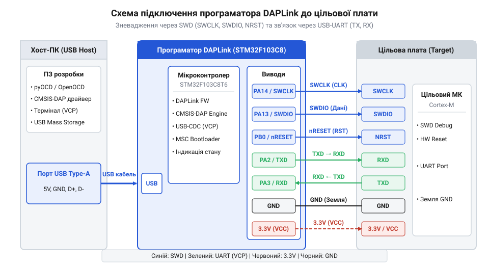

# Складання та налаштування власного програматора DAPLink на STM32

<preknowlist>
- [WeAct Mini Debugger (DAPLink / ST-Link V2.1)](root:cat-hw-boards/daplink-debugger) — розуміння апаратної будови та функцій програматорів DAPLink
- [Фірмова прошивка та протокол ST-Link V2.1](root:cat-hw-boards/stlink-v21-firmware-architecture) — уявлення про архітектуру прошивки та роботу USB VCP/MSC інтерфейсів
</preknowlist>

## Апаратна база та підготовка плати-носія

Створення власного апаратного зневаджувача починається з вибору доступної плати-носія. Популярна плата @@en|Blue Pill@@ на базі мікроконтролера @@en|STM32F103C8T6@@ містить процесорне ядро @@en|ARM Cortex-M3@@ та апаратний контролер @@en|USB 2.0 Full-Speed@@, що робить її ідеальним кандидатом для збірки адаптера [DAPLink](root:cat-hw-boards/daplink-debugger). Для перетворення цієї плати на повноцінний програматор потрібно розподілити сигнальні лінії між внутрішніми периферійними блоками мікроконтролера та фізичними виводами з'єднувача, до якого підключається цільова плата.

Інтерфейс @@en|SWD@@ (від англ. *Serial Wire Debug*) потребує двох основних ліній: лінія тактування `SWCLK` призначається на вивід `PA5`, а двонапрямлена лінія даних `SWDIO` — на `PA6`. Додатково лінія апаратного скидання `nRESET` призначається на вивід `PB0` у конфігурації з відкритим стоком (англ. @@en|open-drain@@), а лінія однопровідного трасування `SWO` — на `PA7`. Для реалізації функції віртуального послідовного порту @@en|USB VCP@@ (від англ. *Virtual COM Port*) використовується апаратний модуль @@en|USART1@@: вивід `PA9` працює як передавач `TXD`, а `PA10` — як приймач `RXD`.

Важливою апаратною особливістю плати @@en|Blue Pill@@ є підтяжка шини @@en|USB@@. Для коректної ідентифікації пристрою хостом лінія `USB D+` (вивід `PA12`) повинна мати підтягувальний резистор номіналом 1.5 кОм до лінії живлення 3.3 В. На дешевше виготовлених платах там часто впаяно резистор 10 кОм, що викликає помилки змонтування USB-пристрою в операційній системі; у такому разі номінал слід замінити або керувати підтяжкою програмно.

Під час підключення програматора до цільових плат із різною напругою живлення необхідно забезпечити узгодження логічних рівнів. Більшість сигнальних виводів мікроконтролера @@en|STM32F103C8@@ толерантні до напруги 5 В у режимі цифрового входу, проте при передачі даних до 5-вольтових пристроїв або роботі з низьковольтними цілями (1.8–2.5 В) прямого підключення недостатньо. Для захисту вхідних кіл 3.3-вольтових мікроконтролерів при прийомі сигналів від 5-вольтової периферії застосовують пасивні резистивні дільники напруги. При виборі номіналів дільника напругу на виході обчислюють за формулою `V_out = V_in · R2 / (R1 + R2)`, де для пропорції `R1 = 1 кОм` та `R2 = 2 кОм` амплітуда 5 В знижується до безпечного рівня 3.33 В. Проте критичним обмеженням є апаратна паразитна ємність вхідного виводу та провідників `C_in` (типово від 10 до 20 пФ), яка разом із еквівалентним опором Тевеніна `R_th = (R1 · R2) / (R1 + R2) = 667 Ом` утворює паразитне `RC`-коло низьких частот із постійною часу `τ = R_th · C_in`. При ємності 15 пФ постійна часу дорівнює `τ ≈ 10 нс`, що дає тривалість наростання фронту `t_r ≈ 2.2 · τ ≈ 22 нс`. Спроба використати високоомні резистори (наприклад, `R1 = 10 кОм` та `R2 = 20 кОм`) збільшує еквівалентний опір до `6.67 кОм`, а тривалість фронту — до `220 нс`, що спотворює прямокутну форму тактового сигналу `SWCLK` на частотах понад 2 МГц і призводить до збоїв синхронізації. Вибір низькоомних плечей `1 кОм` та `2 кОм` забезпечує компроміс між помірним струмом споживання (`1.67 мА`) та збереженням крутизни фронтів на високих швидкостях. Для двонапрямлених ліній даних `SWDIO` та робочих напруг менше 3.3 В використовують активні двонапрямлені схеми узгодження на @@en|MOSFET@@-транзисторах або двоканальних шинних буферах типу @@en|74LVC2T45@@, які живляться від двох незалежних опорних шин живлення та розроблені для швидкої зміни напрямку передачі даних без порушення часових затримок тактування `SWCLK`.

*Схема розводки виводів плати-носія Blue Pill та її з'єднання з цільовим мікроконтролером через лінії SWD, nRESET і UART.*

## Збірка вихідного коду та завантаження bootloader

Проєкт відкритої прошивки @@en|DAPLink@@ побудовано за модульним принципом, де шар опису плати (англ. @@en|Board Layer@@) відокремлено від ядра протоколів зневадження та @@en|USB@@-стеку. Налаштування апаратної конфігурації здійснюється у файлах `target_board.h` та `daplink_board.c` (або `target_board.cpp`), де мапуються номери виводів, конфігураційні регістри @@en|GPIO@@ та макроси керування напрямком двонапрямної лінії `SWDIO`.

:::code proj-stm32-daplink-programmer/c/target_board.h
:::code proj-stm32-daplink-programmer/c/daplink_board.c

Для автоматизації процесу комбінування та компіляції вихідних файлів використовується система збірки @@en|CMake@@ разом із крос-компілятором @@en|arm-none-eabi-gcc@@. Конфігурація `CMakeLists.txt` задає прапорці для ядра @@en|Cortex-M3@@, підключає необхідні каталоги заголовочних файлів і формує бінарні файли прошивки у форматах `.elf`, `.bin` та `.hex`.

:::tabs
:::code proj-stm32-daplink-programmer/c/CMakeLists.txt
:::code proj-stm32-daplink-programmer/cpp/CMakeLists.txt
:::code proj-stm32-daplink-programmer/cpp/include/target_board.h
:::code proj-stm32-daplink-programmer/cpp/src/target_board.cpp
:::

Первинний запис завантажника (англ. @@en|bootloader@@) у флеш-пам'ять @@en|STM32F103C8@@ виконується через вбудований системний завантажувач по інтерфейсу @@en|UART@@ (перемикач `BOOT0` у положення 1) або за допомогою зовнішнього програматора через [архітектуру ST-Link V2.1](root:cat-hw-boards/stlink-v21-firmware-architecture). Після успішного завантаження бінарного файлу `bootloader.bin` і повернення `BOOT0` у 0 плата підключається до операційної системи через @@en|USB@@, де розпізнається як знімний накопичувач @@en|MSC@@ (від англ. *Mass Storage Class*) з міткою `DAPLINK`.

Вибір джерела завантаження мікроконтролера серії @@en|STM32F103C8@@ здійснюється апаратно за допомогою логічних рівнів на виводах `BOOT0` та `BOOT1`, які ядро фіксує в момент підйому фронту сигнальної лінії скидання. Для активації затиснутого в масочній пам'яті @@en|ROM Bootloader@@ (від англ. @@en|bootloader@@ — завантажувач) у системній пам'яті (англ. @@en|System Memory@@ за адресою `0x1FFF0000`) необхідно встановити джампер `BOOT0` у положення логічної одиниці (підтяжка до шини 3.3 В), а джампер `BOOT1` залишити в положенні логічного нуля (підтяжка до заземлення @@en|GND@@). Якщо `BOOT1` також перевести у стан логічної одиниці, процесор спробує виконати код із внутрішньої оперативної пам'яті @@en|SRAM@@ (від англ. @@en|Static Random-Access Memory@@ — статична пам'ять із довільним доступом за адресою `0x20000000`), що використовується лише під час оперативної відлагоджувальної прошивки. Після встановлення комбінації `BOOT0=1` та `BOOT1=0` і подачі імпульсу скидання мікроконтролер запускає внутрішній периферійний інтерфейс @@en|USART1@@ (на виводах `PA9/TX` та `PA10/RX`), дозволяючи завантажити `bootloader.bin` консольною утилітою @@en|stm32flash@@ або графічним середовищем @@en|STM32CubeProgrammer@@. По завершенні запису джампер `BOOT0` обов'язково повертають у положення 0 (початкова адреса флеш-пам'яті `0x08000000`), що гарантує автономний запуск завантаженої прошивки @@en|DAPLink@@ при кожному наступному ввімкненні живлення.

## Прошивка DAPLink та перевірка з OpenOCD

Після змонтування віртуального накопичувача запис основної прошивки зневаджувача виконується шляхом звичайного перетягування файлу `daplink_firmware.bin` на цей диск. Вбудований @@en|bootloader@@ перехоплює файлову операцію запису в сектори @@en|FAT16@@, самостійно програмує робочий образ прошивки у верхній блок флеш-пам'яті мікроконтролера й ініціює автоматичне перезавантаження пристрою.

Після перезапуску операційна система розпізнає складений @@en|USB Composite Device@@ пристрій, який містить інтерфейс зневадження @@en|CMSIS-DAP v1/v2@@ та віртуальний послідовний порт @@en|USB VCP@@. Для перевірки роботи послідовного порту достатньо відкрити відповідний @@en|COM-порт@@ у термінальній утиліті на швидкості 115200 бод та переконатися у двонапрямному обміні даними між комп'ютером і цільовою платою.

Перевірка інтерфейсу зневадження виконується за допомогою утиліти [OpenOCD](root:sf-devices/openocd-debugger-basics) (від англ. *Open On-Chip Debugger*) або @@en|pyOCD@@. Під час запуску @@en|OpenOCD@@ із конфігураційним файлом `interface/cmsis-dap.cfg` утиліта підключається до програматора, ініціалізує тактування `SWCLK` і зчитує ідентифікатор цільового ядра @@en|CoreSight IDCODE@@. Успішне зчитування регістрів та можливість зупинки процесора підтверджують повну готовність саморобного програматора до роботи.

Для роботи з нетиповими платами або довільним перерозподілом ліній `SWCLK`, `SWDIO` та `nRESET` створюють власний файл конфігурації @@en|OpenOCD@@ (наприклад, `custom_daplink.cfg`). У ньому послідовно визначають команду вибору апаратного драйвера `adapter driver cmsis-dap`, явно задають транспортний протокол `transport select swd` та налаштовують граничну тактову частоту шини за допомогою директиви `adapter speed 1000` (значення в кГц). Початкове значення частоти 1 МГц обирають для гарантованого встановлення зв'язку через довгі з'єднувальні шлейфи з високою паразитною ємністю, після чого для прискорення читання флеш-пам'яті її підвищують до 4000 кГц. За потреби від фільтрації USB-пристроїв у файл додають специфічні ідентифікатори @@en|VID/PID@@ (`cmsis_dap_vid_pid`), а налаштування механізму скидання цільового ядра підключають командою `reset_config srst_only` або `reset_config sysresetreq`. Завершальним кроком до конфігурації імпортують файл цільового мікроконтролера (наприклад, `source [find target/stm32f1x.cfg]`), що остаточно зв'язує карту сигнальних виводів адаптера з регістрами зневадження конкретного чипа.
