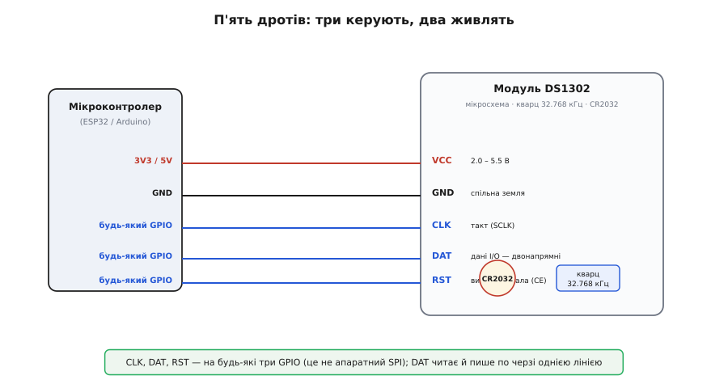
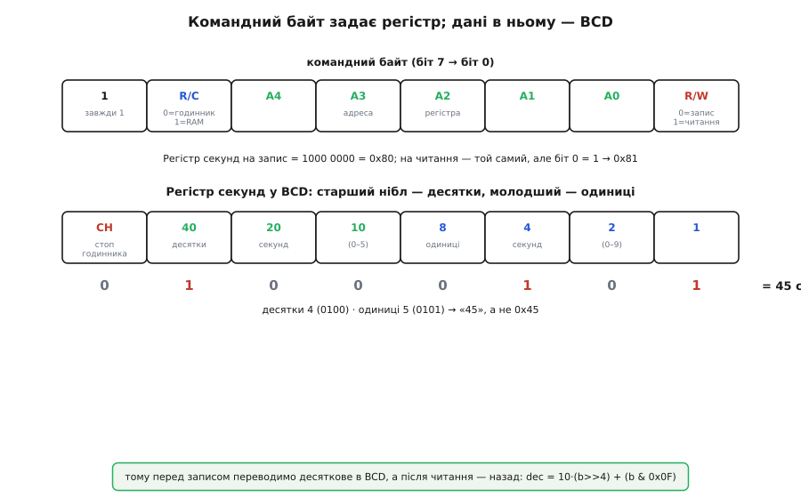

# DS1302 — RTC-модуль (CR2032)

## Призначення та автономний хід DS1302

Головний контролер будь-якого пристрою втрачає відлік часу при знеструмленні: після перезапуску його внутрішні таймери обнуляються. Для збереження дати й секунд у автономних реєстраторах із [microSD-модулем](root:cat-hw-boards/microsd-card) потрібен окремий вузол, що працює незалежно від основного живлення. Спеціалізована мікросхема @@en|DS1302@@ від @@en|Dallas Semiconductor@@ виконує роль @@en|RTC@@ (англ. @@en|real-time clock@@, від real — справжній, time — час, clock — годинник) — автономного годинника реального часу. Вона постійно веде відлік секунд, хвилин, годин, чисел місяця, днів тижня й років. Це дає змогу мікроконтролеру одразу діставати точний час без підключення до мережі.

## Резервне живлення та кварцовий резонатор

Точність ходу годинника забезпечує @@en|кварцовий резонатор@@ (від нім. Quarz — кварц) на 32.768 кГц. Частота 32768 дорівнює 2¹⁵, тому 15-розрядний двійковий дільник усередині мікросхеми утворює рівно один секундний імпульс. Для автономної роботи модуль оснащено монетною батарейкою @@en|CR2032@@. Автоматичний внутрішній перемикач безшовно переводить мікросхему на резервне живлення при зникненні зовнішньої напруги VCC. У режимі збереження часу чип споживає лише десятки наноампер, що гарантує роботу годинника роками.

*Схема автономного живлення та тактування модуля DS1302.*

## Трипровідний інтерфейс та BCD-кодування

Обмін даними відбувається через 3-провідний синхронний інтерфейс, що складається з ліній @@en|CLK@@ (тактування), @@en|DAT@@ (двонапрямні дані) та @@en|RST@@ (вибір чипа). Оскільки цей протокол не потребує апаратних шин, @@en|програмний обмін@@ (англ. @@en|bit-banging@@, від bit — біт, bang — ударяти) реалізують на будь-яких вільних виводах @@en|GPIO@@ (англ. @@en|general-purpose input/output@@, від general — загальний, purpose — призначення, input — вхід, output — вихід). Значення дати й часу зберігаються в регістрах у форматі @@en|BCD@@ (англ. @@en|binary-coded decimal@@, двійково-кодоване десяткове, від binary — двійковий, code — код, decimal — десятковий), де старший нібл містить десятки, а молодший — одиниці.

*Структура командного байта та формат зберігання даних BCD у регістрах DS1302.*

## Керуючі біти та безпека батареї

У регістрах модуля розміщено два критичні прапорці. Старший біт @@en|CH@@ (англ. @@en|clock halt@@, зупинка годинника) у регістрі секунд зупиняє генератор при значенні 1, тому при першому запуску його обов'язково скидають у 0. Біт @@en|WP@@ (англ. @@en|write protect@@, захист від запису) у регістрі `0x8E` блокує зміну часу, і його знімають перед записом нових даних. Мікросхема підтримує @@en|крапельний підзаряд@@ (англ. @@en|trickle-charge@@, від trickle — стікати краплями, charge — заряджати) через регістр `0x90`, проте цю функцію суворо заборонено вмикати для одноразової батарейки @@en|CR2032@@, щоб уникнути її перегріву й витоку. Акумулятори @@en|LIR2032@@ підзаряджати дозволено.

## Підключення модуля та підводні камені

Модуль підключають п'ятьма провідниками до живлення та трьох цифрових пінів мікроконтролера. При програмній реалізації лінію @@en|DAT@@ необхідно вручну перемикати між режимами виходу та входу залежно від напрямку передачі. Усі зчитані з регістрів значення @@en|BCD@@ перед використанням у коді конвертують у десяткові числа через зсув на 4 біти та множення десятків. Окремо варто враховувати, що регістр року зберігає лише дві останні цифри, а день тижня є незалежним лічильником від 1 до 7, який не обчислюється з дати автоматично.
