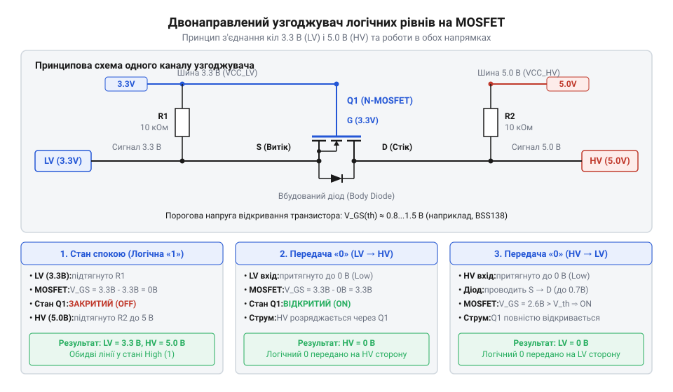
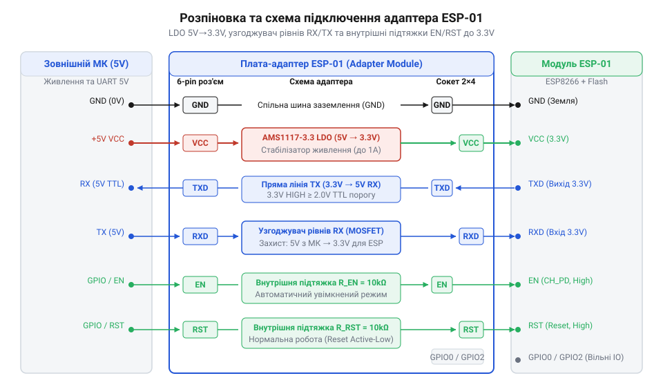

# Апаратний інтерфейс адаптера ESP-01: принципова схема, розпіновка та електричні рівні

<preknowlist>
- [USB-UART адаптер CP2102 (Micro-USB)](root:cat-hw-boards/cp2102-usb-uart) — принципи послідовної передачі даних через UART, призначення ліній RX/TX та спільні вимоги до заземлення.
- [Плата-адаптер для ESP32-CAM (CH340, Type-C)](root:cat-hw-boards/esp32-cam-programmer) — архітектура спеціалізованих адаптерів для Wi-Fi модулів та організація кіл живлення та узгодження ліній.
</preknowlist>

## Проблема прямого підключення ESP-01

Пряме підключення Wi-Fi модуля @@en|ESP-01@@ (англ. @@en|Espressif@@) на чипі @@en|ESP8266@@ до 5-вольтових плат призводить до нестабільності чи виходу з ладу. Модуль вимагає живлення 3.0–3.6 В (номінально 3.3 В). Подача 5 В на контакт @@en|VCC@@ викликає електричний пробій оксиду затворів @@en|CMOS@@-транзисторів (англ. @@en|Complementary Metal-Oxide-Semiconductor@@, комплементарний метал-оксид-напівпровідник) і руйнує кристал.

Штатний вихід 3.3 В керуючої плати не підходить: під час імпульсів радіопередачі струм @@en|ESP-01@@ зростає від 70–170 мА до пікових 300–500 мА. Вбудовані стабілізатори розраховані лише на 50–150 мА, тому напруга просідає нижче 3.0 В, що активує детектор @@en|Brownout@@ (англ. @@en|Brownout Reset@@, скидання при зниженні живлення) та перезавантажує чип.

Рівні інтерфейсу @@en|UART@@ (англ. @@en|Universal Asynchronous Receiver-Transmitter@@, універсальний асинхронний приймач-передавач) також несумісні. 5-вольтові пристрої формують на лінії transmission @@en|TX@@ рівень 5 В, тоді як входи @@en|ESP8266@@ обмежені значенням `V_IO_max = VCC + 0.3 V` (близько 3.6 В). Сигнал 5 В на вхід reception @@en|RX@@ створює надмірний струм через @@en|ESD@@-діоди (англ. @@en|Electrostatic Discharge@@, захист від електростатичного розряду) чи p-n перехід, викликаючи перегрів, деградацію кристала та спотворення даних.

Службові лінії @@en|EN@@ (англ. @@en|Enable@@, активація чипа, також позначувана як @@en|CH_PD@@) та @@en|RST@@ (англ. @@en|Reset@@, апаратне скидання) у плаваючому стані призводять до самочинних перезапусків чи засинання. Порівняно з [іншими послідовними адаптерами](root:cat-hw-boards/cp2102-usb-uart) або [адаптером для ESP32-CAM](root:cat-hw-boards/esp32-cam-programmer), модуль @@en|ESP-01@@ вимагає проміжної плати для стабілізації живлення та узгодження рівнів.

## Принципова схема та живлення адаптера

Живлення модуля @@en|ESP-01@@ вимагає стабільної напруги 3.3 В та струму до 400 мА у піках передачі даних. Для підключення до стандартних 5-вольтних джерел адаптер використовує лінійний стабілізатор напруги @@en|LDO@@ (англ. *low dropout*, низьке падіння напруги) @@en|AMS1117-3.3@@. Він приймає вхідну напругу `V_in` у діапазоні 4.5–6.0 В та знижує її до фіксованої вихідної напруги `V_out = 3.3 V`. ESP-01@@ вимагає стабільної напруги 3.3 В | Більше про принципи функціонування та розрахунок теплового розсіювання LDO-регулятора читайте в матеріалі про [лінійний регулятор напруги AMS1117](root:cat-hw-power/ams1117-linear-regulator).

Шина живлення містить вхідний згладжувальний конденсатор `C_in` ємністю 10 мкФ та вихідну ємність `C_out` із двох паралельних конденсаторів — керамічного чи танталового на 10–100 мкФ і декомплектуючого на 100 нФ. Вихідна ємність працює як буфер енергії: під час увімкнення передавача @@en|Wi-Fi@@ вона віддає накопичений заряд, компенсуючи інерційність стабілізатора та запобігаючи просіданню напруги.

Надлишок напруги стабілізатор перетворює на тепло, яке розсіюється корпусом @@en|SOT-223@@. Для вхідної напруги `V_in = 5.0 V`, вихідної `V_out = 3.3 V` та середнього струму споживання `I_out = 0.2 A` теплова потужність `P_d` обчислюється так:

```
P_d = (V_in - V_out) × I_out
    = (5.0 - 3.3) × 0.2      [різниця напруг на середній струм]
    = 1.7 × 0.2              [падіння напруги на стабілізаторі]
    = 0.34 W                 [розсіювана теплова потужність]
```

Для корпусу @@en|SOT-223@@ тепловий опір між кристалом і середовищем становить `R_θJA = 90 °C/W`. Перевищення температури кристала `ΔT` над навколишнім середовищем розраховується за формулою:

```
ΔT = P_d × R_θJA
   = 0.34 × 90              [добуток потужності на тепловий опір]
   = 30.6 °C                [підйом температури кристала]
```

За кімнатної температури 25 °C кристал нагрівається до 55.6 °C, що безпечно для мікросхеми (межа 125 °C). При зростанні напруги до `V_in = 6.0 V` середня потужність досягає `P_d = 0.81 W`, а температура кристала зростає майже до 98 °C. Через це оптимальним джерелом живлення для адаптера є стабілізована напруга 5.0 В.

## Узгодження логічних рівнів сигнальних ліній

Для безпечного з'єднання 5-вольтової логіки мікроконтролера та 3.3-вольтових виводів @@en|ESP-01@@ адаптер містить двонаправлені перетворювачі рівнів на N-канальних польових транзисторах @@en|MOSFET@@ для ліній @@en|RX@@ та @@en|TX@@. Детальніше про схемотехніку й динаміку перемикання таких конвертерів читайте в статті про [двонаправлений транзисторний узгоджувач логічних рівнів](root:hw-digital/mosfet-level-shifter).


*Схема двонаправленого перетворювача рівнів на MOSFET-транзисторі, що забезпечує безпечне спряження сигнальних ліній 5 В та 3.3 В.*

Канал складається з транзистора @@en|BSS138@@ та двох підтягувальних резисторів `R_LV = 10 kΩ` і `R_HV = 10 kΩ`. Затвор `G` під'єднано до `V_LV = 3.3 V`, витік `S` — до 3.3-вольтової лінії @@en|LV@@ (вивід @@en|ESP-01@@), а стік `D` — до 5-вольтової лінії @@en|HV@@ (зовнішній контакт). Вбудований діод субстрату під'єднано анодом до витоку, а катодом — до стоку.

Схема працює в трьох станах:

1. **Передача логічної одиниці**. При 3.3 В на стороні @@en|LV@@ напруга затвор-витік `V_GS = 3.3 V - 3.3 V = 0 V`. Оскільки `V_GS < V_GS(th)`, транзистор закритий. Резистори підтягують лінію @@en|HV@@ до 5 В, а @@en|LV@@ — до 3.3 В, витримуючи рівень одиниці для обох пристроїв.

2. **Передача нуля від 5V-пристрою до ESP-01**. Коли зовнішній пристрій притягує лінію @@en|HV@@ до 0 В, діод субстрату відкривається й знижує напругу на витоку до ~0.7 В. При цьому `V_GS` зростає до ~2.6 В і перевищує `V_GS(th)`. Транзистор відкривається й розряджає лінію @@en|LV@@ до 0 В.

3. **Передача нуля від ESP-01 до 5V-пристрою**. Коли @@en|ESP-01@@ притягує лінію @@en|LV@@ до 0 В, напруга `V_GS` зростає до `3.3 V > V_GS(th)`. Відкритий транзистор з'єднує лінію @@en|HV@@ із землею через ключ модуля, притягуючи 5-вольтову сторону до 0 В.

Паразитні ємності `C_p` у поєднанні з опорами підтяжки утворюють @@en|RC@@-ланцюг, що затягує фронти сигналів. Для збереження прямокутних імпульсів на високих швидкостях передачі опори підтяжки добирають у межах від 2.2 кОм до 10 кОм.

## Призначення та розпіновка зовнішніх роз'ємів

Адаптер має два комутаційні вузли: зовнішній 6-контактний роз'єм для керуючої плати чи @@en|USB-UART@@ конвертера та внутрішню розетку @@en|PBD-8@@ (2x4 контакти) із кроком 2.54 мм для модуля @@en|ESP-01@@.


*Розпіновка зовнішніх інтерфейсних контактів адаптера ESP-01 та внутрішніх ліній сокета з вбудованими резисторами підтяжки.*

Зовнішній 6-піновий роз'єм містить сигнали:

* `@@en|VCC@@`: вхід живлення адаптера (4.5–6.0 В від джерела або штифту 5V мікроконтролера).
* `@@en|GND@@`: спільне заземлення (0 В) керуючої системи.
* `@@en|TX@@` (або @@en|TXD@@): вихід даних від @@en|ESP-01@@ до мікроконтролера з рівнем 5 В (підключається до `@@en|RX@@`).
* `@@en|RX@@` (або @@en|RXD@@): вхід даних 5 В від мікроконтролера до @@en|ESP-01@@ через конвертер (підключається до `@@en|TX@@`).
* `@@en|EN@@` (або @@en|CH_PD@@): контакт активації чипа.
* `@@en|RST@@`: контакт апаратного скидання модуля (перезавантаження при замиканні на землю).

Сокет 2x4 відтворює цокольовку @@en|ESP-01@@. Для службових ліній схему оснащено вбудованими @@en|SMD@@ резисторами підтяжки 10 кОм до шини 3.3 В:

1. `Pin 1 (GND)`: з'єднано із загальною землею.
2. `Pin 2 (GPIO2)`: виведений без підтяжки для вибору режиму завантаження.
3. `Pin 3 (GPIO0)`: підтягнутий до 3.3 В для запуску з флеш-пам'яті; при замиканні на землю переходить у режим прошивки.
4. `Pin 4 (RXD)`: під'єднано до сторони @@en|LV1@@ перетворювача рівнів.
5. `Pin 5 (TXD)`: під'єднано до сторони @@en|LV2@@ перетворювача рівнів.
6. `Pin 6 (CH_PD / EN)`: підтягнутий до 3.3 В для постійної активації чипа.
7. `Pin 7 (RST)`: підтягнутий до 3.3 В для запобігання хибним перезавантаженням від наводок.
8. `Pin 8 (VCC)`: під'єднано до виходу 3.3 В регулятора @@en|AMS1117-3.3@@.

Орієнтацію модуля визначає ключ на шовкографії: антена @@en|PCB@@ модуля @@en|ESP-01@@ має дивитися назовні плати, щоб металеві роз'єми не екранували Wi-Fi сигнал.

## Часові характеристики та граничні навантаження

Час наростання фронту `t_r` обмежується швидкістю заряджання ємності лінії. Опір підтяжки `R_HV = 10 kΩ` та паразитні ємності `C_p = 30 pF` утворюють @@en|RC@@-ланцюг зі сталою часу `τ`:

```
τ = R_HV × C_p
  = 10000 × (30 × 10⁻¹²)    [добуток опору на ємність]
  = 300 ns                  [стала часу]
```

Стала часу `τ = 300 ns` визначає інерційність. Фронт наростання `t_r` від 10% до 90% обчислюють через `τ`:

```
t_r = 2.2 × τ
    = 2.2 × 300             [множник стандартного фронту]
    = 660 ns                [тривалість фронту]
```

Затримка `t_r = 660 ns` обмежує швидкість. При @@en|UART@@ 115200 біт/с тривалість біта `T_bit` становить:

```
T_bit = 1 / 115200
      ≈ 8.68 µs             [тривалість біта]
```

Фронт `t_r = 0.66 µs` займає 7.6% від `T_bit = 8.68 µs`, зберігаючи прямокутну форму імпульсу. При 921600 біт/с біт скорочується до `T_bit ≈ 1.09 µs`, і той самий фронт займає понад 60% часу, перетворюючи імпульс на трикутний і викликаючи помилку кадрування @@en|Framing Error@@ (англ. frame — кадр). Для високих швидкостей опір підтяжки зменшують до 2.2 кОм.

Граничні навантаження адаптера обмежені його деталями:

* Вхідна напруга `V_in_max`: 6.0 В тривало (понад 9 В руйнує стабілізатор).
* Струм навантаження `I_out_max`: 500 мА (через обмеження тепловідведення @@en|AMS1117-3.3@@).
* Напруга сигнальних ліній 5V `V_HV_max`: 5.5 В.
* Струм цифрових виводів: до 10 мА на канал.

## Діагностика та усунення несправностей схеми

Діагностику схеми адаптера @@en|ESP-01@@ виконують покроковим вимірюванням напруг та аналізом сигналів мультиметром чи осцилографом.

1. **Симптом: Модуль перезавантажується при підключенні до @@en|Wi-Fi@@ або виводить збої в консоль (скидання через просідання живлення — англ. @@en|Brownout Reset@@)**.
   * *Причина*: Просідання напруги 3.3 В нижче 3.0 В через слабке джерело 5 В чи опір дротів.
   * *Діагностика*: Перевірте осцилографом контакт 8 (VCC 3.3V) сокета 2x4 у режимі @@en|Single Trigger@@ — просідання понад 0.3 В при включенні @@en|Wi-Fi@@ вказує на брак струму.
   * *Усунення*: Використайте джерело 5 В від 1 А та додайте конденсатор 220–470 мкФ між @@en|VCC@@ і @@en|GND@@.

2. **Симптом: Відсутній зв'язок по @@en|UART@@ або дані викривлені**.
   * *Причина*: Переплутано лінії @@en|TX@@/@@en|RX@@, відсутня спільна земля чи пробито транзистор узгоджувача рівнів.
   * *Діагностика*: Перевірте кросове з'єднання (@@en|TX@@ на @@en|RX@@, @@en|RX@@ на @@en|TX@@). У спокої на контактах @@en|RX@@ і @@en|TX@@ має бути 5 В. Якщо на стороні високої напруги (англ. @@en|High Voltage@@, @@en|HV@@) є 5 В, а на сокеті 2x4 низької напруги (англ. @@en|Low Voltage@@, @@en|LV@@) без @@en|ESP-01@@ — 0 В, підтяжку обірвано або транзистор пробито.
   * *Усунення*: Відновіть кросову комутацію, з'єднайте землі та замініть транзистор @@en|BSS138@@.

3. **Симптом: Модуль не виконує код при світінні індикатора живлення**.
   * *Причина*: Низький рівень на лініях @@en|EN@@ або @@en|RST@@ через несправну підтяжку.
   * *Діагностика*: Без @@en|ESP-01@@ виміряйте напругу на штифтах 6 (EN) та 7 (RST) сокета 2x4 відносно @@en|GND@@ — має бути 3.3 В.
   * *Усунення*: При 0 В відновіть пропайку резисторів 10 кОм поверхневого монтажу (англ. @@en|Surface-Mount Device@@, @@en|SMD@@) чи додайте зовнішні резистори до шини 3.3 В.
