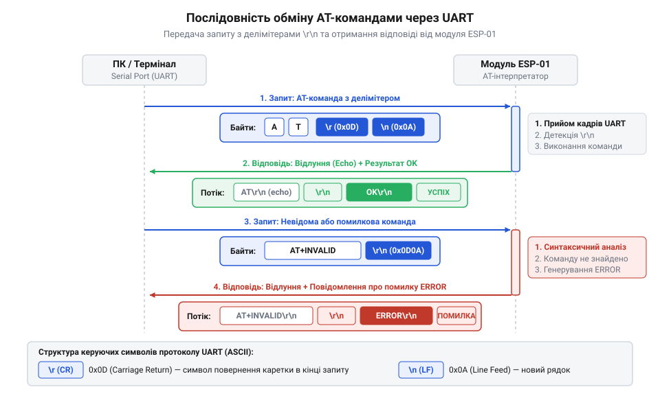

# Програмний інтерфейс AT-команд для первинного тестування ESP-01 через адаптер

<preknowlist>
- [USB-UART адаптер CP2102 (Micro-USB)](root:cat-hw-boards/cp2102-usb-uart) — призначення ліній RX/TX, логічні рівні 3.3 В та створення послідовного COM-порта
</preknowlist>

## Нерозпізнаний модуль і текстовий протокол

Перше підключення модуля @@en|ESP-01@@ до ПК через [USB-UART адаптер](root:cat-hw-boards/cp2102-usb-uart) часто супроводжується «мовчанням» термінала або виводом хаотичного набору символів. Ця проблема виникає через неузгодженість базових швидкостей обміну: вбудований первинний завантажувач мікроконтролера @@en|ESP8266@@ виводить службові логи на швидкості 74880 бод, тоді як стандартний опитувач прошивки працює на 115200 або 9600 бод. Без знання поточного стану пристрою пряма передача бінарних даних або команд керування стає неможливою.

Для діагностики та конфігурування без написання користувацького коду використовують AT-команди (англ. @@en|AT commands@@, від скорочення англ. @@en|attention@@ — увага). Це текстовий протокол режиму «запит-відповідь», у якому хост надсилає коротку текстову стрічку, а модуль повертає результат її виконання.

Кожен текстовий кадр запиту обов'язково завершується двома управляючими символами розриву рядка — поверненням каретки `\r` (символ `0x0D`) та переведенням рядка `\n` (символ `0x0A`). У текстовому протоколі цей блок називається @@en|CRLF@@ (від англ. @@en|Carriage Return / Line Feed@@ — повернення каретки та переведення рядка). Якщо термінал не додає `\r\n` в кінці команди, приймальний буфер модуля очікує завершення кадру нескінченно й не передає команду на виконання інтерпретатору.

## Перевірка зв'язку та зчитування версії

Після налаштування термінала на передачу символів `\r\n` перевірка апаратної готовності модуля виконується надсиланням тестового запиту `AT`. У відповідь пристрій повертає відлуння (англ. @@en|echo@@, від грецького *echo* — відбитий звук) запиту та підтвердження `OK`. Перевірити стан після перезавантаження дозволяє відповідь `ready`, яку прошивка виводить у момент завершення внутрішньої ініціалізації після подачі живлення або скидання лінії `RST`.

Зчитування системної інформації здійснюється викликом `AT+GMR`. Модуль повертає версію командного інтерпретатора @@en|AT@@, версію @@en|SDK@@ (англ. @@en|Software Development Kit@@ — набір засобів розробки) та дату збірки. Це дозволяє визначити перелік підтримуваних функцій, оскільки синтаксис деяких команд різниться між версіями прошивок. Якщо визначена версія є застарілою або не містить необхідних функцій, виконайте [оновлення прошивки та прошивання ESP-01](root:cat-hw-boards/esp01-firmware-flashing).

*Схема послідовності обміну даними ілюструє структури запиту й відповіді з обов'язковими управляючими символами розриву рядка.*

Системні відповіді модуля поділяються на три основні типи:
1. `OK` — команду успішно розпізнано та виконано.
2. `ERROR` — виявлено синтаксичну помилку в текстовому кадрі або передано неприпустимі параметри.
3. `busy p...` (англ. @@en|busy@@ — зайнятий) — пристрій виконує попередній тривалий процес (наприклад, сканування ефіру) і тимчасово не приймає нові запити.

Якщо замість очікуваної відповіді модуль хаотично перезавантажується або виводить сміття, причиною є просідання напруги на лінії живлення 3.3 В під час стрибків споживання струму радіомодулем.

## Керування швидкістю послідовного порта

За замовчуванням більшість фабричних прошивок @@en|ESP-01@@ налаштовано на швидкість 115200 бод (англ. @@en|baud rate@@, від прізвища винахідника Еміля Бодо, англ. @@en|Emile Baudot@@). При підключенні до малопотужних мікроконтролерів із програмним @@en|UART@@ виникають часові похибки та втрата байтів, що вимагає зниження швидкості, наприклад, до 9600 бод.

Зміна параметрів послідовного порта виконується за допомогою двох команд:
- `AT+UART_CUR=<baudrate>,<databits>,<stopbits>,<parity>,<flowcontrol>` — тимчасова конфігурація (англ. @@en|current UART configuration@@). Налаштування застосовуються негайно у @@en|RAM@@ (від англ. @@en|Random Access Memory@@ — оперативна пам'ять) і діють до першого скидання живлення. Якщо під час вибору нової швидкості зв'язок втрачено, перезавантаження модуля повертає початкові параметри.
- `AT+UART_DEF=<baudrate>,<databits>,<stopbits>,<parity>,<flowcontrol>` — конфігурація за замовчуванням (англ. @@en|default UART configuration@@). Параметри записуються в енергонезалежну флеш-пам'ять (англ. @@en|flash memory@@, від англ. @@en|flash@@ — спалах) пристрою та зберігаються після вимкнення живлення.

Виконання команди `AT+UART_CUR=9600,8,1,0,0` безпечно перемикає порт на 9600 бод, 8 біт даних, 1 стоп-біт, без парності та без апаратного контролю потоку для перевірки стабільності з'єднання.

## Налаштування базових режимів Wi-Fi

Після узгодження швидкості порта переходять до перевірки радіомодуля. Пристрій підтримує три режими роботи @@en|Wi-Fi@@: режим клієнта або станції (англ. @@en|Station mode@@, від лат. *statio* — стоянка), режим точки доступу (англ. @@en|SoftAP@@, від англ. @@en|Software Access Point@@ — програмна точка доступу) та комбінований режим.

Перевірити поточний режим дає змогу запит `AT+CWMODE?`. Зміна режиму здійснюється командами `AT+CWMODE_CUR=<mode>` (тимчасово) або `AT+CWMODE_DEF=<mode>` (збереження у флеш-пам'ять), де значення `<mode>` дорівнює `1` для станції, `2` для точки доступу та `3` для комбінованого режиму.

Кожна зміна режиму @@en|Wi-Fi@@ вимагає внутрішньої ініціалізації @@en|RF@@-тракту (англ. @@en|Radio Frequency@@ — радіочастота). Мережеві виклики виконуються з часовими затримками від сотень мікросекунд до кількох секунд. Спроба надіслати наступну команду до отримання `OK` чи `ERROR` призведе до помилки `BUSY`. Подальші мережеві операції, такі як відкриття [мережевих сокетів](root:cat-hw-boards/esp01-tcp-udp-sockets) чи оновлення прошивки, потребують урахування цих часових інтервалів.
