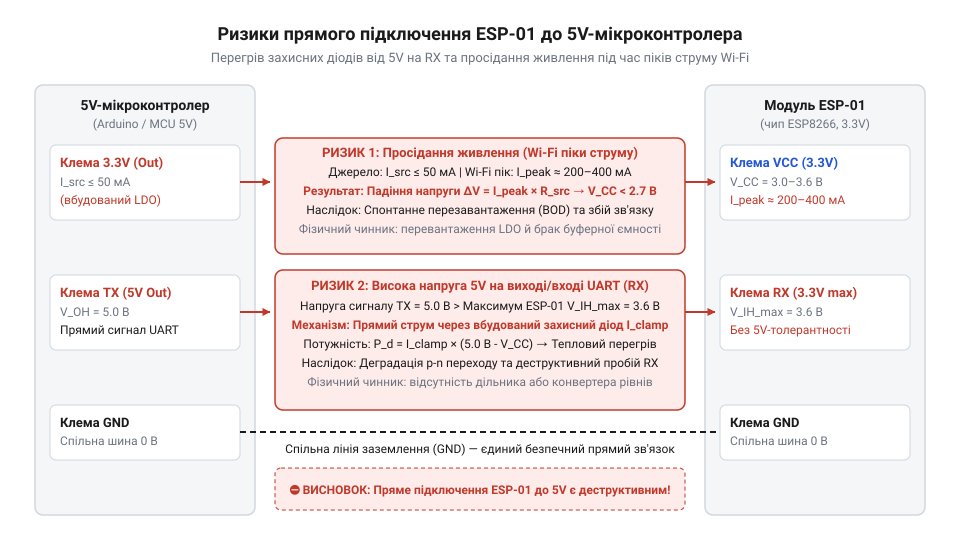
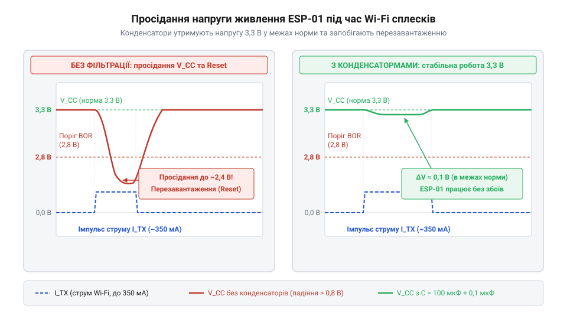
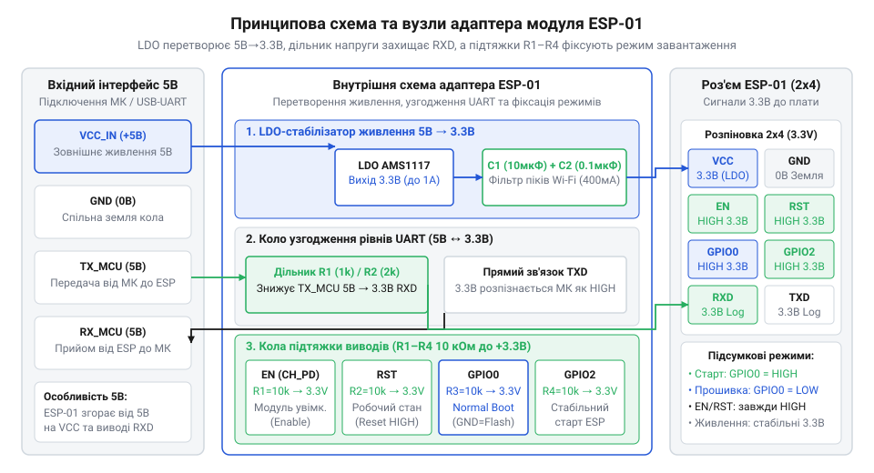

# Адаптер живлення й підключення ESP-01

<preknowlist>
- [USB-UART адаптер CP2102 (Micro-USB)](root:cat-hw-boards/cp2102-usb-uart) — Принципи послідовного інтерфейсу UART, призначення ліній TX/RX та вимога спільного заземлення GND для з'єднання пристроїв.
</preknowlist>

## Спроба прямого підключення модуля ESP-01

Спроба з'єднати бездротовий модуль `@@en|ESP-01@@` безпосередньо з 5-вольтовою мікроконтролерною платою або звичайним джерелом живлення майже завжди призводить до нестабільної роботи чи навіть виходу пристрою з ладу. Причиною є несумісність електричних характеристик та конструктивних параметрів модуля з типовим обладнанням.

Чип `@@en|ESP8266@@`, на якому побудований модуль `@@en|ESP-01@@`, розрахований на номінальну напругу живлення 3.3 В з допустимим діапазоном від 3.0 В до 3.6 В. Коли розробник подає на контакт VCC напругу 5 В від плати `@@en|Arduino Uno@@` або від USB-порту, всередині напівпровідникової структури відбувається електричний пробій p-n переходів. Аналогічна небезпека виникає і на сигнальних лініях: якщо на цифровий вхід `@@en|RX@@` (від англ. @@en|Receiver@@ — приймач даних) модуля надходить 5-вольтний логічний сигнал від мікроконтролера, вхідний буфер чипа піддається критичному перевантаженню, що викликає швидкий перегрів і руйнування кристала.


*Схема ілюструє виникнення небезпечних струмів у лінії RX та просідання живлення при прямому з'єднанні.*

Друга суттєва перешкода полягає у струмовому режимі. У стані спокою або під час звичайного прийому даних модуль споживає струм у межах 20–70 мА. Однак у моменти активації `@@en|Wi-Fi@@`-передавача та випромінювання високочастотного радіосигналу споживання струму миттєво зростає до пікових значень 200–300 мА. Фізична природа цих короткочасних сплесків полягає в тому, що під час передачі пакетів даних підсилювач потужності (від англ. @@en|power amplifier@@ — підсилювач потужності) радіотракту миттєво випромінює радіосигнал і вимагає стрімкого постачання заряду з надзвичайно крутим фронтом наростання струму. Більшість популярних плат розширення та перетворювачів інтерфейсів, як-от [перетворювач послідовного порту](root:cat-hw-boards/cp2102-usb-uart), мають вбудовані регулятори 3.3 В, які розраховані лише на статичний струм до 50–100 мА. Вони не встигають зреагувати на такі імпульси через повільну перехідну характеристику контуру зворотного зв'язку, а малоємні вихідні конденсатори розряджаються за частки мікросекунди. У момент радіовипромінювання напруга живлення різко падає, що викликає `@@en|brown-out reset@@` (від англ. @@en|brown-out reset@@ — скидання мікроконтролера при просіданні живлення) або повне зависання модуля.

Окрім електричних проблем, виникає суто фізичне ускладнення при складанні схеми. Модуль `@@en|ESP-01@@` має дворядний вихідний роз'єм типу 2x4 з кроком 2.54 мм. Якщо спробувати встановити його безпосередньо у макетну плату `@@en|breadboard@@` (від англ. @@en|breadboard@@ — макетна плата без паяння, від історичної дошки для різання хліба, де деталі кріпили цвяхами), протилежні штирі вставки потрапляють на одну й ту саму контактну рейку, створюючи коротке замикання між виводами.

З моменту появи модуля `@@en|ESP-01@@` у 2014 році наддешевий чип `@@en|ESP8266@@` спричинив бум в аматорській електроніці, відкривши доступ до мережі `@@en|Wi-Fi@@` для найпростіших проєктів. Проте розробники одразу зіткнулися з труднощами підключення: дворядний роз'єм 2x4 не підходив для макетних плат, а живлення 3.3 В вимагало високих пікових струмів до 300 мА. Спочатку аматори будували саморобні дільники напруги та зовнішні `@@en|LDO-стабілізатори@@` на безпайкових платах, що часто спричиняло ненадійний зв'язок через довгі провідники. Це призвело до масового виробництва дешевих плашок-адаптерів з роз'ємом 2x4, стабілізатором `@@en|AMS1117-3.3@@` та транзисторними перетворювачами рівнів, які зробили `@@en|ESP-01@@` стандартним доповненням для 5-вольтових платформ.

Отже, стабільна робота пристрою вимагає проміжного вузла, який знижує вхідну напругу, компенсує кидки струму та адаптує сигнальні рівні. Докладні характеристики самого мікроконтролера описує огляд [сімейства бездротових чипів](root:cat-hw-boards/esp-01-module-family-overview), а геометрію контактів та електричні межі модуля детально розкриває [апаратний довідник плати](root:cat-hw-boards/esp-01-adapter/api-esp01-adapter-hardware-interface.md) адаптера.

## Стабілізація живлення та згладжування імпульсів

Щоб забезпечити модуль `@@en|ESP-01@@` якісною енергією від 5-вольтової лінії, на платі-адаптері встановлено вузол стабілізації напруги та фільтрації імпульсних завад. Основу цього вузла становить `@@en|LDO-стабілізатор@@` (від англ. @@en|Low Dropout Regulator@@ — стабілізатор напруги з малим падінням), найпоширенішим представником якого є чип `@@en|AMS1117-3.3@@`.

Принцип роботи лінійного регулятора полягає у безперервній зміні опору внутрішнього регулювального транзистора. Пристрій порівнює вихідну напругу з внутрішнім еталонним джерелом і утримує на контакті VOUT значення вихідної напруги `V_out = 3.3 B`. Різницю потенціалів між вхідною напругою `V_in` та вихідною напругою `V_out` визначають відніманням:

```text
ΔV = V_in - V_out
   = 5.0 B - 3.3 B               [підстановка вхідних значень]
   = 1.7 B                       [обчислення різниці]
```

Теплову потужність `P`, яку розсіює стабілізатор при піковому струмі `I`, обчислюють як добуток спаду напруги та струму навантаження:

```text
P = ΔV × I
  = 1.7 B × 0.3 A                [підстановка спаду напруги та пікового струму]
  = 0.51 Вт                      [обчислення теплової потужності]
```

З обчислення видно, що при піковому струмі `I = 0.3 A` стабілізатор перетворює на тепло понад пів вата енергії, що вимагає належного відведення тепла на платі. Як влаштовані такі компоненти, пояснюють [лінійні регулятори живлення](root:hw-power/ldo), а математичні границі та розрахунок температури містить [розрахунок режимів живлення](root:cat-hw-boards/esp-01-adapter/math-esp01-adapter-power-dissipation.md) стабілізатора.


*Осцилограма демонструє короткочасні просідання напруги під час радіоімпульсів та їх компенсацію конденсатором.*

Самого лише стабілізатора недостатньо для компенсації короткочасних сплесків струму. Зворотний зв'язок `@@en|LDO-стабілізатор@@` має обмежену швидкість реакції, яка вимірюється кількома мікросекундами. Радіопередавач модуля вмикається набагато швидше, через що в лінії 3.3 В виникає короткий імпульс просідання напруги. Для усунення цього ефекту паралельно виходу живлення адаптера запаяно два типи конденсаторів.

Електролітичний або танталовий конденсатор ємністю від 10 мкФ до 100 мкФ працює як накопичувач енергії: у момент сплеску споживання він віддає збережений заряд у коло живлення, не даючи напрузі впасти нижче критичного порогу 3.0 В. Однак швидкість віддачі цього заряду обмежує його `@@en|ESR@@` (від англ. @@en|Equivalent Series Resistance@@ — еквівалентний послідовний опір), тобто власний внутрішній опір обкладок та електроліту. Під час мікросекундного сплеску струму цей опір викликає миттєве просідання напруги ще до того, як конденсатор встигне віддати накопичену енергію. Через таку затримку віддачі сам по собі електролітичний конденсатор не здатний придушити найгостріші імпульсні завади. Поруч із ним розміщено керамічний конденсатор ємністю 0.1 мкФ (100 нФ), який має нікчемно малий `@@en|ESR@@` і миттєво шунтує високочастотні імпульсні завади, створювані цифровими шинами чипа. Завдяки такій комбінації напруга на VCC модуля `@@en|ESP-01@@` залишається стабільною за будь-яких режимів роботи `@@en|Wi-Fi@@`.

## Схеми узгодження рівнів та підтяжки

Забезпечивши стабільне живлення, необхідно вирішити проблему передачі даних через інтерфейс `@@en|UART@@` (від англ. @@en|Universal Asynchronous Receiver-Transmitter@@ — універсальний асинхронний приймач-передавач) та правильно задати початкові режими роботи чипа.

При з'єднанні модуля `@@en|ESP-01@@` з 5-вольтовим мікроконтролером лінія `@@en|TX@@` (від англ. @@en|Transmitter@@ — передавач даних) мікроконтролера видає сигнал амплітудою 5 В. Вхід `@@en|RX@@` модуля `@@en|ESP-01@@` не розрахований на таку напругу. Для зниження сигналу до безпечних 3.3 В на адаптері застосовують резистивний дільник або схему на N-канальному `@@en|MOSFET@@`-транзисторі (від англ. @@en|Metal-Oxide-Semiconductor Field-Effect Transistor@@ — метало-оксид-напівпровідниковий польовий транзистор). Для резистивного дільника з опорами R1 та R2 амплітуду напруги `V_rx` на вході `@@en|RX@@` розраховують за формулою:

```text
V_rx = V_in × R2 ÷ (R1 + R2)
     = 5.0 B × 2000 Ом ÷ (1000 Ом + 2000 Ом)   [підстановка значень опорів дільника]
     = 3.33 B                                  [розрахунок напруги на вході RX]
```

Сигнал з лінії `@@en|TX@@` модуля `@@en|ESP-01@@` має амплітуду 3.3 В, що розпізнається 5-вольтовими мікроконтролерами як логічна одиниця без додаткового підсилення. Як працюють двонаправлені перетворювачі на транзисторах, показують [схеми узгодження рівнів](root:hw-digital/level-shifter).


*Схема показує з'єднання LDO-стабілізатора, узгоджувачів рівнів RX/TX та кіл підтяжки службових ліній.*

Крім узгодження `@@en|UART@@`, адаптер вирішує завдання надійного запуску чипа. При подачі живлення або знятті сигналу скидання кристал `@@en|ESP8266@@` негайно запускає програму з внутрішнього `@@en|ROM@@` (від англ. @@en|Read-Only Memory@@ — постійний запам'ятовувальний пристрій). Первинний завантажувач `@@en|ROM bootloader@@` у перші ж тактові імпульси фіксує логічні стани трьох службових ліній `@@en|GPIO@@` (від англ. @@en|General-Purpose Input/Output@@ — виводи загального призначення): `@@en|GPIO0@@`, `@@en|GPIO2@@` та `@@en|GPIO15@@`. Комбінація цих напруг утворює трибітовий вектор режиму завантаження. Для стабільного старту програми з зовнішньої флеш-пам'яті завантажувач вимагає стан `(0, 1, 1)`: низький рівень 0 В на `@@en|GPIO15@@` та високі рівні 3.3 В на `@@en|GPIO0@@` й `@@en|GPIO2@@`. При притисканні `@@en|GPIO0@@` до землі під час скидання формується вектор `(0, 0, 1)` і чип переходить у режим `@@en|UART bootloader@@` для запису нових даних. На платі модуля `@@en|ESP-01@@` вивід `@@en|GPIO15@@` не виведений на зовнішній роз'єм 2x4 і жорстко підтягнутий до землі через резистор. Через це режим запуску повністю залежить від чіткої фіксації потенціалів на інших службових виводах `@@en|GPIO@@`:

1. Вивід `@@en|EN@@` (`@@en|CH_PD@@` — від англ. @@en|Chip Enable / Power Down@@ — ввімкнення чипа) має перебувати під високим потенціалом 3.3 В для активації внутрішніх блоків.
2. Вивід `@@en|RST@@` (від англ. @@en|Reset@@ — скидання) вимагає підтяжки до 3.3 В, щоб уникнути довільних перезавантажень від наводок.
3. Виводи `@@en|GPIO0@@` та `@@en|GPIO2@@` визначають режим завантаження: для старту основної програми з флеш-пам'яті обидва виводи повинні мати високий рівень (3.3 В). Якщо під час скидання `@@en|GPIO0@@` притиснути до землі, чип перейде в режим `@@en|UART bootloader@@` (від англ. @@en|UART bootloader@@ — завантажувач прошивки через послідовний порт) для запису нової прошивки.

На платі адаптера виводи `@@en|EN@@`, `@@en|RST@@`, `@@en|GPIO0@@` та `@@en|GPIO2@@` вже підтягнуті до лінії 3.3 В через `@@en|pull-up@@` (від англ. @@en|pull up@@ — підтяжка до напруги живлення) резистори номіналом 10 кОм. Це звільняє розробника від створення обв'язки на макетній платі. Зібрати схему допоможе [практичний приклад підключення](root:cat-hw-boards/esp-01-adapter/proj-esp01-adapter-arduino-wiring.md) до плати `@@en|Arduino Uno@@`, а перевірити роботу адаптера дозволяє [довідник керуючих команд](root:cat-hw-boards/esp-01-adapter/api-esp01-at-command-interface.md) через послідовний порт.

## Порядок підключення та керування живленням

Неправильне підключення мікроконтролерних модулів нерідко призводить до фізичного пошкодження кремнієвих кристалів або їхнього зависання у невизначеному стані під час увімкнення. Модуль @@en|ESP-01@@ живиться напругою 3.3 В, однак його плата-адаптер розрахована на комутацію з 5-вольтовими джерелами та керованими платами розширення. Щоб забезпечити надійну роботу пристрою та зберегти його компоненти, комутацію потрібно виконувати у суворо визначеній послідовності.

Першим кроком встановлюють модуль @@en|ESP-01@@ у дворядний роз'єм адаптера, а потім підключають лінію заземлення @@en|GND@@ (англ. *ground* — земля) до загальної шини системи. Якщо подати сигнальні рівні на входи без спільного заземлення або до підключення шини живлення @@en|VCC@@ (англ. *voltage at the common collector* — напруга живлення), виникає ефект @@en|phantom powering@@ (англ. *phantom* — примарний, *powering* — живлення), або паразитного живлення. Високий логічний рівень 5 В із виводу @@en|TX@@ зовнішнього контролера надходить на вхідний вивід @@en|RX@@ (англ. *receive* — прийом) модуля, де відсутність живлення на основній шині 3.3 В відкриває внутрішній верхній захисний діод @@en|ESD@@ (англ. *electrostatic discharge* — електростатичний розряд), увімкнений між вхідним виводом та внутрішнім колом живлення мікросхеми. Оскільки потенціал 5 В на вході перевищує напругу знеструмленої внутрішньої шини з урахуванням прямого спаду напруги на діоді (0.5–0.7 В), цей діод переходить у стан прямої провідності. Струм від зовнішнього передавача проходить через вивід @@en|RX@@ та верхній клемповий діод безпосередньо на внутрішню шину 3.3 В @@en|ESP8266@@, заряджаючи шунтувальні конденсатори та намагаючись живити увесь кристал. Внаслідок цього чип отримує нестабільну проміжну напругу (1.5–2.5 В), прошивка потрапляє у хаотичний стан, а вбудована пам'ять може збійнути під час завантаження. ESP-01@@ у дворядний роз'єм адаптера | Фізичний механізм проходження струму через захисні діоди та методи запобігання цього ефекту розкриває [паразитне живлення цифрових мікросхем](root:hw-digital/phantom-powering-in-digital-circuits).

Щоб запобігти паразитному живленню, застосовують порядок комутації @@en|power sequencing@@ (англ. *power* — живлення, *sequence* — послідовність). Спершу завжди підключають @@en|GND@@ та основне живлення @@en|VCC@@ 5 В на вхід адаптера, чекаючи виходу вбудованого стабілізатора на робочий режим 3.3 В. Лише після цього комутують інформаційні лінії @@en|RX@@ (англ. *receive* — прийом) та @@en|TX@@ (англ. *transmit* — передача). Вбудовані на адаптері резистори @@en|pull-up@@ 10 кОм автоматично утримують лінії @@en|EN@@, @@en|RST@@, @@en|GPIO0@@ та @@en|GPIO2@@ у високому стані, що гарантує штатне завантаження з внутрішньої флеш-пам'яті без випадкового переходу в режим програмування.

Під час збірки на безпайковій макетній платі @@en|breadboard@@ (англ. *breadboard* — макетна плата) адаптер вставляють у рейки живлення так, щоб його контакти не перемикали суміжні кола. Для практичного складання пристрою зверніться до [інструкції з підключення Arduino](root:cat-hw-boards/esp-01-adapter/proj-esp01-adapter-arduino-wiring.md), де детально показано комутацію з мікроконтролером. Повні електричні параметри та фізичне розташування виводів описує [довідник апаратного інтерфейсу](root:cat-hw-boards/esp-01-adapter/api-esp01-adapter-hardware-interface.md).


*Послідовність підключення заземлення, живлення та сигнальних ліній адаптера для запобігання паразитному живленню.*

Аналогічних правил дотримуються під час вимкнення чи демонтажу пристрою: спочатку від'єднують сигнальні лінії @@en|RX@@ та @@en|TX@@, після чого знімають напругу 5 В із виводу @@en|VCC@@, і лише наприкінці розривають коло @@en|GND@@. Якщо вимкнути живлення адаптера при підключеному [зовнішньому USB-UART адаптері](root:cat-hw-boards/cp2102-usb-uart), високий логічний рівень із виводу передавача знову спричинить паразитне живлення внутрішньої шини 3.3 В, утримуючи чип @@en|ESP8266@@ у хаотичному проміжному стані. Для безпечного перезапуску модуля під час роботи не потрібно щоразу знеструмлювати коло 5 В — достатньо короткочасно підключити лінію @@en|RST@@ до заземлення @@en|GND@@, що змусить мікроконтролер виконати чисте апаратне скидання без виникнення сплесків напруги на стабілізаторі.

## Пошук та ліквідація системних збоїв

Навіть правильно зібрана схема може поводитися нестабільно: модуль раптово перезавантажується у момент підключення до бездротової мережі або втрачає зв'язок під час відправки даних. Основна причина таких відмов полягає у короткочасних пікових струмах до 300–400 мА, які споживає передавач @@en|Wi-Fi@@ протягом кількох мікросекунд. Якщо джерело живлення 5 В має великий внутрішній опір або слабке вихідне коло, напруга на вході стабілізатора просідає, а вихідна напруга 3.3 В падає нижче критичних 2.7 В. Це викликає апаратне скидання чипа @@en|brown-out reset@@ (англ. *brown-out* — просідання напруги, *reset* — скидання).

Для діагностики просідання напруги використовують осцилограф або мультиметр із функцією фіксації мінімальних значень, проте звичайний вимірювач усереднює показники за сотні мілісекунд і не здатний помітити мікросекундні імпульсні провали під час сплесків споживання. Щоб виміряти точну амплітуду й тривалість просідання, застосовують осцилограф у режимі поодинокого запуску @@en|Single Trigger@@ (англ. *single trigger* — поодинокий запуск, від *single* — один, *trigger* — заскочка, пусковий гачок). Вимірювальний щуп підключають безпосередньо до виводів 3.3 В та @@en|GND@@ адаптера, налаштовують відкритий вхід та розгортку часу 50–100 мкс на поділку. Рівень спрацьовування тригера виставляють трохи нижче номінальних 3.3 В (наприклад, 3.0 В) за спадним фронтом @@en|falling edge@@ (англ. *falling edge* — спадний фронт, від *falling* — падаючий, *edge* — край, крайка). Коли модуль починає передачу й напруга падає нижче заданої межі, прилад миттєво захоплює сигнал і зупиняє розгортку, дозволяючи за допомогою вимірювальних курсорів чітко визначити амплітуду провалля ΔV відносно 3.3 В та тривалість Δt перебування напруги нижче критичного порогу 2.7 В. Для ліквідації таких імпульсних просідань паралельно клем живлення 5 В або на вихід 3.3 В [лінійного стабілізатора](root:hw-power/ldo) адаптера встановлюють додатковий електролітичний конденсатор ємністю 100–470 мкФ з малим рівнем @@en|ESR@@ (англ. *equivalent series resistance* — еквівалентний послідовний опір). Конденсатор виступає локальним резервуаром енергії, який миттєво віддає струм під час радіоімпульсів, запобігаючи апаратному скиданню. При виборі джерела живлення переконуються, що воно забезпечує струм не менше 500 мА з урахуванням навантаження самого стабілізатора.

Інший поширений клас несправностей стосується послідовного зв'язку @@en|UART@@, коли у терміналі замість текстових відповідей з'являються випадкові символи («сміття»). Передусім перевіряють швидкість передачі @@en|baud rate@@ (англ. *baud* — Бод, від прізвища Бодо, *rate* — швидкість), яка для стандартної AT-прошивки зазвичай становить 115200 або 9600 біт/с. Зсув швидкостей або відсутність спільної землі між пристроями унеможливлює розпізнавання старт-стопових бітів. Якщо ви користуєтеся [зовнішнім USB-перетворювачем](root:cat-hw-boards/cp2102-usb-uart), переконайтеся у надійності контакта лінії @@en|GND@@.

Також слід зважати на тепловий режим адаптера: лінійний стабілізатор перетворює надлишок напруги на тепло. При живленні від 5 В спад напруги становить 1.7 В, що створює помірне нагрівання кристала. Проте підвищення вхідної напруги до 9–12 В спричиняє спрацьовування теплового захисту стабілізатора й аварійне вимкнення модуля. Детальні параметри обчислення навантаження стабілізатора дає [математичний розрахунок режимів](root:cat-hw-boards/esp-01-adapter/math-esp01-adapter-power-dissipation.md). Для первинного перевірочного опитування модуля після усунення апаратних проблем використовують [довідник AT-команд](root:cat-hw-boards/esp-01-adapter/api-esp01-at-command-interface.md).
