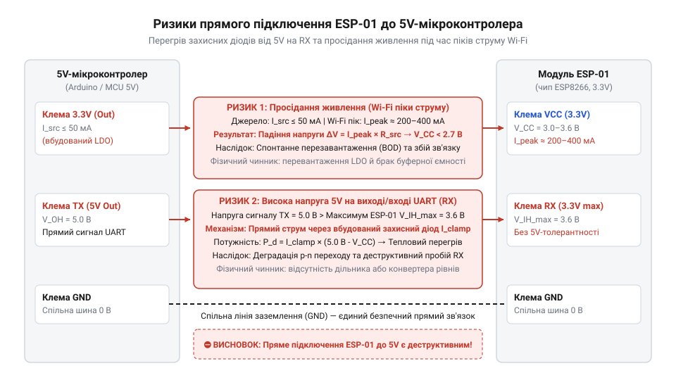
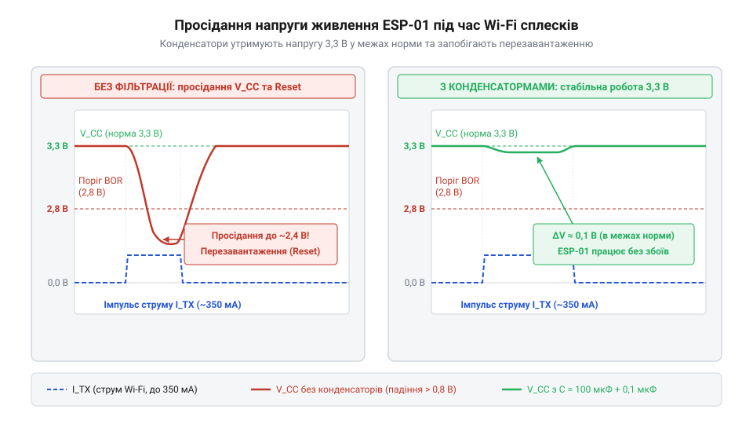
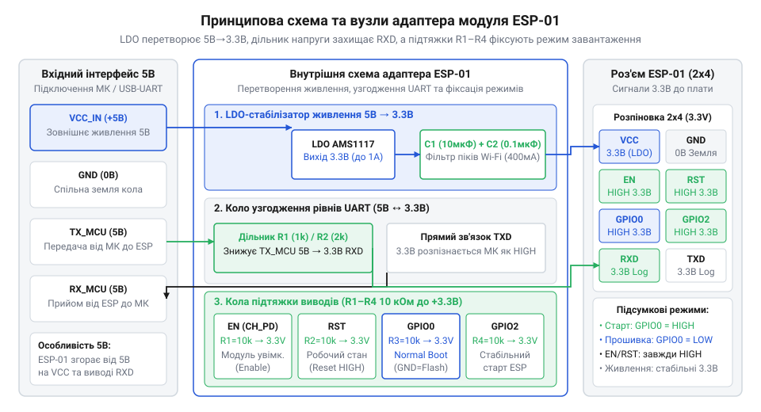

# Адаптер живлення й підключення ESP-01

<preknowlist>
- [USB-UART адаптер CP2102 (Micro-USB)](root:cat-hw-boards/cp2102-usb-uart) — Принципи послідовного інтерфейсу UART, призначення ліній TX/RX та вимога спільного заземлення GND для з'єднання пристроїв.
</preknowlist>

## Спроба прямого підключення модуля ESP-01

Пряме з'єднання мікромодуля ESP-01 з 5-вольтовою платою спричиняє незворотний пробій напівпровідникових P-N-переходів кристала ESP8266 через перевищення граничної напруги 3.3 В на виводах VCC та RX. Під час активації передавача Wi-Fi струм споживання стрибає до 300 мА. Слабкі джерела живлення не встигають компенсувати цей імпульс, що викликає просідання напруги та апаратне скидання @@en|brown-out reset@@ (англ. brown-out — зниження напруги). Конструктивно дворядний роз'єм 2x4 з кроком 2.54 мм неможливо встановити у безпайкову макетну плату: протилежні контакти потрапляють в один вертикальний ряд, створюючи коротке замикання.


*Пряме підключення ESP-01 до 5 В загрожує виходом з ладу напівпровідникових переходів та коротким замиканням крок в крок на макетній платі.*

## Стабілізація живлення та згладжування імпульсів

Плата-адаптер містить лінійний @@en|LDO-стабілізатор@@ (англ. low dropout — низьке падіння) AMS1117-3.3, який знижує вхідну напругу з 5 В до безпечних 3.3 В. Теплова потужність розсіювання обчислюється так: Принцип роботи та схеми включення таких компонентів детально викладено у матеріалі про [лінійні LDO-стабілізатори](root:hw-power/ldo).

```
P = (V_in - V_out) × I
  = (5 - 3.3) × 0.3      [підстановка параметрів AMS1117]
  = 0.51                 [розсіювана потужність у ватах]
```

Обмежена швидкість реакції контуру зворотного зв'язку стабілізатора створює короткочасні просідання напруги. Керамічний конденсатор 0.1 мкФ шунтує високочастотні завади, а накопичувальний конденсатор 10–100 мкФ компенсує пікові струми передавача.


*Сплески струму Wi-Fi-передавача спричиняють просідання напруги живлення нижче критичного порогу 2.7 В без накопичувальних конденсаторів.*

## Схеми узгодження рівнів та підтяжки

Для безпечного зниження амплітуди сигналу TX з 5 В до 3.3 В на вході RX адаптер застосовує резистивний дільник напруги або @@en|MOSFET-транзистор@@ (англ. metal-oxide-semiconductor — метал-оксид-напівпровідник). Внутрішній @@en|ROM bootloader@@ (англ. boot — чобіт, load — завантажувати) опитує трибітовий вектор службових ліній GPIO0, GPIO2 та GPIO15 для вибору режиму завантаження чипа. Для надійної фіксації високого потенціалу 3.3 В у робочому режимі плата-адаптер містить підтягувальні @@en|pull-up резистори@@ (англ. pull up — підтягувати вгору) 10 кОм на виводах EN, RST, GPIO0 та GPIO2. Детальний розбір побудови й застосування таких кіл наведено у матеріалі про [схеми узгодження логічних рівнів](root:hw-digital/level-shifter).


*Схема адаптера забезпечує зниження напруги до 3.3 В, узгодження рівнів UART та надійну фіксацію режимів завантаження.*

## Порядок підключення та керування живленням

Подача сигналів UART до комутації шин живлення спричиняє фантомне живлення: струм витоку тече через верхні захисні @@en|ESD-діоди@@ (англ. electrostatic discharge — електростатичний розряд) мікросхеми на внутрішню лінію VCC, викликаючи хаотичні збої. Правильна послідовність комутації @@en|power sequencing@@ (англ. sequence — послідовність) вимагає першим з'єднувати спільний дріт GND, далі VCC, а потім лінії даних. Для безпечного перезапуску модулем притискають лінію RST до землі. Для налагодження [використовують USB-UART адаптер CP2102](root:cat-hw-boards/cp2102-usb-uart).


*Дотримання порядку підключення GND перед лініями даних запобігає виникненню фантомного живлення через ESD-діоди.*

## Пошук та ліквідація системних збоїв

Імпульсні просідання живлення під час Wi-Fi-випромінювання фіксують осцилографом у режимі поодинокого запуску @@en|single trigger@@ (англ. trigger — курок, пусковий сигнал). Спонтанний перезапуск @@en|brown-out reset@@ усувають підключенням додаткового електролітичного конденсатора @@en|low-ESR@@ (англ. low equivalent series resistance — низький еквівалентний послідовний опір) ємністю 100–470 мкФ. Розсинхронізація послідовного обміну виникає через неузгоджену швидкість @@en|baud rate@@ (фр. Baudot — за прізвищем Бодо). Спрацьовуванню теплового захисту стабілізатора запобігають зниженням вхідної напруги до 5 В та покращенням тепловідведення.
